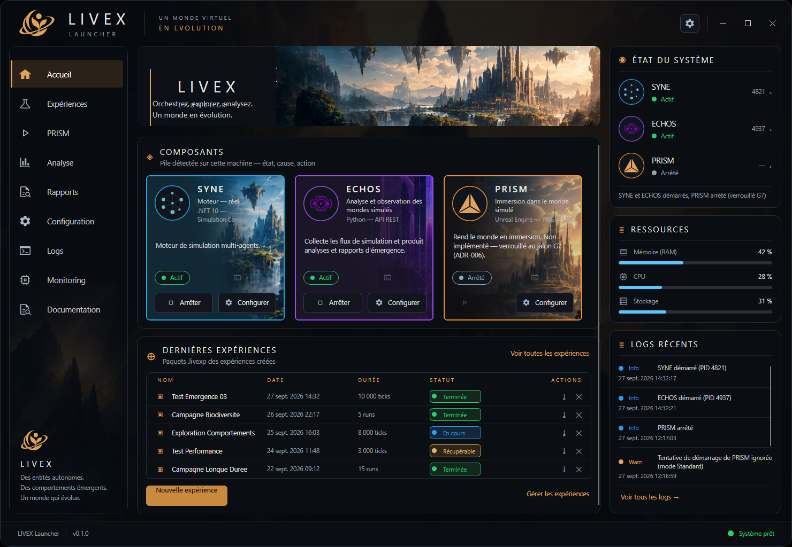
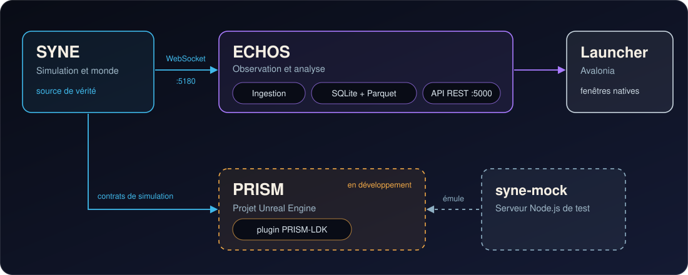
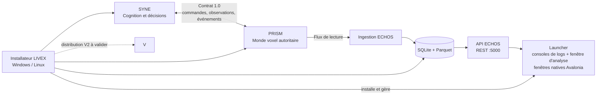
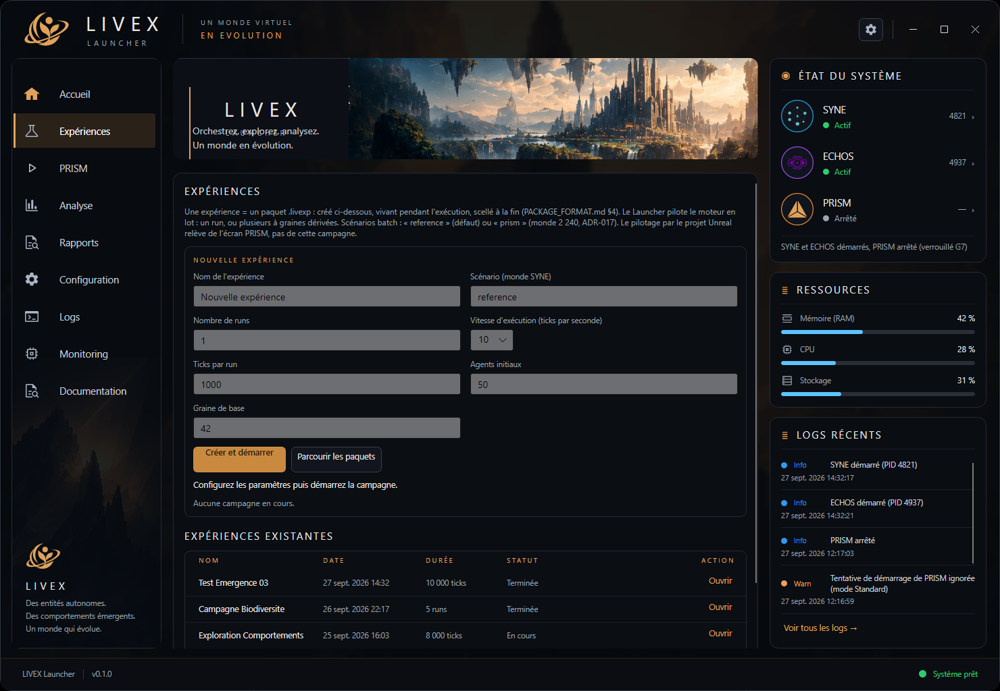
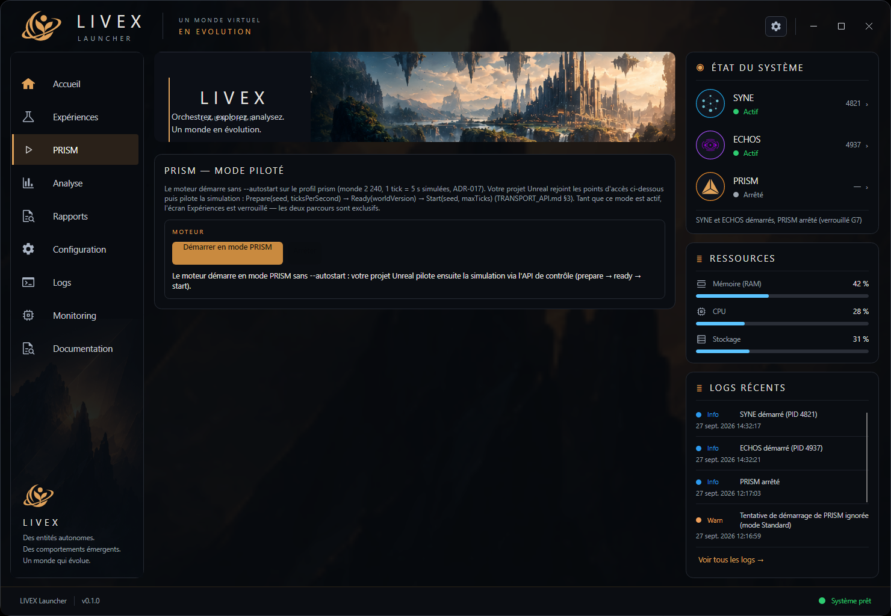
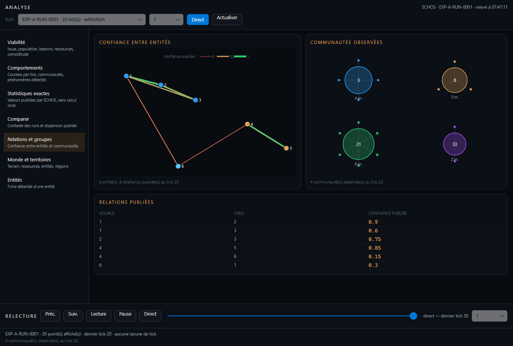
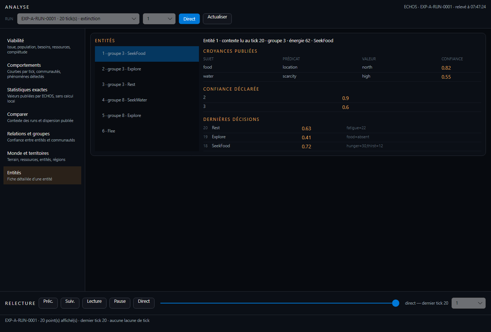
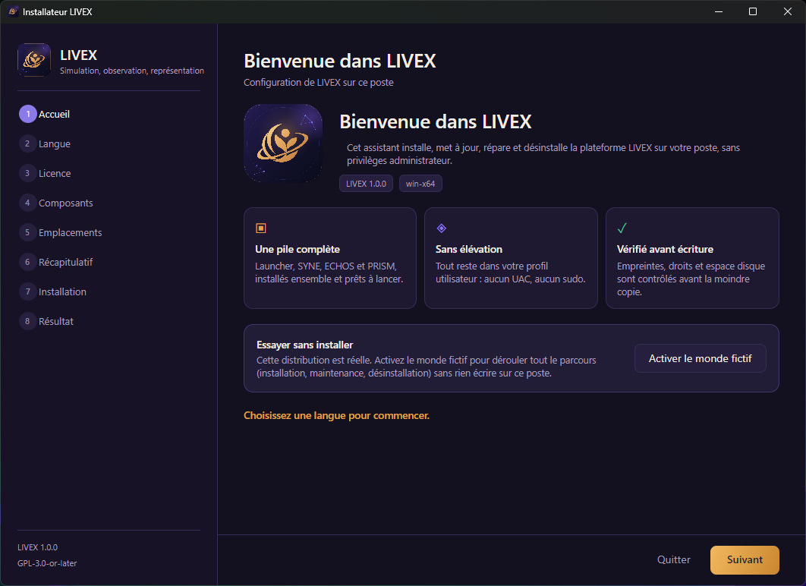
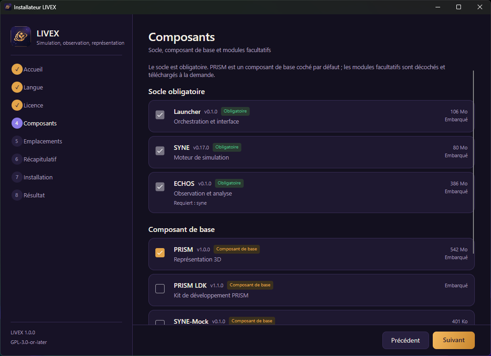

<div align="center">



<br />

<a href="docs/syne/README.md"></a>
<a href="docs/echos/README.md"></a>
<a href="docs/prism/README.md"></a>

[](VERSIONING.md)
[](LICENSE)
[](syne/component.json)
[](docs/syne/API_CONTRACTS.md)

[](https://github.com/donovan-dev-web/LIVEX/actions/workflows/ci.yml)
[](docs/governance/LIVEX-STATUS.md#4-inventaire-des-tests)
[](docs/governance/LIVEX-STATUS.md#couverture)

**[Site web](https://donovan-dev-web.github.io/LIVEX/)** &nbsp;·&nbsp; **[Le projet](#le-projet)** &nbsp;·&nbsp; **[Architecture](#architecture)** &nbsp;·&nbsp; **[Performances](#performances)** &nbsp;·&nbsp; **[Démarrage](#démarrage-rapide)** &nbsp;·&nbsp; **[Documentation](#documentation)** &nbsp;·&nbsp; **[Contribuer](#contribuer)**

</div>

<br />

<a id="le-projet"></a>


**LIVEX explore une question : comment des comportements collectifs peuvent-ils émerger de règles locales simples, sans scénario qui les impose ?**

Dans LIVEX, « émergence » désigne d'abord des **motifs collectifs** — regroupements, échanges, spécialisations ou conflits — qui apparaissent à partir d'interactions locales. Le projet s'intéresse à cette émergence collective, dite faible dans son cadrage : les causes restent traçables aux règles explicites du modèle. Il n'étudie pas l'apprentissage ni l'amélioration individuelle comme objectif de recherche. Un état ou une maîtrise d'agent peut évoluer si une règle le prévoit ; cela ne constitue pas, à lui seul, l'émergence collective visée.

Le moteur fait évoluer des entités autonomes dans un monde régi par des règles explicites. Chaque entité perçoit une partie de son environnement, possède des besoins, des croyances et une mémoire, puis choisit ses actions selon une architecture cognitive BDI (*Beliefs, Desires, Intentions*). Le système observe les résultats sans les dicter.

> [!IMPORTANT]
> **Position scientifique.** LIVEX fournit un dispositif d’expérimentation, pas une preuve automatique d’intelligence ou d’émergence. Les résultats sont des observations à analyser, à lire avec leurs protocoles, leurs données et leurs limites. Dans la campagne documentée d’octobre 2026, le contraste de quête spatiale est confirmé ; le cycle social étudié est publié comme **non confirmé**. Voir le [rapport expérimental pérenne](docs/governance/realignment/EXPERIMENTAL-VALIDATION-2026-10.md).
>
> Les hypothèses, limites et choix du projet sont documentés dans la [monographie actualisée](docs/monographie/00-SOMMAIRE-GENERAL.md), la [photographie V1 d'origine](LIVEX-Monographie_SnapV0-1.pdf) et les [décisions d’architecture](docs/syne/adr).

<div align="center">



<sub>Le Launcher LIVEX : orchestration des composants, journaux et analyse dans une interface native.</sub>

</div>

## Principes de conception

| Principe | Application dans LIVEX |
|:--|:--|
| **Déterminisme** | Une même graine, configuration et version du moteur permettent de reproduire une trajectoire. Toute altération volontaire (ex. la calibration de survie 0.13.0) impose un bump MINOR et le re-calage assumé des checksums dorés. |
| **Décisions explicables** | Les décisions BDI produisent des traces consultables et analysables. |
| **Information locale** | Les entités agissent à partir de ce qu’elles perçoivent et mémorisent, pas d’une vérité globale. |
| **Observation indépendante** | L’analyse mesure le monde sans en devenir la source de vérité. |
| **Contrats explicites** | Les composants échangent par des interfaces documentées et versionnées. |

<a id="architecture"></a>


LIVEX repose sur SYNE (cognition), PRISM (monde physique) et ECHOS (observation et analyse), reliés par des contrats explicites. LIVEX 1.0.0 est la release publique V1 : SYNE y détient le monde et PRISM/Unreal le représente. PRISM V2 est maintenant en cours d'implémentation comme simulation .NET headless autoritaire. Son host exécute déjà le monde, plusieurs chaînes d'actions et les échanges avec SYNE ; la boucle couplée a été exercée sur 1 000 ticks. L'extraction complète du monde SYNE, le run R2 de 5 000 ticks, l'ingestion analytique ECHOS en production, le viewer live et le packaging V2 restent à achever. Les résultats V1 et V2 sont distingués dans le [statut transversal actuel](docs/governance/LIVEX-CURRENT-STATUS.md).

<div align="center">



</div>

<sub>Schéma conservé pour l’architecture V1 ; il ne représente pas la refonte PRISM V2 décrite ci-dessous.</sub>

<details>
<summary>Version texte du schéma (Mermaid)</summary>



</details>

### Les trois couches

| Composant | Rôle | Responsabilité |
|:--|:--|:--|
| **SYNE**<br/><sub>*Systems & Emergent Network Engine*</sub> | Cognition multi-agents | En couplage V2, porte besoins, croyances, mémoire, relations, groupes et décisions ; émet des commandes et applique les observations PRISM. L'extraction du monde historique reste en cours. |
| **ECHOS**<br/><sub>*Emergent Cognition & Holistic Observation System*</sub> | Observation et analyse | Ingestion SYNE disponible ; valide et stocke aussi les enveloppes du flux PRISM. L'analyse et le cycle de production ECHOS pour les runs PRISM restent à raccorder. |
| **PRISM**<br/><sub>*Persistent Reality & Interactive Simulation Module (V2)*</sub> | Monde physique autoritaire | Simulation .NET headless en cours d'intégration : monde 2,5D, matière, actions, navigation, temps physique et structures. Le viewer Silk.NET/OpenGL est facultatif ; son client live n'est pas encore câblé au lancement. |

### Les outils

| Outil | Rôle | Responsabilité |
|:--|:--|:--|
| **Launcher** | Orchestration | Application de bureau Avalonia : orchestre l’environnement logiciel, supervise les composants et présente journaux et analyses dans une interface native. |
| **syne-mock** | Test d’intégration V1 | Outil Node.js des contrats hérités ; les campagnes PRISM V2 utilisent les bots déterministes `Prism.Bots`. |
| **Installateur LIVEX** | Distribution et maintenance | Distribue la release V1. Le packaging des composants PRISM V2 reste à intégrer et valider. |

### Communication entre les composants

Les applications communiquent par des interfaces réseau documentées, indépendantes de leurs langages et de leurs frameworks.

- **Contrat SYNE↔PRISM 1.0.0** : commandes SYNE→PRISM, observations et événements PRISM→SYNE, et flux de lecture PRISM→ECHOS / visualiseur. La boucle couplée a été exercée sur 1 000 ticks ; R2 reste à valider sur 5 000 ticks répétés.
- **Plan de contrôle HTTP** : préparation et cycle de vie du run ; le plan de données de tick est indépendant du transport.
- **Contrats versionnés** : ils cadrent l’évolution des composants et la compatibilité des messages.

Cette séparation évite de coupler le moteur à une interface graphique ou à un système d’analyse particulier.

### Principes structurants

- **Séparation des responsabilités** : cognition, monde physique, analyse, visualisation et orchestration sont confiées à des composants distincts.
- **Indépendance technologique** : les composants se développent et se testent séparément, sans dépendre des implémentations internes des autres.
- **Responsabilités séparées** : PRISM est l’autorité de l’espace, de la matière et du temps physique ; SYNE est l’autorité de la cognition ; ECHOS observe les flux sans modifier le run.
- **Interfaces explicites et versionnées** : des contrats documentés facilitent l’intégration, les tests et l’évolution du système.

L’architecture et les contrats sont détaillés dans la [documentation technique](docs/ARCHITECTURE.md) et la [spécification des échanges inter-composants](docs/COMMUNICATION.md). Le [statut transversal actuel](docs/governance/LIVEX-CURRENT-STATUS.md) décrit l'intégration V2 ; le [relevé de release V1](docs/governance/LIVEX-STATUS.md) conserve ses versions et compteurs. Le badge de couverture décrit les rapports disponibles, sans présenter la mesure partielle comme la couverture globale complète.

<a id="garanties-preuves-et-limites"></a>


| | |
|:--|:--|
| **Reproductibilité** | Une graine, une configuration et une version moteur fixées permettent de comparer et rejouer les trajectoires ; l’état du générateur pseudo-aléatoire est persisté pour les reprises. La garantie est testée, et ne signifie pas que deux configurations différentes produisent le même monde. |
| **Causalité et explicabilité** | Le pipeline BDI utilise les informations connues par l’agent ; les décisions peuvent porter cibles, preuves et candidats rejetés. Les effets différés ferment la fenêtre causale d’un tick. |
| **Mesures non intrusives** | ECHOS observe le flux et rend explicites les états mesurés, absents ou manquants ; l’analyse ne devient pas la source de vérité de la simulation. |
| **Validation documentée** | Les rapports versionnés de [gouvernance](docs/governance/realignment/README.md) conservent décisions, protocoles, résultats et limites du réalignement SYNE 0.15.0 → 0.17.0. Le [statut transversal](docs/governance/LIVEX-CURRENT-STATUS.md) distingue les validations V1 et V2 par composant et par date. |
| **Limites assumées** | L’émergence d’une société, d’une intelligence ou d’une conscience n’est pas garantie. Les campagnes sont bornées par leurs graines, horizons, scénarios et critères préenregistrés. PRISM V2 porte déjà le monde physique ; le viewer live, l'intégration complète et les portes d'acceptation restent ouverts. |

### Aperçu des interfaces

<div align="center">

| Launcher · expériences | Launcher · vue PRISM |
|:--:|:--:|
|  |  |

| ECHOS · relations | ECHOS · agents |
|:--:|:--:|
|  |  |

</div>

<sub>Captures d’interface : elles présentent le Launcher et des vues de la génération V1. Elles ne représentent pas le viewer PRISM V2 live et ne constituent pas une preuve scientifique.</sub>

La capture dédiée de l'assistant d'installation sera ajoutée à `docs/captures/` après une capture réelle de la release 1.0.0 ; elle n'est pas encore disponible.

Les captures statiques de présentation sont conservées dans `docs/captures/` et inventoriées dans [`docs/captures/README.md`](docs/captures/README.md). Le dépôt n’embarque aucune animation GIF : si le projet en a besoin un jour, elle rejoint ce dossier, en WebP ou MP4 de préférence.

<a id="performances"></a>


Les chiffres distinguent les mesures de la pile V1 (une machine, octobre 2026) et les mesures locales PRISM V2 (Windows, Release, 4 novembre). Ce sont des observations de profils précis, pas des engagements de performance ou des portes de viabilité franchies. Les mesures V1 sont détaillées dans le [rapport de performance](docs/governance/LIVEX-PERFORMANCE-2026-10.md), celles de PRISM V2 dans sa [spécification de performance](docs/prism/PERFORMANCE.md).

| Mesure | Cadence observée | Lecture |
|:--|--:|:--|
| SYNE seul, 100 agents (`--headless`) | ~67 t/s sur 1000 ticks | Dépend de l’horizon : ~129 t/s sur 300 ticks, ~2,9 t/s à 1000 agents |
| Ingestion ECHOS, 100 entités | ~16 t/s | Voie mono-thread ; l’analyse ajoute 0,5 à 2,7 s |
| Pile SYNE + ECHOS, 100 agents | **~13 t/s** | ECHOS (ingestion) est le facteur limitant, pas le moteur |
| PRISM V2, 1 agent inactif | ~13,6 ms/tick | Mesure locale après optimisation ; ne valide pas 1 000 agents |
| Profil SYNE `prism` V1, 100 agents | 6 t/s | Cadence historique du profil ; ne mesure pas le runtime PRISM V2 |

| Configuration | Poste de travail | Charge type |
|:--|:--|:--|
| **Minimale** | 4 cœurs, 8 Go, SSD | SYNE 100 agents à 6 t/s + ECHOS, sans rendu Unreal |
| **Recommandée, V1** | 6–8 cœurs, 16 Go, NVMe, GPU dédié | Pile SYNE + ECHOS + Launcher et présentation Unreal historique |

Un run long se dimensionne sur le débit **à l’horizon visé**, pas sur celui des premiers ticks ; alléger l’ingestion ECHOS (`analysisEvery` > 1 ou voie batch) est le premier levier pour tenir une cadence plus élevée. Justification et chiffres complets : [rapport de performance, § Recommandations](docs/governance/LIVEX-PERFORMANCE-2026-10.md#7-recommandations).

Les mesures sont reproductibles avec le harnais [`scripts/benchmark-windows.py`](scripts/benchmark-windows.py) (le [`scripts/benchmark.py`](scripts/benchmark.py) historique est réservé à Unix) ; la référence moteur publiée reste [`docs/syne/PERFORMANCE.md`](docs/syne/PERFORMANCE.md).

<a id="démarrage-rapide"></a>


## Installer LIVEX

LIVEX **1.0.0** est publiée sous le tag [`livex-v1.0.0`](https://github.com/donovan-dev-web/LIVEX/releases/tag/livex-v1.0.0). Téléchargez l’installateur correspondant à **Windows x64** ou **Linux x64** dans la [release publique](https://github.com/donovan-dev-web/LIVEX/releases/tag/livex-v1.0.0), puis suivez le [guide utilisateur](docs/installer/GUIDE-UTILISATEUR.md). Les variantes `core` et `full` sont disponibles pour les deux plateformes.

### livex-setup Captures
| Installateur · Accueil | Installateur · Choix Composant |
|:--:|:--:|
|  |  |


Le guide et les captures d’installateur décrivent la distribution V1. Le packaging V2 doit ajouter le host PRISM .NET et, éventuellement, son viewer distinct ; ce travail reste ouvert. Consultez la [documentation de l’installateur](docs/installer/README.md) pour le périmètre publié.

Pour lancer les composants depuis les sources ou parcourir le mode démonstration de l’assistant, consultez le [guide de développement et d’installation locale](docs/INSTALLATION.md) et la [documentation du mode démo](docs/installer/README.md#5-bis-mode-démonstration-monde-fictif).

## Structure du dépôt

<details>
<summary>Afficher l’arborescence</summary>

```text
LIVEX/
├── syne/                   # Moteur de simulation C#/.NET
├── echos/
│   └── echos/              # API, analyse, ingestion et stockage (sans interface)
├── prism/                  # PRISM V2, simulation .NET headless
│   ├── Prism.Contracts/
│   ├── Prism.Core/
│   ├── Prism.Content/
│   ├── Prism.Host/
│   ├── Prism.Bots/
│   ├── Prism.Viewer/
│   └── Prism.sln
├── syne-mock/              # Serveur Node.js de test des contrats SYNE
├── launcher/               # Orchestrateur Avalonia, paquets et tests du Launcher
├── docs/
│   ├── README.md           # Portail de la documentation
│   ├── ARCHITECTURE.md     # Vue d'ensemble technique
│   ├── COMMUNICATION.md    # Protocoles et ports inter-composants
│   ├── INSTALLATION.md     # Prérequis et commandes de lancement
│   ├── presentation/       # Vision, FAQ, glossaire, périmètre éthique
│   ├── governance/         # Feuille de route, état du dépôt, gitflow
│   ├── adr/                # Décisions d'architecture transverses
│   ├── syne/               # Documentation et décisions SYNE
│   ├── echos/              # Documentation ECHOS
│   ├── launcher/           # Spécification complète du Launcher
│   ├── prism/              # Contrats et feuille de route PRISM
│   └── installer/          # Installateur : code, tests et documentation
└── LIVEX-Monographie...    # Référence scientifique et technique
```

</details>

## Documentation

| Lire… | Pour… |
|:--|:--|
| [Site web](https://donovan-dev-web.github.io/LIVEX/) | Parcourir la présentation, le glossaire, la technique et le journal du projet. |
| [Vision](docs/presentation/VISION.md) | Comprendre les objectifs, le périmètre et les limites. |
| [Architecture](docs/ARCHITECTURE.md) | Voir les composants et leurs responsabilités. |
| [Installation & démarrage](docs/INSTALLATION.md) | Installer les dépendances et lancer la pile locale. |
| [Feuille de route](docs/governance/ROADMAP.md) | Suivre les jalons et les travaux à venir. |
| [Performances](docs/governance/LIVEX-PERFORMANCE-2026-10.md) | Connaître les débits, la capacité et la configuration d’exécution recommandée. |
| [Communication](docs/COMMUNICATION.md) | Consulter les protocoles et ports inter-composants. |
| [Glossaire](docs/presentation/GLOSSARY.md) | Retrouver le vocabulaire du projet. |
| [FAQ](docs/presentation/FAQ.md) | Obtenir des réponses aux questions fréquentes. |
| [Launcher LIVEX](launcher/README.md) · [spécification complète](docs/launcher/README.md) | Lire la release V1 et les évolutions prévues pour son orchestration de la pile V2. |
| [Installateur LIVEX](docs/installer/README.md) · [guide utilisateur](docs/installer/GUIDE-UTILISATEUR.md) | Télécharger, installer, mettre à jour, réparer et désinstaller LIVEX 1.0.0. |
| [Monographie actualisée](docs/monographie/00-SOMMAIRE-GENERAL.md) · [photographie V0.1](LIVEX-Monographie_SnapV0-1.pdf) | Lire les fondements, l'état actuel de PRISM V2 et les chapitres historiques de la version initiale. |
| [SYNE](docs/syne/README.md) · [ECHOS](docs/echos/README.md) · [PRISM](docs/prism/README.md) | Entrer dans la documentation d’un composant. |
| [État courant V2](docs/governance/LIVEX-CURRENT-STATUS.md) · [Relevé de release V1](docs/governance/LIVEX-STATUS.md) · [Documentation générale](docs/README.md) | Distinguer les réalisations en cours des résultats historiques de la release. |

## Contribuer

Les contributions suivent les conventions du dépôt. Avant de proposer un changement, consultez le [guide de contribution](CONTRIBUTING.md), le [Gitflow](docs/governance/GITFLOW.md) et le [code de conduite](CODE_OF_CONDUCT.md). Une question ou un problème ? Le [canal d’assistance](SUPPORT.md) est là pour ça. Les choix techniques durables doivent rester cohérents avec l’[architecture](docs/ARCHITECTURE.md) et les ADR du composant concerné.

## Licence et auteur

Distribué sous licence [GNU GPL v3.0 ou ultérieure](LICENSE) (SPDX : `GPL-3.0-or-later`). Copyright (C) 2026 Donovan Chartrain. Le texte complet de la licence figure dans [`LICENSE`](LICENSE), la déclaration de copyright dans [`NOTICE`](NOTICE) ; les composants tiers et les fichiers non couverts par la GPL sont recensés dans [`THIRD-PARTY-NOTICES.md`](THIRD-PARTY-NOTICES.md). Les éléments Unreal de PRISM V1 restent soumis aux conditions d'Epic Games ; la cible V2 .NET et ses dépendances seront documentées dans les notices avant distribution.


<br>

**Donovan Chartrain**, développeur et infographiste 3D · [Portfolio développement](https://donovan-dev-web.vercel.app) · [Portfolio 3D](https://donovan-dev-3d.vercel.app)

<br />

<div align="center">


Copyright (C) 2026 Donovan Chartrain.
</div>
