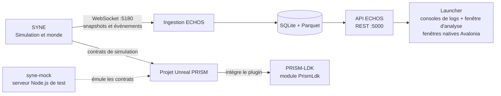

<div align="center">

# LIVEX

### Living Intelligent Virtual Ecosystem eXperience

**Un monde simulé. Des agents autonomes. Des phénomènes à observer.**

[](LICENSE)
[](VERSIONING.md)
[](docs/syne/DETERMINISM.md)
[](docs/syne/API_CONTRACTS.md)
[](docs/presentation/GLOSSARY.md)
[](https://github.com/donovan-dev-web/LIVEX/actions/workflows/ci.yml)
[](docs/governance/LIVEX-STATUS.md#5-tests-et-validations)
[](docs/governance/LIVEX-STATUS.md#5-tests-et-validations)

[Découvrir le projet](#-le-projet) · [Architecture](#-architecture) · [Démarrage](#-démarrage-rapide) · [Documentation](#-documentation) · [Contribuer](#-contribuer)

</div>

---

## 🌱 Le projet

**LIVEX explore une question : comment des comportements collectifs peuvent-ils émerger de règles locales simples, sans scénario qui les impose ?**

Le moteur fait évoluer des entités autonomes dans un monde régi par des règles explicites. Chaque entité perçoit une partie de son environnement, possède des besoins, des croyances et une mémoire, puis choisit ses actions selon une architecture cognitive BDI (*Beliefs, Desires, Intentions*). Le système observe les résultats sans les dicter.

LIVEX est un projet de recherche et d’expérimentation en vie artificielle et en simulation multi-agents. Ses résultats sont des observations à analyser, pas des preuves scientifiques en eux-mêmes. Les hypothèses, limites et choix du projet sont documentés dans la [monographie](LIVEX-Monographie_SnapV0-1.pdf) et les [décisions d’architecture](docs/syne/adr).

## ✨ Principes de conception

| Principe | Application dans LIVEX |
|:--|:--|
| **Déterminisme** | Une même graine, configuration et version du moteur permettent de reproduire une trajectoire. Toute altération volontaire (ex. la calibration de survie 0.13.0) impose un bump MINOR et le re-calage assumé des checksums dorés. |
| **Décisions explicables** | Les décisions BDI produisent des traces consultables et analysables. |
| **Information locale** | Les entités agissent à partir de ce qu’elles perçoivent et mémorisent, pas d’une vérité globale. |
| **Observation indépendante** | L’analyse mesure le monde sans en devenir la source de vérité. |
| **Contrats explicites** | Les composants échangent par des interfaces documentées et versionnées. |

## 🧩 Architecture



| Composant | Responsabilité | État |
|:--|:--|:--|
| **SYNE 0.15.0** · *Systems & Emergent Network Engine* | Simule le monde et les agents. C’est la source de vérité de l’état simulé. | Moteur .NET 10 (`engineVersion 0.15.0`, défauts calibrés — ADR-016, profil de référence ADR-015), observabilité (contrat 0.4.0), persistance et contrôle local. |
| **ECHOS 0.1.0** · *Emergent Cognition & Holistic Observation System* | Ingère et analyse les runs, expose les métriques et fournit le pilotage. | API FastAPI **sans interface** (ADR-007), stockage SQLite/Parquet (schéma v6), signaux de viabilité ; la présentation vit dans le Launcher. |
| **PRISM** · *Perceptual Rendering & Interactive Simulation Module* | Projet Unreal final de LIVEX, pour représenter le monde SYNE et fournir l'expérience interactive. | Projet Unreal PRISM intégrant le plugin **PRISM-LDK** (*LIVEX Development Kit*, module technique `PrismLdk`). |
| **Launcher 0.1.0** | Orchestre la pile : détection des composants par manifeste, campagnes, supervision, journaux et fenêtre d’analyse, paquets `.livexp`. | Application de bureau Avalonia (statut V1) ; la présentation d’ECHOS vit en lui depuis l’ADR-007. |
| **syne-mock 0.1.0** | Simule le protocole et un scénario de simulation pour le développement client. | Serveur Node.js local ; comportement incomplet et non équivalent au moteur SYNE (contrat aligné 0.4.0). |

> **État du dépôt :** SYNE et ECHOS disposent de leur runtime ; **PRISM** est
> le projet Unreal final de LIVEX et intègre **PRISM-LDK** (*LIVEX Development
> Kit*, module `PrismLdk`). Le `LDK.uproject` du checkout est un hôte technique
> de développement/build du plugin, pas un second produit. Consultez les documentations de
> [PRISM](docs/prism/README.md) et du [mock SYNE](syne-mock/README.md)
> pour les détails et limites de l'intégration.

## 🚀 Démarrage rapide

Pour lancer le moteur seul :

```bash
dotnet run --project syne/Simulation.Console --configuration Release -- \
  --seed 12345 --max-ticks 1000 --headless
```

Pour démarrer **SYNE, l’ingestion et l’API ECHOS** ensemble, lancez `./scripts/dev-stack.sh`. Le script prépare l’environnement manquant et démarre les services dans le bon ordre. L’API ne sert aucune page : pour observer l’analyse en direct, ouvrez la **fenêtre Analyse du Launcher** (bouton dédié) et les **consoles de logs** de chaque composant. Voir le guide [Installation & démarrage](docs/INSTALLATION.md#démarrage-complet-syne-echos). Pour travailler sur PRISM sans le moteur complet, consultez le [guide du mock SYNE](syne-mock/README.md).

## 🗂️ Dans le dépôt

```text
LIVEX/
├── syne/                   # Moteur de simulation C#/.NET
├── echos/
│   └── echos/              # API, analyse, ingestion et stockage (sans interface)
├── prism/
│   └── LDK/                # Plugin PRISM-LDK + hôte technique de build/test
│       ├── LDK.uproject    # Hôte, pas le projet LIVEX complet
│       └── Plugins/PrismLdk/
├── syne-mock/              # Serveur Node.js de test des contrats SYNE
├── launcher/               # Orchestrateur Avalonia, paquets et tests du Launcher
├── docs/
│   ├── README.md           # Portail de la documentation
│   ├── ARCHITECTURE.md     # Vue d'ensemble technique
│   ├── COMMUNICATION.md    # Protocoles et ports inter-composants
│   ├── INSTALLATION.md     # Prérequis et commandes de lancement
│   ├── presentation/       # Vision, FAQ, glossaire, périmètre éthique
│   ├── governance/         # Feuille de route, état du dépôt, gitflow
│   ├── adr/                # Décisions d'architecture transverses
│   ├── syne/               # Documentation et décisions SYNE
│   ├── echos/              # Documentation ECHOS
│   ├── launcher/           # Spécification complète du Launcher
│   ├── prism/              # Contrats et feuille de route PRISM
│   └── installer/          # Spécification de l'installateur (à venir)
└── LIVEX-Monographie...    # Référence scientifique et technique
```

## 📚 Documentation

| Lire… | Pour… |
|:--|:--|
| [Vision](docs/presentation/VISION.md) | Comprendre les objectifs, le périmètre et les limites. |
| [Architecture](docs/ARCHITECTURE.md) | Voir les composants et leurs responsabilités. |
| [Installation & démarrage](docs/INSTALLATION.md) | Installer les dépendances et lancer la pile locale. |
| [Feuille de route](docs/governance/ROADMAP.md) | Suivre les jalons et les travaux à venir. |
| [Communication](docs/COMMUNICATION.md) | Consulter les protocoles et ports inter-composants. |
| [Glossaire](docs/presentation/GLOSSARY.md) | Retrouver le vocabulaire du projet. |
| [FAQ](docs/presentation/FAQ.md) | Obtenir des réponses aux questions fréquentes. |
| [Launcher LIVEX](launcher/README.md) · [spécification complète](docs/launcher/README.md) | Comprendre l'état V1, les modes de lancement, l'interface et les limites d'intégration. |
| [Monographie](LIVEX-Monographie_SnapV0-1.pdf) | Lire les fondements, modèles et choix détaillés. |
| [Documentation SYNE](docs/syne/README.md) · [ECHOS](docs/echos/README.md) · [PRISM](docs/prism/README.md) | Entrer dans la documentation d’un composant. |
| [Documentation générale](docs/README.md) | Repérer les sources de vérité, les contrats et les documents historiques. |

## 🤝 Contribuer

Les contributions suivent les conventions du dépôt. Avant de proposer un changement, consultez le [guide de contribution](CONTRIBUTING.md), le [Gitflow](docs/governance/GITFLOW.md) et le [code de conduite](CODE_OF_CONDUCT.md). Une question ou un problème ? Reportez-vous au [canal d'assistance](SUPPORT.md). Les choix techniques durables doivent rester cohérents avec l’[architecture](docs/ARCHITECTURE.md) et les ADR du composant concerné.

## Licence & auteur

Distribué sous licence [MIT](LICENSE).

**Donovan Chartrain** · Développeur et infographiste 3D

[Portfolio développement](https://donovan-dev-web.vercel.app) · [Portfolio 3D](https://donovan-dev-3d.vercel.app)

<div align="center">

*Construire les conditions. Observer les conséquences. Comprendre ce qui émerge.*

</div>
