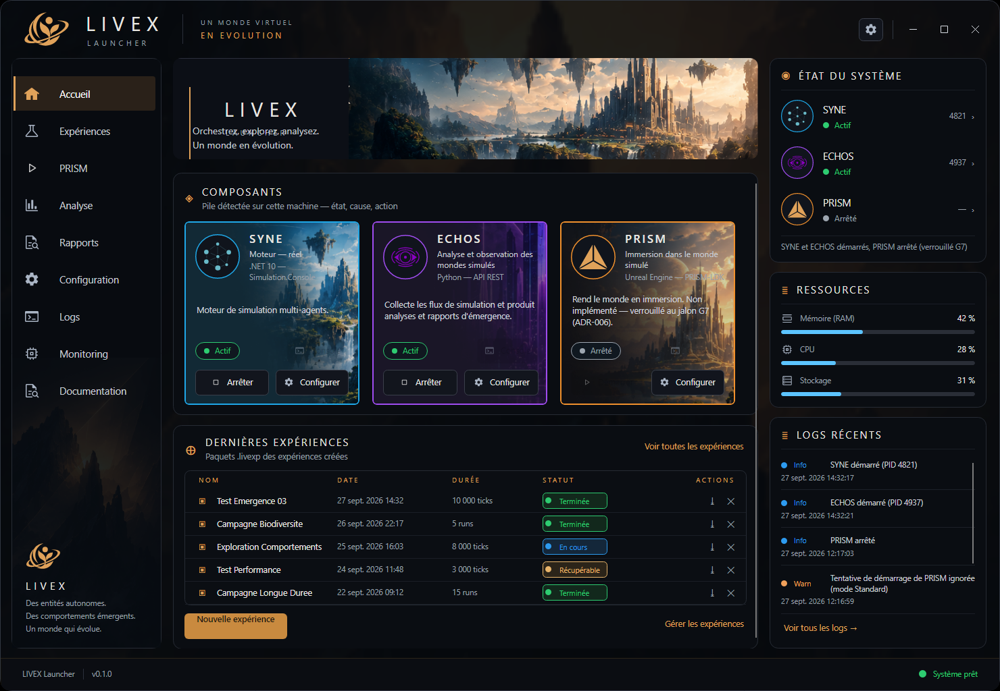
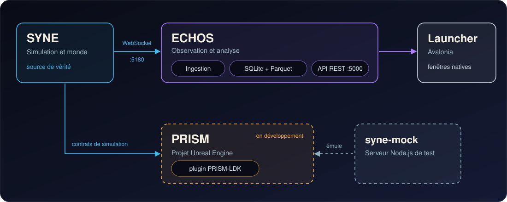
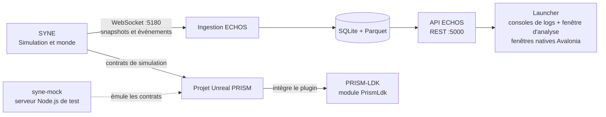
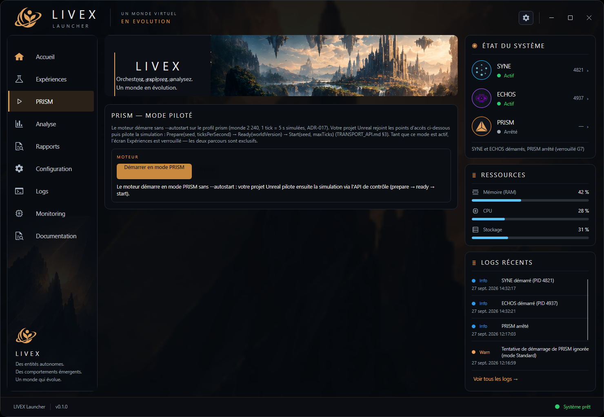
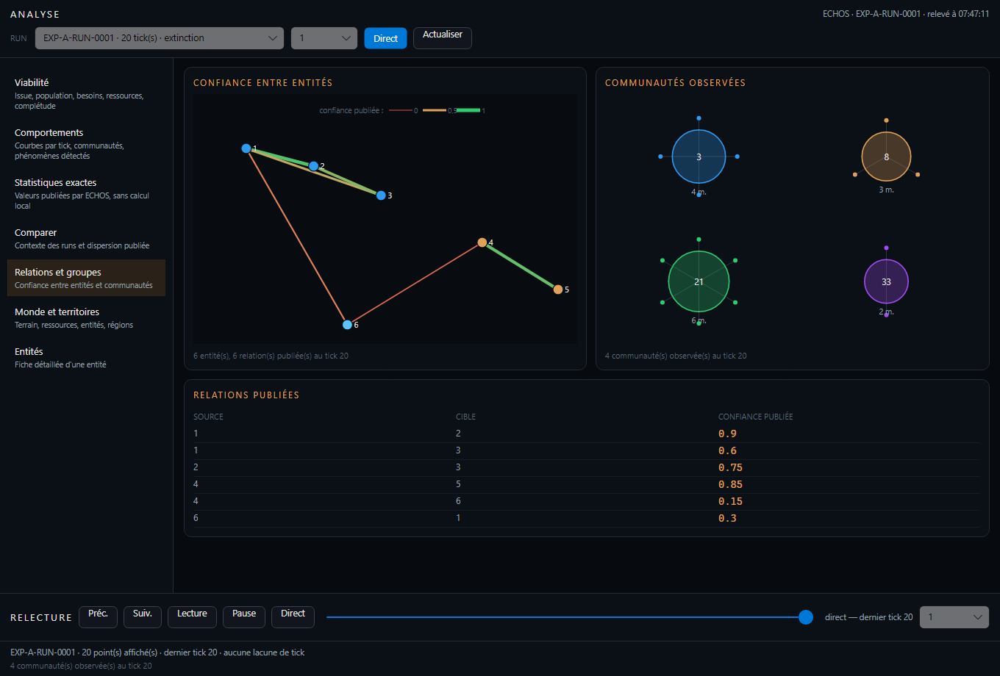
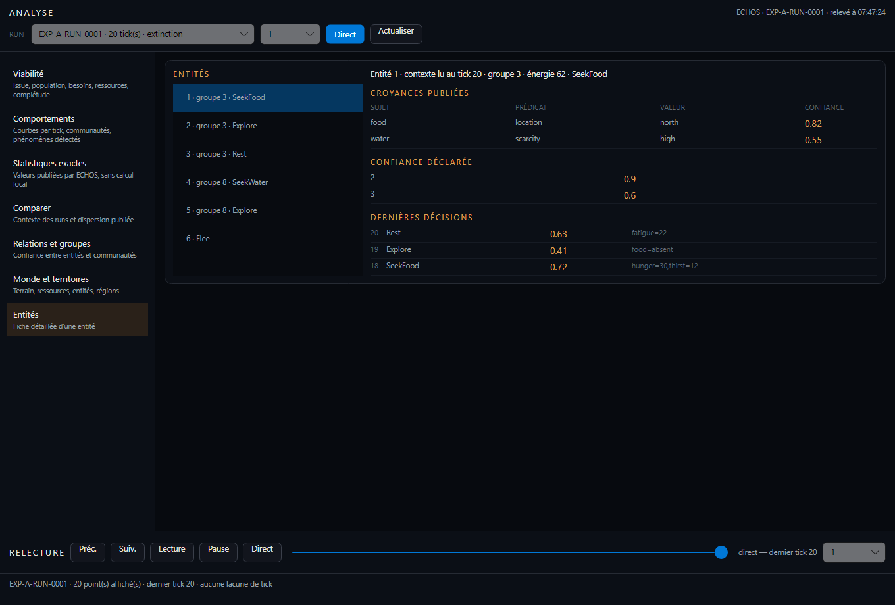
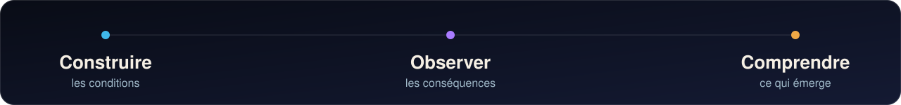

<div align="center">



<br />

<a href="docs/syne/README.md"></a>
<a href="docs/echos/README.md"></a>
<a href="docs/prism/README.md"></a>

[](VERSIONING.md)
[](LICENSE)
[](syne/component.json)
[](docs/syne/API_CONTRACTS.md)

[](https://github.com/donovan-dev-web/LIVEX/actions/workflows/ci.yml)
[](docs/governance/LIVEX-STATUS.md#4-inventaire-des-tests)
[](docs/governance/LIVEX-STATUS.md#couverture)

**[Site web](https://donovan-dev-web.github.io/LIVEX/)** &nbsp;·&nbsp; **[Le projet](#le-projet)** &nbsp;·&nbsp; **[Architecture](#architecture)** &nbsp;·&nbsp; **[Performances](#performances)** &nbsp;·&nbsp; **[Démarrage](#démarrage-rapide)** &nbsp;·&nbsp; **[Documentation](#documentation)** &nbsp;·&nbsp; **[Contribuer](#contribuer)**

</div>

<br />

<a id="le-projet"></a>


**LIVEX explore une question : comment des comportements collectifs peuvent-ils émerger de règles locales simples, sans scénario qui les impose ?**

Le moteur fait évoluer des entités autonomes dans un monde régi par des règles explicites. Chaque entité perçoit une partie de son environnement, possède des besoins, des croyances et une mémoire, puis choisit ses actions selon une architecture cognitive BDI (*Beliefs, Desires, Intentions*). Le système observe les résultats sans les dicter.

> [!IMPORTANT]
> **Position scientifique.** LIVEX fournit un dispositif d’expérimentation, pas une preuve automatique d’intelligence ou d’émergence. Les résultats sont des observations à analyser, à lire avec leurs protocoles, leurs données et leurs limites. Dans la campagne documentée d’octobre 2026, le contraste de quête spatiale est confirmé ; le cycle social étudié est publié comme **non confirmé**. Voir le [rapport expérimental pérenne](docs/governance/realignment/EXPERIMENTAL-VALIDATION-2026-10.md).
>
> Les hypothèses, limites et choix du projet sont documentés dans la [monographie](LIVEX-Monographie_SnapV0-1.pdf) et les [décisions d’architecture](docs/syne/adr).

<div align="center">



<sub>Le Launcher LIVEX : orchestration des composants, journaux et analyse dans une interface native.</sub>

</div>

## Principes de conception

| Principe | Application dans LIVEX |
|:--|:--|
| **Déterminisme** | Une même graine, configuration et version du moteur permettent de reproduire une trajectoire. Toute altération volontaire (ex. la calibration de survie 0.13.0) impose un bump MINOR et le re-calage assumé des checksums dorés. |
| **Décisions explicables** | Les décisions BDI produisent des traces consultables et analysables. |
| **Information locale** | Les entités agissent à partir de ce qu’elles perçoivent et mémorisent, pas d’une vérité globale. |
| **Observation indépendante** | L’analyse mesure le monde sans en devenir la source de vérité. |
| **Contrats explicites** | Les composants échangent par des interfaces documentées et versionnées. |

<a id="architecture"></a>


LIVEX repose sur **trois couches séparées** — SYNE (la simulation), ECHOS (l’observation) et PRISM (la représentation 3D) — reliées par des contrats de communication explicites. Deux outils les entourent : le **Launcher**, qui orchestre la pile, et **syne-mock**, qui sert aux tests. Chaque composant a un périmètre défini.

<div align="center">



</div>

<sub>Vue logique des responsabilités et des principaux échanges. Le stockage représente les données exploitées par ECHOS ; les contours pointillés signalent ce qui est en développement (PRISM) ou une fonction de test (syne-mock), et non un flux de simulation.</sub>

<details>
<summary>Version texte du schéma (Mermaid)</summary>



</details>

### Les trois couches

| Composant | Rôle | Responsabilité |
|:--|:--|:--|
| **SYNE**<br/><sub>*Systems & Emergent Network Engine*</sub> | Moteur de simulation | Fait évoluer le monde, calcule les interactions et les décisions des entités, puis expose l’état simulé et les événements produits. C’est la **source de vérité** du système. |
| **ECHOS**<br/><sub>*Emergent Cognition & Holistic Observation System*</sub> | Observation et analyse | Ingère les données de simulation, les stocke, calcule des métriques et expose les résultats par une API REST. Peut participer au pilotage de la simulation sans devenir propriétaire de son état. |
| **PRISM**<br/><sub>*Perceptual Rendering & Interactive Simulation Module*</sub> | Rendu et interaction | Projet Unreal Engine pour représenter visuellement le monde simulé et interagir avec lui. S’appuie sur **PRISM-LDK**, un plugin qui expose les interfaces de communication de LIVEX à Unreal Engine et à ses Blueprints. En développement. |

### Les outils

| Outil | Rôle | Responsabilité |
|:--|:--|:--|
| **Launcher** | Orchestration | Application de bureau Avalonia : orchestre l’environnement logiciel, supervise les composants et présente journaux et analyses dans une interface native. |
| **syne-mock** | Test d’intégration | Serveur Node.js qui émule les contrats de communication de SYNE pour tester les clients (notamment PRISM) sans exécuter le moteur complet. Il ne remplace ni la simulation réelle ni sa validation. |

### Communication entre les composants

Les applications communiquent par des interfaces réseau documentées, indépendantes de leurs langages et de leurs frameworks.

- **WebSocket** : SYNE diffuse l’initialisation du monde, les instantanés de simulation (*snapshots*) et les événements aux composants consommateurs.
- **HTTP REST** : l’API de contrôle de SYNE et l’API d’analyse d’ECHOS permettent respectivement de piloter la simulation et de consulter les résultats.
- **Contrats versionnés** : ils définissent les structures des messages et permettent de faire évoluer les composants en maîtrisant leur compatibilité.

Cette séparation évite de coupler le moteur à une interface graphique ou à un système d’analyse particulier.

### Principes structurants

- **Séparation des responsabilités** : simulation, analyse, visualisation et orchestration sont confiées à des composants distincts.
- **Indépendance technologique** : les composants se développent et se testent séparément, sans dépendre des implémentations internes des autres.
- **Autorité centrale de la simulation** : SYNE reste responsable de l’état du monde. ECHOS et PRISM consomment ses données sans devenir des sources concurrentes de vérité.
- **Interfaces explicites et versionnées** : des contrats documentés facilitent l’intégration, les tests et l’évolution du système.

L’architecture et les contrats sont détaillés dans la [documentation technique](docs/ARCHITECTURE.md) et la [spécification des échanges inter-composants](docs/COMMUNICATION.md). Le [statut courant](docs/governance/LIVEX-STATUS.md) précise les versions, les vérifications locales du 19 octobre 2026 et les portes qui restent ouvertes. Les badges affichent le total de tests exécutés et les résultats de couverture disponibles, sans présenter la couverture partielle comme une mesure globale complète.

<a id="garanties-preuves-et-limites"></a>


| | |
|:--|:--|
| **Reproductibilité** | Une graine, une configuration et une version moteur fixées permettent de comparer et rejouer les trajectoires ; l’état du générateur pseudo-aléatoire est persisté pour les reprises. La garantie est testée, et ne signifie pas que deux configurations différentes produisent le même monde. |
| **Causalité et explicabilité** | Le pipeline BDI utilise les informations connues par l’agent ; les décisions peuvent porter cibles, preuves et candidats rejetés. Les effets différés ferment la fenêtre causale d’un tick. |
| **Mesures non intrusives** | ECHOS observe le flux et rend explicites les états mesurés, absents ou manquants ; l’analyse ne devient pas la source de vérité de la simulation. |
| **Validation documentée** | Les rapports versionnés de [gouvernance](docs/governance/realignment/README.md) conservent décisions, protocoles, résultats et limites du réalignement SYNE 0.15.0 → 0.17.0. Le [statut local courant](docs/governance/LIVEX-STATUS.md) distingue ces campagnes antérieures des tests réellement exécutés dans le checkout. |
| **Limites assumées** | L’émergence d’une société, d’une intelligence ou d’une conscience n’est pas garantie. Les campagnes sont bornées par leurs graines, horizons, scénarios et critères préenregistrés. PRISM et plusieurs capacités envisagées restent en développement. |

### Aperçu des interfaces

<div align="center">

| Launcher · expériences | Launcher · vue PRISM |
|:--:|:--:|
|  |  |  |

| ECHOS · relations | ECHOS · agents |
|:--:|:--:|
|  |  |

</div>

<sub>Captures d’interface : elles présentent le Launcher et les vues d’observation, sans constituer une preuve scientifique ni un engagement sur toutes les capacités du produit.</sub>

Les captures statiques de présentation sont conservées dans `docs/captures/` et inventoriées dans [`docs/captures/README.md`](docs/captures/README.md). Le dépôt n’embarque aucune animation GIF : si le projet en a besoin un jour, elle rejoint ce dossier, en WebP ou MP4 de préférence.

<a id="performances"></a>


Les chiffres ci-dessous proviennent d’un **relevé local** (une seule machine de bureau, octobre 2026) : ce sont des observations, pas des engagements de performance. Le détail des protocoles, la ventilation par composant et par scénario, la capacité maximale et les limites figurent dans le [rapport de performance et de tests](docs/governance/LIVEX-PERFORMANCE-2026-10.md).

| Mesure | Cadence observée | Lecture |
|:--|--:|:--|
| SYNE seul, 100 agents (`--headless`) | ~67 t/s sur 1000 ticks | Dépend de l’horizon : ~129 t/s sur 300 ticks, ~2,9 t/s à 1000 agents |
| Ingestion ECHOS, 100 entités | ~16 t/s | Voie mono-thread ; l’analyse ajoute 0,5 à 2,7 s |
| Pile SYNE + ECHOS, 100 agents | **~13 t/s** | ECHOS (ingestion) est le facteur limitant, pas le moteur |
| Cadence PRISM visée, 100 agents | 6 t/s | ~2× de marge sur la pile ; SYNE consomme ~9 % de sa capacité |

| Configuration | Poste de travail | Charge type |
|:--|:--|:--|
| **Minimale** | 4 cœurs, 8 Go, SSD | SYNE 100 agents à 6 t/s + ECHOS, sans rendu Unreal |
| **Recommandée** | 6–8 cœurs, 16 Go, NVMe, GPU dédié | Pile complète SYNE + ECHOS + Launcher + PRISM à 6 t/s |

Un run long se dimensionne sur le débit **à l’horizon visé**, pas sur celui des premiers ticks ; alléger l’ingestion ECHOS (`analysisEvery` > 1 ou voie batch) est le premier levier pour tenir une cadence plus élevée. Justification et chiffres complets : [rapport de performance, § Recommandations](docs/governance/LIVEX-PERFORMANCE-2026-10.md#7-recommandations).

Les mesures sont reproductibles avec le harnais [`scripts/benchmark-windows.py`](scripts/benchmark-windows.py) (le [`scripts/benchmark.py`](scripts/benchmark.py) historique est réservé à Unix) ; la référence moteur publiée reste [`docs/syne/PERFORMANCE.md`](docs/syne/PERFORMANCE.md).

<a id="démarrage-rapide"></a>


> [!NOTE]
> LIVEX est en cours de développement. Le **Launcher** est accessible depuis les sources du projet ; sa distribution sous forme d’application installable n’est pas encore finalisée.

Depuis la racine du dépôt :

```bash
dotnet run --project launcher/Launcher.App
```

Les prérequis, les commandes de compilation et les procédures de démarrage détaillées sont dans le [guide d’installation](docs/INSTALLATION.md).

**Distribution.** Des installateurs pour **Windows et Linux** sont prévus pour installer LIVEX sans lancer les composants à la main : une application accessible depuis le menu du système, avec ses raccourcis. Ils ne sont pas encore disponibles ; leur livraison suivra la finalisation du packaging et des vérifications nécessaires.

## Structure du dépôt

<details>
<summary>Afficher l’arborescence</summary>

```text
LIVEX/
├── syne/                   # Moteur de simulation C#/.NET
├── echos/
│   └── echos/              # API, analyse, ingestion et stockage (sans interface)
├── prism/
│   └── LDK/                # Plugin PRISM-LDK + hôte technique de build/test
│       ├── LDK.uproject    # Hôte, pas le projet LIVEX complet
│       └── Plugins/PrismLdk/
├── syne-mock/              # Serveur Node.js de test des contrats SYNE
├── launcher/               # Orchestrateur Avalonia, paquets et tests du Launcher
├── docs/
│   ├── README.md           # Portail de la documentation
│   ├── ARCHITECTURE.md     # Vue d'ensemble technique
│   ├── COMMUNICATION.md    # Protocoles et ports inter-composants
│   ├── INSTALLATION.md     # Prérequis et commandes de lancement
│   ├── presentation/       # Vision, FAQ, glossaire, périmètre éthique
│   ├── governance/         # Feuille de route, état du dépôt, gitflow
│   ├── adr/                # Décisions d'architecture transverses
│   ├── syne/               # Documentation et décisions SYNE
│   ├── echos/              # Documentation ECHOS
│   ├── launcher/           # Spécification complète du Launcher
│   ├── prism/              # Contrats et feuille de route PRISM
│   └── installer/          # Spécification de l'installateur (à venir)
└── LIVEX-Monographie...    # Référence scientifique et technique
```

</details>

## Documentation

| Lire… | Pour… |
|:--|:--|
| [Site web](https://donovan-dev-web.github.io/LIVEX/) | Parcourir la présentation, le glossaire, la technique et le journal du projet. |
| [Vision](docs/presentation/VISION.md) | Comprendre les objectifs, le périmètre et les limites. |
| [Architecture](docs/ARCHITECTURE.md) | Voir les composants et leurs responsabilités. |
| [Installation & démarrage](docs/INSTALLATION.md) | Installer les dépendances et lancer la pile locale. |
| [Feuille de route](docs/governance/ROADMAP.md) | Suivre les jalons et les travaux à venir. |
| [Performances](docs/governance/LIVEX-PERFORMANCE-2026-10.md) | Connaître les débits, la capacité et la configuration d’exécution recommandée. |
| [Communication](docs/COMMUNICATION.md) | Consulter les protocoles et ports inter-composants. |
| [Glossaire](docs/presentation/GLOSSARY.md) | Retrouver le vocabulaire du projet. |
| [FAQ](docs/presentation/FAQ.md) | Obtenir des réponses aux questions fréquentes. |
| [Launcher LIVEX](launcher/README.md) · [spécification complète](docs/launcher/README.md) | Comprendre l’état V1, les modes de lancement, l’interface et les limites d’intégration. |
| [Monographie](LIVEX-Monographie_SnapV0-1.pdf) | Lire les fondements, modèles et choix détaillés. |
| [SYNE](docs/syne/README.md) · [ECHOS](docs/echos/README.md) · [PRISM](docs/prism/README.md) | Entrer dans la documentation d’un composant. |
| [État courant et validations](docs/governance/LIVEX-STATUS.md) · [Documentation générale](docs/README.md) | Lire les résultats vérifiés localement, les portes ouvertes, les sources de vérité et les documents historiques. |

## Contribuer

Les contributions suivent les conventions du dépôt. Avant de proposer un changement, consultez le [guide de contribution](CONTRIBUTING.md), le [Gitflow](docs/governance/GITFLOW.md) et le [code de conduite](CODE_OF_CONDUCT.md). Une question ou un problème ? Le [canal d’assistance](SUPPORT.md) est là pour ça. Les choix techniques durables doivent rester cohérents avec l’[architecture](docs/ARCHITECTURE.md) et les ADR du composant concerné.

## Licence et auteur

Distribué sous licence [GNU GPL v3.0 ou ultérieure](LICENSE) (SPDX : `GPL-3.0-or-later`). Copyright (C) 2026 Donovan Chartrain. Le texte complet de la licence figure dans [`LICENSE`](LICENSE), la déclaration de copyright dans [`NOTICE`](NOTICE) ; les composants tiers et les fichiers non couverts par la GPL sont recensés dans [`THIRD-PARTY-NOTICES.md`](THIRD-PARTY-NOTICES.md). Cette licence couvre le code de SYNE, ECHOS, du Launcher, de syne-mock et du site vitrine ; le projet Unreal PRISM (`prism/`, dont le plugin PRISM-LDK) reste soumis aux conditions d'Epic Games et n'est pas couvert par la GPL.


<br>

**Donovan Chartrain**, développeur et infographiste 3D · [Portfolio développement](https://donovan-dev-web.vercel.app) · [Portfolio 3D](https://donovan-dev-3d.vercel.app)

<br />

<div align="center">



Copyright (C) 2026 Donovan Chartrain.
</div>
