<div align="center">


<br />

<a href="docs/syne/README.md"></a>
<a href="docs/echos/README.md"></a>
<a href="docs/prism/README.md"></a>

[](VERSIONING.md)
[](LICENSE)
[](syne/component.json)
[](docs/prism/API_CONTRACTS.md)

[](https://github.com/donovan-dev-web/LIVEX/actions/workflows/ci.yml)
[](docs/governance/LIVEX-CURRENT-STATUS.md#comptabilité-des-tests--total-projet)
[](docs/echos/README.md)

**[Site web](https://donovan-dev-web.github.io/LIVEX/)** &nbsp;·&nbsp; **[Le projet](#le-projet)** &nbsp;·&nbsp; **[Avancement](#avancement)** &nbsp;·&nbsp; **[Architecture](#architecture)** &nbsp;·&nbsp; **[Performances](#performances)** &nbsp;·&nbsp; **[Démarrage](#démarrage-rapide)** &nbsp;·&nbsp; **[Documentation](#documentation)** &nbsp;·&nbsp; **[Contribuer](#contribuer)**

</div>

<br />

<a id="le-projet"></a>


**LIVEX explore une question : comment des comportements collectifs peuvent-ils émerger de règles locales simples, sans scénario qui les impose ?**

Dans LIVEX, « émergence » désigne d'abord des **motifs collectifs** — regroupements, échanges, spécialisations ou conflits — qui apparaissent à partir d'interactions locales. Le projet s'intéresse à cette émergence collective, dite faible dans son cadrage : les causes restent traçables aux règles explicites du modèle. Il n'étudie pas l'apprentissage ni l'amélioration individuelle comme objectif de recherche. Un état ou une maîtrise d'agent peut évoluer si une règle le prévoit ; cela ne constitue pas, à lui seul, l'émergence collective visée.

Le moteur fait évoluer des entités autonomes dans un monde régi par des règles explicites. Chaque entité perçoit une partie de son environnement, possède des besoins, des croyances et une mémoire, puis choisit ses actions selon une architecture cognitive BDI (*Beliefs, Desires, Intentions*). Le système observe les résultats sans les dicter.

> [!IMPORTANT]
> **Position scientifique.** LIVEX fournit un dispositif d’expérimentation, pas une preuve automatique d’intelligence ou d’émergence. Les résultats sont des observations à analyser, à lire avec leurs protocoles, leurs données et leurs limites. Dans la campagne documentée d’octobre 2026, le contraste de quête spatiale est confirmé ; le cycle social étudié est publié comme **non confirmé**. Voir le [rapport expérimental pérenne](docs/governance/realignment/EXPERIMENTAL-VALIDATION-2026-10.md).
>
> Les hypothèses, limites et choix du projet sont documentés dans la [monographie actualisée](docs/monographie/00-SOMMAIRE-GENERAL.md), la [photographie V0.1 d’origine](docs/presentation/Monographie-Prototype-V01/LIVEX-Monographie_SnapV0-1.pdf) et les [décisions d’architecture](docs/syne/adr).

<div align="center">

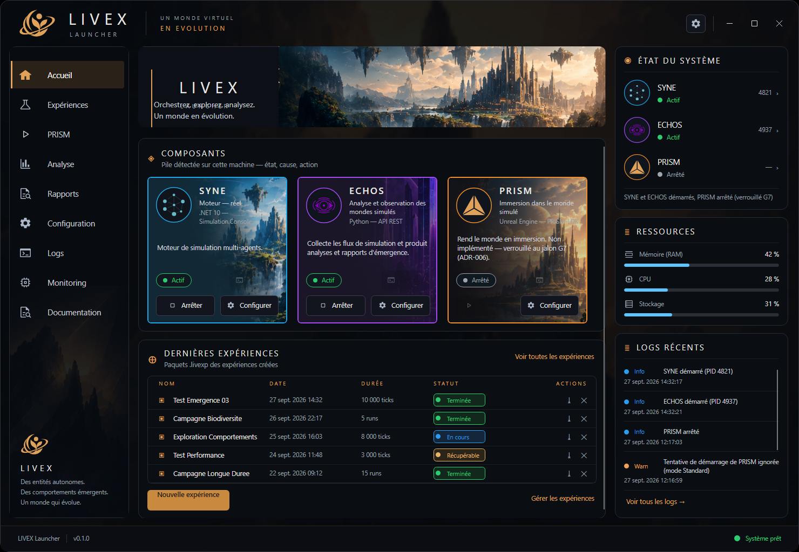

<sub>Le Launcher LIVEX : orchestration des composants, journaux et analyse dans une interface native.</sub>

</div>

<a id="avancement"></a>
## Avancement — relevé du 15 novembre 2026

LIVEX **1.0.0** reste la release publique : SYNE y détient le monde et le projet Unreal PRISM/PRISM-LDK le représente. Le travail en cours construit **LIVEX 2.0**, dont PRISM V2 devient l’autorité physique : le monde, la matière et le temps quittent SYNE pour un hôte .NET headless, et SYNE ne conserve que la cognition. Les phases P0 à P9 ont livré leur socle — P9 est clôturée — et P11 est livrée ; P10 est livré côté ECHOS, Launcher et distribution, avec la recette d’installation encore à faire.

| Composant | Version du relevé | Tests au 15/11 | État |
| :-- | :-- | :-- | :-- |
| **SYNE** | `0.18.0` | **813/813** | P9 clôturée le 15/11 : `PrismWorldAdapter` est la seule implémentation de `IWorld`, plus aucune classe de monde dans `Simulation.Core` ; **G5 franchie le 14/11** (R3, 100 agents × 5 000 ticks, empreinte `855fdc2e1387e8d3`, 25 chaînes, **30,5 ms/tick** propre à SYNE). |
| **PRISM V2** | `2.0.0-preview.1` | **525/525** | P0–P9 : socle livré (P9 clôturée), **P11 (viewer) livrée le 15/11** (PRISM-110 à 118) : rendu, inspecteur, sept calques, modes client/embarqué/rejeu, plan de contrôle. G3, G4 et G5 franchies ; **G1 ouverte, non bloquante**. |
| **ECHOS** | `0.1.0` | **419** + 14 ignorés (91,14 %) | Ingestion du flux PRISM en production (`POST /ingest/prism`), analyse des runs V2 et comparaison par `contentHash`. |
| **Launcher** | `0.1.0` | **236** + 4 cas dynamiques | Modes **Hôte**/**Viewer**, `world.json` dans les paquets `.livexp`, ordre de démarrage `requires`/`consumes`, `--check` à 5 composants valides. |
| **Installateur** | `1.0.0` | **120/120** | Distribue la V1 ; `prism-host`, `prism-viewer` et le pack de contenu sont publiés et déclarés facultatifs dans `installer/build/components.json`. |
| **syne-mock** | `0.1.0` | **51** + 2 ignorés | Émulateur Node.js des contrats V1, outil de test hors produit livré. |

**Ce qui reste avant LIVEX 2.0**

- **Clore P11** : produire le relevé **B8** publiable sous Windows et valider le rendu sous Linux (fenêtre réelle). Le code, le manifeste, les tests et la chaîne gatée sont livrés.
- **G6** : consigner une session réelle datée (Launcher → SYNE + PRISM + ECHOS + Viewer) et mener la recette **INSTALLER-200** sur machine propre.
- **G2** : épingler une empreinte de monde `WorldGenVersion 2` et publier le rapport daté ; la comparaison Windows/Linux est déjà exécutée par la CI.
- **G1** : ramener le tick de l’hôte sous budget — **431,5 ms/tick à 100 agents**, dont **ApplyWrites 404,7 ms (94 %)** ; le levier identifié est la suppression des recherches de chemin rejouées (PRISM-143), pas la parallélisation de la perception.
- **G7–G8** : calibrage, ablations et candidate de livraison, reportés après l’implémentation complète.

Le détail par composant, les commandes et les écarts sont tenus dans le [statut transversal](docs/governance/LIVEX-CURRENT-STATUS.md), le [plan d’implémentation](docs/governance/IMPLEMENTATION-PLAN-2026-11-15.md) et le [checkup PRISM du 15 novembre](docs/governance/PRISM-CHECKUP-2026-11-15.md).

## Principes de conception

| Principe | Application dans LIVEX |
|:--|:--|
| **Déterminisme** | Une même graine, configuration et version du moteur permettent de reproduire une trajectoire. Toute altération volontaire (ex. la calibration de survie 0.13.0) impose un bump MINOR et le re-calage assumé des checksums dorés. |
| **Décisions explicables** | Les décisions BDI produisent des traces consultables et analysables. |
| **Information locale** | Les entités agissent à partir de ce qu’elles perçoivent et mémorisent, pas d’une vérité globale. |
| **Observation indépendante** | L’analyse mesure le monde sans en devenir la source de vérité. |
| **Contrats explicites** | Les composants échangent par des interfaces documentées et versionnées. |

<a id="architecture"></a>


LIVEX sépare **la cognition** (SYNE), **le monde physique** (PRISM V2), **l’observation** (ECHOS) et **l’orchestration** (Launcher), reliés par des contrats versionnés. En V1, SYNE portait le monde et PRISM/Unreal le représentait. En V2, l’hôte PRISM exécute le monde 2,5D, la matière, les actions, les chaînes de production, la navigation, le temps physique et les structures ; SYNE lui adresse des commandes et applique ses observations ; ECHOS ingère le flux de lecture, l’analyse et le compare ; le viewer en est un client facultatif.

La boucle couplée est reproductible : **R2** (50 agents × 5 000 ticks) redonne `0bf833f4bcfc1e5e` sur trois hôtes, **R3** (100 agents × 5 000 ticks) redonne `855fdc2e1387e8d3` sur deux passes et **porte G5**. Depuis le 15 novembre 2026, la session est **gatée par le Launcher** : la pile reste au tick `-1` jusqu’au **Play**, et le viewer relaie `play`, `pause`, `stop` et `quit` à l’hôte, qui reste l’autorité du monde (relevé réel : Play 338, pause stable à 343, reprise 499, stop 503).

<div align="center">

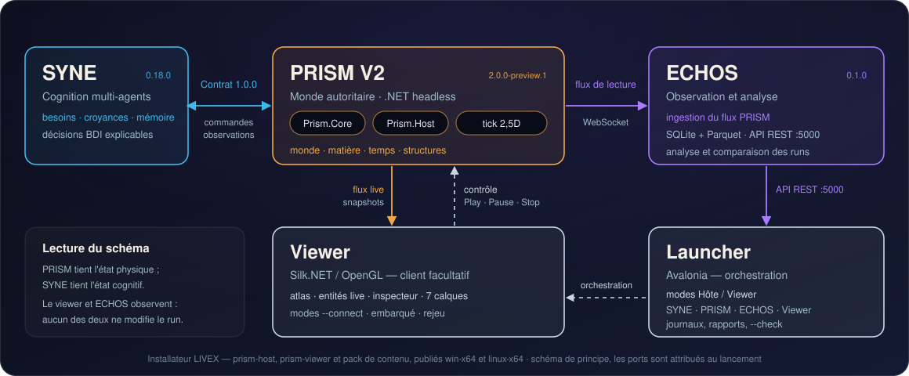

</div>

<details>
<summary>Version texte du schéma (Mermaid)</summary>

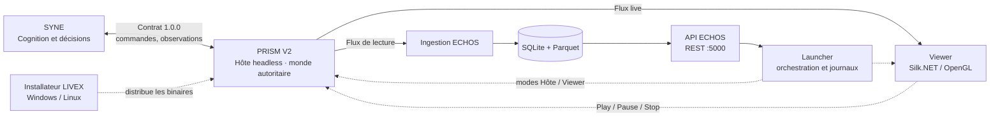

</details>

### Les trois couches

| Composant | Rôle | Responsabilité |
|:--|:--|:--|
| **SYNE**<br/><sub>*Systems & Emergent Network Engine* — `0.18.0`</sub> | Cognition multi-agents | Porte besoins, croyances, mémoire, relations, groupes et décisions ; émet des commandes et applique les observations PRISM. L’extraction du monde historique est achevée : `PrismWorldAdapter` est la seule implémentation de `IWorld`. Les agents accomplissent les chaînes sans plan scripté. |
| **ECHOS**<br/><sub>*Emergent Cognition & Holistic Observation System* — `0.1.0`</sub> | Observation et analyse | Ingère le flux PRISM en production, le persiste (schéma SQLite v9 + Parquet), rejoue les runs pour les métriques de ressources et de coopération, et nomme le premier tick de divergence entre deux runs. |
| **PRISM**<br/><sub>*Perceptual Rendering & Interactive Simulation Module (V2)* — `2.0.0-preview.1`</sub> | Monde physique autoritaire | Simulation .NET headless : monde 2,5D, matière, actions, navigation, temps physique et structures, sous contrat `1.0.0`. Le viewer Silk.NET/OpenGL est facultatif et livré ; il ne fait jamais avancer le monde. |

### Les outils

| Outil | Rôle | Responsabilité |
|:--|:--|:--|
| **Launcher** | Orchestration | Application Avalonia : démarre et supervise SYNE, PRISM, ECHOS et le Viewer dans l’ordre déclaré, présente journaux et analyses, propose les modes **Hôte** et **Viewer** et vérifie l’installation avec `--check`. |
| **syne-mock** | Test d’intégration V1 | Serveur Node.js des contrats hérités ; les campagnes PRISM V2 utilisent les bots déterministes `Prism.Bots`. |
| **Installateur LIVEX** | Distribution et maintenance | Distribue la release V1 (Windows/Linux, variantes `core` et `full`) et publie désormais les artefacts V2 (`prism-host`, `prism-viewer`, pack de contenu) comme composants facultatifs. |

### Communication entre les composants

Les applications communiquent par des interfaces réseau documentées, indépendantes de leurs langages et de leurs frameworks.

- **Contrat SYNE↔PRISM `1.0.0`** : commandes SYNE→PRISM, observations et événements PRISM→SYNE, flux de lecture PRISM→ECHOS/viewer. R2 est validé sur 5 000 ticks répétés (`0bf833f4bcfc1e5e` × 3 hôtes) et R3 sur 100 agents × 5 000 ticks (`855fdc2e1387e8d3` × 2 passes).
- **Flux de lecture** : WebSocket `/data/read` ; snapshots, deltas, entités et métriques, consommés par l’ingestion ECHOS et par le viewer, sans écriture dans le monde.
- **Plan de contrôle** : préparation et cycle de vie du run côté hôte (`prepare`, `start`, `shutdown`) ; le viewer expose `POST /control/play|pause|stop|quit` et les relaie à l’hôte. Le plan de données de tick reste indépendant du transport.
- **Contrats versionnés** : ils cadrent l’évolution des composants et la compatibilité des messages ; l’observabilité SYNE est en `0.6.0`.

Cette séparation évite de coupler le moteur à une interface graphique ou à un système d’analyse particulier.

### Principes structurants

- **Séparation des responsabilités** : cognition, monde physique, analyse, visualisation et orchestration sont confiées à des composants distincts.
- **Indépendance technologique** : les composants se développent et se testent séparément, sans dépendre des implémentations internes des autres.
- **Autorités explicites** : PRISM est l’autorité de l’espace, de la matière et du temps physique ; SYNE est l’autorité de la cognition ; ECHOS et le viewer observent sans modifier le run.
- **Interfaces explicites et versionnées** : des contrats documentés facilitent l’intégration, les tests et l’évolution du système.

L’architecture et les contrats sont détaillés dans la [documentation technique](docs/ARCHITECTURE.md) et la [spécification des échanges inter-composants](docs/COMMUNICATION.md). Le [statut transversal](docs/governance/LIVEX-CURRENT-STATUS.md) décrit l’intégration V2 ; le [relevé de release V1](docs/governance/LIVEX-STATUS.md) conserve ses versions et compteurs. Le badge de couverture décrit les rapports disponibles, sans présenter la mesure partielle comme la couverture globale complète.

<a id="garanties-preuves-et-limites"></a>


| | |
|:--|:--|
| **Reproductibilité** | Une graine, une configuration et une version moteur fixées permettent de comparer et rejouer les trajectoires ; l’état du générateur pseudo-aléatoire est persisté pour les reprises. La garantie est testée, et ne signifie pas que deux configurations différentes produisent le même monde. |
| **Causalité et explicabilité** | Le pipeline BDI utilise les informations connues par l’agent ; les décisions peuvent porter cibles, preuves et candidats rejetés. Les effets différés ferment la fenêtre causale d’un tick. |
| **Mesures non intrusives** | ECHOS observe le flux et rend explicites les états mesurés, absents ou manquants ; l’analyse ne devient pas la source de vérité de la simulation. |
| **Validation documentée** | Les rapports versionnés de [gouvernance](docs/governance/realignment/README.md) conservent décisions, protocoles, résultats et limites du réalignement SYNE 0.15.0 → 0.17.0. Les portes G3, G4 et G5 ont leurs rapports datés ; le [statut transversal](docs/governance/LIVEX-CURRENT-STATUS.md) distingue les validations V1 et V2 par composant et par date. |
| **Limites assumées** | L’émergence d’une société, d’une intelligence ou d’une conscience n’est pas garantie. Les campagnes sont bornées par leurs graines, horizons, scénarios et critères préenregistrés. Le viewer est livré, mais son relevé B8 et sa validation graphique Linux restent à produire ; G1, G2 et la recette G6 restent ouvertes, et les campagnes V2 ne valent pas encore validation expérimentale (G7 reportée). |

### Aperçu des interfaces

<div align="center">

| Launcher · accueil | Launcher · expériences |
|:--:|:--:|
|  | 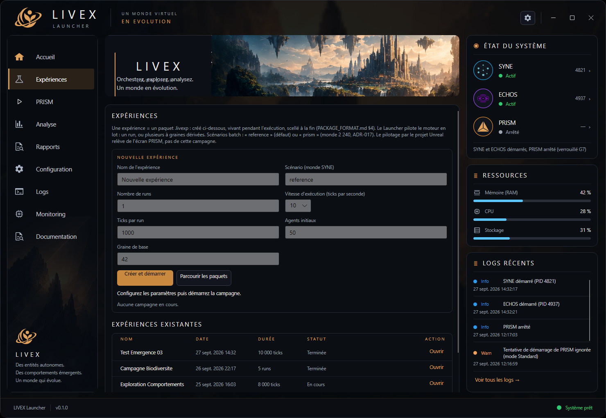 |

| Launcher · vue PRISM | ECHOS · relations |
|:--:|:--:|
| 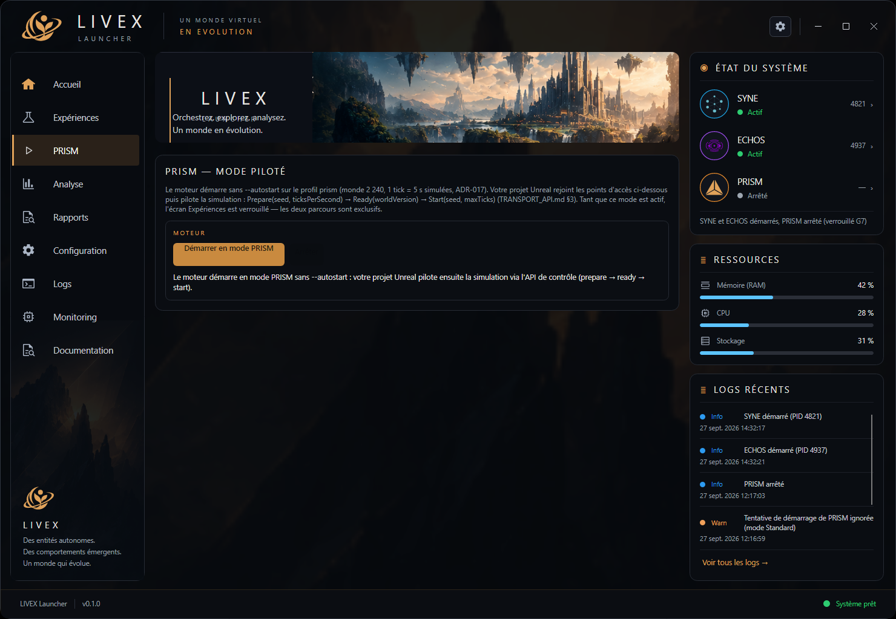 | 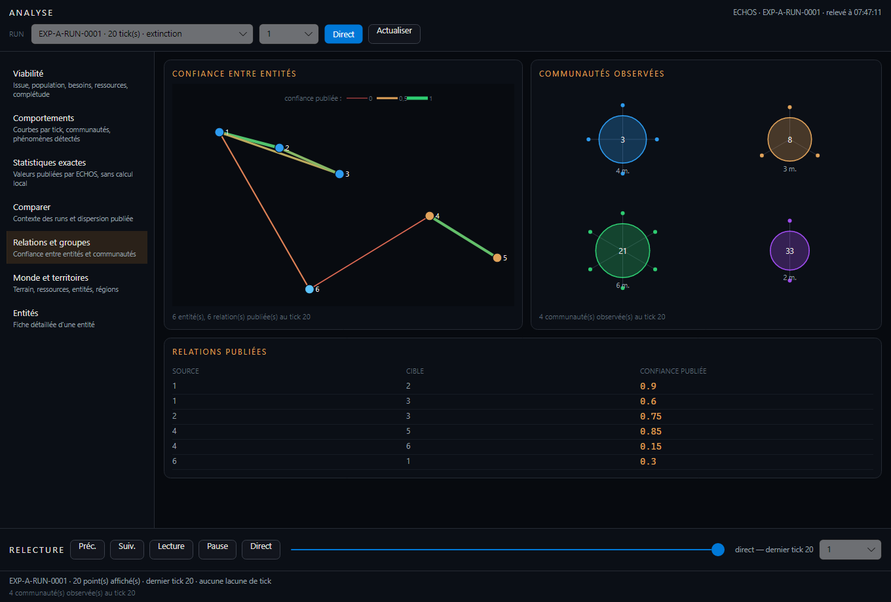 |

| ECHOS · agents | Installateur · choix des composants |
|:--:|:--:|
| 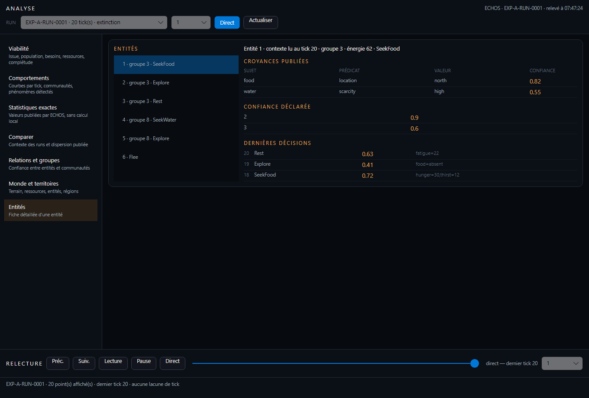 | 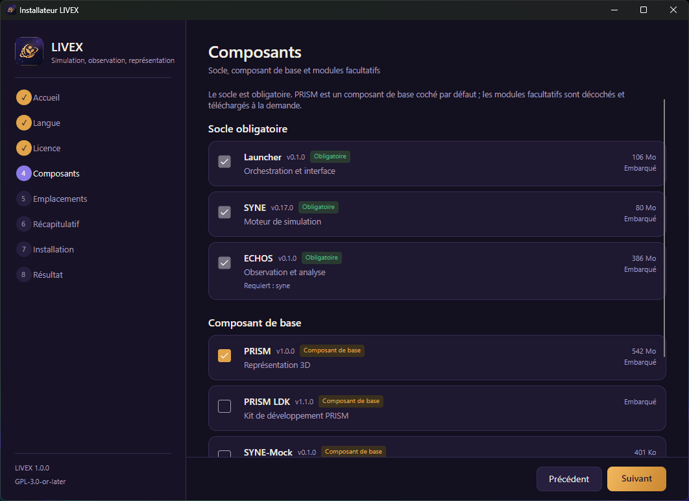 |

| PRISM V2 · viewer en mode embarqué (15 novembre 2026) |
|:--:|
| 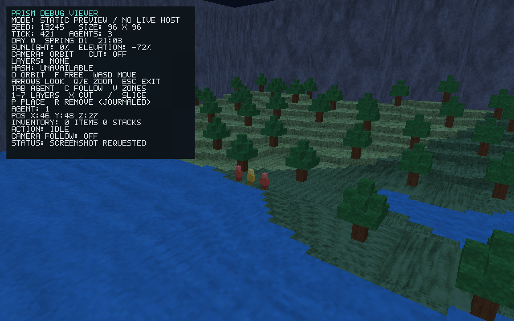 |

</div>

<sub>Les captures du Launcher, d’ECHOS et de l’installateur documentent la pile V1 (ou des versions de travail). La capture du viewer PRISM V2 a été produite le 15 novembre 2026 en mode embarqué par le module <code>--screenshot</code> : elle documente le rendu, pas le relevé B8 ni la validation graphique Linux, qui restent à produire. Aucune capture ne vaut preuve scientifique.</sub>

Les captures statiques sont conservées dans `docs/captures/` et inventoriées dans [`docs/captures/README.md`](docs/captures/README.md). Le dépôt n’embarque aucune animation GIF : si le projet en a besoin un jour, elle rejoint ce dossier, en WebP ou MP4 de préférence.

<a id="performances"></a>


Les chiffres ci-dessous sont des **observations datées**, pas des engagements de performance ni des portes de viabilité franchies. Les mesures V1 (une machine, octobre 2026) sont détaillées dans le [rapport de performance](docs/governance/LIVEX-PERFORMANCE-2026-10.md) ; les mesures V2 dans la [spécification de performance PRISM](docs/prism/PERFORMANCE.md) et les relevés [`benchmarks/`](docs/prism/benchmarks).

**Pile V1 — octobre 2026**

| Mesure | Cadence observée | Lecture |
|:--|--:|:--|
| SYNE seul, 100 agents (`--headless`) | ~67 t/s sur 1000 ticks | Dépend de l’horizon : ~129 t/s sur 300 ticks, ~2,9 t/s à 1000 agents |
| Ingestion ECHOS, 100 entités | ~16 t/s | Voie mono-thread ; l’analyse ajoute 0,5 à 2,7 s |
| Pile SYNE + ECHOS, 100 agents | **~13 t/s** | ECHOS (ingestion) est le facteur limitant, pas le moteur |
| Profil SYNE `prism` V1, 100 agents | 6 t/s | Cadence historique du profil ; ne mesure pas le runtime PRISM V2 |

**PRISM V2 et boucle couplée — 15 novembre 2026**

| Mesure | Coût observé | Lecture |
|:--|--:|:--|
| SYNE couplé, coût propre à 100 agents | **30,5 ms/tick** | R3 : 100 agents × 5 000 ticks, 25 chaînes, budget 50 ms → **G5 franchie** |
| PRISM V2, tick couplé à 100 agents | **431,5 ms/tick** | B9 du 15/11 (2 passes) : ApplyWrites 404,7 ms (94 %), perception 15,2 ms, macros 14,4 ms ; budget 50 ms → **G1 ouverte** |
| PRISM V2, tick couplé à 1 000 agents | 850 ms/tick | Dernière mesure valide ; perception 317 ms ; budget 250 ms |
| PRISM V2, 1 agent inactif | ~13,6 ms/tick | Mesure locale du 4/11 après optimisation ; ne préjuge pas du tick couplé |

| Configuration | Poste de travail | Charge type |
|:--|:--|:--|
| **Minimale** | 4 cœurs, 8 Go, SSD | SYNE 100 agents à 6 t/s + ECHOS, sans rendu Unreal |
| **Recommandée, V1** | 6–8 cœurs, 16 Go, NVMe, GPU dédié | Pile SYNE + ECHOS + Launcher et présentation Unreal historique |
| **Recommandée, V2** | 8 cœurs, 16 Go, NVMe, GPU OpenGL 3.3 | Hôte PRISM headless + SYNE + ECHOS, viewer facultatif ; budgets de l’hôte encore ouverts (G1) |

Un run long se dimensionne sur le débit **à l’horizon visé**, pas sur celui des premiers ticks. Alléger l’ingestion ECHOS (`analysisEvery` > 1 ou voie batch) reste le premier levier côté V1 ; côté V2, le coût du tick est dominé par l’écriture des observations et les recherches de chemin rejouées. Justification et chiffres complets : [rapport de performance V1, § Recommandations](docs/governance/LIVEX-PERFORMANCE-2026-10.md#7-recommandations) et [PERFORMANCE.md](docs/prism/PERFORMANCE.md).

Les mesures sont reproductibles avec [`scripts/benchmark-windows.py`](scripts/benchmark-windows.py) (V1), [`scripts/prism-coupled-benchmark.py`](scripts/prism-coupled-benchmark.py) (tick couplé V2, relevé B9) et le harnais B8 du viewer. La référence moteur publiée reste [`docs/syne/PERFORMANCE.md`](docs/syne/PERFORMANCE.md).

<a id="démarrage-rapide"></a>


## Installer LIVEX

LIVEX **1.0.0** est publiée sous le tag [`livex-v1.0.0`](https://github.com/donovan-dev-web/LIVEX/releases/tag/livex-v1.0.0). Téléchargez l’installateur correspondant à **Windows x64** ou **Linux x64** dans la [release publique](https://github.com/donovan-dev-web/LIVEX/releases/tag/livex-v1.0.0), puis suivez le [guide utilisateur](docs/installer/GUIDE-UTILISATEUR.md). Les variantes `core` et `full` sont disponibles pour les deux plateformes.

### Captures de l’installateur

| Installateur · accueil | Installateur · choix des composants |
|:--:|:--:|
| 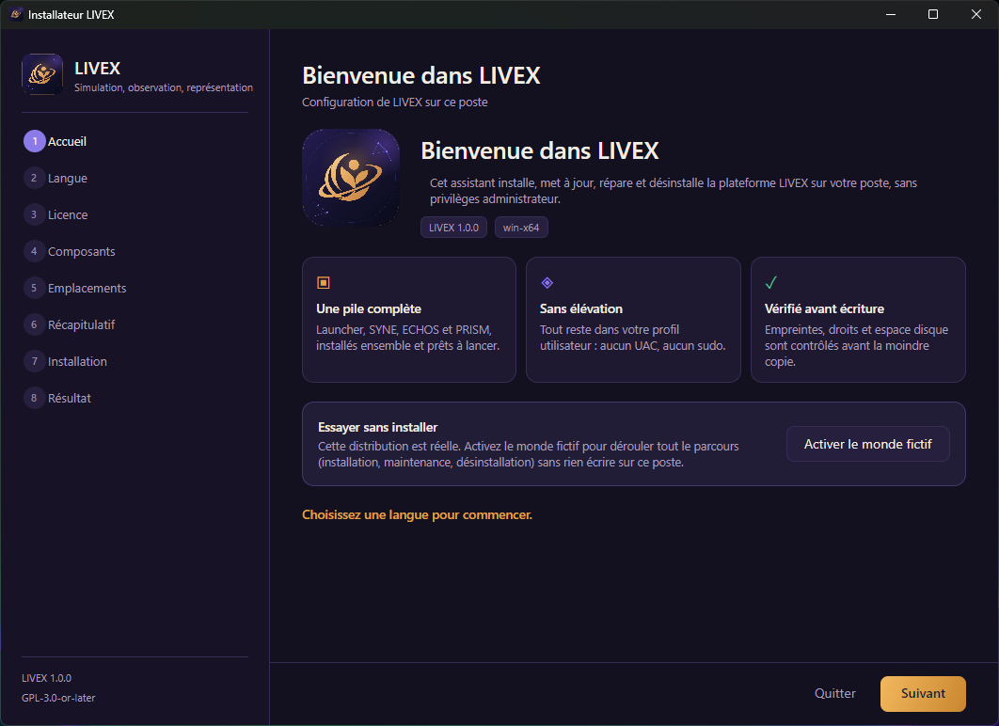 |  |

Le guide et ces captures décrivent la distribution V1. La chaîne de publication V2 existe déjà : `scripts/release/publish_prism_v2.py` produit `prism-host`, `prism-viewer` et le pack de contenu pour `win-x64` et `linux-x64` (archives mesurées, SHA-256 dans `distribution.json`), et `installer/build/components.json` les déclare comme composants facultatifs. Il reste à intégrer ces artefacts à l’assistant et à dérouler la recette d’installation sur machine propre (INSTALLER-200). Voir la [documentation de l’installateur](docs/installer/README.md).

### Depuis les sources

```bash
# PRISM V2 : aperçu statique du viewer, sans hôte
cd prism
dotnet run --project Prism.Viewer/Prism.Viewer.csproj -- --seed 12345 --size 96

# Hôte autonome, puis viewer client sur le flux de lecture
dotnet run --project Prism.Host -- --autostart --seed 12345 --control-port 8131 --read-port 8132
dotnet run --project Prism.Viewer/Prism.Viewer.csproj -- --connect ws://127.0.0.1:8132/data/read
```

Les recettes complètes (hôte séparé, mode embarqué, SYNE + PRISM couplés, arrêt propre) sont dans [`docs/prism/MANUAL_RUN.md`](docs/prism/MANUAL_RUN.md). Pour le reste de la pile, consultez le [guide de développement et d’installation locale](docs/INSTALLATION.md) et la [documentation du mode démonstration](docs/installer/README.md#5-bis-mode-démonstration-monde-fictif).

## Structure du dépôt

<details>
<summary>Afficher l’arborescence</summary>

```text
LIVEX/
├── syne/                   # Moteur de cognition C#/.NET (0.18.0)
├── echos/
│   └── echos/              # API, analyse, ingestion et stockage (sans interface)
├── prism/                  # PRISM V2, simulation .NET headless
│   ├── Prism.Contracts/
│   ├── Prism.Core/
│   ├── Prism.Content/
│   ├── Prism.Host/
│   ├── Prism.Bots/
│   ├── Prism.Viewer/       # Viewer Silk.NET/OpenGL facultatif
│   ├── assets/             # Atlas, palettes et police du viewer
│   └── Prism.sln
├── syne-mock/              # Serveur Node.js de test des contrats SYNE
├── launcher/               # Orchestrateur Avalonia, paquets et tests du Launcher
├── installer/              # Installateur Windows/Linux et composants distribués
├── site/                   # Site vitrine Astro (FR/EN)
├── scripts/                # Benchmarks, publication et outils de release
├── docs/
│   ├── README.md           # Portail de la documentation
│   ├── ARCHITECTURE.md     # Vue d'ensemble technique
│   ├── COMMUNICATION.md    # Protocoles et ports inter-composants
│   ├── INSTALLATION.md     # Prérequis et commandes de lancement
│   ├── captures/           # Captures d'écran de présentation
│   ├── presentation/       # Vision, FAQ, glossaire, périmètre éthique
│   ├── governance/         # État courant, feuille de route, gitflow, checkups
│   ├── adr/                # Décisions d'architecture transverses
│   ├── syne/               # Documentation et décisions SYNE
│   ├── echos/              # Documentation ECHOS
│   ├── launcher/           # Spécification complète du Launcher
│   ├── prism/              # PRISM V2 : contrats, roadmap, benchmarks, monographie
│   ├── installer/          # Installateur : code, tests et documentation
│   └── monographie/        # Monographie réalignée sur PRISM V2
└── .github/                # Workflows CI et release
```

</details>

## Documentation

| Lire… | Pour… |
|:--|:--|
| [Statut transversal — 15/11/2026](docs/governance/LIVEX-CURRENT-STATUS.md) | Voir l’état réel par composant, les compteurs de tests et les portes ouvertes. |
| [Plan d’implémentation](docs/governance/IMPLEMENTATION-PLAN-2026-11-15.md) · [checkup PRISM](docs/governance/PRISM-CHECKUP-2026-11-15.md) | Suivre les lots restants, leurs dépendances et les preuves attendues. |
| [Site web](https://donovan-dev-web.github.io/LIVEX/) | Parcourir la présentation, le glossaire, la technique et le journal du projet. |
| [Vision](docs/presentation/VISION.md) | Comprendre les objectifs, le périmètre et les limites. |
| [Architecture](docs/ARCHITECTURE.md) | Voir les composants, leurs responsabilités et la cible V2. |
| [Installation & démarrage](docs/INSTALLATION.md) · [PRISM à la main](docs/prism/MANUAL_RUN.md) | Installer les dépendances, lancer la pile et piloter le viewer. |
| [Feuille de route](docs/governance/ROADMAP.md) · [roadmap PRISM](docs/prism/ROADMAP.md) | Suivre les jalons et les travaux à venir. |
| [Performances](docs/governance/LIVEX-PERFORMANCE-2026-10.md) · [PERFORMANCE PRISM](docs/prism/PERFORMANCE.md) | Connaître les débits, les budgets et les relevés B9/G5. |
| [Tests PRISM](docs/prism/TESTING.md) | Rejouer les suites et lire les compteurs par projet. |
| [Communication](docs/COMMUNICATION.md) | Consulter les protocoles, les ports et le plan de contrôle. |
| [Glossaire](docs/presentation/GLOSSARY.md) · [FAQ](docs/presentation/FAQ.md) | Retrouver le vocabulaire et les réponses fréquentes. |
| [Launcher](launcher/README.md) · [spécification complète](docs/launcher/README.md) | Lire la release V1 et l’orchestration Hôte/Viewer de la pile V2. |
| [Installateur](docs/installer/README.md) · [guide utilisateur](docs/installer/GUIDE-UTILISATEUR.md) | Télécharger, installer, mettre à jour, réparer et désinstaller LIVEX 1.0.0. |
| [Monographie actualisée](docs/monographie/00-SOMMAIRE-GENERAL.md) · [photographie V0.1](docs/presentation/Monographie-Prototype-V01/LIVEX-Monographie_SnapV0-1.pdf) | Lire les fondements, l’état actuel de PRISM V2 et les chapitres historiques. |
| [SYNE](docs/syne/README.md) · [ECHOS](docs/echos/README.md) · [PRISM](docs/prism/README.md) | Entrer dans la documentation d’un composant. |
| [Relevé de release V1](docs/governance/LIVEX-STATUS.md) · [portail documentaire](docs/README.md) · [captures](docs/captures/README.md) | Distinguer les résultats historiques de la release et parcourir les ressources. |

## Contribuer

Les contributions suivent les conventions du dépôt. Avant de proposer un changement, consultez le [guide de contribution](CONTRIBUTING.md), le [Gitflow](docs/governance/GITFLOW.md) et le [code de conduite](CODE_OF_CONDUCT.md). Une question ou un problème ? Le [canal d’assistance](SUPPORT.md) est là pour ça. Les choix techniques durables doivent rester cohérents avec l’[architecture](docs/ARCHITECTURE.md) et les ADR du composant concerné.

## Licence et auteur

Distribué sous licence [GNU GPL v3.0 ou ultérieure](LICENSE) (SPDX : `GPL-3.0-or-later`). Copyright (C) 2026 Donovan Chartrain. Le texte complet de la licence figure dans [`LICENSE`](LICENSE), la déclaration de copyright dans [`NOTICE`](NOTICE) ; les composants tiers et les fichiers non couverts par la GPL sont recensés dans [`THIRD-PARTY-NOTICES.md`](THIRD-PARTY-NOTICES.md). Les éléments Unreal de PRISM V1 restent soumis aux conditions d’Epic Games ; la cible V2 .NET (hôte, viewer, pack de contenu) est distribuée sous GPL-3.0-or-later et documentée dans les notices.


<br>

**Donovan Chartrain**, développeur et infographiste 3D · [Portfolio développement](https://donovan-dev-web.vercel.app) · [Portfolio 3D](https://donovan-dev-3d.vercel.app)

<br />

<div align="center">


Copyright (C) 2026 Donovan Chartrain.
</div>
