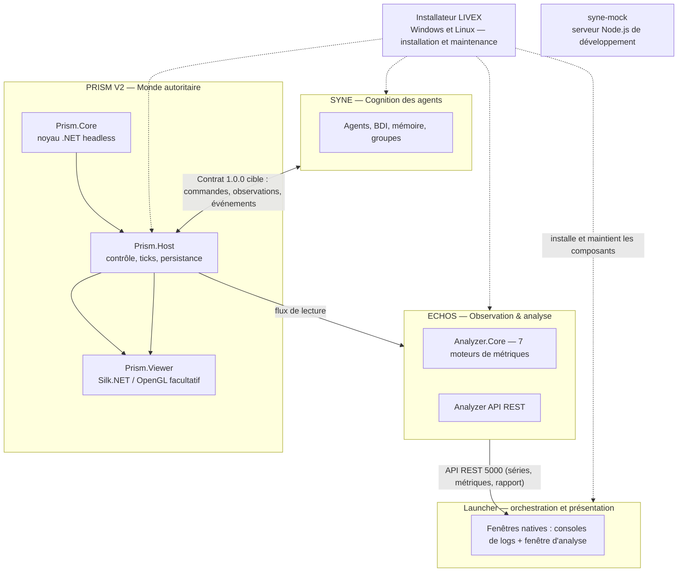
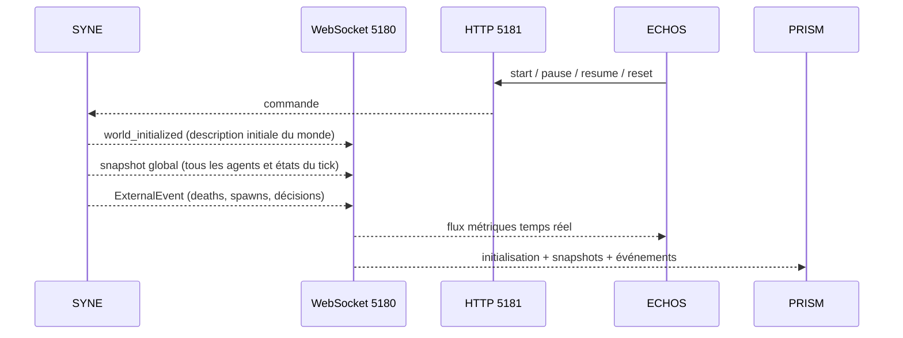

# ARCHITECTURE.md

**Composant** : LIVEX (général)
**Statut** : [V1 LIVRÉE — ARCHITECTURE V2 PRÉVUE]
**Dernière mise à jour** : 4 novembre 2026
**Dépend de** : `presentation/VISION.md`, `CI_CD.md`
**Source Monographie** : Partie 2 (Présentation du Projet), §7.1–7.3 (monorepo, diagrammes, contrats)

---

## 1. Vue d'ensemble

Après la release V1, LIVEX prépare une V2 dont PRISM est profondément refondu. Le schéma et les responsabilités ci-dessous décrivent la **cible V2** ; les sections explicitement marquées V1 et les statuts de release gardent leur sens historique. SYNE portera la cognition, PRISM l'autorité du monde physique, ECHOS l'observation et l'analyse. Le Launcher orchestrera les composants.



## 2. Couches runtime et composants de support

### 2.1 SYNE — Systems & Emergent Network Engine (cible V2)

Source : Monographie §2.3, Partie 3.

- **Rôle** : autorité de la cognition des agents — besoins, croyances, mémoire, relations, groupes et décisions. Le monde physique relève de PRISM dans la cible V2.
- **Contraintes** : indépendant du rendu, fonctionne headless, déterministe pour un seed, une configuration et une version identiques, persistant.
- **Sous-systèmes** : World, Agents, Cognition, Actions, Interaction, Spatial (grille spatiale), Nav (pathfinding).
- **Contrats de sortie** : `WorldSnapshot` et `ExternalEvent` (JSON camelCase) via WebSocket 5180 ; API de contrôle HTTP 5181.

Voir `syne/ARCHITECTURE.md`.

### 2.2 ECHOS — Emergent Cognition & Holistic Observation System

Source : Monographie Partie 4.

- **Rôle** : observe, analyse et pilote la simulation ; expose des métriques, un score d'émergence, une analyse causale et la comparaison d'expériences.
- **Implémentation V0.1** : backend d'analyse **Python (FastAPI, API locale)** sur la base des moteurs de métriques ; stockage SQLite / fichiers Parquet. **Moteur sans interface** : aucune page web, aucun shell de bureau (ADR-007) ; les séries et le rapport sont présentés par le Launcher, dans ses fenêtres natives.
- **Contrats d'entrée** : consomme le flux WebSocket 5180 de SYNE (snapshots + événements).
- **Contrats de sortie** : API REST (liste des runs, métriques, comparaison, export). Aucune interface n'est exposée par ECHOS.

> Divergence documentée : la Monographie (§7.1) décrit un prototype ECHOS en **C#/.NET (Analyzer.Core + ASP.NET) avec interface web React TS**. **Décision V0.1 (utilisateur, 23/09/2026)** : backend **Python FastAPI** (analyse NumPy/Pandas/SciPy, graphes NetworkX) et stockage **SQLite/Parquet**. **Décision du 5 octobre 2026 (`ADR-007`)** : l'interface React et le shell Electron sont **retirés** — ECHOS est un moteur sans interface, et la présentation (consoles de logs, fenêtre d'analyse) est portée par le Launcher en Avalonia. La logique métier reste calquée sur les 7 moteurs de métriques de la Monographie.

Voir `echos/ARCHITECTURE.md`.

### 2.3 PRISM — Persistent Reality & Interactive Simulation Module (V2)

Source : Monographie Partie 5.

- **Rôle prévu** : autorité de l'espace, de la matière et du temps physique ; monde borné 2.5D défini par des packs de données, corps et navigation, actions, agriculture, fabrication, structures et chantiers.
- **Architecture prévue** : solution .NET avec `Prism.Core` sans dépendance graphique, `Prism.Contracts`, `Prism.Content`, `Prism.Host` headless, `Prism.Viewer` Silk.NET/OpenGL facultatif et outils de bots/benchmarks.
- **Contrat cible** : SYNE↔PRISM 1.0.0 indépendant du transport — commandes, observations, événements, plus un flux de lecture PRISM→ECHOS et visualiseur. SYNE reste l'horloge maîtresse ; le viewer ne fait pas avancer la simulation.
- **V1** : le projet Unreal et le plugin PRISM-LDK livrés en 1.0.0 sont conservés comme référence historique de la version précédente.

Voir `prism/ARCHITECTURE.md`.

### 2.4 syne-mock — serveur de simulation de contrat V1

- **Rôle** : serveur Node.js autonome pour développer et tester l'intégration PRISM sans lancer le moteur SYNE complet.
- **Couverture** : cycle de contrôle, initialisation du monde, messages WebSocket, snapshots globaux, événements et scénario configurable (par défaut 50 agents, jusqu'à 400 ticks).
- **Limite** : ce n'est pas SYNE, ne remplace ni ses tests ni sa validation scientifique et n'en reproduit pas fidèlement les algorithmes. Les décisions sociales et le pathfinding notamment sont simplifiés ; voir `../syne-mock/README.md`.

### 2.5 Installateur LIVEX

L'installateur 1.0.0 est le composant de distribution livré avec la release
publique `livex-v1.0.0` pour Windows x64 et Linux x64. Il installe le socle et
PRISM, propose les modules facultatifs, puis prend en charge mise à jour,
réparation et désinstallation. Les variantes `core` et `full` existent pour
chaque plateforme. Le détail est dans [`installer/README.md`](installer/README.md).

## 3. Communication inter-composants

Détaillé dans `COMMUNICATION.md`. Résumé contractuel :

| Flux | Transport | Port | Payload (JSON camelCase) |
| :-- | :-- | :-- | :-- |
| SYNE ↔ PRISM (cible V2) | Contrat versionné, transport indépendant | Défini par le host | Commandes, observations et événements (`API_CONTRACTS.md` 1.0.0 cible) |
| PRISM → ECHOS / viewer (cible V2) | Flux de lecture | Défini par le host | Instantanés/deltas régionaux, métriques et état des chantiers |
| SYNE → ECHOS (V1) | WebSocket | 5180 par défaut | `world_initialized` 1.1, snapshots et événements (contrat 0.5.0) |
| Contrôle de SYNE | HTTP REST | 5181 par défaut | `prepare/ready/start/pause/resume/stop/reset`, état (moteur **0.17.0**) |
| ECHOS API | HTTP REST | 5000 (V0.1 FastAPI) | runs (avec `outcome` de population), métriques, export, comparaison (`?light=1`) |

Les valeurs par défaut ne remplacent pas la configuration du serveur. Le détail
des schémas et du cycle de préparation est dans
[`syne/API_CONTRACTS.md`](syne/API_CONTRACTS.md).

## 4. Dépendances et frontières

| Élément | Dépendance / frontière |
| :-- | :-- |
| `Simulation.Console` | Référence en processus à `Simulation.Core`. |
| ECHOS | Client externe des contrats HTTP/WebSocket ; ne référence pas les assemblies C# de SYNE. |
| PRISM V2 | Cible .NET composée d'un noyau headless, d'un host et d'un viewer facultatif. |
| PRISM V1 / PRISM-LDK | Projet et plugin Unreal livrés dans la release 1.0.0 ; référence historique V1. |
| SYNE ↔ PRISM V2 | Contrat indépendant du transport ; aucun partage d'assemblies nécessaire. |
| `syne-mock` | Outil d'intégration hérité de V1 ; la cible V2 prévoit `Prism.Bots` pour les scénarios de validation. |

Règle V1 : les clients présentaient les données de SYNE sans en devenir
propriétaires. Dans la cible V2, PRISM est propriétaire de l'état physique,
SYNE de l'état cognitif, et le viewer/ECHOS n'altèrent ni l'un ni l'autre.

## 5. Stacks (Monographie §7.1)

| Agent | Stack |
| :-- | :-- |
| Moteur de simulation | C#/.NET, SDK 10.0.400 (pinné `global.json`) — [HÉRITÉ] |
| Analyse ECHOS | Prototype C#/.NET ; **V0.1 : Python (FastAPI)** |
| Interface ECHOS | **Retirée** — présentation portée par le Launcher (Avalonia, ADR-007) |
| PRISM V2 | .NET headless (`Prism.Core`/`Prism.Host`) ; viewer Silk.NET/OpenGL facultatif |
| PRISM V1 | Projet Unreal livré en 1.0.0 avec PRISM-LDK (`PrismLdk`) |
| Mock SYNE | Node.js ; outil de développement, non moteur scientifique |
| Tests C# | xUnit + Moq |
| Tests interface | Avalonia headless + xUnit (Launcher) ; Vitest + ESLint + Prettier **retirés** avec `echos-ui` |
| CI/CD | GitHub Actions |
| Conteneurisation | **Retirée** (08/10/2026) — distribution par artefacts natifs + Launcher, arbitrage A1 |

## 6. Organisation actuelle du dépôt

```text
LIVEX/
├── syne/                  # Moteur de simulation (C#/.NET)
├── echos/                 # Observation & analyse (Python/FastAPI, API seule)
├── prism/                 # Cible V2 .NET ; V1 Unreal gardée en historique
├── syne-mock/             # Serveur Node.js de simulation du contrat SYNE
├── launcher/              # Orchestrateur de la pile (Avalonia)
├── docs/                  # Documentation technique
│   ├── presentation/      # Vision, FAQ, glossaire, éthique
│   ├── governance/        # Roadmap, état du dépôt, gitflow
│   ├── adr/               # Décisions transverses
│   ├── syne/
│   ├── echos/
│   ├── launcher/
│   ├── prism/
│   └── installer/         # Spécification seule, aucun code à ce jour
└── .github/workflows/     # GitHub Actions (ci.yml, release.yml)
```

> Note : l'archive `docs/docs_prototype/` (spécifications historiques du prototype Godot) a été retirée par la revue documentaire V0.1 (PR #502) ; la [Monographie](../LIVEX-Monographie_SnapV0-1.md) reste la référence historique. Les références à Godot dans les documents historiques ne décrivent pas l'implémentation PRISM actuelle.

## 7. Flux de données de référence V1 (historique)



### 7.1 Déterminisme transverse

En V1, le déterminisme s'appuyait sur le `WorldSnapshot` de SYNE. Dans la cible
V2, PRISM fixe l'état physique et ses empreintes ; SYNE fixe l'état cognitif.
Le contrat SYNE↔PRISM versionne les commandes, observations, événements et
références de run conformément à `../VERSIONING.md`.

---

## Notes historiques V1

Le projet Unreal et le plugin PRISM-LDK sont les éléments PRISM de la release
1.0.0. Les recommandations de build Unreal ci-dessus ne s'appliquent pas à la
cible .NET PRISM V2 ; voir [`prism/README.md`](prism/README.md).
