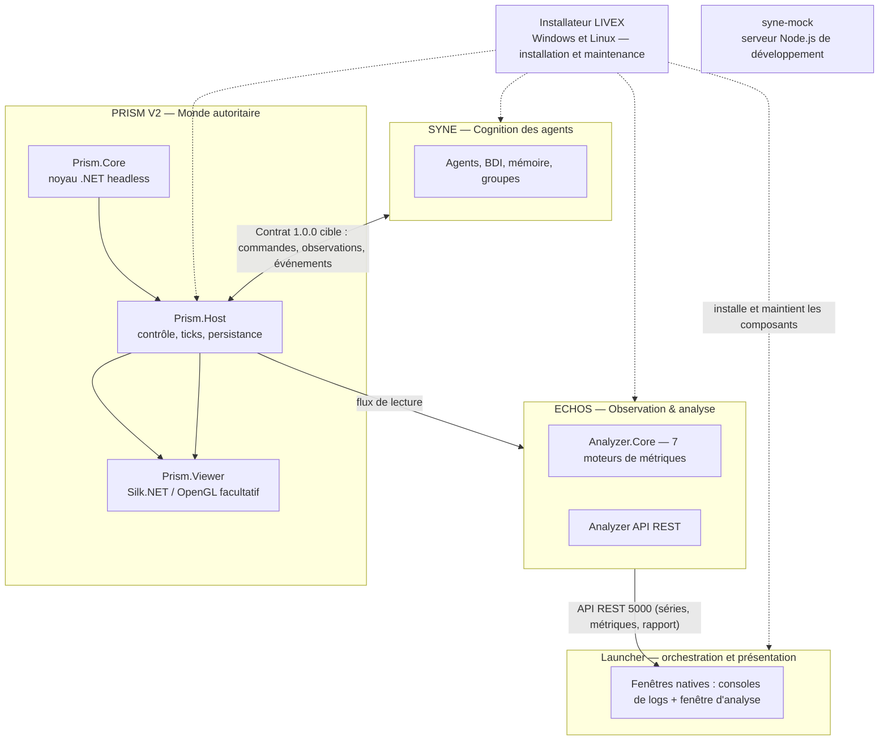
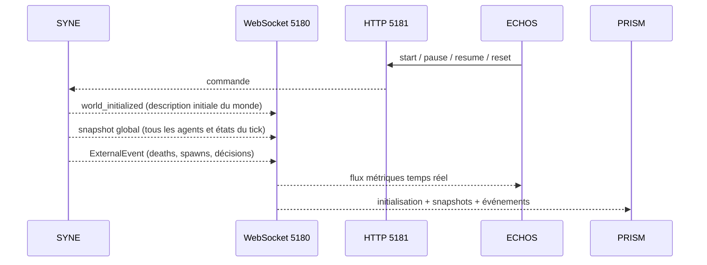

# ARCHITECTURE.md

**Composant** : LIVEX (général)
**Statut** : [V1 LIVRÉE — PRISM V2 PARTIELLEMENT IMPLÉMENTÉE ; INTÉGRATION EN COURS]
**Dernière mise à jour** : 4 novembre 2026
**Dépend de** : `presentation/VISION.md`, `CI_CD.md`
**Source Monographie** : Partie 2 (Présentation du Projet), §7.1–7.3 (monorepo, diagrammes, contrats)

---

## 1. Vue d'ensemble

Après la release V1, LIVEX développe PRISM V2 comme autorité du monde physique. Les rôles V2 décrits ici sont partiellement en service : le host PRISM exécute déjà la génération, le tick et plusieurs systèmes d'action ; le couplage applique les observations à SYNE. L'extraction complète du monde historique de SYNE, la reprise couplée et les validations de release restent ouvertes. SYNE porte la cognition, ECHOS l'observation et l'analyse, et le Launcher orchestre les processus.



## 2. Couches runtime et composants de support

### 2.1 SYNE — Systems & Emergent Network Engine

Source : Monographie §2.3, Partie 3.

- **Rôle V1 autonome** : moteur de simulation et de cognition, avec son monde historique. **En couplage V2** : SYNE porte la cognition ; PRISM possède l'état physique faisant autorité. L'extraction des systèmes de monde de SYNE est prévue en plusieurs étapes et n'est pas terminée.
- **Contraintes** : indépendant du rendu, fonctionne headless, déterministe pour un seed, une configuration et une version identiques, persistant.
- **Sous-systèmes** : World, Agents, Cognition, Actions, Interaction, Spatial (grille spatiale), Nav (pathfinding).
- **Contrats V1** : `WorldSnapshot` et `ExternalEvent` via WebSocket 5180 ; contrôle HTTP 5181. **Couplage V2** : adaptateur SYNE consomme les observations PRISM, les mappe en observations cognitives et les applique aux croyances. La boucle CLI `--prism-url` a été exercée sur 1 000 ticks.

Voir `syne/ARCHITECTURE.md`.

### 2.2 ECHOS — Emergent Cognition & Holistic Observation System

Source : Monographie Partie 4.

- **Rôle** : observe, analyse et pilote la simulation ; expose des métriques, un score d'émergence, une analyse causale et la comparaison d'expériences.
- **Implémentation V0.1** : backend d'analyse **Python (FastAPI, API locale)** sur la base des moteurs de métriques ; stockage SQLite / fichiers Parquet. **Moteur sans interface** : aucune page web, aucun shell de bureau (ADR-007) ; les séries et le rapport sont présentés par le Launcher, dans ses fenêtres natives.
- **Contrats d'entrée** : ingestion SYNE historique par WebSocket 5180 ; un adaptateur distinct valide et persiste aussi les enveloppes du flux de lecture PRISM, avec `contentHash` et séquence. L'ingestion PRISM n'est pas encore intégrée au cycle de production d'un run.
- **Contrats de sortie** : API REST (liste des runs, métriques, comparaison, export). Aucune interface n'est exposée par ECHOS.

> Divergence documentée : la Monographie (§7.1) décrit un prototype ECHOS en **C#/.NET (Analyzer.Core + ASP.NET) avec interface web React TS**. **Décision V0.1 (utilisateur, 23/09/2026)** : backend **Python FastAPI** (analyse NumPy/Pandas/SciPy, graphes NetworkX) et stockage **SQLite/Parquet**. **Décision du 5 octobre 2026 (`ADR-007`)** : l'interface React et le shell Electron sont **retirés** — ECHOS est un moteur sans interface, et la présentation (consoles de logs, fenêtre d'analyse) est portée par le Launcher en Avalonia. La logique métier reste calquée sur les 7 moteurs de métriques de la Monographie.

Voir `echos/ARCHITECTURE.md`.

### 2.3 PRISM — Persistent Reality & Interactive Simulation Module (V2)

Source : Monographie Partie 5.

- **Rôle V2** : autorité de l'espace, de la matière et du temps physique ; monde 2,5D borné, défini par des packs, avec navigation, actions, cultures, fabrication et structures.
- **Implémentation actuelle** : solution .NET avec `Prism.Core`, contrats, compilateur de contenu, host headless, viewer optionnel et bots déterministes. L'hôte raccorde les actions, les cultures, la construction, les conteneurs et plusieurs effets de structure. La campagne réduite est épinglée ; le run couplé de 5 000 ticks reste ouvert.
- **Contrat `1.0.0`** : commandes SYNE→PRISM, observations/événements PRISM→SYNE et flux de lecture PRISM→ECHOS/viewer. SYNE est l'horloge maîtresse ; le viewer ne fait pas avancer la simulation. Le contrat est gelé, mais l'intégration et plusieurs portes de validation restent en cours.
- **V1** : le projet Unreal et le plugin PRISM-LDK livrés en 1.0.0 sont conservés comme référence historique de la version précédente.

Voir `prism/ARCHITECTURE.md`.

### 2.4 syne-mock — serveur de simulation de contrat V1

- **Rôle** : serveur Node.js autonome pour développer et tester l'intégration PRISM sans lancer le moteur SYNE complet.
- **Couverture** : cycle de contrôle, initialisation du monde, messages WebSocket, snapshots globaux, événements et scénario configurable (par défaut 50 agents, jusqu'à 400 ticks).
- **Limite** : ce n'est pas SYNE, ne remplace ni ses tests ni sa validation scientifique et n'en reproduit pas fidèlement les algorithmes. Les décisions sociales et le pathfinding notamment sont simplifiés ; voir `../syne-mock/README.md`.

### 2.5 Installateur LIVEX

L'installateur 1.0.0 est le composant de distribution livré avec la release
publique `livex-v1.0.0` pour Windows x64 et Linux x64. Il installe le socle et
PRISM, propose les modules facultatifs, puis prend en charge mise à jour,
réparation et désinstallation. Les variantes `core` et `full` existent pour
chaque plateforme. Le détail est dans [`installer/README.md`](installer/README.md).

## 3. Communication inter-composants

Détaillé dans `COMMUNICATION.md`. Résumé contractuel :

| Flux | Transport | Port | Payload (JSON camelCase) |
| :-- | :-- | :-- | :-- |
| SYNE ↔ PRISM V2 | HTTP de contrôle et WebSocket de tick/lecture, contrat versionné | Configuré par le host | Commandes, observations, événements et resynchronisation ; boucle couplée exercée sur 1 000 ticks |
| PRISM → ECHOS / viewer V2 | WebSocket de lecture ; ingestion ECHOS dédiée | Configuré par le host | Snapshots, deltas, entités, métriques et chantiers ; ingestion ECHOS persistante, production continue à raccorder |
| SYNE → ECHOS (V1) | WebSocket | 5180 par défaut | `world_initialized` 1.1, snapshots et événements (contrat 0.5.0) |
| Contrôle de SYNE | HTTP REST | 5181 par défaut | `prepare/ready/start/pause/resume/stop/reset`, état (moteur **0.17.0**) |
| ECHOS API | HTTP REST | 5000 (V0.1 FastAPI) | runs (avec `outcome` de population), métriques, export, comparaison (`?light=1`) |

Les valeurs par défaut ne remplacent pas la configuration du serveur. Le détail
des schémas et du cycle de préparation est dans
[`syne/API_CONTRACTS.md`](syne/API_CONTRACTS.md).

## 4. Dépendances et frontières

| Élément | Dépendance / frontière |
| :-- | :-- |
| `Simulation.Console` | Référence en processus à `Simulation.Core`. |
| ECHOS | Client externe des contrats HTTP/WebSocket ; ne référence pas les assemblies C# de SYNE. |
| PRISM V2 | Implémentation .NET en cours ; noyau headless, host et viewer facultatif présents. |
| PRISM V1 / PRISM-LDK | Projet et plugin Unreal livrés dans la release 1.0.0 ; référence historique V1. |
| SYNE ↔ PRISM V2 | Contrat indépendant du transport ; aucun partage d'assemblies nécessaire. |
| `syne-mock` | Émulateur de contrat V1 ; `Prism.Bots` fournit les campagnes déterministes V2. |

Règle V1 : les clients présentaient les données de SYNE sans en devenir
propriétaires. En V2, PRISM est propriétaire de l'état physique, SYNE de
l'état cognitif, et le viewer/ECHOS n'altèrent ni l'un ni l'autre. L'extraction
des systèmes physiques encore présents dans SYNE reste incomplète.

## 5. Stacks (Monographie §7.1)

| Agent | Stack |
| :-- | :-- |
| Moteur de simulation | C#/.NET, SDK 10.0.400 (pinné `global.json`) — [HÉRITÉ] |
| Analyse ECHOS | Prototype C#/.NET ; **V0.1 : Python (FastAPI)** |
| Interface ECHOS | **Retirée** — présentation portée par le Launcher (Avalonia, ADR-007) |
| PRISM V2 | .NET headless (`Prism.Core`/`Prism.Host`) ; viewer Silk.NET/OpenGL facultatif |
| PRISM V1 | Projet Unreal livré en 1.0.0 avec PRISM-LDK (`PrismLdk`) |
| Mock SYNE | Node.js ; outil de développement, non moteur scientifique |
| Tests C# | xUnit + Moq |
| Tests interface | Avalonia headless + xUnit (Launcher) ; Vitest + ESLint + Prettier **retirés** avec `echos-ui` |
| CI/CD | GitHub Actions |
| Conteneurisation | **Retirée** (08/10/2026) — distribution par artefacts natifs + Launcher, arbitrage A1 |

## 6. Organisation actuelle du dépôt

```text
LIVEX/
├── syne/                  # Moteur de simulation (C#/.NET)
├── echos/                 # Observation & analyse (Python/FastAPI, API seule)
├── prism/                 # PRISM V2 .NET ; PRISM V1 Unreal gardée en historique
├── syne-mock/             # Serveur Node.js de simulation du contrat SYNE
├── launcher/              # Orchestrateur de la pile (Avalonia)
├── docs/                  # Documentation technique
│   ├── presentation/      # Vision, FAQ, glossaire, éthique
│   ├── governance/        # Roadmap, état du dépôt, gitflow
│   ├── adr/               # Décisions transverses
│   ├── syne/
│   ├── echos/
│   ├── launcher/
│   ├── prism/
│   └── installer/         # Spécification seule, aucun code à ce jour
└── .github/workflows/     # GitHub Actions (ci.yml, release.yml)
```

> Note : l'archive `docs/docs_prototype/` (spécifications historiques du prototype Godot) a été retirée par la revue documentaire V0.1 (PR #502) ; la [Monographie](../LIVEX-Monographie_SnapV0-1.md) reste la référence historique. Les références à Godot dans les documents historiques ne décrivent pas l'implémentation PRISM actuelle.

## 7. Flux de données de référence V1 (historique)



### 7.1 Déterminisme transverse

En V1, le déterminisme s'appuyait sur le `WorldSnapshot` de SYNE. En V2, PRISM
fixe l'état physique et ses empreintes ; SYNE fixe l'état cognitif. La boucle
couplée est implémentée, mais l'extraction du monde et la reprise partagée
restent en cours.
Le contrat SYNE↔PRISM versionne les commandes, observations, événements et
références de run conformément à `../VERSIONING.md`.

---

## Notes historiques V1

Le projet Unreal et le plugin PRISM-LDK sont les éléments PRISM de la release
1.0.0. Les recommandations de build Unreal ci-dessus ne s'appliquent pas à la
cible .NET PRISM V2 ; voir [`prism/README.md`](prism/README.md).
