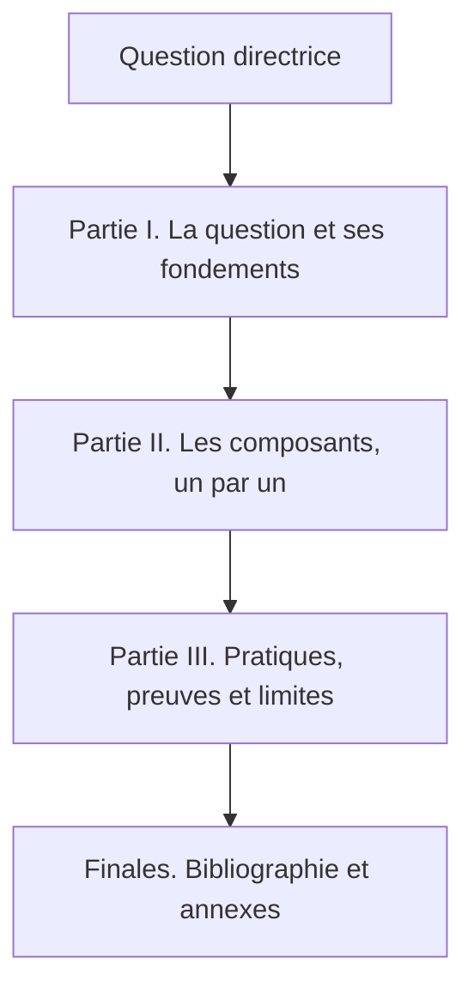

# Avant-propos. Pourquoi ce livre, comment le lire, ce qu'il ne promet pas

## 1. Pourquoi ce livre existe

Ce livre a été entrepris parce qu'une question l'exigeait. Il ne cherche pas à célébrer un système, mais à rendre testable une curiosité née entre le code et l'image : celle des mondes de science-fiction et de LitRPG où les habitants semblent vivre, parce qu'ils ont des besoins, des perceptions et des raisonnements plutôt que des répliques écrites à l'avance.

Je suis développeur et infographiste 3D. Ces deux métiers m'ont placé devant les deux faces d'un même problème : représenter un monde, et construire ce qui le fait fonctionner. J'ai choisi la seconde comme méthode. Plutôt que de programmer les comportements que je voulais observer, j'ai entrepris de bâtir l'environnement et les lois capables de les laisser apparaître. Puis d'observer, de mesurer, d'analyser et, autant que possible, de reproduire.

La démarche a été artisanale et expérimentale : construire, expérimenter, observer, douter de ses hypothèses, recommencer. Et si quelque chose d'intéressant apparaît, ne pas se contenter de le montrer, mais le mesurer et le rendre rejouable. C'est cette exigence qui structure tout le livre.

Un mot sur le ton que le lecteur trouvera ici. Ce livre n'est pas une plaidoirie, ni une publicité, ni un rapport technique. C'est le récit méthodique d'un objet en construction, écrit par celui qui le construit, avec ce que cela suppose d'honnêteté et de doutes. Quand quelque chose ne fonctionne pas, le livre le dit. Quand une capacité est livrée mais désactivée, il le dit. Quand un chiffre pourrait être mal lu, il l'explique avant qu'on ne se trompe. Ce n'est pas de la modestie de façade : c'est la condition pour que le lecteur puisse faire confiance à ce qu'il lit.

## 2. Comment lire ce livre

Le livre suit un fil narratif unique. Chaque chapitre s'ouvre par sa question, l'instruit par le récit, des exemples suivis, des formules expliquées et des blocs, puis discute ses limites et dégage son apport à la question directrice, avant de passer au chapitre suivant. Les annexes conservent les matériaux exhaustifs (contrats, dictionnaire des métriques, architecture détaillée, schémas, glossaire, décisions d'architecture, chronologie, paramètres et bases de données) sans interrompre le propos, et les trois dernières reviennent sur la trajectoire du projet, ses mesures et son programme. La bibliographie nomme les lignées de recherche sans importer de preuves.

Trois lecteurs peuvent ouvrir ce livre. Le lecteur curieux y trouvera une introduction accessible, qui ne suppose aucune connaissance technique. Le développeur y trouvera les structures, les algorithmes, les valeurs et les contrats réels. Le lecteur scientifique y trouvera la précision, les formules, les références et, surtout, la séparation constante entre observation, interprétation et hypothèse. Ces trois niveaux ne sont pas découpés en sous-sections étiquetées : ils se succèdent dans le même texte, en montant progressivement en complexité.

Cette progression mérite d'être décrite une fois, pour que le lecteur sache toujours où il se trouve. Chaque chapitre commence par une phrase qui pose la question en langage ordinaire. Il poursuit par une description des mécanismes, accessible à qui n'a jamais lu une ligne de code, à base d'exemples concrets et de situations suivies. Il descend ensuite dans le détail technique : structures de données, algorithmes, formules, valeurs par défaut tirées du code. Il remonte enfin vers la réflexion : ce que le mécanisme démontre, ce qu'il ne démontre pas, où sont les bornes de validité. Le lecteur pressé peut s'arrêter après la première moitié d'un chapitre et comprendre l'essentiel ; le lecteur exigeant trouvera, plus bas, de quoi vérifier.

Le livre se lit dans l'ordre, mais il est construit pour qu'on puisse l'ouvrir au milieu. Chaque partie est autonome ; chaque chapitre rappelle, à la fin, ce qu'il apporte et ce qu'il laisse ouvert, de sorte qu'un lecteur arrivé directement à un chapitre technique ne soit pas perdu.

## 3. Ce que ce livre ne promet pas

Le livre distingue sans relâche cinq statuts. Le **disponible** désigne ce qui est livré et vérifié dans la version décrite : un test, un contrat ou une campagne rejouable l'atteste. L'**expérimental** désigne une capacité utilisable, avec des limites connues et documentées, qui peut changer. Le **en développement** désigne un travail engagé dont rien n'est garanti pour une version donnée. L'**envisagé** désigne une piste considérée, sans engagement de livraison. Le **hors périmètre** désigne ce qui est volontairement exclu de l'état décrit, non oublié.

Le livre définit chaque terme chargé avant de l'employer. Il sépare l'observation, l'interprétation et l'hypothèse. Il refuse la causalité tirée d'une seule scène. Il rappelle que toute simulation dépend de ses hypothèses. Il corrige explicitement plutôt que de dissimuler.

Ce livre n'est ni un jeu commercial, ni une preuve d'intelligence, ni une société humaine miniature, ni un moteur physique réaliste, ni une validation automatique. C'est le récit complet d'une plateforme expérimentale en temps réel qui sépare quatre responsabilités (décider, mesurer, montrer, archiver) afin de rendre les mécanismes observables.

Il faut ajouter une mise en garde qui reviendra souvent : **ce livre ne fournit aucune preuve de l'émergence**. Il fournit un dispositif capable de l'observer, honnêtement, et des résultats de première génération. La différence entre « capable d'observer » et « a observé » est la plus importante du livre. Une grande partie du travail décrit ici consiste à rendre l'observation digne de confiance : distinguer un zéro observé d'un zéro non mesuré, signaler un trou de flux au lieu de l'interpoler, écarter une mesure biaisée plutôt que la publier. Beaucoup de ces choix paraissent ennuyeux à l'écrit. Ils sont pourtant ce qui sépare une intuition d'un résultat.

## 4. L'état décrit

Le livre couvre l'état réel d'octobre 2026 : un moteur stabilisé et recalibré, un observatoire devenu volontairement sans interface, une scène en construction encadrée, un orchestrateur qui archive à l'octet, un outil d'intégration honnête sur ses limites, et un installateur à l'état de spécification.

Sur le plan factuel, l'inventaire du dépôt au 12 octobre 2026 recense 640 fichiers suivis par Git, répartis en 220 fichiers source, 164 fichiers de tests, 167 documents, 46 fichiers de configuration, 38 assets et 5 fichiers autres. Les suites exécutées localement totalisent 1 258 tests réussis et 16 tests ignorés, sans échec, avec des couvertures mesurées de 90,55 % pour ECHOS et de 87,41 % pour les assemblages SYNE agrégés, au-dessus du seuil de 80 % requis. Ces résultats ne signifient pas que toutes les capacités prévues sont livrées : ils décrivent ce qui est vérifié au moment de la description.

Les composants à l'état décrit :

- **SYNE 0.15.0** (contrat d'observabilité 0.4.0) : moteur .NET autoritaire, déterministe, persistant, indépendant du rendu. Disponible.
- **ECHOS 0.1.0** (schéma SQLite v6) : ingestion, stockage, analyse et API REST headless. L'interface web a été retirée par décision ; disponible en tant que service d'analyse.
- **PRISM et PRISM-LDK** : projet Unreal final et plugin d'intégration, en version de travail. L'expérience de rendu complète est hors périmètre V0.1.
- **Launcher 0.1.0** : application de bureau native d'orchestration et d'archivage, format de paquet `.livexp`. Disponible.
- **`syne-mock` 0.1.0** : serveur Node.js d'émulation pour le développement. Outil, non moteur équivalent.
- **Installateur** : spécification seule, aucun code à ce jour. En développement.

Le tableau suivant récapitule la correspondance entre chaque composant et son rôle, pour fixer le vocabulaire employé dans tout le livre.

| Composant | Rôle en un mot | Ce qu'il fait | Ce qu'il ne fait jamais |
| :-- | :-- | :-- | :-- |
| SYNE | décider | simule le monde, décide, persiste | afficher, analyser |
| ECHOS | mesurer | ingère, calcule, stocke, publie | décider, écrire dans le monde |
| PRISM | montrer | rend la scène, suit l'état | décider, modifier le monde |
| Launcher | archiver | orchestre, archive, rejoue | simuler, analyser |
| `syne-mock` | émuler | sert un contrat pour le développement | faire autorité |
| Installateur | installer | dépose, configure, vérifie | simuler, orchestrer |

La snapshot historique de conception (le document racine nommé monographie V0.1) demeure la référence de conception initiale. Les choix qui ont évolué depuis, notamment la scène actuelle et son plugin, sont décrits ici à jour, sans valeur prescriptive rétrospective. L'annexe J précise, choix par choix, ce que cette conception initiale a conservé, changé ou abandonné, de sorte qu'un lecteur qui consulte un document ancien sache ce qui est encore vrai.

## 5. Le contrat de lecture

Le livre s'appuie sur le code comme source de vérité, sur les contrats versionnés comme engagements, et sur les tests et campagnes rejouables comme preuves. Il ne demande pas au lecteur de croire l'auteur sur parole : il lui donne les moyens de vérifier.

Pour rendre ce contrat concret, voici ce que le lecteur trouvera dans chaque type d'énoncé.

- Quand le livre cite un **chiffre**, il s'agit d'une valeur par défaut du moteur à la version indiquée, ou d'une mesure rejouable, et le contexte le précise.
- Quand le livre décrit un **mécanisme**, il donne sa formule ou sa règle exacte, jamais une paraphrase floue.
- Quand le livre avance une **interprétation**, il la marque comme telle et rappelle qu'elle n'engage pas le moteur.
- Quand le livre signale une **limite**, il dit ce qui manque, à quelle version, et pourquoi.

Si, en refermant ce livre, vous savez reformuler le projet, trouver ses preuves et signaler un problème précis, alors le premier succès est atteint.

Bienvenue dans LIVEX.
