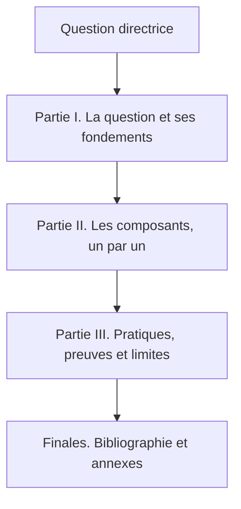

# Avant-propos. Pourquoi ce livre, comment le lire, ce qu'il ne promet pas

## 1. Pourquoi ce livre existe

Ce livre a été entrepris parce qu'une question l'exigeait. Il ne cherche pas à célébrer un système, mais à rendre testable une curiosité née entre le code et l'image : celle des mondes de science-fiction et de LitRPG où les habitants semblent vivre, parce qu'ils ont des besoins, des perceptions et des raisonnements plutôt que des répliques écrites à l'avance.

Je suis développeur et infographiste 3D. Ces deux métiers m'ont placé devant les deux faces d'un même problème : représenter un monde, et construire ce qui le fait fonctionner. J'ai choisi la seconde comme méthode. Plutôt que de programmer les comportements que je voulais observer, j'ai entrepris de bâtir l'environnement et les lois capables de les laisser apparaître. Puis d'observer, de mesurer, d'analyser et, autant que possible, de reproduire.

La démarche a été artisanale et expérimentale : construire, expérimenter, observer, douter de ses hypothèses, recommencer. Et si quelque chose d'intéressant apparaît, ne pas se contenter de le montrer, mais le mesurer et le rendre rejouable. C'est cette exigence qui structure tout le livre.

Un mot sur le ton que le lecteur trouvera ici. Ce livre n'est pas une plaidoirie, ni une publicité, ni un rapport technique. C'est le récit méthodique d'un objet en construction, écrit par celui qui le construit, avec ce que cela suppose d'honnêteté et de doutes. Quand quelque chose ne fonctionne pas, le livre le dit. Quand une capacité est livrée mais désactivée, il le dit. Quand un chiffre pourrait être mal lu, il l'explique avant qu'on ne se trompe. Ce n'est pas de la modestie de façade : c'est la condition pour que le lecteur puisse faire confiance à ce qu'il lit.

## 2. Comment lire ce livre

Le livre suit un fil narratif unique. Chaque chapitre s'ouvre par sa question, l'instruit par le récit, des exemples suivis, des formules expliquées et des blocs, puis discute ses limites et dégage son apport à la question directrice, avant de passer au chapitre suivant. Les annexes conservent les matériaux exhaustifs (contrats, dictionnaire des métriques, architecture détaillée, schémas, glossaire, décisions d'architecture, chronologie, paramètres et bases de données) sans interrompre le propos, et les trois dernières reviennent sur la trajectoire du projet, ses mesures et son programme. La bibliographie nomme les lignées de recherche sans importer de preuves.

Trois lecteurs peuvent ouvrir ce livre. Le lecteur curieux y trouvera une introduction accessible, qui ne suppose aucune connaissance technique. Le développeur y trouvera les structures, les algorithmes, les valeurs et les contrats réels. Le lecteur scientifique y trouvera la précision, les formules, les références et, surtout, la séparation constante entre observation, interprétation et hypothèse. Ces trois niveaux ne sont pas découpés en sous-sections étiquetées : ils se succèdent dans le même texte, en montant progressivement en complexité.

Cette progression mérite d'être décrite une fois, pour que le lecteur sache toujours où il se trouve. Chaque chapitre commence par une phrase qui pose la question en langage ordinaire. Il poursuit par une description des mécanismes, accessible à qui n'a jamais lu une ligne de code, à base d'exemples concrets et de situations suivies. Il descend ensuite dans le détail technique : structures de données, algorithmes, formules, valeurs par défaut tirées du code. Il remonte enfin vers la réflexion : ce que le mécanisme démontre, ce qu'il ne démontre pas, où sont les bornes de validité. Le lecteur pressé peut s'arrêter après la première moitié d'un chapitre et comprendre l'essentiel ; le lecteur exigeant trouvera, plus bas, de quoi vérifier.

Le livre se lit dans l'ordre, mais il est construit pour qu'on puisse l'ouvrir au milieu. Chaque partie est autonome ; chaque chapitre rappelle, à la fin, ce qu'il apporte et ce qu'il laisse ouvert, de sorte qu'un lecteur arrivé directement à un chapitre technique ne soit pas perdu.

## 3. Ce que ce livre ne promet pas

Le livre distingue sans relâche cinq statuts. Le **disponible** désigne ce qui est livré et vérifié dans la version décrite : un test, un contrat ou une campagne rejouable l'atteste. L'**expérimental** désigne une capacité utilisable, avec des limites connues et documentées, qui peut changer. Le **en développement** désigne un travail engagé dont rien n'est garanti pour une version donnée. L'**envisagé** désigne une piste considérée, sans engagement de livraison. Le **hors périmètre** désigne ce qui est volontairement exclu de l'état décrit, non oublié.

Le livre définit chaque terme chargé avant de l'employer. Il sépare l'observation, l'interprétation et l'hypothèse. Il refuse la causalité tirée d'une seule scène. Il rappelle que toute simulation dépend de ses hypothèses. Il corrige explicitement plutôt que de dissimuler.

Ce livre n'est ni un jeu commercial, ni une preuve d'intelligence, ni une société humaine miniature, ni un moteur physique réaliste, ni une validation automatique. C'est le récit complet d'une plateforme expérimentale en temps réel qui sépare quatre responsabilités (décider, mesurer, montrer, archiver) afin de rendre les mécanismes observables.

Il faut ajouter une mise en garde qui reviendra souvent : **ce livre ne fournit aucune preuve de l'émergence**. Il fournit un dispositif capable de l'observer, honnêtement, et des résultats de première génération. La différence entre « capable d'observer » et « a observé » est la plus importante du livre. Une grande partie du travail décrit ici consiste à rendre l'observation digne de confiance : distinguer un zéro observé d'un zéro non mesuré, signaler un trou de flux au lieu de l'interpoler, écarter une mesure biaisée plutôt que la publier. Beaucoup de ces choix paraissent ennuyeux à l'écrit. Ils sont pourtant ce qui sépare une intuition d'un résultat.

*Mise à jour (A0-4/BL-04, 17 octobre 2026).* Cette mise en garde devient un **critère opérationnel** : la définition forte d'émergence à cinq critères (chapitre 2b.4) est assortie d'un protocole de verdict — pré-enregistrement des seuils, K ≥ 5 graines, contre-factuel obligatoire, provenance en trois états (mesuré, absent, zéro observé), interdiction de déplacer les critères après observation. La campagne du 17/10 produit un verdict **confirmé** (contraste de quête spatiale, 5/5 graines) et un verdict **non confirmé** (cycle homéostatique social : disparition sous ablation, mais signature de non-saturation non reproduite en monde peuplé). Le score composite demeure **exploratoire** : aucun phénomène ne prouve l'émergence générale. Les critères, protocoles, résultats et limites sont conservés dans le [rapport expérimental de gouvernance](../governance/realignment/EXPERIMENTAL-VALIDATION-2026-10.md).

## 4. L'état décrit

Cette édition est mise à jour au 4 novembre 2026. Elle distingue la release
publique V1 et le développement de PRISM V2. Les passages anciens qui décrivent
les contrats Unreal de V1 restent des faits historiques ; ils ne sont plus le
modèle d'intégration actuel.

Le relevé V1 détaillé, arrêté au 31 octobre, est conservé dans le [statut de la
release](../governance/LIVEX-STATUS.md). L'état transversal V2 est synthétisé
séparément dans le [statut courant](../governance/LIVEX-CURRENT-STATUS.md), afin
que les compteurs mesurés à des dates différentes ne soient pas additionnés.

- **SYNE 0.17.0** : moteur .NET autonome. Il porte encore son monde historique
  en V1. Dans le couplage PRISM V2, il traite la cognition, reçoit les
  observations PRISM et les applique aux croyances. La boucle couplée a été
  exercée sur 1 000 ticks ; l'extraction complète des systèmes physiques reste
  à faire. Les suites relevées le 4 novembre comptent 708 réussites.
- **ECHOS 0.1.0** : API d'analyse headless, stockage SQLite/Parquet et
  ingestion SYNE. ECHOS sait aussi valider et conserver le flux de lecture
  PRISM V2 ; cette voie n'est pas encore raccordée au cycle de production des
  runs et aux métriques. Le dernier relevé de tests trouvé date du 19 octobre :
  383 réussis, 14 ignorés.
- **PRISM V1 / PRISM-LDK** : projet et plugin Unreal livrés avec LIVEX 1.0.0.
  Ils sont historiques et restent documentés à ce titre.
- **PRISM V2** : simulation .NET headless, autorité du monde physique. Le
  contrat SYNE↔PRISM `1.0.0`, le host, les chaînes d'actions et les campagnes
  de bots ont des bases fonctionnelles. Au 4 novembre, 403 tests étaient
  réussis ; la boucle couplée avec SYNE avait été exercée sur 1 000 ticks. Le
  run R2 de 5 000 ticks, la reprise commune et plusieurs validations de release
  restent ouverts.
- **Launcher et installateur** : outils de la release V1 disponibles. Leur
  intégration et leur packaging des composants V2 ne sont pas achevés.
- **`syne-mock`** : outil Node.js des contrats V1, non équivalent au moteur et
  non utilisé comme campagne PRISM V2 ; les campagnes PRISM utilisent
  `Prism.Bots`.

| Composant | Rôle V1 | Rôle en couplage V2 |
| :-- | :-- | :-- |
| SYNE | simuler le monde, décider, persister | décider et porter l'état cognitif ; monde historique encore présent |
| PRISM | représenter les données SYNE dans Unreal | simuler l'état physique et appliquer les commandes |
| ECHOS | ingérer et analyser les flux SYNE | conserver aussi les enveloppes de lecture PRISM ; intégration analytique en cours |
| Launcher | lancer les services V1 et archiver les campagnes | orchestration PRISM V2 en cours d'intégration |
| `syne-mock` | émuler les contrats SYNE pour les clients Unreal | outil historique, ne remplace ni SYNE ni `Prism.Bots` |
| Installateur | distribuer la release publique | distribution V2 à préparer |

Les résultats expérimentaux ne changent pas de portée avec l'architecture : le
contraste de quête spatiale est confirmé selon le protocole publié, le cycle
social n'est pas confirmé, et l'émergence générale n'est pas établie. Une
boucle logicielle fonctionnelle n'est pas, à elle seule, une preuve de
viabilité ou d'émergence.

## 5. Le contrat de lecture

Le livre s'appuie sur le code comme source de vérité, sur les contrats versionnés comme engagements, et sur les tests et campagnes rejouables comme preuves. Il ne demande pas au lecteur de croire l'auteur sur parole : il lui donne les moyens de vérifier.

Pour rendre ce contrat concret, voici ce que le lecteur trouvera dans chaque type d'énoncé.

- Quand le livre cite un **chiffre**, il s'agit d'une valeur par défaut du moteur à la version indiquée, ou d'une mesure rejouable, et le contexte le précise.
- Quand le livre décrit un **mécanisme**, il donne sa formule ou sa règle exacte, jamais une paraphrase floue.
- Quand le livre avance une **interprétation**, il la marque comme telle et rappelle qu'elle n'engage pas le moteur.
- Quand le livre signale une **limite**, il dit ce qui manque, à quelle version, et pourquoi.

Si, en refermant ce livre, vous savez reformuler le projet, trouver ses preuves et signaler un problème précis, alors le premier succès est atteint.

Bienvenue dans LIVEX.
