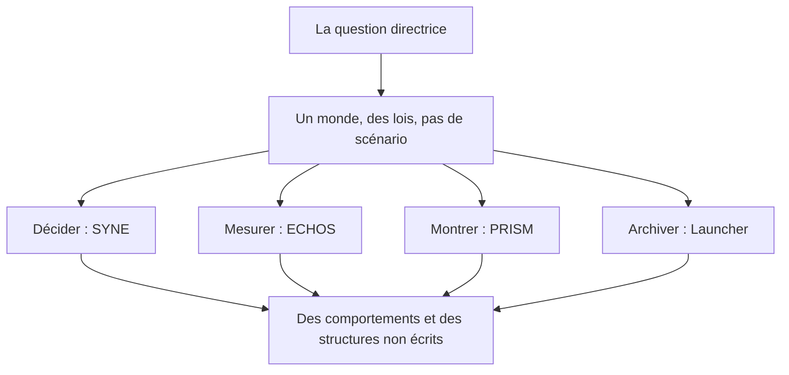

# Chapitre 1. Introduction : la question qui exige un monde

Il y a des questions qu'on ne peut pas trancher en discutant. Il faut construire quelque chose, le laisser tourner, puis regarder honnêtement ce qui se passe. Celle-ci m'accompagne depuis mes premiers mondes virtuels, entre code et image 3D.

**Peut-on construire un environnement virtuel régi par des lois fondamentales, au sein duquel des entités autonomes peuvent produire des comportements et des structures qui n'ont pas été explicitement programmés ?**

Je l'appelle la question directrice, parce qu'elle commande tout le reste. Chaque choix du système (chaque rayon de perception, chaque taux de décroissance de la mémoire, chaque table de la base d'analyse) existe pour la rendre testable au lieu de la laisser à l'état de slogan. Et chaque limite rappelée dans ce livre existe pour ne pas tricher avec elle : un comportement spectaculaire à l'écran ne répond pas à la question si l'on ne peut pas dire quelles règles locales l'ont produit, ni le reproduire.

## 1.1 Une question qu'on ne tranche pas en discutant

On peut discuter longtemps de savoir si des comportements collectifs peuvent apparaître sans être programmés. L'argument a une limite évidente : il compare des intuitions, pas des systèmes. Pour avancer, il faut un objet. Un monde où les règles sont posées, où les comportements ne sont pas écrits, et où l'on peut observer ce qui en résulte, le mesurer, l'analyser et le rejouer.

C'est cet objet que LIVEX construit. Sa valeur ne réside pas dans une réponse définitive, qui n'existe pas encore, mais dans la possibilité de poser la question dans des conditions contrôlées. Un monde qui tourne, avec des lois lisibles et une instrumentation honnête, vaut mieux qu'un slogan bien tourné.

Cette posture a une conséquence immédiate sur le vocabulaire. Le mot « émergence » ne désigne pas, ici, un phénomène magique. Il désigne quelque chose de précis et de vérifiable : une propriété du niveau système qui n'a pas été écrite comme objectif, mais que l'on peut retracer à des interactions locales. C'est pourquoi le livre définit chaque terme chargé avant de l'employer, et pourquoi il sépare avec constance ce qu'on observe de ce qu'on interprète.

On peut formuler la différence ainsi. Une réponse argumentée dira : « il est plausible que des structures sociales apparaissent sans être programmées, car les fourmilières existent ». Une réponse instrumentée dira : « dans ce monde précis, avec ces règles, ce groupe s'est formé au tick précis, avec ces membres précis, et voici la chaîne de causes qui l'a produit ; rejouez la même graine et vous le retrouverez au même endroit ». La première est une intuition située dans une conversation ; la seconde est un fait situé dans un dispositif. Le projet entier est le passage de l'une à l'autre.

## 1.2 Pourquoi les mondes actuels ne suffisent pas à y répondre

J'ai aimé les jeux à mondes ouverts comme beaucoup de gens. Puis je les ai regardés de près. Le garde patrouille toujours au même endroit. Le villageois marche entre deux points. Le village reste identique si l'on laisse tourner la machine pendant des heures. Ce n'est pas de la vie, c'est une illusion orchestrée : des arbres de comportement et des machines à états, aussi sophistiqués soient-ils, restent pré-écrits. Leurs habitants ne peuvent pas décider de former un groupe imprévu, d'inventer une route, de transmettre un savoir à un voisin. Leurs réponses sont des cas prévus, pas des choix.

Restait l'option des modèles de langage : confier la cognition à un réseau qui parle bien. Je l'ai écartée pour le cœur du système, et le livre explique longuement pourquoi. Un grand modèle coûte cher par entité et par tick. Il tire ses réponses au sort au lieu de les reproduire à l'identique. Il ne permet pas de tracer exactement pourquoi telle décision a été prise plutôt qu'une autre. Or la question directrice exige l'inverse : des causes locales inspectables, des trajectoires rejouables, des explications réfutables.

Si un jour un modèle apprenant entre dans LIVEX, ce sera comme une expérience identifiée, comparée à une base qui s'en passe. Jamais comme le moteur de la cohérence du monde.

## 1.3 Une troisième voie

D'où la troisième voie, qui donne son plan au livre. Il ne s'agit ni de scripter les scènes collectives, ni de déléguer la cognition à un modèle opaque. Il s'agit de programmer l'environnement et les lois qui peuvent les permettre : des besoins, des perceptions incomplètes, des souvenirs qui s'effacent, des croyances faillibles, des actions coûteuses, des messages qui se déforment. Puis d'observer, de mesurer, d'analyser et de reproduire.

C'est une posture mécaniste et artisanale. Mécaniste, parce que chaque phénomène doit pouvoir être retracé à ses causes locales, sans narration cachée ni composant opaque. Artisanale, parce que la démarche est celle d'un atelier : construire, expérimenter, douter de ses hypothèses, recommencer, et documenter ce qui a été appris.

Cette posture se traduit dans l'architecture par une séparation stricte des responsabilités. Un composant décide (SYNE, le moteur autoritaire). Un composant mesure sans toucher (ECHOS, l'observatoire). Un composant montre sans décider (PRISM, la scène). Un composant archive pour rejouer (le Launcher). Cette séparation protège la question : elle empêche que la représentation se substitue au monde, que la mesure modifie le mesuré, ou que l'archive relaie au lieu de sceller.

Chaque boîte de ce schéma correspond à une partie du livre. La partie I établit la question et ses fondements. La partie II visite chaque composant. La partie III relie les composants, traite la reproductibilité, les campagnes, les résultats et les limites.

## 1.4 Ce que ce livre va faire, et ne pas faire

Ce livre n'est ni un jeu commercial, ni une preuve d'intelligence, ni une société humaine miniature, ni un moteur physique. C'est le récit complet d'une plateforme expérimentale en temps réel, dans son état réel d'octobre 2026.

Vous y suivrez des entités comme Charlie, dont un calcul de décision complet est détaillé au chapitre SYNE : Charlie choisit de manger plutôt que de socialiser, non parce que je l'ai décidé, mais parce que ses chiffres penchent. Vous verrez pourquoi marcher coûtait trop cher avant une calibration, et comment cette découverte a rendu le monde viable. Vous comprendrez pourquoi un zéro dans une courbe peut signifier « l'instrument n'a rien vu » plutôt que « le monde est vide ». Ces trois exemples, un calcul, un échec corrigé, une mesure honnête, résument la méthode : montrer les mécanismes, assumer les erreurs, distinguer l'observé de l'aveugle.

Chaque chapitre se termine par ce qu'il apporte à la question directrice, et par ce qu'il ne permet pas encore de conclure.

## 1.5 Les trois promesses du livre

Il faut être précis sur ce que le lecteur peut attendre. Le livre tient trois promesses, et trois seulement.

La première est **l'exhaustivité descriptive**. Le lecteur trouvera une description complète du système tel qu'il est construit : chaque composant, chaque mécanisme majeur, chaque contrat, chaque paramètre notable. Rien d'important n'est laissé de côté, et ce qui manque est nommé comme manquant.

La deuxième est **la traçabilité des affirmations**. Chaque chiffre vient d'une source : une option du code, un contrat versionné, une campagne rejouable. Le lecteur qui doute peut remonter à la source. Le livre ne demande jamais un acte de foi.

La troisième est **l'honnêteté sur les limites**. Le livre dit ce qui n'existe pas encore, ce qui est désactivé par défaut, ce qui est hors périmètre, et ce que les mesures ne permettent pas de conclure. Une partie entière, la quatorzième, est consacrée aux limites réelles.

En échange, le livre ne promet pas de résultat scientifique définitif. Il ne promet pas que l'émergence advienne. Il ne promet pas que les chiffres soient spectaculaires. Il promet un dispositif, une méthode et une lecture honnête de l'un et de l'autre.

## 1.6 Ce que ce chapitre apporte à la question directrice

Ce chapitre a établi pourquoi la question exige un objet construit plutôt qu'un débat, pourquoi les mondes scriptés et les modèles opaques ne peuvent pas y répondre, et pourquoi LIVEX choisit la voie mécaniste : des lois locales, explicites, instrumentées, rejouables.

Il a aussi posé le contrat de lecture du livre. Désormais, quand le texte dira « observable », « autonome » ou « émergent », il s'agira de propriétés précises et vérifiables, non d'impressions. Le chapitre suivant dissèque ce que les mondes scriptés et les agents génératifs produisent réellement, afin d'établir avec rigueur la première limite qui justifie tout le reste : le script ne peut pas produire d'histoire propre.

**Ce que ce chapitre ne permet pas de conclure.**

- Il ne démontre pas que la question soit tranchable en l'état : il montre seulement qu'elle exige un objet, et que l'objet est constructible.
- Il n'établit pas que LIVEX réussisse : poser une exigence n'est pas la satisfaire.
- Il ne prouve pas que la voie mécaniste soit la seule possible, ni la meilleure : c'est un choix, argumenté et révisible.
- Il ne garantit pas qu'une observation future soit interprétable : sans les instruments décrits plus loin dans le livre, une surprise resterait une anecdote.
