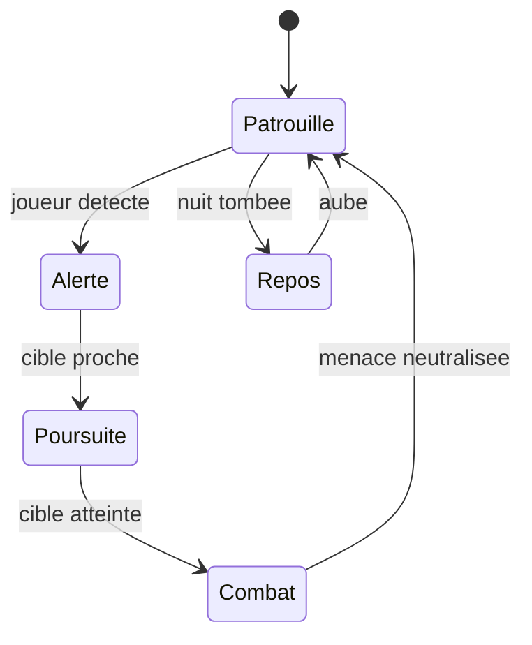
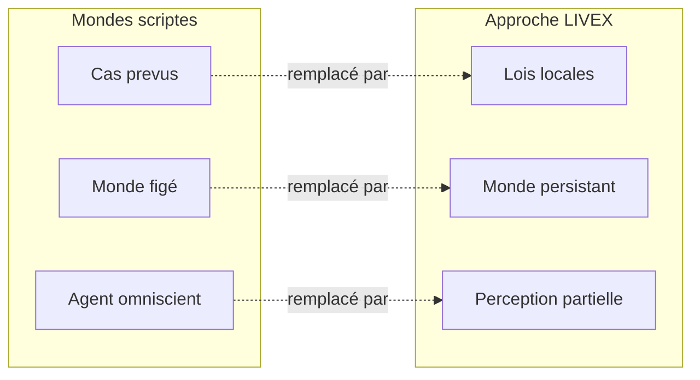

# Chapitre 2. Pourquoi les mondes scriptés ne peuvent pas répondre à la question

Entrez dans n'importe quel village d'un grand jeu de rôle. Les habitants se lèvent, vont au puits, balayent, se couchent. Laissez tourner la machine pendant des heures : le village sera identique. Non parce que ses habitants sont sages, mais parce qu'ils sont des horloges. Chacun suit un arbre de comportement ou une machine à états, par exemple « si le joueur approche, saluer ; si la nuit tombe, dormir », aussi sophistiqué soit-il, fini et pré-écrit. Aucun ne décidera de fonder un groupe imprévu, d'ouvrir une route ou d'oublier puis réinventer un savoir. Leurs vies sont des réponses à des cas prévus, pas des choix.

C'est la première limite que ce livre doit établir, parce qu'elle justifie tout le reste : le script ne peut pas produire d'histoire propre. Il produit de l'illusion orchestrée, précieuse pour le spectacle, inutile pour la question directrice. Ce chapitre détaille quatre limites (le script, le décor, l'omniscience, l'opacité), puis l'intuition naturaliste dont LIVEX procède, avant de définir précisément l'émergence visée.

## 2.1 L'illusion orchestrée : arbres de comportement et machines à états

Les personnages non joueurs d'un jeu moderne reposent, dans la grande majorité des cas, sur deux familles d'outils. Les **machines à états finis** décrivent un nombre fini de situations (patrouiller, attaquer, fuir, dormir) et les transitions autorisées entre elles. Les **arbres de comportement** hiérarchisent des décisions en branches successives, du plus général au plus précis, avec des conditions évaluées à chaque passage.

Ces outils sont excellents pour leur usage : produire des comportements lisibles, réactifs et contrôlables, dans un budget de calcul maîtrisé. Ils souffrent pourtant d'une limite structurelle. Un arbre de comportement, aussi profond soit-il, encode un ensemble de cas prévus. Il ne peut pas engendrer une conduite dont aucun cas n'a été écrit. Le garde existera toujours au même poste. Le villageois suivra toujours la même boucle. La richesse apparente vient du nombre de cas prévus, non d'une capacité à en produire de nouveaux.

Pour la question directrice, la conséquence est nette. Si les comportements collectifs sont écrits à l'avance, on n'observe que ce qu'on a programmé. Un groupe qui se forme à l'endroit prévu par le script ne prouve rien. Il faut donc un mécanisme différent, dans lequel les régularités collectives ne figurent nulle part dans le code, seulement dans les interactions.

Une machine à états comme celle-ci décrit un comportement lisible et presque totalement prévisible. Sa force est de rendre chaque transition explicite ; sa faiblesse, de ne contenir que les transitions écrites. Ajouter un état, c'est ajouter un cas. Le nombre d'états croît avec la finesse voulue, mais la nature du mécanisme ne change pas : il rejoue une partition donnée.

On peut objecter que des arbres très profonds produisent des comportements apparemment surprenants. C'est vrai, et c'est trompeur. Un arbre riche surprend parce qu'il combine beaucoup de cas, non parce qu'il en invente. Le jour où une situation non prévue survient, l'arbre ne produit rien de nouveau : il retombe sur la branche par défaut, ou il échoue. La surprise qu'il procure est celle d'une combinatoire étendue, pas celle d'une genèse.

## 2.2 Le monde décoratif et l'agent omniscient

Deux autres limites complètent la première.

**Le monde décoratif.** Un village de jeu peut sembler vivant. Ses habitants ont des routines, les marchés s'animent, les gardes patrouillent. Mais cette vie est une illusion à l'échelle macroscopique. Les habitants n'ont pas de mémoire partagée, pas de conflits non écrits, pas d'économie qui évolue. Le monde ne produit pas d'histoire : il la rejoue. L'immersion visuelle est réelle, la dynamique collective est figée.

**L'agent omniscient.** Dans de nombreuses simulations, chaque agent connaît l'état complet du monde. Il sait où se trouvent chaque ressource, chaque allié, chaque ennemi. Cette omniscience supprime exactement ce qui, dans le monde réel, produit de la complexité : l'exploration, la surprise, la rumeur, l'erreur. Si tous savent tout, personne n'a besoin de chercher, de croire, de se tromper, ni de transmettre un savoir incertain. L'information parfaite appauvrit le monde.

LIVEX répond à ces deux limites par deux principes qui reviennent dans chaque chapitre : le monde doit pouvoir vivre sans observateur (persistance), et chaque entité ne connaît qu'une partie du monde (observabilité partielle).

## 2.3 L'IA opaque et ses quatre limites

La lignée la plus récente des simulations sociales repose sur des modèles de langage. Un agent génératif s'exprime dans une langue naturelle, se souvient de faits racontés, planifie, et produit parfois des comportements collectifs saisissants. Cette richesse est réelle, mais elle introduit quatre limites incompatibles avec la question directrice.

- **Le coût.** Un modèle de langage est coûteux en calcul. Le faire tourner pour chaque entité à chaque tick est prohibitif dès qu'on veut une population et une durée utiles.
- **La reproductibilité.** Un tel modèle est probabiliste. Deux exécutions avec la même entrée peuvent produire des sorties différentes. Or comparer des expériences exige des trajectoires reproductibles.
- **La traçabilité.** Il est difficile d'expliquer exactement pourquoi un modèle a produit une réponse donnée. Or la question exige de remonter la chaîne causale jusqu'aux causes locales.
- **La cohérence.** Un modèle de langage peut se contredire dans la durée, par exemple oublier un fait établi plus tôt. Or un monde persistant exige une cohérence tenue sur des milliers de ticks.

Position de LIVEX : le modèle opaque est refusé au cœur du monde. Un réseau apprenant peut éventuellement entrer dans le projet, jamais comme mécanisme central de cohérence, mais comme expérience identifiée, comparable à une base qui s'en passe.

Ce refus mérite d'être compris, car il pourrait passer pour un rejet de la modernité. Il n'en est rien. Le projet ne dit pas que les modèles génératifs sont mauvais ; il dit qu'ils ne conviennent pas au rôle qu'exige la question. Un modèle probabiliste par entité et par tick est un instrument merveilleux pour étudier le langage et la narration, et un instrument inadapté pour étudier la causalité locale rejouable. Le refus est un choix de compatibilité, non un jugement de valeur.

| Critère exigé par la question | Script | Agent génératif | LIVEX |
| :-- | :-- | :-- | :-- |
| Comportements non prévus | non | oui | oui, sous réserve d'observation |
| Coût par entité et par tick | faible | élevé | faible |
| Reproductibilité | oui | non | oui |
| Traçabilité de la cause | partielle | faible | complète |
| Cohérence dans la durée | oui | fragile | oui |

## 2.4 L'intuition naturaliste : des structures sans architecte

L'intuition qui a fait naître LIVEX vient d'ailleurs. Des fourmilières sans architecte. Des vols d'oiseaux sans chorégraphe. Des hiérarchies sans décret. Dans la nature, les structures les plus complexes naissent de règles locales appliquées indépendamment par chaque individu.

Cette observation n'est pas nouvelle. Les simulations pionnières l'ont montrée en miniature. *Sugarscape* (Epstein et Axtell, 1996) fait apparaître migration, commerce et conflit à partir de règles simples et de ressources limitées. Les essaims artificiels montrent des organisations robustes sans chef, mais sans cognition. Les agents génératifs montrent une richesse sociale avec langage, mais sans reproductibilité.

Il manquait un cadre qui réunisse plusieurs exigences à la fois : cognition explicite, observabilité partielle, persistance longue, instruments de mesure intégrés, déterminisme. C'est cet espace que LIVEX occupe, avec une priorité que je tiens pour morale autant que technique : un monde mécaniste, où chaque phénomène peut être retracé à ses causes locales, sans narration cachée ni modèle opaque.

L'intuition naturaliste comporte un piège qu'il faut nommer. On pourrait croire que « copier la nature » suffit, et qu'il n'y a qu'à laisser faire. C'est faux, et c'est même l'erreur la plus fréquente de la simulation sociale. La nature n'est pas un algorithme ; elle est un ensemble de contraintes physiques, énergétiques et historiques dont l'interaction produit, parfois, des structures. Reproduire « la nature » demanderait de reproduire ces contraintes, pas seulement leurs effets visibles. LIVEX ne prétend donc pas imiter la nature. Il pose quelques lois suffisantes pour rendre l'inattendu possible, et il assume que cette version simplifiée est un modèle, non une copie.

## 2.5 Les sept principes

De cette exigence naissent sept principes qui irriguent tout le système et reparaissent dans chaque chapitre.

1. **Pas de narration imposée.** Aucune règle du type « au tick 1000, créer un événement » ou « si la population dépasse tel seuil, fonder un village ». Les résultats collectifs ne doivent jamais être préprogrammés.
2. **Autonomie fonctionnelle.** Le moteur fournit aux entités un état, des besoins, une perception, une mémoire, des croyances, des capacités et des actions. Il ne leur dicte pas ce qu'elles doivent faire.
3. **Observabilité partielle.** Une entité ne perçoit qu'une partie du monde. Elle peut se tromper, être mal informée, croire un message faux. Cette imperfection est un moteur de diversité comportementale.
4. **Déterminisme reproductible.** Avec la même graine et les mêmes réglages, la version identique du moteur produit exactement la même trajectoire, au bit près.
5. **Persistance.** Le monde continue d'exister sans observateur. Il peut être sauvegardé, arrêté et repris sans discontinuité.
6. **Indépendance du rendu.** Le moteur fonctionne sans écran. La scène reflète l'état du monde, elle ne décide jamais.
7. **Observabilité scientifique.** Chaque décision, chaque action, chaque interaction est tracée et analysable. L'instrument observe sans modifier le phénomène.

Ces principes ne sont pas décoratifs : chacun ferme une porte précise. Le premier interdit le scénario. Le deuxième interdit la télécommande. Le troisième interdit l'omniscience. Le quatrième interdit l'aléa incontrôlé. Le cinquième interdit le monde qui n'existe que sous le regard. Le sixième interdit la représentation décideuse. Le septième interdit l'observation qui perturbe. Ensemble, ils dessinent un espace étroit : il ne reste presque rien à décider, sinon les lois locales elles-mêmes. C'est exactement l'intention.

## 2.6 Émergence faible : du surprenant mais analysable

Le mot « émergence » doit être manié avec prudence. Ce livre distingue l'émergence faible de l'émergence forte.

L'**émergence forte** désigne l'apparition de propriétés fondamentalement nouvelles, irréductibles aux propriétés des composants, au sens où la conscience est parfois présentée. LIVEX ne prétend pas produire cela.

L'**émergence faible** désigne l'apparition, au niveau du système, de propriétés qui n'ont pas été spécifiées comme objectifs, mais qui restent des conséquences analysables des interactions locales. C'est cette émergence que LIVEX vise. Quand des entités assoiffées convergent vers la même source, s'y côtoient, s'y parlent et s'y lient, et qu'un groupe apparaît là où aucun script n'a écrit « fondez un groupe », la chaîne causale reste lisible, du besoin individuel à la structure collective.

Cette distinction est décisive pour la scientificité du projet. Elle signifie que les phénomènes observés doivent pouvoir être analysés, expliqués et reproduits, sans recours à des concepts mystérieux. Ni conscience, ni intelligence générale, ni société humaine miniature : un système abstrait qui permet d'explorer certains mécanismes, sans remplacer ni les données empiriques ni les méthodes des sciences humaines.

On peut résumer le critère par une question unique, qui servira de test dans tout le livre : **peut-on remonter la chaîne des causes, et la rejouer ?** Si oui, le phénomène est une émergence faible analysable. Si l'on ne peut que le constater sans l'expliquer, ce n'est pas encore un résultat ; c'est une énigme, et une énigme n'entre pas dans un livre de méthode. Le projet préfère une structure modeste et expliquée à un prodige inexplicable.

## 2.7 Ce que ce chapitre apporte à la question directrice

Ce chapitre a établi quatre limites (le script pré-écrit, le décor figé, l'omniscience, l'opacité) et sept principes de conception (pas de narration, autonomie, partialité, déterminisme, persistance, indépendance du rendu, observabilité). Il a aussi défini l'émergence visée comme faible et analysable.

Il ne prouve encore rien sur la faisabilité : il énonce ce que le projet refuse de faire, et pourquoi. Le chapitre suivant prend la question au mot, terme après terme, pour traduire chaque promesse en exigences testables et confronter ces exigences à ce qui est réellement construit dans l'état V0.1.

**Ce que ce chapitre ne permet pas de conclure.**

- Il ne démontre pas que les mondes scriptés soient incapables de toute surprise : sa critique porte sur la **narration pré-écrite**, pas sur la technique qui la produit.
- Il n'établit pas que LIVEX échappe lui-même à ces limites : il énonce des refus, il ne prouve pas qu'ils suffisent.
- Il ne prouve pas que l'émergence faible soit la seule émergence concevable, seulement qu'elle est la seule qui puisse être analysée avec les moyens prévus.
- Il ne garantit pas que les sept principes tiennent à l'échelle : plusieurs supposent une population et des durées encore modestes.
