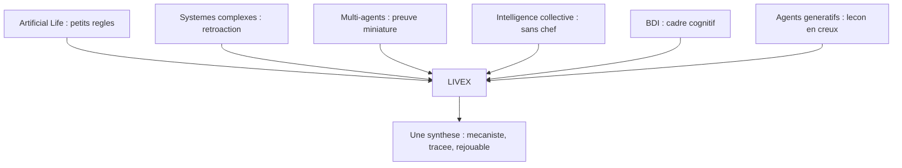

# Chapitre 3. Six lignées pour une question

Ma question n'est née seule. Elle s'inscrit dans six lignées que je raconte ici non comme un catalogue, mais comme les six réponses partielles dont LIVEX tente la synthèse. Chacune explique un choix du système actuel. Aucune n'est citée pour décorer : chacune a laissé une trace vérifiable dans le code ou la méthode.

Lire ce chapitre comme une généalogie aide à comprendre la suite. Chaque fois qu'un chapitre technique décrira un mécanisme, on pourra se demander de quelle lignée l'idée provient, et ce que LIVEX y a changé. Une lignée ne donne pas seulement une inspiration : elle donne aussi une limite. Ce qu'une tradition n'a pas su résoudre indique l'endroit où le projet doit être neuf.

**Pourquoi ce chapitre importe pour la question directrice.** Aucune question de recherche ne naît seule : elle hérite de traditions qui ont chacune apporté une pièce. Situer LIVEX dans ces lignées revient à montrer que la question directrice n'est pas une intuition isolée, mais une synthèse : à l'Artificial Life, l'audace de ne pas programmer le résultat ; aux systèmes complexes, la rétroaction ; au multi-agents, la preuve miniature ; à l'intelligence collective, la robustesse sans chef ; au BDI, le cadre de la décision ; aux agents génératifs, la leçon en creux. Chaque dette éclaire un choix du projet, et donc une manière de répondre à la question.

## 3.1 Artificial Life : l'audace de ne pas programmer le résultat

L'Artificial Life (ALife) étudie les systèmes vivants à travers des systèmes artificiels. Le terme a été popularisé par Christopher Langton lors du premier colloque sur le sujet en 1987, avec la formule programmatique « la vie telle qu'elle pourrait être », par opposition à la vie telle qu'elle est. L'ALife ne cherche pas à simuler des organismes biologiques existants ; elle cherche à comprendre les principes du vivant (auto-organisation, adaptation, reproduction, évolution) à travers des systèmes simplifiés.

Trois exemples emblématiques ont marqué cette lignée : les automates cellulaires de Conway (*Game of Life*, 1970), les fourmis artificielles et l'optimisation par colonies de fourmis de Dorigo (1992), et les créatures virtuelles de Karl Sims (1994).

**Ce que LIVEX en hérite.** Une conviction : un petit jeu de règles peut engendrer des dynamiques riches, à condition d'accepter de ne pas programmer le résultat. Un environnement qui a une matière : des réserves qui s'épuisent et se régénèrent, une géographie qui résiste, des rythmes qui scandent. Sans cette matière, l'inattendu n'a nulle part où naître.

**Ce que LIVEX y ajoute.** L'ALife classique produit de la richesse morphologique ou spatiale, rarement de la richesse sociale. Ses créatures évoluent, mais elles ne forment guère de groupes, ne se font pas confiance, ne se trompent pas mutuellement. LIVEX garde l'audace de l'émergence, mais déplace l'objet : ce n'est plus la forme de la créature qui émerge, c'est la structure de la société. Il lui faut donc, en plus de la matière, une cognition et une communication, ce que l'ALife fournit rarement.

## 3.2 Systèmes complexes : la rétroaction comme cœur et comme point critique

La science des systèmes complexes étudie les systèmes composés de nombreux éléments en interaction, dont le comportement global est difficile à prédire à partir des propriétés individuelles. Les travaux de John Holland (*Emergence: From Chaos to Order*, 1998), de Murray Gell-Mann et de la Santa Fe Institute ont établi les fondements du domaine.

Les propriétés clés sont l'émergence (le global résulte des interactions locales), l'adaptation (les agents modifient leur comportement selon l'environnement), l'auto-organisation (des structures apparaissent sans ordonnateur central) et la rétroaction (les résultats des actions modifient les conditions qui les ont produites).

**Ce que LIVEX en hérite.** Le monde de LIVEX est pensé comme un système complexe. Les entités sont adaptatives : leur décision dépend de leur état et de leur perception. Les groupes, revus à intervalle régulier, modifient les interactions futures. Les boucles de rétroaction sont le cœur du projet et, en même temps, son point le plus critique. C'est parce que les résultats modifient leurs propres conditions qu'il faut mesurer sans toucher.

**Ce que LIVEX y ajoute.** Une exigence de traçabilité. Les systèmes complexes se contentent souvent de constater un comportement global ; LIVEX veut pouvoir remonter, pour chaque décision, à la chaîne complète des causes locales. Cette exigence change la nature du projet : il ne suffit pas que le comportement apparaisse, il faut encore qu'il soit explicable, décision par décision. C'est ce que permet la chaîne de traçabilité de la boucle.

## 3.3 Simulation multi-agents : la preuve miniature

La simulation multi-agents (MAS, *Multi-Agent System*) est un paradigme de modélisation dans lequel des agents autonomes interagissent dans un environnement partagé. Les travaux de Joshua Epstein et Robert Axtell avec *Sugarscape* (1996) ont démontré que des structures sociales complexes (migration, commerce, guerre, culture) pouvaient émerger de règles individuelles simples placées dans un environnement aux ressources limitées.

Les principes fondamentaux du MAS sont l'autonomie (chaque agent décide), l'hétérogénéité (les agents peuvent différer), l'interaction locale (les agents n'interagissent qu'avec leurs voisins) et l'environnement partagé (un espace commun).

**Ce que LIVEX en hérite.** Les quatre piliers, auxquels s'ajoute ce qui manquait. L'autonomie, par l'utilité transparente. L'hétérogénéité, par huit traits tirés autour d'une valeur neutre, singuliers par individu. L'interaction locale, par une perception de cinquante unités et une parole de cinquante-cinq, avec une ligne de vue masquée par les obstacles. L'environnement partagé, par des réserves finies. Et surtout, une mémoire qui s'efface selon une exponentielle, des croyances bornées qui expirent, une communication dégradable. Deux entités au même endroit peuvent ainsi voir deux mondes différents et décider différemment. C'est ce que LIVEX ajoute à *Sugarscape*.

**Ce que LIVEX y ajoute.** La persistance longue et le déterminisme. La plupart des simulations multi-agents tournent quelques milliers de pas et s'arrêtent ; LIVEX veut pouvoir sauvegarder, reprendre et rejouer, à l'identique, un monde qui a vécu. Cette contrainte technique est ce qui rend l'expérience scientifique possible, car elle autorise la comparaison contrôlée.

## 3.4 Intelligence collective : la robustesse sans chef

L'intelligence collective étudie comment des systèmes distribués, sans contrôleur central, produisent des structures ou des solutions globales adaptatives. Les travaux d'Eric Bonabeau, Marco Dorigo et Guy Theraulaz (*Swarm Intelligence*, 1999) ont synthétisé les principes de l'intelligence en essaim : autonomie des agents, émergence de comportements collectifs, fonctionnement distribué.

Les systèmes d'essaim (fourmis, abeilles, poissons, oiseaux) montrent comment des règles locales simples, par exemple « suis ton voisin » ou « va vers la source de nourriture la plus proche », produisent des organisations robustes et adaptatives.

**Ce que LIVEX en hérite, et ce dont il se distingue.** LIVEX retient la robustesse sans chef, mais ne se contente pas de suivre des voisins. Il veut du raisonnement. Les entités de LIVEX ne se contentent pas de suivre une règle d'essaim ; elles raisonnent, se souviennent, communiquent parfois de travers, coopèrent ou s'affrontent. L'intelligence collective, ici, émerge non pas de règles de suivi, mais de l'interaction entre cognition individuelle et contraintes environnementales.

**Ce que LIVEX y ajoute.** La possibilité de l'échec. Un essaim est robuste par construction : ses règles de suivi garantissent la cohésion. LIVEX, au contraire, laisse les entités se tromper, se méfier, s'ignorer. Une structure collective, ici, peut ne jamais apparaître, ou apparaître puis disparaître. Cette fragilité n'est pas un défaut : c'est ce qui rend l'observation intéressante. Un système qui produit toujours le même résultat n'a rien à révéler.

## 3.5 Architectures cognitives BDI : le cadre organisationnel

L'architecture BDI (*Beliefs, Desires, Intentions*) est un modèle cognitif pour agents rationnels, proposé par Anand Rao et Michael Georgeff en 1995. Elle structure le raisonnement en croyances (ce que l'entité tient pour vrai, correct ou erroné, complet ou partiel), désirs ou objectifs (ce qu'elle cherche à obtenir), et intentions (ce à quoi elle s'engage).

Le cycle BDI suit une séquence : perception, mémoire, croyances, besoins, objectifs, évaluation, délibération, intention, action, conséquences, nouvelles perceptions.

**Ce que LIVEX en hérite.** LIVEX adopte le formalisme BDI comme structure d'organisation du raisonnement. Il ne cherche pas à implémenter une théorie philosophique de l'esprit. BDI sert de cadre organisationnel : les croyances décrivent le modèle interne de l'entité, les objectifs expriment ses motivations, les intentions représentent ses engagements d'action. La sélection d'action utilise une approche par utilité, entièrement transparente et explicable. Le chapitre SYNE détaille le calcul complet d'une décision réelle, celle de Charlie.

**Ce que LIVEX y ajoute.** L'opérationnalisation chiffrée. Là où le BDI classique reste souvent descriptif (l'entité a des croyances et des désirs), LIVEX donne à chaque terme une valeur numérique, une règle de mise à jour et une trace. Une croyance a une confiance entre zéro et un. Un objectif a une priorité calculée. Une intention a une durée et un seuil d'interruption. Cette concrétion est ce qui rend le cadre vérifiable plutôt que philosophique.

## 3.6 Agents génératifs et modèles de langage : la leçon en creux

Les travaux récents sur les agents génératifs à base de modèles de langage (*Generative Agents*, Joon Sung Park et al., 2023) ont démontré qu'un petit nombre d'agents dotés de mémoire narrative, de réflexion et de planification pouvaient produire des comportements sociaux riches dans un environnement simulé.

Cette approche présente cependant des limites décisives pour la question directrice : le coût par entité et par tick, la non-reproductibilité du modèle probabiliste, l'intraçabilité de la causalité, et la cohérence fragile dans la durée.

**Ce que LIVEX en hérite.** Une leçon en creux. Pour répondre à la question, il fallait refuser le modèle opaque au cœur du monde. Aucun réseau de neurones ne décide dans LIVEX à l'état décrit. Si un tel modèle y entre un jour, ce sera comme une expérience identifiée, comparée à une base qui s'en passe.

**Ce que LIVEX y ajoute.** Une alternative mesurable. Là où les agents génératifs montrent ce qu'on peut obtenir avec un langage riche, LIVEX montre ce qu'on peut obtenir avec une cognition pauvre mais transparente. Les deux expériences ne se remplacent pas : elles répondent à deux questions différentes. LIVEX répond à « que produit un ensemble de lois locales et rejouables ? ». La question n'exige pas de langage ; elle exige des causes lisibles.

## 3.7 Ce que chaque lignée explique d'un choix du projet

Les six lignées ne sont pas une bibliographie : elles sont une généalogie de décisions.

| Lignée | Réponse partielle | Choix de LIVEX |
| :-- | :-- | :-- |
| Artificial Life | un petit jeu de règles produit de la richesse | un environnement qui a une matière, non un décor |
| Systèmes complexes | le global naît du local, la rétroaction compte | entités adaptatives, groupes revus, instrumenter sans toucher |
| Multi-agents | migration, commerce et conflit depuis du simple | autonomie, hétérogénéité, localité, plus une cognition faillible |
| Intelligence collective | robustesse sans chef | raisonnement individuel contraint plutôt que suivi de voisins |
| BDI | structure du raisonnement rationnel | croyances, objectifs, intentions, décidées par utilité transparente |
| Agents génératifs | richesse sociale sans reproductibilité | refus du modèle opaque au cœur du monde |

On peut ajouter, pour chaque lignée, ce que LIVEX lui doit de plus concret. À l'ALife, la matière du monde et l'idée de rythmes. Aux systèmes complexes, la notion de rétroaction et l'exigence de mesurer sans perturber. Au multi-agents, la preuve qu'un environnement contraint suffit à faire naître du social. À l'intelligence collective, l'idée d'une robustesse sans autorité. Au BDI, l'architecture en trois composantes et le cycle de la décision. Aux agents génératifs, la leçon négative : ce qu'il faut refuser pour garder la traçabilité.

## 3.8 Ce que ce chapitre apporte à la question directrice

Ce chapitre a situé LIVEX dans six lignées et montré que chaque choix du projet répond à une réponse partielle trouvée ailleurs. Ni l'ALife, ni les systèmes complexes, ni le multi-agents, ni l'intelligence collective, ni le BDI, ni les agents génératifs ne suffisent seuls. LIVEX tente leur synthèse autour d'un invariant : un monde mécaniste, traçable et rejouable.

Reste à payer les dettes conceptuelles. Le chapitre suivant, plus technique, définit chaque concept central avec son histoire, sa formule lorsqu'elle existe, son usage exact dans LIVEX et sa mise en garde.

**Ce que ce chapitre ne permet pas de conclure.**

- Il ne prétend pas que les six lignées soient exhaustives : d'autres traditions (vie artificielle générative, systèmes dynamiques hors équilibre, économie expérimentale) pourraient revendiquer une place.
- Il n'établit pas qu'une synthèse soit supérieure à chacune prise séparément : c'est une hypothèse de conception, que l'expérience devra confronter.
- Il ne garantit pas que les emprunts restent valides hors de leur contexte d'origine : une architecture cognitive conçue pour un robot n'a pas les mêmes contraintes qu'une entité de monde virtuel.
- Il ne fige pas l'état de l'art : une lignée pourrait évoluer et rendre un choix du projet obsolète.
