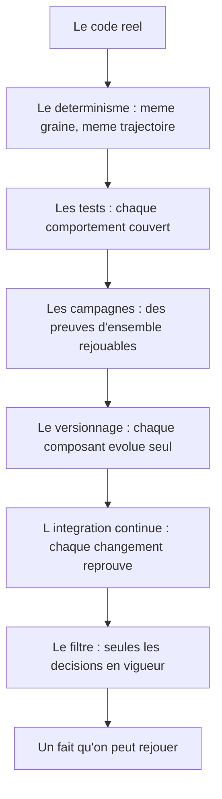

# Chapitre 4. La méthode : ne croire que ce qui se rejoue

Une phrase gouverne ce projet jusque dans ses tests : en cas de doute entre un document et le code, le code prime. Non par mépris de l'écrit, ce livre en est la preuve, mais parce que la question directrice exige des faits rejouables, pas des descriptions flatteuses. Chaque paramètre cité dans ce livre est le défaut réel du moteur 0.15.0, chaque route une route implémentée, chaque garantie un test nommé que le lecteur peut relancer.

Ce chapitre explique la méthode en six volets : le primat du code, le déterminisme comme contrat, les tests comme preuve, les campagnes rejouables, le versionnage et le filtrage des décisions, et l'intégration continue qui exécute tout le reste à chaque changement.

La méthode n'est pas un supplément de rigueur ajouté après coup. Elle est la condition de tout le reste. Sans elle, le projet serait une collection d'impressions : « il me semble que des groupes apparaissent », « cette calibration a l'air meilleure ». Avec elle, chaque affirmation devient une proposition qu'on peut vérifier, contester et corriger. C'est cette bascule, de l'impression à la proposition vérifiable, que le chapitre décrit.

**Pourquoi ce chapitre importe pour la question directrice.** Une réponse à une question de recherche n'a de valeur que si l'on peut la vérifier. La méthode de LIVEX n'est donc pas un ornement : c'est ce qui rend la question directrice décidable. Le code prime sur les intentions, le déterminisme rend les comparaisons possibles, les tests et les campagnes fournissent des preuves, et le filtre des décisions évite de présenter une intention ancienne comme un fait. Sans cette méthode, la question resterait rhétorique.

## 4.1 Le code prime

Documenter un logiciel qui évolue expose à un piège : décrire une intention ancienne comme si elle était un état présent. Pour l'éviter, la méthode part du code. On lit les options réellement parsées, les valeurs réellement employées, les contrats réellement émis. On ne conserve d'un document plus ancien que ce qui reste vrai et vérifiable. Un chiffre non vérifié n'entre pas dans le livre.

Cette discipline a un coût : elle ralentit la rédaction et oblige à recouper. Elle a un bénéfice : elle rend chaque affirmation défendable. C'est le prix de la crédibilité, et c'est aussi ce qui distingue ce livre d'une brochure.

Le primat du code produit une conséquence parfois inconfortable : il oblige à écrire des phrases déplaisantes. « Cette capacité est livrée mais désactivée par défaut. » « Cette valeur a changé lors d'une calibration, et la trajectoire de référence aussi. » « Cette métrique a été renommée parce que son ancien nom mentait. » Un livre écrit pour séduire éviterait ces phrases. Un livre écrit pour être cru les recherche. Le lecteur trouvera donc, tout au long de l'ouvrage, des aveux de ce genre : ce sont eux qui font la valeur du reste.

Ces aveux ont une forme systématique, rassemblée dans l'annexe J : ce qui a été conservé du prototype, ce qui a été changé et pourquoi, ce qui a été abandonné, et ce que les calibrations ont corrigé. Un lecteur qui rencontre une valeur ou une formule dans un document plus ancien y trouvera la réponse à la seule question qui compte : est-ce encore vrai ?

Un mot sur la manière dont le livre traite les documents secondaires. Les décisions d'architecture rédigées, les notes de conception et les rapports internes existent, mais ils n'ont pas autorité. Ils servent de contexte, jamais de preuve. Lorsqu'un document et le code divergent, c'est le code qui tranche, et le livre signale la divergence. Cette hiérarchie simple évite le travers le plus courant de la documentation logicielle : la description d'un système idéal qui n'existe plus.

## 4.2 Le déterminisme comme contrat moral

Le déterminisme est, avant d'être technique, un engagement de méthode. Même graine, mêmes réglages, même version de moteur : même trajectoire, au bit près. Sans cette garantie, il devient impossible de distinguer une conséquence d'une règle d'un effet accidentel de l'aléatoire ou de l'ordre d'exécution.

Le dispositif repose sur plusieurs piliers. Un générateur pseudo-aléatoire unique et sérialisable, xoshiro256** initialisé par splitmix64, dont l'état complet (quatre fois soixante-quatre bits) est sauvegardé et restauré. Un ordre causal strict dans la boucle. Aucun aléa caché dans les serveurs de transport. Une persistance qui restaure l'état en place au lieu de rejouer la simulation. Des checksums dorés qui attestent que la trajectoire n'a pas changé.

Lorsque la trajectoire a été volontairement modifiée, par exemple lors des calibrations, cela a été assumé par un changement de version et un ré-épinglage des checksums dans le même geste. L'échelle temporelle configurable, elle, laisse le défaut inchangé au bit près : la liberté nouvelle ne falsifie pas le passé. Le détail complet du dispositif de déterminisme fait l'objet du chapitre 11.

Pourquoi parler de contrat **moral** et non seulement technique ? Parce qu'un déterminisme peut être simulé : il suffit de verrouiller suffisamment de choses pour que la plupart des runs se ressemblent, puis d'accepter quelques divergences rares. Un tel « déterminisme de façade » suffirait à une démonstration, mais pas à une expérience. Le projet refuse cette facilité. Le déterminisme est une promesse tenue ou non, vérifiable par comparaison d'empreintes, et quand elle est rompue, le livre le dit. C'est cette exigence qui fait qu'une observation est un résultat plutôt qu'une anecdote.

## 4.3 Les tests comme preuve

Les tests sont la seconde face de cette méthode. À l'état décrit, les suites exécutées localement le 12 octobre 2026 totalisent 1 258 tests réussis et 16 tests ignorés, sans échec : 634 côté moteur SYNE (548 pour le cœur et 86 pour la console), 361 côté ECHOS, 217 côté Launcher (164 unitaires, 20 d'intégration et 33 de bout en bout) et 46 côté `syne-mock` (deux tests supplémentaires étant ignorés sous Windows, faute de livraison des signaux d'arrêt).

Ces chiffres ne sont pas une fierté : ils sont une condition. Ils indiquent qu'un comportement décrit a été couvert par un test, non que l'ensemble du projet est prouvé. La couverture de lignes mesurée est de 90,55 % pour ECHOS et de 87,41 % pour les assemblages SYNE agrégés (90,43 % pour le cœur, 74,03 % pour la console), au-dessus du seuil de 80 % fixé par le projet.

| Suite | Tests réussis | Tests ignorés | Couverture de lignes |
| :-- | --: | --: | --: |
| SYNE, cœur | 548 | | 90,43 % |
| SYNE, console | 86 | | 74,03 % |
| SYNE, agrégé | 634 | | 87,41 % |
| ECHOS | 361 | | 90,55 % |
| Launcher | 217 | | |
| `syne-mock` | 46 | 2 (Windows) | |
| Total local | 1 258 | 16 | |

Le livre est explicite sur la portée des tests. Un test vert confirme le comportement qu'il couvre. Il ne valide pas l'ensemble du contrat entre composants. Les tests SYNE et ceux de `syne-mock` valident des produits distincts : leur réussite ne démontre pas que les deux simulations sont équivalentes. Et aucun résultat automatisé de PRISM ne peut être déduit de la réussite des autres composants.

Deux points de vigilance sont assumés. Un test de débit (le plancher de performance à mille entités) est sensible à la charge de la machine et échoue sous instrumentation de couverture ; il est exclu de la mesure de couverture, sans que cela indique une régression du moteur. Un test de launcher échoue également sous le collecteur de couverture pour une raison d'infrastructure ; il passe en exécution standard. Ces exclusions sont documentées, non dissimulées.

Il faut souligner ce que signifie « documenté, non dissimulé ». Un test qu'on retire silencieusement pour faire passer une barrière verte serait une falsification. Un test dont on explique qu'il est incompatible avec l'instrumentation de couverture, et qu'on exclut de la mesure de couverture en le gardant en exécution standard, est une décision d'ingénierie assumée. La différence entre les deux est exactement le sujet de ce chapitre : la méthode consiste à dire ce qu'on fait, y compris quand c'est peu flatteur.

## 4.4 Les campagnes rejouables

Au-dessus des tests unitaires, des campagnes rejouables servent de preuves d'ensemble. La stabilisation sur 2 500 ticks vérifie qu'un monde peuplé de cinquante à cent entités ne s'éteint pas sur plusieurs graines. L'enchaînement par réinitialisation vérifie qu'on peut comparer plusieurs populations dans une même session sans rouvrir le monde. La mesure de cadence et de rattrapage vérifie le comportement sous pression. Les benchmarks honnêtes mesurent le débit réel, y compris là où il échoue. La validation Windows vérifie l'ensemble sur une machine réelle.

Ces campagnes sont exécutées par des scripts rejouables. Ce sont donc des preuves, pas des récits. Le chapitre 12 raconte chacune d'elles.

Une campagne se distingue d'un test par son objet. Un test vérifie un comportement précis, dans une condition précise. Une campagne vérifie une propriété d'ensemble, sur une population et une durée. Par exemple : « un monde de cent entités ne s'éteint pas avant 2 500 ticks, sur cette famille de graines ». Une telle propriété ne peut pas se vérifier par un test unitaire ; il faut faire tourner des mondes entiers, plusieurs fois, et comparer. C'est pourquoi les campagnes existent au-dessus des tests, et pourquoi elles sont rejouables : une propriété d'ensemble n'est une preuve que si l'on peut refaire l'expérience qui l'a établie.

Ces campagnes illustrent aussi une limite : elles prouvent ce qu'elles testent, et rien de plus. Une campagne de stabilisation ne dit pas que les comportements sont intéressants ; elle dit que le monde survit. Le livre sépare soigneusement « le monde vit » et « le monde produit quelque chose de notable ». Confondre les deux serait la faute la plus grave possible dans un projet de ce genre.

## 4.5 Versionnage indépendant et filtre des décisions

Le projet versionne chaque composant indépendamment, un numéro global n'apparaissant que lors des livraisons assemblées. Les conventions de version (format, incréments, compatibilité) sont uniques et partagées. Cette organisation évite qu'une évolution locale d'un composant force une renumérotation de tout le projet.

Les décisions d'architecture font l'objet d'un filtre strict. Seules sont conservées les décisions acceptées, réellement implémentées et toujours en vigueur dans l'état décrit. Les pistes abandonnées, les propositions non traduites en code et les documents sans impact sur l'état courant sont écartés. Ce filtre évite de présenter une intention ancienne comme une réalité présente. C'est la même discipline que le primat du code, appliquée aux documents de décision.

Le versionnage indépendant a une vertu souvent sous-estimée : il permet d'énoncer une compatibilité sans mentir. Le contrat d'observabilité du moteur peut évoluer sans que l'analyse doive changer en même temps, à condition que la règle de compatibilité ascendante soit respectée. Le livre peut donc dire, précisément, quelle version parle à quelle autre, et sous quelle condition. Une version globale unique aurait caché ces distinctions derrière un numéro unique, et obligé à des affirmations vagues.

## 4.6 L'intégration continue et la distribution

L'intégration continue s'exécute sur Linux et Windows ; à l'état décrit, la branche principale est verte, treize jobs sur treize. La distribution, elle, repose sur des artefacts natifs et un orchestrateur, les conteneurs ayant été retirés par arbitrage assumé. Cette décision raconte la même philosophie : ne promettre que ce qui tourne, archiver ce qui a tourné, pouvoir le rejouer.

Le retrait des conteneurs mérite une phrase, parce qu'il est représentatif. Une solution à la mode avait été essayée, puis abandonnée au profit d'artefacts natifs plus proches du terrain. Le livre ne cache pas ce genre de revirement : il montre que la méthode n'est pas de suivre les outils du moment, mais de choisir ceux qui tiennent la promesse de reproductibilité. Un conteneur n'est pas intrinsèquement meilleur ou pire ; il ne convenait pas ici, et le projet l'assume.

## 4.7 Ce que ce chapitre apporte à la question directrice

Ce chapitre a exposé la méthode qui rend le reste du livre vérifiable : le code prime, le déterminisme est un contrat, les tests et les campagnes sont des preuves, le versionnage est indépendant et les décisions filtrées. Grâce à elle, la question directrice peut être instruite sans complaisance.

Le chapitre suivant complète cette méthode par une vue d'ensemble du projet : sa vision, le pourquoi de sa découpe en quatre responsabilités, et l'architecture globale de référence.
