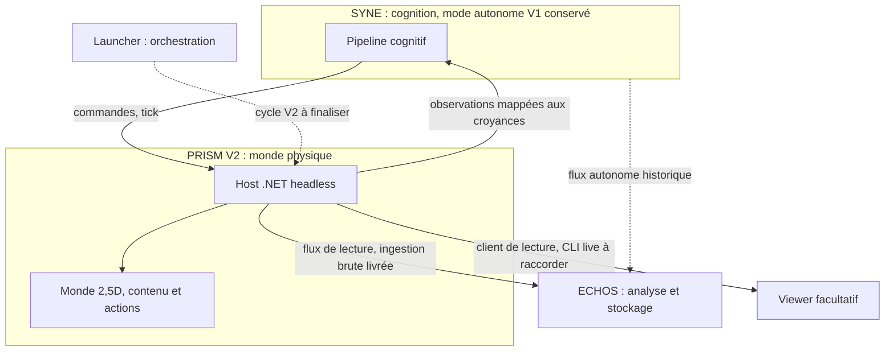

# Chapitre 4b. Le projet : pour construire ainsi, vision et architecture globale

Pourquoi quatre composants plutôt qu'un seul programme ? Pourquoi séparer décider, mesurer, montrer et archiver ? Ce chapitre répond en partant de la question décomposée : chaque découpage existe pour empêcher une triche précise, et l'architecture globale est la forme visible de cette vigilance.

## 4b.1 La vision en une phrase

La vision tient en une phrase : **rendre observables les mécanismes à l'origine des comportements collectifs, en séparant le moteur de simulation, l'analyse et la représentation.**

Cette phrase porte plusieurs refus. LIVEX n'est pas un jeu commercial (aucune boucle de divertissement prescrite). Ce n'est pas une preuve d'intelligence (aucune conscience affirmée). Ce n'est pas une société miniature (un système abstrait). Ce n'est pas un moteur physique (un plan continu sans réalisme mécanique). Ce n'est pas une validation automatique : les chiffres sont accompagnés de leur provenance et de leurs réserves.

La communication du projet découle de cette vision : montrer comment le système est conçu, ce qu'il permet d'observer dans sa version, ce qu'il ne permet pas d'affirmer, et comment il évolue. La narration publique suit le même cap que le livre : des preuves plutôt que des superlatifs, des limites plutôt que des promesses.

On peut opposer deux manières de présenter un projet comme celui-ci. La première fait de la promesse le centre : « un monde où une société émerge toute seule ». La seconde fait de la méthode le centre : « un dispositif capable d'observer, honnêtement, si et comment une structure apparaît ». La première attire vite et déçoit ensuite. La seconde exige un effort et se vérifie. Le projet a choisi la seconde, et le livre ne s'en écarte jamais.

## 4b.2 Des responsabilités qui évoluent entre V1 et V2

Les frontières du projet sont stables, mais leur emplacement a changé. En V1,
SYNE détenait le monde et PRISM/Unreal le représentait. En V2, PRISM porte
l'état physique ; SYNE reçoit les observations et traite les décisions
cognitives. L'extraction du monde depuis SYNE est engagée par étapes, mais
n'est pas terminée. Un texte rigoureux doit donc nommer la version avant
d'attribuer l'autorité du monde.

- **SYNE** reste le moteur cognitif et le moteur historique autonome. Dans le
  couplage V2, il applique à ses croyances les observations PRISM et produit
  les intentions des agents.
- **PRISM V2** possède l'état physique du monde, exécute les commandes et
  publie observations, événements et flux de lecture. Le viewer est un client,
  jamais l'autorité de simulation.
- **ECHOS** mesure et stocke sans écrire dans le monde. Il ingère le flux SYNE
  historique et possède un chemin séparé pour valider et conserver les
  enveloppes PRISM. La seconde voie n'est pas encore raccordée au cycle
  analytique complet des runs.
- **Le Launcher** orchestre la release V1. Ses lanes d'intégration PRISM V2
  restent à compléter.

| Composant | V1 | V2 au 4 novembre 2026 | Frontière à préserver |
| :-- | :-- | :-- | :-- |
| SYNE | Monde et cognition | Cognition couplée ; extraction du monde incomplète | Ne pas présenter les anciennes tables SYNE comme l'état physique PRISM |
| PRISM | Représentation Unreal, via PRISM-LDK | Monde .NET autoritaire, rendu facultatif | Le viewer ne fait pas avancer la simulation |
| ECHOS | Ingestion et analyse des flux SYNE | Ingestion brute PRISM présente, analyse de production à raccorder | Ne pas inventer les mesures absentes du contrat |
| Launcher | Orchestration et archivage V1 | Raccordement PRISM V2 partiel | Ne pas assimiler un manifeste à une intégration complète |
| `syne-mock` | Émulation de contrat V1 | N'est pas le moteur des campagnes PRISM | Un mock ne remplace pas la validation sur SYNE réel |

## 4b.3 Architecture globale au 4 novembre 2026

Le schéma distingue les flux historiques des échanges V2 déjà exercés. Un trait
plein représente une capacité implémentée ; le trait pointillé marque un
raccordement encore incomplet.

La boucle de transport SYNE→PRISM→SYNE a été exercée sur 1 000 ticks. Cette
mesure ne vaut pas validation R2 : le run couplé de 5 000 ticks, ses répétitions
à empreintes identiques et la reprise partagée restent à faire. ECHOS persiste
les enveloppes PRISM, mais ne les a pas encore raccordées à l'analyse du run
supervisé. Le viewer sait consommer des messages, mais l'aperçu n'est pas
encore une session live.

La release V1 reste disponible et possède son propre relevé de tests. Les
compteurs V2 ne doivent pas être additionnés aux compteurs V1 comme s'ils
provenaient d'une seule exécution. Les versions et les preuves par composant
sont datées dans le [statut transversal actuel](../governance/LIVEX-CURRENT-STATUS.md).

## 4b.4 Les niveaux du Launcher

Le Launcher n'est pas un simple bouton de démarrage. Il organise le projet en niveaux, du composant jusqu'au paquet scellé, et cette organisation mérite d'être posée dès maintenant, car les chapitres suivants y reviendront.

| Niveau | Ce qu'il contient | Propriétaire |
| :-- | :-- | :-- |
| Composant | un binaire et son manifeste | Launcher (détection) |
| Service | un composant lancé et supervisé | Launcher |
| Run | une exécution reproductible | Launcher |
| Campagne | une suite paramétrée de runs | Launcher |
| Paquet `.livexp` | l'archive vivante puis scellée | Launcher |
| Catalogue | l'ensemble des paquets disponibles | Launcher |

Cette hiérarchie a un intérêt méthodologique : elle sépare l'unité d'échec (le run) de l'unité de partage (la campagne). Si un run échoue, on le reprend. Si une campagne est terminée, on la scelle et on la partage. Cette séparation évite deux erreurs : perdre une campagne entière à cause d'un run raté, et ne rien pouvoir partager tant que tout n'est pas fini.

## 4b.5 Le rôle des outils : mock et installateur

Le `syne-mock` est un serveur Node.js présent dans le dépôt. Il expose des routes HTTP et un WebSocket compatibles avec les flux d'intégration documentés. Il permet de développer les connexions, les structures Blueprint, les événements et le cycle de vie d'un client sans lancer le moteur complet. Il n'est pas la source du contrat et ne reproduit pas fidèlement les décisions, le pathfinding ni les systèmes sociaux de SYNE. Ses résultats ne doivent pas servir de résultats scientifiques. C'est un outil de développement, et il est décrit comme tel dans tout le livre.

L'installateur est, à l'état décrit, une spécification sans code. Il décrit un assistant d'installation par composant, sans élévation de privilèges, avec des dépendances embarquées et un catalogue de mise à jour atomique. Le livre lui consacre un chapitre parce qu'il fait partie de la vision d'ensemble, en précisant clairement qu'aucune ligne de code ne l'implémente encore.

La présence de ces deux outils dans l'architecture mérite une justification, car elle pourrait sembler contradictoire avec le souci d'honnêteté. Pourquoi garder un émulateur qui ne reproduit pas fidèlement le moteur, et une spécification sans code ? Pour deux raisons utilitaires. Le mock accélère le développement des clients, qu'il ne faut pas obliger à montrer un moteur complet pour tester une connexion. L'installateur anticipe la livraison, qu'il est plus sage de concevoir avant d'écrire. Dans les deux cas, la règle est la même : l'outil est utile, mais il n'a aucune autorité. Le livre le dit à chaque mention, pour que personne ne confonde un outil de confort avec une preuve.

## 4b.6 Ce que la découpe protège

La topologie « décider ici, mesurer là sans toucher, montrer ailleurs sans décider, archiver sans relayer » rend la question testable au lieu de la proclamer. Chaque composant protège les autres de leurs tentations. Le moteur ne peut pas être mis en scène. L'analyse ne peut pas altérer le monde. La scène ne peut pas décider. L'archive ne peut pas relayer.

C'est cette forme, et non une simple commodité d'ingénierie, qui donne au livre sa structure. Chaque chapitre de la partie suivante vérifiera, composant par composant, que la protection tient.

## 4b.7 Ce que ce chapitre apporte à la question directrice

Ce chapitre a montré que la découpe du projet n'est pas arbitraire : elle répond, composant par composant, au risque de tricher avec la question. Il a aussi posé l'architecture globale de référence et le rôle des outils.

La partie suivante ouvre le moteur. Le chapitre 5, consacré à SYNE, commence par la terre et son métabolisme : l'espace, les ressources, les obstacles et les rythmes, avant les habitants et leur cognition.
