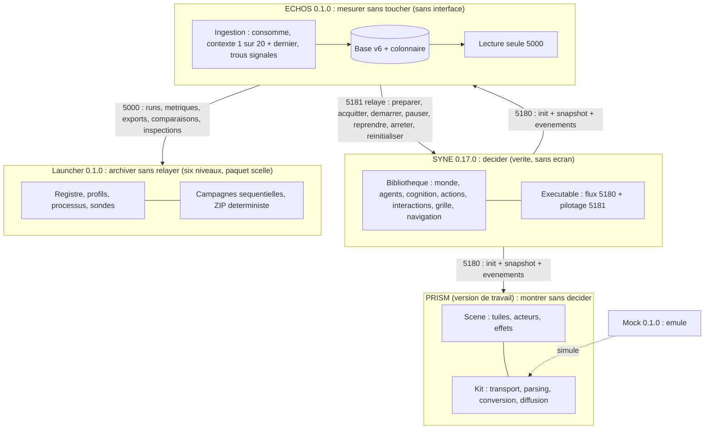
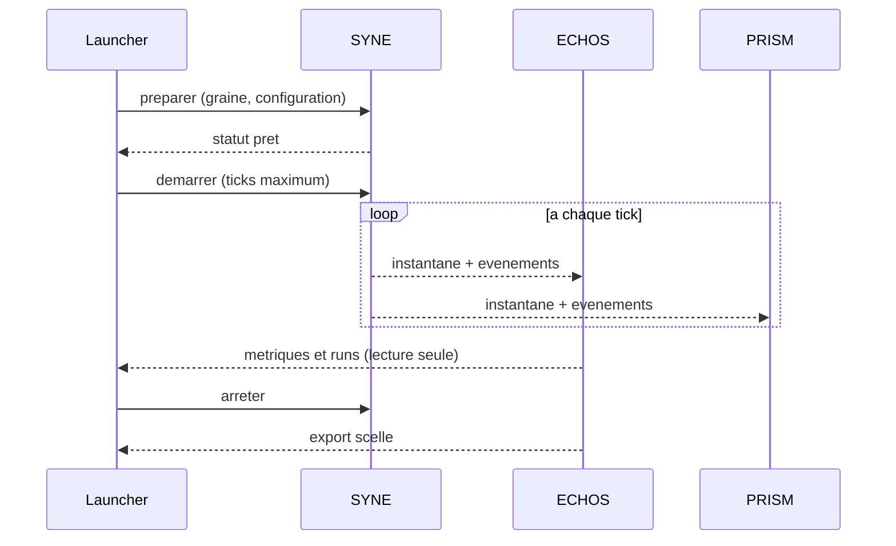

# Chapitre 4b. Le projet : pour construire ainsi, vision et architecture globale

Pourquoi quatre composants plutôt qu'un seul programme ? Pourquoi séparer décider, mesurer, montrer et archiver ? Ce chapitre répond en partant de la question décomposée : chaque découpage existe pour empêcher une triche précise, et l'architecture globale est la forme visible de cette vigilance.

## 4b.1 La vision en une phrase

La vision tient en une phrase : **rendre observables les mécanismes à l'origine des comportements collectifs, en séparant le moteur de simulation, l'analyse et la représentation.**

Cette phrase porte plusieurs refus. LIVEX n'est pas un jeu commercial (aucune boucle de divertissement prescrite). Ce n'est pas une preuve d'intelligence (aucune conscience affirmée). Ce n'est pas une société miniature (un système abstrait). Ce n'est pas un moteur physique (un plan continu sans réalisme mécanique). Ce n'est pas une validation automatique : les chiffres sont accompagnés de leur provenance et de leurs réserves.

La communication du projet découle de cette vision : montrer comment le système est conçu, ce qu'il permet d'observer dans sa version, ce qu'il ne permet pas d'affirmer, et comment il évolue. La narration publique suit le même cap que le livre : des preuves plutôt que des superlatifs, des limites plutôt que des promesses.

On peut opposer deux manières de présenter un projet comme celui-ci. La première fait de la promesse le centre : « un monde où une société émerge toute seule ». La seconde fait de la méthode le centre : « un dispositif capable d'observer, honnêtement, si et comment une structure apparaît ». La première attire vite et déçoit ensuite. La seconde exige un effort et se vérifie. Le projet a choisi la seconde, et le livre ne s'en écarte jamais.

## 4b.2 Quatre responsabilités, quatre interdits

Un seul programme pourrait tout faire, et tout confondre : la scène déciderait à la place du monde, la mesure modifierait le mesuré, l'archive relaierait au lieu de sceller. D'où quatre responsabilités aux frontières non négociables.

- **SYNE décide.** Il possède la vérité unique du monde. Il fonctionne sans écran, de manière déterministe et persistante. Interdiction faite aux autres de réécrire l'état simulé.
- **ECHOS mesure sans toucher.** Il est en lecture seule, sans aléa ni horodatage, et signale les trous d'ingestion au lieu de les combler. Interdiction de modifier le phénomène observé.
- **PRISM montre sans décider.** Il reflète l'état du monde en scripts visuels, en couche mince. Interdiction de devenir un moteur parallèle.
- **Le Launcher archive sans relayer.** Il pilote les cycles de vie et laisse les données aller directement du moteur aux consommateurs. Il scelle l'archive à l'octet. Interdiction de s'interposer dans le flux de données.

Autour de ces quatre responsabilités, deux outils assument des rôles plus modestes. Le `syne-mock` émule le transport sans prouver la simulation. L'installateur promet une installation sans rien affirmer d'autre que sa spécification.

| Composant | Responsabilité | Interdit | Preuve de non-violation |
| :-- | :-- | :-- | :-- |
| SYNE | décider | être mis en scène | tests de trajectoire et d'empreinte |
| ECHOS | mesurer | altérer le monde | lecture seule, provenance des mesures |
| PRISM | montrer | décider | la scène suit l'instantané, ne le produit pas |
| Launcher | archiver | relayer | données directes moteur vers consommateurs |

Chaque interdit est testé. Le piloté égal à l'interrompu. Le rapport égal à sa régénération. L'entrée jamais rejouée. Le zéro lu distingué du zéro aveugle.

Cette liste d'interdits peut paraître abstraite. Elle a pourtant une conséquence très concrète sur la manière d'écrire le code : elle interdit les raccourcis commodes. Par exemple, il serait commode que le rendu calcule lui-même la position d'un agent pour lisser l'affichage ; c'est interdit, car la position simulée doit rester autoritaire. Il serait commode que l'analyse écrive un champ de contexte dans l'instantané ; c'est interdit, car l'analyse ne touche pas au monde. Ces interdits coûtent du travail, mais ils sont la raison d'être de la découpe. Un projet qui les relâcherait gagnerait en confort et perdrait sa crédibilité.

## 4b.3 Architecture globale de référence

Le schéma suivant décrit l'état V0.1. Un trait plein désigne un flux disponible, un trait pointillé un outil ou un élément en développement.

**Lecture du schéma.** Le flux principal va du moteur vers l'analyse et la scène : d'abord une initialisation qui décrit la topologie et les entités de départ, puis, à chaque tick, un snapshot global de l'état, accompagné d'événements typés. Le pilotage emprunte un autre chemin : un port de contrôle avec accusé de réception obligatoire, où le redémarrage d'un run terminé renvoie une erreur dédiée. La lecture d'analyse expose des runs, des métriques, des exports, des comparaisons et des inspections, triées, sans aléa. Les ports sont configurables et jamais codés en dur. Le format est du JSON textuel. Les champs ajoutés sont tolérés selon la règle de compatibilité. Enfin, dans cette version locale, il n'y a pas d'authentification entre composants.

**Séquences de référence.** Un monde est préparé, puis acquitté, puis démarré. Une réinitialisation partielle permet d'enchaîner plusieurs runs sans interrompre le serveur. Une campagne enchaîne des runs à graines dérivées, avec reprise exacte et scellement de l'archive.

Ce schéma des séquences montre la propriété essentielle de l'architecture : **les données ne passent jamais par le Launcher**. Le Launcher donne l'ordre de démarrer et l'ordre d'arrêter, puis il lit l'analyse. Il ne relaie pas le flux du moteur, qui va directement aux consommateurs. C'est ce qui garantit qu'un problème dans l'orchestration ne déforme pas les données observées.

## 4b.4 Les niveaux du Launcher

Le Launcher n'est pas un simple bouton de démarrage. Il organise le projet en niveaux, du composant jusqu'au paquet scellé, et cette organisation mérite d'être posée dès maintenant, car les chapitres suivants y reviendront.

| Niveau | Ce qu'il contient | Propriétaire |
| :-- | :-- | :-- |
| Composant | un binaire et son manifeste | Launcher (détection) |
| Service | un composant lancé et supervisé | Launcher |
| Run | une exécution reproductible | Launcher |
| Campagne | une suite paramétrée de runs | Launcher |
| Paquet `.livexp` | l'archive vivante puis scellée | Launcher |
| Catalogue | l'ensemble des paquets disponibles | Launcher |

Cette hiérarchie a un intérêt méthodologique : elle sépare l'unité d'échec (le run) de l'unité de partage (la campagne). Si un run échoue, on le reprend. Si une campagne est terminée, on la scelle et on la partage. Cette séparation évite deux erreurs : perdre une campagne entière à cause d'un run raté, et ne rien pouvoir partager tant que tout n'est pas fini.

## 4b.5 Le rôle des outils : mock et installateur

Le `syne-mock` est un serveur Node.js présent dans le dépôt. Il expose des routes HTTP et un WebSocket compatibles avec les flux d'intégration documentés. Il permet de développer les connexions, les structures Blueprint, les événements et le cycle de vie d'un client sans lancer le moteur complet. Il n'est pas la source du contrat et ne reproduit pas fidèlement les décisions, le pathfinding ni les systèmes sociaux de SYNE. Ses résultats ne doivent pas servir de résultats scientifiques. C'est un outil de développement, et il est décrit comme tel dans tout le livre.

L'installateur est, à l'état décrit, une spécification sans code. Il décrit un assistant d'installation par composant, sans élévation de privilèges, avec des dépendances embarquées et un catalogue de mise à jour atomique. Le livre lui consacre un chapitre parce qu'il fait partie de la vision d'ensemble, en précisant clairement qu'aucune ligne de code ne l'implémente encore.

La présence de ces deux outils dans l'architecture mérite une justification, car elle pourrait sembler contradictoire avec le souci d'honnêteté. Pourquoi garder un émulateur qui ne reproduit pas fidèlement le moteur, et une spécification sans code ? Pour deux raisons utilitaires. Le mock accélère le développement des clients, qu'il ne faut pas obliger à montrer un moteur complet pour tester une connexion. L'installateur anticipe la livraison, qu'il est plus sage de concevoir avant d'écrire. Dans les deux cas, la règle est la même : l'outil est utile, mais il n'a aucune autorité. Le livre le dit à chaque mention, pour que personne ne confonde un outil de confort avec une preuve.

## 4b.6 Ce que la découpe protège

La topologie « décider ici, mesurer là sans toucher, montrer ailleurs sans décider, archiver sans relayer » rend la question testable au lieu de la proclamer. Chaque composant protège les autres de leurs tentations. Le moteur ne peut pas être mis en scène. L'analyse ne peut pas altérer le monde. La scène ne peut pas décider. L'archive ne peut pas relayer.

C'est cette forme, et non une simple commodité d'ingénierie, qui donne au livre sa structure. Chaque chapitre de la partie suivante vérifiera, composant par composant, que la protection tient.

## 4b.7 Ce que ce chapitre apporte à la question directrice

Ce chapitre a montré que la découpe du projet n'est pas arbitraire : elle répond, composant par composant, au risque de tricher avec la question. Il a aussi posé l'architecture globale de référence et le rôle des outils.

La partie suivante ouvre le moteur. Le chapitre 5, consacré à SYNE, commence par la terre et son métabolisme : l'espace, les ressources, les obstacles et les rythmes, avant les habitants et leur cognition.
