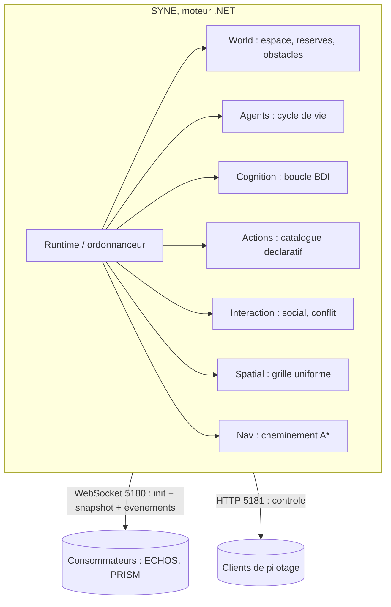

# SYNE I. La terre et son métabolisme

Avant les habitants, la terre. Non un décor, mais un métabolisme : un plan continu où des réserves respirent, une géographie qui résiste, des rythmes qui passent, sans jamais raconter d'histoire à la place de ceux qui y vivent. C'est la première réponse concrète à la question directrice : des lois fondamentales aveugles, qui contraignent sans ordonner.

Ce chapitre a une ambition précise. Il ne s'agit pas de décrire un monde « réaliste » au sens visuel, mais de poser les conditions minimales pour que des comportements non écrits puissent apparaître : un espace fini où l'on se rencontre, des ressources partagées et limitées, une géographie qui gêne le pas et le regard, des rythmes qui changent le contexte sans l'orchestrer. Chacun de ces choix peut sembler anodin. Mis bout à bout, ils forment la scène sur laquelle la question directrice peut se jouer. Le livre prend donc le temps de les dérouler, parce qu'une loi mal comprise au départ rend incompréhensible tout ce qui suit.

**Pourquoi ce chapitre importe pour la question directrice.** Imaginez un échiquier dont les cases coûtent : se déplacer use, la nourriture s'épuise, les murs cachent la vue. Si le plateau n'avait aucune conséquence, aucune pression n'apparaîtrait, et rien d'inattendu ne pourrait naître. C'est le premier maillon de la question : pour que des comportements non programmés apparaissent, il faut d'abord un monde qui contraint. La terre de LIVEX est ce monde. Elle ne raconte rien et ne décide rien ; elle rend simplement certaines choses coûteuses et rares, ce qui suffit à créer les tensions d'où naîtront, plus tard, les rencontres.

## 1. L'espace

Le monde de référence est un plan continu de 500 unités sur 500. Les positions sont continues, bornées par un clamp aux bords : il n'y a pas de tore magique, pas de réapparition d'un bord à l'autre. Le monde est fini, et l'on y bute. C'est un choix, non une limite technique : un espace borné force la cohabitation, donc les rencontres, donc les interactions sociales.

Un tore aurait été l'option paresseuse. Sur un tore, un agent qui marche longtemps revient à son point de départ et le monde n'a pas de bord. C'est élégant pour un jeu, mais cela affaiblit la question : sans bord, sans frontière, les entités ne se heurtent jamais à la finitude de leur monde. Or c'est précisément la finitude qui crée la pression. Un espace borné et des ressources partagées produisent une tension de cohabitation, et cette tension est le premier moteur des structures collectives que le livre cherchera ensuite.

Pour la représentation, un profil dédié décrit un plan plus vaste (2 240 unités de côté, cellule de 32), mais il s'agit de la scène, non du monde simulé. Le monde reste la référence : un plan logique, sans relief obligatoire, dont les positions ont des conséquences.

Un mot sur les unités. Une clé informative, `world.metersPerUnit`, indique la correspondance entre une unité du monde et une longueur physique (défaut : une unité pour un mètre). Elle n'entre dans aucun calcul du moteur : elle est transmise aux clients pour qu'ils projettent correctement l'espace. Le monde ne simule pas la matière ; il calcule des positions et des états.

Cette séparation entre l'espace logique et son interprétation physique mérite d'être soulignée, car elle reviendra partout. Le moteur ne connaît ni mètre, ni centimètre, ni pixel : il connaît des unités de position et des unités de temps. C'est le client qui décide de ce qu'une unité vaut à l'écran. Cette indifférence de principe a une conséquence pratique importante : on peut agrandir le monde présenté, changer l'échelle d'affichage, sans rien changer à la simulation. La suite le montrera avec le profil de représentation, qui multiplie la taille apparente du monde sans toucher à l'économie du moteur.

## 2. Les réserves qui respirent

Quatre réserves globales font vivre le monde. Elles sont partagées par toutes les entités, et leur épuisement est un moteur de comportement.

| Réserve | Quantité initiale | Régénération par tick | Consommée par |
| :-- | --: | --: | :-- |
| Nourriture | 20 000 | 20 | action Eat |
| Eau | 20 000 | 10 | action Drink |
| Bois | 50 | 0,1 | mécanique de construction (ouverte) |
| Minerai | 0 | 0 | mécanique de construction (ouverte) |

Deux mots sur la nature de ces réserves. Elles sont **globales**, non localisées. Une entité qui mange ne se déplace pas vers « un champ » : elle ponctionne une réserve commune, quelle que soit sa position. C'est un choix de modèle qui surprend à première lecture, et il faut en tirer les conséquences : le monde ne contient pas de gisements localisés, il contient des stocks finis que tout le monde partage. Une conséquence directe est que la richesse est communaliste : ce que l'un consomme, l'autre ne le consomme pas. Cela crée une compétition douce, non une conquête de territoire.

Chaque fin de tick, le monde applique son cycle : la régénération, puis une éventuelle dégradation périodique. Rien de tout cela ne tire au sort ; l'ordre est causal et strict. Les réserves de bois et de minerai sont présentes mais quasi inertes : elles accompagnent une mécanique de construction encore ouverte et ne jouent, à l'état décrit, aucun rôle dans la survie. Les nommer, c'est déjà préparer un avenir possible ; ne pas en dépendre, c'est rester honnête sur le présent.

L'histoire de la nourriture mérite d'être racontée, parce qu'elle explique une calibration entière. Une version antérieure appliquait une dégradation périodique qui, en fin de période, annulait exactement la régénération : l'apport net devenait nul et la réserve se réduisait à sa valeur initiale. À 100 entités, ce monde mourait avant le tick 2 000. La calibration a supprimé cette dégradation par défaut et fixé une régénération nette de 20 unités par tick, rendant le monde viable sur l'horizon de 2 500 ticks. Ce point sera développé dans le chapitre de calibration ; il annonce déjà la méthode : on mesure, on isole une cause, on corrige, on assume le changement de version et de trajectoire.

Une réserve vide n'interdit pas la quête : une entité peut chercher. Mais elle interdit l'action terminale : sans nourriture globale, pas de repas, seulement la poursuite. C'est cette bascule qui fait converger les besoins vers la même source et prépare, sans l'écrire, les rassemblements dont naîtront les liens.

Ce dernier point est un des mécanismes les plus importants du livre, et il faut le dire lentement. Rien, dans le code, ne dit « les entités doivent se rassembler ». Il n'y a pas de place de village, pas de point de rendez-vous. Tout ce qui existe, c'est une ressource finie, partagée, et des besoins qui montent. Si la ressource est abondante, les entités se croisent au hasard. Mais quand elle se raréfie, toutes ont intérêt à être là où l'on mange, et cette convergence géographique suffit à augmenter mécaniquement la fréquence des rencontres. Les rencontres font les relations, les relations font les groupes. Aucune de ces étapes n'est écrite : chacune est une conséquence de la précédente. C'est exactement ce que la question directrice appelle une structure non explicitement programmée.

## 3. La géographie qui résiste

La géographie du monde est faite de cercles : des obstacles statiques `{id, x, y, rayon}`. Un obstacle bloque le pas : si la cible d'un déplacement tombe dans le disque, le pas est refusé et l'entité reste sur place. Il masque aussi le regard : le segment qui le traverse cache la cible. C'est la ligne de vue, un des ressorts de l'observabilité partielle.

Le cercle n'est pas le fruit du hasard. Tester si un pas tombe dans un disque se réduit à comparer une distance à un rayon ; tester si un segment traverse un disque se réduit à calculer une distance d'un point à une droite. Ces deux tests sont exacts, peu coûteux, et sans cas particulier. Une forme rectangulaire aurait exigé des tests de bord et des coins, des cas limites et des erreurs classiques sur les angles. Le cercle simplifie le test de collision et le test de ligne de vue sans changer le principe : une géographie qui contraint le mouvement et la perception. La forme rectangulaire est reportée, non oubliée.

Un layout initial pose ces obstacles au démarrage. Des constructions peuvent ensuite en ajouter ou en retirer en cours de route. Chaque mutation est tracée par un événement, inscrite au snapshot, accompagnée d'une révision incrémentée. La grille de pathfinding n'est re-rasterisée que si nécessaire, et cette opération est un non-événement sans changement.

La géographie n'est pas qu'un mur : elle est aussi une information. Quand le moteur exporte la description du monde, il indique pour chaque cellule si elle est marchable et à quel coût. Une cellule est marquée non marchable dès qu'un obstacle la recouvre, et cela n'arrive pas seulement quand le centre de l'obstacle tombe dans la cellule, mais aussi quand le disque mord la cellule, c'est-à-dire quand la distance au centre de la cellule reste inférieure au rayon augmenté d'une demi-cellule. Autrement dit, la frontière marchable épouse le contour réel des obstacles, non une grille grossière. C'est ce détail qui empêche un agent de « couper » à travers une paroi à cause d'un arrondi.

## 4. Se déplacer dans ce monde

Le déplacement obéit à des règles simples, mais dont l'articulation explique beaucoup de comportements observés.

Chaque agent qui se déplace paie un coût **forfaitaire** d'énergie de 0,03 par tick de déplacement, **indépendamment de la distance parcourue**. Un pas court et un pas long coûtent pareil : ce qui compte, c'est le fait de bouger, pas la longueur du trajet. Un agent immobile ne paie rien, sauf ce que coûtent ses autres actions. On verra au chapitre de la cognition à quel point cette règle pèse : elle rend le repos attractif et décourage l'errance gratuite.

Le pas lui-même suit un déplacement pseudo-aléatoire déterministe, dérivé de l'identifiant de l'entité, du tick et du désir courant, borné par le trait de vitesse. Aucune direction n'est écrite à l'avance, mais aucune n'est tirée d'un générateur global : la direction est un hachage stable, donc rejouable. La cible d'un déplacement n'est pas un point choisi loin : elle est **locale**, tirée dans un rayon qui n'excède pas la moitié du rayon de perception. Un agent ne se rend pas vers un lieu qu'il ne connaît pas : il se dirige vers un point proche, cohérent avec ce qu'il pourrait percevoir.

Quand un chemin doit contourner un obstacle, le moteur dispose d'une recherche A* sur une grille de cellules de 10 unités, plafonnée à 4 096 cellules développées. Ce plafond n'est pas un détail : il borne le coût d'une recherche et garantit qu'un agent ne passe pas un temps disproportionné à planifier un trajet. Si l'obstacle est trop vaste pour être contourné dans ce budget, l'agent échoue à trouver un chemin et retombe sur un comportement local. C'est une contrainte assumée : mieux vaut un agent myope qu'un agent qui gèle le monde en cherchant un chemin.

Un point d'honnêteté accompagne ces règles. Les réserves étant globales et le coût de déplacement forfaitaire, **agrandir le monde ne change pas l'économie de survie**. Un agent ne « court pas plus loin pour manger » : il mange n'importe où, et se déplacer un tick coûte le même prix quelle que soit la géographie. Ce qui change avec la taille du monde, c'est la **densité sociale** : dans un grand monde, les rencontres sont plus rares. Le livre y revient dans le chapitre consacré à la représentation, car c'est un effet réel que le projet assume et documente plutôt que de le masquer.

## 5. Les rythmes

Trois rythmes scandent le monde sans le diriger.

- **Les saisons.** La saison courante est une fonction pure du tick : `(index initial + tick / durée de saison) modulo 4`. Aucun tirage. Chaque saison module la régénération et la dégradation des réserves par des facteurs par ressource. Le cycle est livré mais désactivé par défaut, afin de préserver la trajectoire de référence ; activé, il n'altère que des champs additifs et des événements. La durée d'une saison est de 360 ticks par défaut, ce qui, à la cadence de référence, fait tourner la roue des saisons sur un rythme lent et prévisible : l'été favorise l'eau, l'automne le bois, l'hiver défavorise la nourriture et l'eau. Aucune entité ne « sait » qu'une saison change ; elle constate seulement que le monde autour d'elle produit plus ou moins. C'est ainsi qu'un rythme global devient, pour une entité locale, une simple variation de son environnement.
- **Les territoires.** Un territoire est une zone délimitée par la présence des entités autour d'un point de survie. À l'état décrit, la zone est un disque configuré ; le territoire effectif est la présence d'entités dans le disque, recalculée en fin de tick. C'est une pure fonction des positions, sans comportement agentique et sans tirage. Purement observationnel, ce système est désactivé par défaut. La nuance est importante : un territoire n'est pas une propriété revendiquée, c'est une zone où des présences sont constatées. Le mot ne doit donc pas faire imaginer une frontière négociée : il n'y a, dans cette version, aucune négociation.
- **Les livres.** Un livre matérialise un savoir figé au tick de rédaction. L'écriture est explicite et débite un coût en énergie à l'auteur (20 par défaut) ; la lecture enregistre un lecteur distinct. Le bénéfice de lecture est posé en principe mais son effet cognitif est reporté. Livrés, désactivés par défaut.

Ces trois systèmes partagent une même propriété : ils rythment le monde sans le gouverner. Ils sont observationnels dans cette version, et le livre le dit. Décrire une « transmission culturelle » alors que le bénéfice de lecture n'est pas encore cognitif serait une faute. On peut écrire un livre, on peut le lire, on peut compter les lecteurs ; on ne peut pas encore dire qu'une idée se transmet. C'est une frontière de version, et le lecteur doit la connaître.

## 6. Le métabolisme et la fenêtre causale

Le cycle des réserves s'applique en fin de tick, après les boucles des entités, la communication, la révision des groupes, les naissances et la mortalité. Cette position n'est pas un détail d'implémentation : elle définit une **fenêtre causale**. Les conséquences d'une action dans un tick n'affectent les réserves qu'en fin de tick, et donc n'influencent les décisions qu'au tick suivant. L'ordre causal strict est la condition du déterminisme, et le déterminisme est la condition de la science.

Pourquoi insister sur un ordre, et non sur un simple « à la fin » ? Parce qu'un ordre ambigu produit un déterminisme fragile. Si deux agents mangeaient « à la même fin de tick » et que le résultat dépendait de l'ordre d'itération, alors un même seed pourrait produire deux trajectoires selon le détail d'implémentation de la boucle. En fixant l'ordre et la position de chaque étape, le moteur rend la trajectoire indépendante de tout hasard d'exécution. C'est ce qui autorise plus loin l'idée d'une empreinte dorée : on peut figer la trajectoire d'un run, parce que cette trajectoire ne dépend d'aucune latitude cachée.

Cette fenêtre causale a une seconde conséquence, moins visible mais précieuse : elle rend l'explication possible. Puisqu'une action ne peut influencer le monde que le tick suivant, on peut toujours remonter de la cause à l'effet sans ambiguïté de simultanéité. Un agent qui réagit à ce qu'il perçoit réagit à l'état du tick précédent, jamais à un état modifié en cours de route par un voisin. L'analyse causale dont traitera la partie ECHOS repose entièrement sur cette propriété.

## 7. L'anatomie interne du moteur

Sous ce monde, une architecture sans décor. Une bibliothèque qui pense, un exécutable qui sert, aucune dépendance graphique.

Les sous-systèmes sont répartis en couches claires : le monde, les agents, la cognition, les actions, les interactions, la grille spatiale, le cheminement. Le SDK .NET est épinglé (version 10.0.400, bande `latestFeature`), afin qu'une même version du code produise le même comportement. Le générateur pseudo-aléatoire est unique et sérialisable (xoshiro256** initialisé par splitmix64) ; l'usage de `System.Random` est interdit, car son état n'est ni stable entre exécutions ni directement sérialisable.

Ce détail sur le générateur mérite une explication, car il est au cœur de la promesse de reproductibilité. Un générateur pseudo-aléatoire ordinaire de la bibliothèque standard peut produire des séquences différentes selon la version du framework, la plateforme ou l'implémentation interne, et son état ne se sauvegarde pas de manière portable. Le moteur utilise donc son propre générateur, dont l'algorithme est fixé et dont l'état est un petit ensemble de mots entiers, sauvegardable et rechargeable exactement. Interdire la classe standard n'est pas une coquetterie : c'est la seule manière de garantir qu'un run au même seed se rejoue à l'identique, des années plus tard, sur une autre machine.

La grille spatiale uniforme accélère la perception et la communication en ne balayant que les cellules voisines (fenêtre de trois par trois). C'est ce qui ramène une recherche de voisinage de coût quadratique à un coût quasi-linéaire, et c'est ce qui permet au monde de tenir mille entités. Sans elle, chaque entité interrogerait toutes les autres à chaque tick, et le coût croîtrait comme le carré de la population : mille entités feraient un million de comparaisons par tick. La grille découpe l'espace en cellules et ne compare qu'aux cellules voisines ; le coût devient proportionnel au nombre d'entités réellement proches, non au nombre total.

## 8. Le budget de temps

Un ordonnanceur exécute les sous-systèmes à des fréquences différentes, selon leur coût et leur besoin. Les fréquences sont réparties en quatre classes : élevée (mouvement, collisions, contraintes immédiates), moyenne (besoins, perception locale, environnement), adaptative (délibération, planification) et faible (analyse, agrégations, statistiques). Le niveau de détail décisionnel espace les décisions des entités lointaines, sans biaiser les proches.

Le budget de référence, pour mille entités et un tick de cent millisecondes, se répartit ainsi : perception 20 ms, mémoire et croyances 15 ms, besoins et objectifs 10 ms, utilité 20 ms, communication 15 ms, actions et mouvement 15 ms, événements 5 ms. Ces chiffres sont des repères d'architecture, pas des garanties figées. Les benchmarks du chapitre des résultats diront où se trouve réellement le goulot.

Ce budget illustre une idée plus générale : le temps est une ressource du simulateur comme une autre. Rien n'oblige tous les sous-systèmes à tourner à chaque tick. La délibération d'une entité lointaine peut n'avoir lieu qu'un tick sur quatre sans que le monde s'en trouve changé, puisque cette entité n'était de toute façon pas perçue par les autres. Espacer les calculs inutiles, c'est ce qui permet d'augmenter la population sans augmenter le coût par tick. La mesure du budget réel, pour sa part, est bien meilleure que ces repères d'architecture ne le laissent craindre : les campagnes mesurent un coût de tick de l'ordre de la fraction de milliseconde, ce que le chapitre des résultats précisera.

## 9. L'anatomie du code

Le dépôt SYNE s'organise en trois ensembles.

- `Simulation.Core` : la bibliothèque principale, qui contient la configuration, le générateur, le monde, les entités, la cognition, les actions, la communication, la grille spatiale, le cheminement et la persistance.
- `Simulation.Console` : l'exécutable, qui prend en charge le mode batch en ligne de commande, le serveur de contrôle HTTP et le serveur d'observabilité WebSocket.
- `Simulation.Core.Tests` et `Simulation.Console.Tests` : les suites de tests, dont certaines épinglent des empreintes dorées de trajectoire (les vecteurs du générateur et de la fabrique d'entités sont verrouillés).

Cette organisation en couches n'est pas cosmétique : elle sépare ce qui pense de ce qui sert, et permet de tester la cognition sans lancer de serveur. C'est une propriété recherchée, pas un effet secondaire. Lorsque la logique de décision vit dans une bibliothèque indépendante du transport et de la console, on peut écrire un test qui vérifie une décision précise, sans monter un serveur, sans réseau, sans fichier. La testabilité est ici le prolongement direct de la promesse de déterminisme : un moteur dont on peut prouver qu'il décide de la même façon deux fois est un moteur dont on peut discuter les décisions.

## 10. Ce que ce chapitre apporte à la question directrice

Ce chapitre a décrit la terre et son métabolisme : un espace borné, des réserves partagées qui respirent en fin de tick, une géographie qui bloque le pas et le regard, des rythmes purs, et une architecture qui interdit l'aléa caché. Ici, les lois contraignent, elles n'ordonnent pas. C'est exactement ce que la question exigeait.

On peut même préciser ce que le chapitre a établi, terme par terme. L'**environnement virtuel** existe : un plan fini, des positions qui coûtent, des ressources qui s'épuisent. Les **lois fondamentales** sont posées : régénérer, consommer, bloquer, masquer, vieillir le monde par saisons. Aucune de ces lois ne mentionne le collectif, et c'est délibéré. Enfin, les **structures non explicitement programmées** sont rendues possibles, non garanties : la raréfaction d'une ressource partagée pousse les entités au même endroit, et cette convergence géographique prépare, sans l'écrire, les rencontres qui feront les liens.

Ce que ce chapitre ne permet pas encore de conclure : qu'un monde viable suffise à faire apparaître du collectif. Un métabolisme ne produit rien seul ; il faut des habitants qui perçoivent, croient et décident. Le chapitre suivant suit l'un d'eux, Charlie, et détaille le calcul qui le fait choisir de manger plutôt que de socialiser.

## Note de conformité — les deux statuts des ressources (arbitrage A0-2)

*Ajoutée le 17 octobre 2026, à l'issue du réalignement SYNE 0.17.0 (phase 0 · A0-2). Le corps du chapitre est inchangé : cette note certifie ce que le code exécute à la date indiquée, conformément à l'arbitrage exécuté le 17/10.*

**Ce que dit le corps reste vrai — pour un des deux statuts.** Le §2 décrit des réserves **globales** : une entité qui mange ponctionne un stock commun, sans se déplacer vers « un champ », et la richesse est communaliste. Ce modèle existe toujours, **déclaré et testé séparément** (`resources.localized = false` ; `ActionExecutorReserveAtomicityTests` sur la réserve mondiale, `AdrCognitivePrimitivesTests` sur ce même mode) : c'est le **modèle baseline**, conservé pour la continuité des baselines et servi comme bras « avant » des comparaisons. Il n'a pas été retiré ; il a été **rangé**.

**Le profil de référence porte l'autre statut.** Depuis le 17 octobre 2026, le profil `reference` — et donc les défauts intégrés, qui lui sont identiques — tourne en modèle **localisé** : `resources.localized = true` est déclaré **explicitement** dans `SimulationProfiles.Reference()` et dans `configs/simulation/reference.json` (parité verrouillée par `ReferenceProfileParityTests`). Concrètement, le monde contient `resources.nodesPerType = 3` gisements par type, aux positions déterministes dérivées de la graine ; `resources.interactionRadius = 2` borne la consommation et l'arrivée ; consommation et régénération se font **au gisement**. Les réserves publiées deviennent l'**agrégat** des gisements, pour l'observabilité.

**La condition d'A0-2 est remplie et publiée.** Le gate de viabilité du profil localisé a été **franchi** le 17 octobre 2026 selon des critères fixés avant exécution : sur 3 graines et 2 500 ticks, aucune mort (population finale = population initiale), quête adossée à un dépôt connu dans 100 % des cas (215 411 décisions `Eat`/`Drink`/`SeekFood`/`SeekWater` portant `targetType = node`), et compétition observable (les 3 dépôts de chaque ressource sont visés par plusieurs agents). Les critères détaillés, checksums et limites figurent dans le [rapport expérimental pérenne](../../governance/realignment/EXPERIMENTAL-VALIDATION-2026-10.md).

**Réqualification des noms : le mot « quête » ne désigne pas la même chose d'un statut à l'autre.** Dans le profil **global**, `SeekFood`/`SeekWater` ne sont pas une quête spatiale : sans cible connue, la cognition ne construit aucune connaissance (`Knowledge()` vaut `null`, `CognitionPipeline`), l'action se résout sans destination, contre le stock abstrait. Dans le profil **localisé**, la même action est bien une quête : destination portée par l'intention, dépôt connu par croyance et mémoire, `targetType = node` dans chaque décision publiée. Les deux statuts portent les mêmes noms d'action ; ils ne désignent pas les mêmes actes. C'est pourquoi la réserve globale est désormais présentée comme une **réserve**, non comme une quête.

**Portée de cette note.** Une note de conformité établit l'accord entre ce chapitre et le code à une date donnée, en citant les tests qui le constatent ; elle ne dit rien de la viabilité du monde ni de l'émergence des structures. Constat relevé le 17 octobre 2026 : suite moteur complète verte (602 tests `Simulation.Core.Tests`), dont `LocalizedResourceActionTests` (`Eat` consomme le gisement sur lequel l'agent se trouve ; hors portée bloqué ; gisement éloigné bloqué ; gisement épuisé bloqué et objectif à réviser), `CognitionKnowledgeTests` (agent ignorant : aucun objectif ciblé et incapacité de manger ; source connue mais hors portée : poursuite ciblée, pas de consommation) et `ReferenceProfileParityTests` (3/3).
