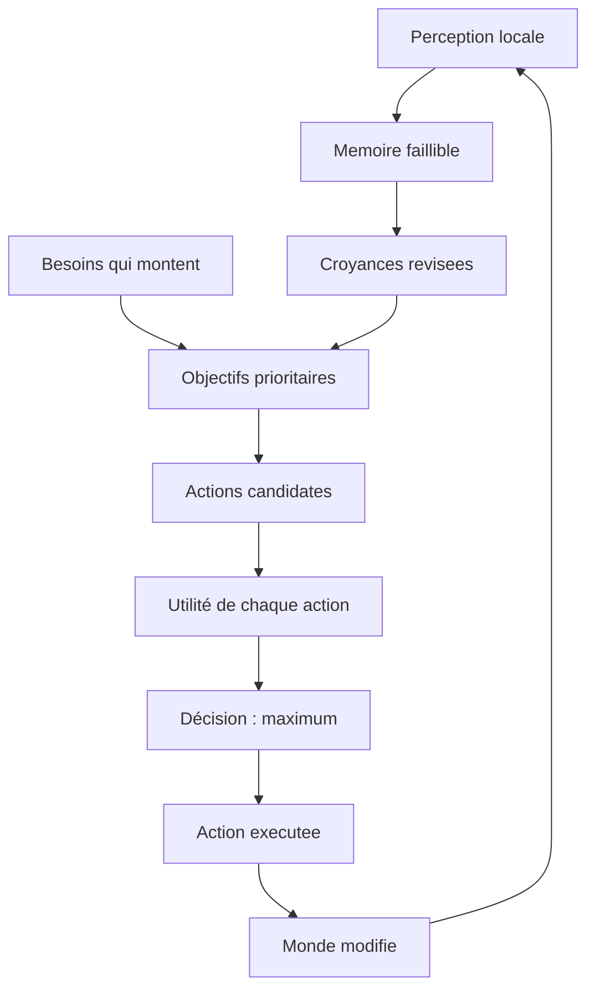

# SYNE II. Comment Charlie décide de manger plutôt que de parler

Suivons Charlie. Faim à soixante-douze, énergie à quarante, une réserve de nourriture accessible, un voisin qui bavarde à dix unités. Que va-t-il faire ? Personne ne l'a écrit. C'est toute l'architecture cognitive de SYNE, croyances, désirs et intentions opérationnalisés par une utilité transparente, qui va trancher, chiffres à l'appui, de façon rejouable à l'identique. Ce chapitre détaille cette architecture, puis déroule le calcul complet de Charlie.

Avant cela, une remarque sur le statut. Ce que cette partie décrit est **disponible** dans l'état 0.17.0, sauf mention contraire. Certaines capacités plus récentes (bibliothèque de plans, inventaire, engagements, contrôle de saillance) sont livrées mais désactivées par défaut ; elles sont signalées comme telles.

Ce chapitre est le cœur du livre, parce qu'il répond à la question la plus concrète que pose la question directrice : comment une entité, à partir de règles locales, choisit-elle une action que personne n'a écrite pour elle ? La réponse tient en une chaîne : des besoins produisent des objectifs, des objectifs produisent des actions candidates, une fonction d'utilité les classe, et le maximum l'emporte. Rien de tout cela n'est magique, et rien n'est caché.



**Pourquoi ce chapitre importe pour la question directrice.** Un thermostat ne « décide » pas de chauffer : il exécute une règle. La question directrice exige autre chose : des entités qui choisissent, à partir d'un état interne et d'un modèle imparfait du monde, sans qu'aucune conduite leur soit dictée. Ce chapitre est donc la réponse la plus directe du livre. Il montre comment un manque devient un objectif, comment un objectif devient une action candidate, et comment une formule tranche. Le point décisif est que personne n'écrit la conduite : on écrit les **règles du calcul**, et la conduite en découle. C'est là que la question cesse d'être une intention pour devenir un mécanisme.

## 1. Les traits

Chaque entité reçoit huit traits, tirés individuellement autour d'une valeur neutre de 1,0, sur une plage de 0,5 à 1,5 à l'initialisation. Les traits modulent la décision, ils ne la dictent pas.

| Trait | Rôle |
| :-- | :-- |
| Bravoure | tolérance au risque |
| Curiosité | pulsion d'exploration |
| Sociabilité | préférence pour la socialisation |
| Avidité | attraction pour l'accumulation de ressources |
| Pessimisme | prudence face au danger |
| Agressivité | disposition à l'attaque |
| Force | puissance de combat |
| Vitesse | vitesse de déplacement |

Il n'y a pas de classes rigides d'entités. Les types sont définis par des paramétrages (plages de traits, taux de besoins, capacités), mais les entités d'un même paramétrage restent singulières, parce que leurs traits sont tirés individuellement. C'est la première source d'hétérogénéité, et donc de diversité comportementale.

Le tirage des traits est **individuel** et non global : deux entités du même type n'auront presque jamais les mêmes huit valeurs. Cette singularité est voulue, et sa portée est plus grande qu'il n'y paraît. Elle signifie que deux agents placés dans une situation strictement identique (mêmes besoins, mêmes croyances, même environnement) peuvent faire des choix différents, parce que leur personnalité module l'utilité. La diversité comportementale n'est donc pas un phénomène émergent à expliquer : elle est inscrite dès l'initialisation, mais elle ne produit ses effets de groupe qu'à travers les décisions. On peut dire que l'hétérogénéité est une graine semée au départ, dont les conséquences collectives sont, elles, imprévisibles.

## 2. Les besoins

Six besoins montent à leurs rythmes. Tous comportent un mécanisme de satisfaction : la faim et la soif par Eat et Drink à l'arrivée au gisement, la fatigue par Rest, la sécurité par Flee, le social par Socialize et la curiosité par Explore — ces trois derniers apaisés **à l'arrivée** à la cible, non pendant le déplacement.

| Besoin | Taux par tick | Seuil de déclenchement | Action générée |
| :-- | --: | --: | :-- |
| Faim | 0,5 | 50 | SeekFood, puis Eat si la réserve est disponible |
| Soif | 0,7 | 50 | SeekWater, puis Drink si la réserve est disponible |
| Fatigue | 0,3 | 70 | Rest |
| Sécurité | 0,001 | 0,5 | Flee |
| Social | 0,003 | 0,7 | Socialize |
| Curiosité | 0,002 | 0,3 | Explore |

Les dérives sociale et de curiosité ont une histoire de calibration en deux temps, et il faut la suivre pour comprendre pourquoi elles valent aujourd'hui 0,003 et 0,002. Ces besoins n'avaient d'abord aucun mécanisme de satisfaction : aucun retour à la baisse. À leur premier rythme, le besoin de social franchissait son seuil vers le tick 700 et déclenchait Socialize en permanence, jusqu'à 96 % des décisions en fin de monde ; le déplacement payé sans gain d'énergie compensé tuait lentement la population. La calibration a donc ralenti les dérives (0,0002 pour le social, 0,0005 pour la curiosité) afin de rendre le monde viable sans supprimer la tendance. Ce réglage réglait un symptôme : il ne faisait que ralentir un besoin qui ne pouvait de toute façon jamais être comblé.

Le réalignement a traité la cause plutôt que le symptôme. Socialize et Explore apaisent désormais leur besoin à l'arrivée (§ ci-dessus), ce qui transforme le besoin en véritable **cycle** : seuil franchi, poursuite ciblée, arrivée, redescente sous le seuil. Dès lors, une dérive ralentie n'était plus nécessaire à la survie, et les rythmes ont pu retrouver une valeur de cycle — le social franchit son seuil vers le tick 230, la curiosité vers le tick 150 — mesurée sur le run de référence plutôt que supposée. C'est la même logique de méthode qu'ailleurs dans le projet : quand un besoin tyrannique tue le monde, on cherche s'il manque un exutoire avant de ralentir le besoin, et l'exutoire rend le rythme utile de nouveau.

La distinction entre les besoins « satisfaisables à distance » et les besoins « apaisés à l'arrivée » est structurante. La faim et la soif se comblent au contact de la ressource — l'agent doit y être. La sécurité, le social et la curiosité, eux, ne se comblent qu'à l'arrivée à une cible crue : un déplacement inachevé ne satisfait rien. Cette asymétrie crée une tension durable entre le manque et sa satisfaction différée, et c'est elle qui pousse les entités à sortir, à fuir et à se retrouver — le moteur qui les pousse vers le collectif. Un besoin sans exutoire, on l'a vu plus haut, aurait fini par dominer toutes les décisions ; c'est la présence de l'exutoire, et non son absence, qui rend la dérive fertile plutôt que tyrannique.

## 3. La perception

Charlie voit peu, et c'est voulu. Sa perception suit plusieurs règles.

- **Rayon** : 50 unités, valeur par défaut.
- **Confiance décroissante avec la distance** : `1 - (distance / rayon) × 0,3`, bornée à un plancher de 0,7. Plus une information est lointaine, moins elle est fiable.
- **Grille spatiale** : seule la fenêtre de trois par trois cellules voisines est balayée.
- **Perception étagée** : chaque entité ne perçoit qu'un tick sur quatre, selon son identifiant (`id modulo 4`). Cette rotation n'est pas un caprice de performance ; elle diversifie les instants d'observation.
- **Ligne de vue** : un obstacle sur le segment sujet-cible masque la cible.

Deux entités au même endroit voient donc deux mondes : l'angle diffère, la distance diffère, le masquage diffère, le tour de rotation diffère. C'est le premier moteur de diversité, et il est structurel, non accidentel.

La formule de confiance perceptuelle mérite d'être lue comme une courbe, non comme une constante. Au contact, la confiance vaut 1 ; à mi-portée, elle vaut environ 0,85 ; à la limite du rayon, elle tombe à 0,7 et ne descend pas plus bas. Le plancher est important : un objet perçu à la limite reste partiellement fiable, car un monde où la perception lointaine serait totalement inutile découragerait l'exploration. Les entités de LIVEX ne sont donc pas myopes au point de ne rien voir ; elles voient flou, ce qui est exactement le genre d'imprécision qui produit des erreurs fécondes.

## 4. La mémoire

Ce que Charlie a perçu s'efface selon une exponentielle :

```text
salience(t) = salience(0) × e^(-taux × délai)
```

Le taux dépend de la catégorie : 0,01 pour une observation, 0,005 pour un événement, 0,002 pour une interaction. Un souvenir est oublié lorsque sa saillance passe sous 0,01. La capacité est bornée à mille souvenirs, le moins saillant étant évincé au-delà.

| Catégorie | Taux de décroissance | Durée approximative avant oubli |
| :-- | --: | --: |
| Observation | 0,01 | environ 460 ticks |
| Événement | 0,005 | environ 920 ticks |
| Interaction | 0,002 | environ 2 300 ticks |

La mémoire n'est donc pas le monde tel qu'il est, mais tel qu'il a été perçu. C'est de cette matière faillible que naissent les croyances.

L'effet d'oubli est très inégal selon la catégorie, et cela aussi est un choix de conception. Une observation s'efface dix fois plus vite qu'une interaction. Autrement dit, ce qu'on a vu une fois s'oublie vite ; ce qu'on a vécu avec quelqu'un se retient longtemps. Cette hiérarchie donne un poids démesuré aux relations interpersonnelles dans la mémoire d'une entité : un mauvais souvenir d'un voisin pèsera plus lourd, dans la durée, qu'une simple observation du paysage. C'est un mécanisme discret, mais qui favorise la formation de relations stables, puisqu'on se souvient surtout des gens.

## 5. Les croyances

Une croyance est un triplet `(sujet, prédicat, valeur)` assorti d'une confiance, d'une source et d'une péremption. Elle est « vraie » pour l'entité dès que sa confiance atteint 0,5. Elle est révisée en continu selon des règles bornées.

- Un signal contraire pénalise les croyances concurrentes de 0,1, avec un plancher de 0,1, puis crée la nouvelle croyance.
- Un signal aligné renforce les croyances existantes de 0,2, avec un plafond de 1,0.
- Toute variation est bornée par pas.
- Toute croyance s'érode de 0,999 par tick.
- Toute croyance expire au bout de 100 ticks, sa confiance étant alors plafonnée à 0,4.

```text
citation : (sujet, predicat, valeur), confiance, source, peremption
confiance ≥ 0,5           => "vrai" pour l'entite
signal contraire          => -0,1 (plancher 0,1) puis nouvelle croyance
signal aligne             => +0,2 (plafond 1,0)
erosion                   => ×0,999 par tick
expiration (100 ticks)    => confiance plafonnee a 0,4
```

Ses croyances peuvent être fausses, partielles ou périmées, exactement comme les nôtres lorsqu'on décide vite. C'est un choix assumé : un modèle interne faillible produit de la diversité et de l'erreur, deux sources de complexité que l'omniscience supprimerait.

L'expiration des croyances est peut-être la règle la plus importante de cette section. Un fait appris cesse d'être fiable après cent ticks : sa confiance est plafonnée à 0,4, c'est-à-dire en dessous du seuil de vérité. Autrement dit, l'entité ne peut pas se reposer sur un savoir ancien : elle doit le rafraîchir, par une nouvelle observation ou par un message. Cette contrainte force une activité constante de vérification, et elle rend la transmission d'information utile, puisque recevoir un message frais vaut mieux qu'utiliser une croyance périmée. Sans expiration, un agent qui aurait appris une fois où se trouve l'eau s'y rendrait éternellement, et le monde deviendrait statique. Avec l'expiration, le savoir se périme, et il faut le renouveler.

## 6. Les objectifs

Des manques naissent des objectifs, priorisés par une formule simple :

```text
priorité = besoin × probabilité de succès × urgence
```

Les objectifs sont ensuite filtrés par faisabilité : capacité suffisante, cible crue accessible, absence d'échec récent en mémoire. Deux objectifs terminaux, manger et boire, revêtent un statut particulier : s'ils trouvent la réserve globale correspondante, ils s'exécutent atomiquement au lieu de prolonger la quête. Sinon, l'entité poursuit la recherche. Cette bascule entre rechercher et consommer est un nœud causal important : c'est elle qui fait converger les besoins vers des points partagés.

La formule de priorité combine trois facteurs qui jouent des rôles différents. Le **besoin** mesure l'intensité du manque. La **probabilité de succès** est une estimation, tirée des croyances et de l'historique, de la chance de réussir. L'**urgence** monte avec le temps, ce qui garantit qu'un objectif qui traîne finit par regagner du poids. Le produit de ces trois facteurs signifie qu'un besoin intense mais jugé irréalisable ne domine pas, et qu'une occasion facile mais peu importante ne prend pas le dessus. C'est une pondération prudente, qui évite les comportements obsessionnels.

Le filtre de faisabilité ajoute une couche de réalisme : une entité renonce à un objectif si elle n'a pas la capacité de l'atteindre, si elle ne croit pas la cible accessible, ou si elle a récemment échoué. Cette mémoire de l'échec empêche les entités de s'acharner. Elle produit aussi un comportement qu'on observera plus loin : les entités les plus mal informées cessent de poursuivre ce qu'elles croient impossible, et se détournent vers d'autres objectifs.

## 7. La décision par utilité

Voici le cœur battant du chapitre, et la réponse la plus directe à la question :

```text
utilité = (bénéfice - coût - risque) × confiance × personnalité + urgence
```

Chaque terme a un sens précis.

- **Bénéfice** : satisfaction potentielle d'un besoin par l'action. Par exemple, manger apporte `min(faim, 30)`, sans plafond sur la satisfaction totale. Un bonus de 1,2 s'applique si l'action aligne avec l'objectif courant.
- **Coût** : dépense de l'action (énergie notamment).
- **Risque** : danger estimé de l'action.
- **Confiance** : fiabilité de l'information, moyenne des croyances liées, modulée par l'historique de succès.
- **Personnalité** : modification par les traits (bravoure pour le risque, curiosité pour l'exploration, sociabilité pour le social, avidité pour la collecte).
- **Urgence** : une sigmoïde du niveau de besoin, `1 / (1 + e^(-0,1 × (besoin - 50))) × 20`, majorée de 5 quand l'objectif vieillit et de 10 quand un seuil critique est franchi.

La sélection retient l'utilité maximale. Deux optimisations bornent le coût : un cache d'utilité (un objectif inchangé n'est pas recalculé) et un arrêt précoce lorsqu'un score dépasse 0,9. Un hystérésis d'un vingtième empêche l'oscillation : une nouvelle action n'est adoptée que si elle dépasse l'action courante d'au moins 0,05. Enfin, une interruption centralisée évalue, à tout tick, si l'action en cours doit céder : sur besoin critique (faim au-delà de 85, énergie sous 10) ou sur une action concurrente supérieure de plus de 10.

Aucune de ces étapes ne tire au sort. La décision est donc rejouable, et donc explicable et réfutable.

La fonction d'urgence mérite un mot, car sa forme sigmoïde a une conséquence intuitive. Une sigmoïde reste plate quand le besoin est faible, se redresse autour du seuil, puis sature. Cela signifie qu'une entité peu affamée ne se précipite pas vers la nourriture, mais qu'à mesure que la faim approche du seuil, l'urgence grimpe brutalement, puis plafonne. Cette forme reproduit une intuition simple : on n'est pas « vingt fois plus urgent » parce qu'on a vingt fois plus faim ; on est urgent, puis on l'est extrêmement. La saturation évite qu'une faim extrême écrase toute autre considération, tout en garantissant que l'entité finit par se nourrir.

L'hystérésis et l'interruption méritent d'être distingués. L'hystérésis empêche le **vacillement** : sans elle, une entité dont deux actions ont des scores proches pourrait changer d'avis à chaque tick, produisant une agitation absurde. L'interruption, elle, traite l'**urgence vitale** : elle autorise une entité engagée à tout abandonner si sa faim ou son énergie atteignent un seuil critique. L'une lisse les petites différences, l'autre casse les grandes. Ensemble, elles donnent un comportement stable en régime normal et réactif en danger.

## 8. Le calcul complet de Charlie

Reprenons Charlie. Faim à 72, énergie à 40, réserve accessible, voisin proche.

Pour **manger** : le bénéfice vaut environ 43 (déplafonné par le niveau de faim), le coût environ 0,2 (plus le coût de déplacement accumulé), le risque environ 1. La confiance est de 0,8, l'urgence d'environ 16. Le produit donne une utilité proche de **50**.

Pour **socialiser** : le bénéfice est plafonné bas par un besoin social faible ; l'utilité plafonne autour de **9**.

Manger gagne. L'action s'exécute : elle retire environ 0,2 d'énergie, réduit la faim de 30, rend 2 d'énergie, et ponctionne la réserve mondiale. Tout est tracé : besoins, croyances considérées, scores par action, flags de délibération et d'interruption.

Le tableau suivant déroule les deux scores, terme à terme, pour rendre le calcul vérifiable.

| Terme | Manger | Socialiser |
| :-- | --: | --: |
| Bénéfice | environ 43 | faible (besoin social bas) |
| Coût | environ 0,2 | déplacement |
| Risque | environ 1 | faible |
| Confiance | 0,8 | moyenne |
| Personnalité | neutre | sociabilité |
| Urgence | environ 16 | faible |
| **Utilité** | **environ 50** | **environ 9** |

Ce que ce calcul démontre n'est pas que Charlie est libre. C'est que sa trajectoire est **singulière** (personne ne l'a écrite), **tracée** (on peut remonter du score au besoin) et **rejouable** (aucun tirage). C'est exactement ce que la question directrice exige : des comportements non programmés, mais analysables.

Il faut noter ce que la démonstration ne prouve pas. Elle ne prouve pas que Charlie « préfère » manger, au sens d'une préférence subjective. Elle ne prouve pas non plus que manger était la bonne décision. Elle prouve que la décision est **calculable** à partir de l'état, et que le résultat suit d'une règle. Le lecteur qui voudrait y voir une volonté se tromperait ; le lecteur qui y verrait une simple automatisme se tromperait aussi, car la décision dépend d'un modèle faillible qui peut se tromper de façon imprévisible. Charlie décide, mais il ne choisit pas au sens moral.

## 9. L'exécution des actions

Chaque tick, après décision, l'exécuteur applique atomiquement l'action choisie. Les effets (coûts d'énergie, récupérations, consommation de réserve) proviennent du catalogue déclaratif. Le déplacement suit un pas pseudo-aléatoire déterministe (dérivé de l'identifiant, du tick et du désir), borné par la vitesse, et il est **interdit d'entrer dans un obstacle** : en cas de rejet, l'entité reste sur place.

Le catalogue par défaut comporte neuf actions : idle, seekFood, seekWater, eat, drink, rest, flee, socialize, explore. Il comporte aussi, de façon déclarative et inerte, des primitives de manipulation (take, give, trade, attack, defend) livrées avec les ADR cognitifs mais jamais générées par la délibération par défaut. Leur activation est un sujet distinct, traité au chapitre de configuration.

L'action Eat, par exemple, a un coût de 0,2, restaure 30 de faim, consomme la réserve de nourriture et rend 2 d'énergie. L'action Drink restaure 30 de soif et rend 1 d'énergie. Les coûts sont calibrés pour que le mouvement, action majoritaire, ne coûte pas plus que le revenu amorti des repas.

L'atomicité de l'action est une propriété souvent négligée mais essentielle. Une action réussit entièrement ou échoue entièrement : pas d'effet partiel, pas d'état intermédiaire. Si un déplacement tombe dans un obstacle, il n'y a pas de « demi-pas » ; l'entité reste sur place. Cette règle simplifie le raisonnement et, surtout, rend la trace d'action lisible : on peut dire, pour tout tick, ce qui a été exécuté ou bloqué, sans ambiguïté. C'est ce qui permet au champ `actions[]` du snapshot de décrire chaque résultat sans zone grise.

## 10. La trace de décision

Chaque décision produit une trace complète : les besoins, les croyances considérées, les scores d'utilité par action et l'action choisie, avec deux drapeaux indiquant si le tick a délibéré ou interrompu. C'est cette trace qui rend l'analyse causale possible : on remonte de l'action à la perception sans jamais conclure seul. Le chapitre ECHOS montrera comment ces traces sont exploitées, et pourquoi le livre insiste tant sur la séparation entre observation, interprétation et hypothèse.

La trace n'est pas un journal de débogage ajouté après coup : elle fait partie du contrat d'observabilité. Chaque décision émet un événement qui contient l'intention retenue, l'utilité, la cause éventuelle d'une interruption, et les drapeaux de délibération. C'est ce qui permet à un observateur de reconstruire, des heures après le run, pourquoi une entité a fait ce qu'elle a fait. Un moteur qui produirait les mêmes décisions sans en garder la trace serait tout aussi déterministe, mais il serait inutilisable pour la science, car on ne pourrait pas discuter ses décisions.

## 11. Ce que ce chapitre apporte à la question directrice

Ce chapitre a montré comment une entité décide. En voyant peu, en oubliant vite, en croyant de travers, en payant cher à se déplacer, elle produit des trajectoires singulières à partir de règles communes, sans qu'aucune conduite soit écrite. Et parce que la décision est chiffrée et tracée, elle peut être rejouée, expliquée, réfutée.

Ce que ce chapitre ne permet pas encore de conclure : que des trajectoires individuelles suffisent à produire du collectif. Une décision isolée n'est pas une société. Il faut un temps partagé, un ordre causal, une boucle. C'est le sujet du chapitre suivant.

Le détail formule par formule des mécanismes évoqués ici est donné plus loin dans cette partie : les huit traits au chapitre **SYNE IX**, la dérive des besoins et leurs seuils au chapitre **SYNE X**, la confiance perceptuelle, l'oubli et la révision des croyances au chapitre **SYNE XI**, et la formule d'utilité complète, avec la prise de risque, au chapitre **SYNE XII**. Ce chapitre raconte ; ceux-là chiffrent.
