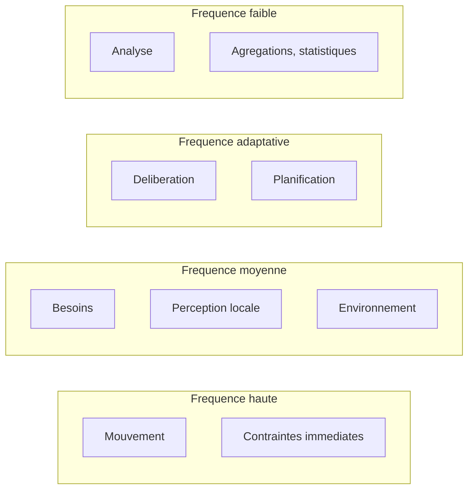

# SYNE III. La boucle de simulation

Le monde a une matière, les habitants une cognition. Il manque un temps partagé : un ordre qui décide ce qui arrive d'abord, et à quelle fréquence. Ce chapitre décrit la boucle, l'unité de temps, l'ordre causal strict et le niveau de détail.

C'est un chapitre d'apparence technique, mais il porte une décision philosophique. Une simulation peut avancer de deux manières : par événements (chaque action se produit quand elle se produit, dans un temps continu) ou par pas discrets (le monde avance par tranches d'un temps égal). Le projet a choisi les pas discrets, et ce choix n'est pas un détail d'implémentation : c'est lui qui rend le monde comparable. Un temps continu est plus « naturel », mais deux exécutions d'un même monde en temps continu ne se ressemblent plus, parce que les instants s'entrelacent de manière imprévisible. Un temps discret, au contraire, impose à toutes les entités la même grille, si bien que le même seed produit toujours la même histoire. Le tick n'est donc pas seulement une unité de temps : c'est la condition de la reproductibilité.

**Pourquoi ce chapitre importe pour la question directrice.** Une horloge partagée est ce qui permet à plusieurs personnes de se donner rendez-vous : sans elle, chacun vivrait dans son temps propre, et rien de commun ne pourrait se produire. Le monde de LIVEX a besoin du même socle : un temps discret, identique pour tous, où chaque événement a un avant et un après. Sans ce temps partagé, on ne pourrait ni comparer deux runs, ni remonter une cause, ni dire qu'un phénomène s'est reproduit. La boucle pose donc la condition de comparabilité sans laquelle la question directrice resterait une impression.

## 1. Le tick

L'unité de temps de la simulation est le tick. Par défaut, un tick vaut une minute simulée, et le moteur avance de dix ticks par seconde réelle, soit dix minutes simulées par seconde réelle. La cadence est configurable, comme l'est la durée simulée d'un tick, sujet traité plus loin.

Le tick n'est pas seulement une unité de temps. C'est l'unité de causalité. À chaque tick, les entités perçoivent, décident et agissent dans un ordre déterminé. Les conséquences d'une action dans un tick n'affectent le monde qu'en fin de tick, et n'influencent donc les décisions qu'au tick suivant. Cette **fenêtre causale fermée** est la condition du déterminisme.

Le moteur prend en charge la pause, la reprise, l'avance pas à pas et le changement de vitesse. Ces opérations ne consomment aucun tirage aléatoire, et ne modifient donc pas la trajectoire : un run piloté produit exactement le même état qu'un run ininterrompu. C'est un point de contrat, vérifié par test.

L'idée que la pause et la reprise ne changent rien vaut d'être appuyée, car elle est contre-intuitive. Dans beaucoup de simulations, mettre en pause et reprendre perturbe l'état : un minuteur réel s'est écoulé, un tampon s'est vidé, l'ordonnancement a bougé. Ici, non. Le temps réel d'attente n'entre dans aucun calcul ; seul compte le nombre de ticks accomplis. Un run mis en pause pendant une heure reprend exactement là où il s'était arrêté, sans que l'horloge murale ait laissé de trace. C'est cette propriété qui rend le pilotage interactif compatible avec la science : on peut observer un run en le suspendant, discuter, puis le reprendre, sans altérer ce qu'on observe.

Cette accélération de six cents fois signifie qu'une journée simulée (1 440 minutes, donc 1 440 ticks) se déroule en environ deux minutes et demie réelles. Ce rythme accéléré est volontaire : il permet d'observer sur une durée raisonnable un monde qui, sinon, demanderait des jours. Le lecteur doit garder ce facteur en tête chaque fois qu'un épisode est daté en ticks : mille ticks ne sont pas mille minutes réelles, mais environ cent secondes.

## 2. La boucle de référence

La boucle de référence comporte quinze étapes, exécutées dans un ordre causal strict.

| # | Étape | Description |
| --: | :-- | :-- |
| 1 | Percevoir | lire les entités, ressources et obstacles proches |
| 2 | Mettre à jour la mémoire | stocker les observations, appliquer la décroissance |
| 3 | Réviser les croyances | intégrer les nouvelles informations |
| 4 | Mettre à jour l'état interne | énergie, besoins physiologiques |
| 5 | Mettre à jour les besoins | calculer les niveaux courants |
| 6 | Générer ou actualiser les objectifs | depuis les besoins non satisfaits |
| 7 | Générer les possibilités | actions candidates |
| 8 | Évaluer les possibilités | score d'utilité |
| 9 | Délibérer | choix de l'action |
| 10 | Définir une intention | engagement sur l'action |
| 11 | Exécuter l'action | appliquer l'action (atomiquement) |
| 12 | Produire des conséquences | effets sur l'entité et le monde |
| 13 | Modifier le monde | mise à jour de l'environnement |
| 14 | Produire des événements | événements observables |
| 15 | Nouvelles perceptions | retour au début |

La boucle est **conceptuelle** : l'ordonnanceur peut exécuter chaque sous-système à sa propre fréquence, ce qui permet d'économiser du calcul sans altérer l'ordre causal.

Il faut lire cette table comme une **chaîne**, non comme une liste. Chaque étape consomme ce que la précédente a produit : on ne peut pas évaluer une possibilité avant de l'avoir générée, ni générer un objectif avant d'avoir mesuré un besoin, ni mesurer un besoin avant d'avoir perçu. L'ordre n'est donc pas une convention, c'est une dépendance. Le respecter, c'est garantir que chaque décision repose sur un état cohérent, non sur un état à moitié mis à jour.

Une distinction fine mérite d'être faite entre la boucle **conceptuelle** et son **exécution**. Conceptuellement, chaque entité parcourt les quinze étapes à chaque tick. En pratique, l'ordonnanceur peut grouper les étapes par sous-système et leur donner des fréquences différentes, ou espacer la délibération des entités lointaines. Ces optimisations ne changent pas la sémantique : ce que l'ordonnanceur calcule à un tick donné est exactement ce que la boucle conceptuelle aurait calculé, simplement à un coût moindre. C'est cette séparation entre le sens et l'ordonnancement qui permet au moteur d'être à la fois rigoureux et efficace.

De cette séquence découle une chaîne de traçabilité, réutilisée dans tout le livre :

```text
Action ← Intention ← Objectif ← Besoin ← Croyance ← Mémoire ← Perception
```

C'est cette chaîne que l'analyse causale reconstruit, et c'est elle qui distingue LIVEX d'un modèle opaque.

La chaîne de traçabilité est peut-être l'acquis le plus important de ce chapitre, parce qu'elle est ce qui rend le monde **explicable**. Dans un modèle opaque, on voit une action et l'on ne sait pas d'où elle vient : un réseau de neurones produit une sortie, et l'on peut au mieux la commenter. Ici, chaque flèche de la chaîne est un objet identifiable et mesurable. Une action vient d'une intention, qui vient d'un objectif, qui vient d'un besoin, qui vient d'une croyance, elle-même issue d'une mémoire, elle-même issue d'une perception. On peut donc répondre à la question « pourquoi cet agent a-t-il fait cela ? », non par une intuition, mais en remontant les flèches l'une après l'autre. C'est cette propriété qui autorise un livre entier d'analyse causale sans jamais avoir à dire « on ne sait pas pourquoi ».

## 3. La distribution des fréquences

Tous les sous-systèmes ne tournent pas à chaque tick. Ils sont répartis en quatre classes.



Ce découpage est un principe d'architecture, non une liste de valeurs figées. Il existe pour un motif précis : le mouvement doit être fluide, la cognition peut être espacée, l'analyse n'a pas besoin de chaque tick.

La logique derrière cette répartition est une logique de **pertinence**. Toutes les couches du monde ne varient pas à la même vitesse. La position d'un agent change à chaque tick et doit être suivie finement ; son objectif change rarement et peut être réévalué moins souvent ; les statistiques globales, enfin, ne gagnent rien à être recalculées à chaque tick, car elles décrivent des tendances, non des instantanés. En donnant à chaque couche la fréquence de sa vitesse de variation, le moteur dépense son calcul là où il compte.

Ce principe éclaire une question fréquente : pourquoi la perception n'est-elle pas calculée pour tout le monde à chaque tick ? Non par économie seulement, mais parce que la perception est elle-même plus utile quand elle est diverse. Le monde gagne à ce que les entités n'observent pas toutes au même instant, comme on le verra au chapitre de la cognition. La distribution des fréquences sert donc deux buts à la fois : elle économise du calcul et elle introduit de la diversité.

## 4. Le niveau de détail

Le niveau de détail décisionnel espace les décisions des entités éloignées, sans biaiser celles des proches.

| Zone | Éloignement | Fréquence de décision |
| :-- | :-- | :-- |
| Zone 0 | proche | tous les ticks |
| Zone 1 | intermédiaire | un tick sur deux |
| Zone 2 | lointaine | un tick sur quatre |

La fréquence suit `1 / 2^LOD`, et une décision n'est réévaluée que lorsque le tick courant est un multiple de l'intervalle ; sinon, l'action courante est poursuivie en **holdover**. Entre deux délibérations planifiées, l'entité reporte sa dernière décision. Ce report n'introduit aucun aléa : il répète un choix déterminé.

Le point délicat du niveau de détail est l'équité. On pourrait craindre qu'un agent lointain, décidant moins souvent, soit désavantagé : moins de réactivité, donc moins de survie. C'est pourquoi le mécanisme est qualifié d'« équitable » : il espace la délibération, jamais la prise en compte des contraintes vitales. Le mouvement continue à chaque tick, la perception vitale reste assurée, et la seule chose qui s'espace est le calcul d'utilité, dont on montre qu'il ne change pas la décision dans l'immense majorité des cas. Un agent qui déciderait tous les ticks ferait presque toujours le même choix qu'un agent qui décide un tick sur quatre, parce que ses besoins et ses perceptions varient lentement. Espacer la délibération des lointains exploite cette inertie sans introduire de biais systématique.

Plus récemment, un **contrôle de saillance** a été livré, désactivé par défaut. Activé, il remplace le report systématique par une politique de reconsidération : entre deux délibérations, l'intention est poursuivie, sauf si un besoin franchit un seuil, si une condition critique survient, ou si un filet de sécurité périodique (tous les cinquante ticks) force la reconsidération. Ce raffinement se fait sur des signaux internes, sans tirage.

Le contrôle de saillance est une réponse à une limite du report pur. Si un agent lointain décide un tick sur quatre, il peut, entre deux décisions, manquer un changement important de sa situation, par exemple la chute brutale de son énergie. La saillance corrige cela : elle permet de reprendre la décision dès qu'un signal interne franchit un seuil, sans attendre la prochaine délibération planifiée. Le filet de sécurité périodique garantit par ailleurs qu'aucune entité ne reste trop longtemps sans reconsidérer sa situation. Ce raffinement est disponible mais désactivé par défaut, pour une raison simple : il modifie la trajectoire de référence, et le projet préfère conserver la trajectoire calibrée tant qu'il n'a pas mesuré l'effet du changement.

## 5. L'ordre causal et le déterminisme

L'ordre causal strict est la clé du déterminisme. À l'intérieur d'un tick, les entités sont traitées par identifiant croissant. La communication s'exécute en une passe, diffusion puis relais. La révision des groupes s'intercale après les décréments de croyances et de confiance, et avant la fusion des naissances. La mortalité, la réduction des effectifs, le cycle des réserves, puis le drainage des événements ferment le tick.

Aucune de ces étapes ne consomme de tirage aléatoire global. Là où un hasard est nécessaire (déplacement pseudo-aléatoire, incompréhension d'un message), il est dérivé d'un hachage stable (splitmix64) des identifiants et du tick, jamais du générateur global. La conséquence est nette : l'avancement du générateur reste minimal, et deux runs au même seed produisent la même trajectoire.

L'ordre des grandes étapes du tick mérite d'être détaillé, car il encode des dépendances subtiles. Traiter les entités par identifiant croissant garantit que la décision d'un agent ne dépend jamais de l'ordre accidentel de parcours d'une collection. La communication en une passe, diffusion avant relais, garantit qu'un message relayé au tick t ne peut pas être relayé une seconde fois dans le même tick par le même agent, ce qui borne la propagation. La révision des groupes intervenant après les décréments de confiance signifie qu'un groupe est jugé sur les relations **mises à jour**, non sur les relations du tick précédent. Et la mort, placée après les naissances, garantit qu'un nouveau-né ne peut pas mourir dans le tick de sa naissance, ce qui évite un cas limite désagréable.

Ces micro-décisions paraissent insignifiantes prises une à une, mais leur ensemble est ce qui rend le monde reproductible. Si l'une d'elles était laissée au hasard de l'implémentation, alors deux exécutions pourraient diverger, et l'on ne pourrait plus comparer deux runs. Le chapitre de la reproductibilité formalisera ce principe : chaque degré de liberté retiré est une garantie gagnée.

## 6. La boucle et la persistance

À la fin de certains ticks, la boucle peut déclencher une sauvegarde automatique (tous les mille ticks par défaut). Cette écriture est purement en sortie : elle ne tire aucun aléa et n'altère donc pas la suite de la simulation. La persistance complète, y compris la reprise exacte, fait l'objet du chapitre suivant.

La sauvegarde automatique est un cas particulier d'une règle générale du projet : **tout ce qui est observé est en lecture seule vis-à-vis de la simulation**. L'entrée de sortie n'a pas le droit d'écrire dans l'état. C'est cette règle qui permet à un observateur de sauvegarder, de journaliser ou de streamer sans jamais perturber ce qu'il observe. Elle paraît élémentaire, mais elle est souvent violée dans les grands systèmes, où l'observabilité modifie l'observé. Le projet s'interdit cette faute par principe.

## 7. Ce que ce chapitre apporte à la question directrice

Ce chapitre a montré que le temps du monde est un temps causal : quinze étapes, un ordre strict, des fréquences distribuées, un niveau de détail qui espace sans fausser. C'est cet ordre qui rend la trajectoire rejouable et la causalité inspectable.

On peut résumer ce que le chapitre établit en une phrase : le monde a un **avant** et un **après** qui ne se confondent jamais, et aucun événement ne peut influencer le passé. Cette flèche du temps, discrète et stricte, est ce qui rend possible tout ce qui suit : la comparaison de deux runs, la reconstruction d'une cause, la mesure d'une propagation. Sans elle, il n'y aurait ni expérience ni analyse, seulement une animation.

Ce que ce chapitre ne permet pas encore de conclure : que ces règles produisent des phénomènes intéressants. Pour cela, il faut pouvoir arrêter le monde et le reprendre sans le briser, afin de comparer des expériences. C'est le sujet du chapitre suivant : persister et revenir.

## Note de conformité — fenêtre causale et ordre d'itération (arbitrage A0-1)

*Ajoutée le 17 octobre 2026, à l'issue du réalignement SYNE 0.17.0 (phase 3, arbitrage A0-1). Le corps du chapitre est inchangé : cette note certifie ce que le code exécute à la date indiquée.*

**Conforme.** L'énoncé du §1 — « les conséquences d'une action dans un tick n'affectent le monde qu'en fin de tick, et n'influencent donc les décisions qu'au tick suivant » — est implémenté : la perception et la délibération d'un tick lisent l'état figé en ouverture de tick ; les effets (déplacements, effets inter-entités) sont mis en file puis appliqués en lot à la fermeture du tick. Références : `Simulation.Core/Actions/TickCommitBuffer.cs` et `CognitionPipeline.Step` (itération triée par identifiant, commit de fin de boucle).

**Précision sur l'ordre.** Le §5 impose l'ordre croissant des identifiants. Cette note précise le sens à en donner : l'ordre d'itération est un **détail d'exécution, pas une loi causale**. Deux runs à configuration et graine identiques mais dont les entités ont été insérées dans un ordre inversé produisent exactement la même empreinte d'état complète. C'est vérifié par `CausalOrderInvarianceTests` (comparaison aux ticks 10, 30 et 60, avec contrôle de divergence par graine), en complément de `CausalWindowTests` (aucun agent ne perçoit un effet produit dans le même tick).

**Exception déclarée.** Le prélèvement sur un **gisement** reste séquentiel, dans l'ordre des identifiants : une action terminale doit savoir si elle a réussi avant d'appliquer son effet sur le besoin, et différer le prélèvement imposerait soit une révision a posteriori du résultat, soit une double dépense silencieuse. La conséquence visible est bornée à la quantité d'un stock partagé — jamais à la perception d'un agent.

**Portée de cette note.** Une note de conformité établit l'accord entre ce chapitre et le code à une date donnée, en citant les tests qui le constatent ; elle ne dit rien de la viabilité du monde ni de l'émergence des structures. Constat relevé le 17 octobre 2026 : `CausalWindowTests` et `CausalOrderInvarianceTests` verts, suite moteur complète verte (596 tests).
