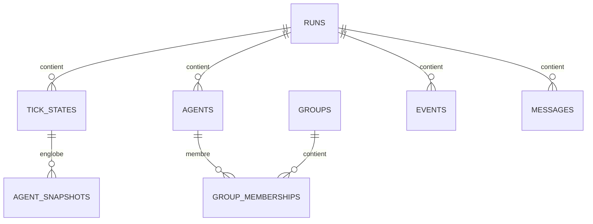

# SYNE IV. Persistance et reprise

Un monde qui ne peut être arrêté ni repris n'est pas un instrument : c'est une démonstration. Pour comparer des expériences, pour analyser une trajectoire longue, pour archiver une campagne, il faut pouvoir sauvegarder le monde, l'éteindre, le rallumer et poursuivre exactement au même endroit. C'est la promesse de ce chapitre : on peut arrêter LIVEX en plein vol et le reprendre à l'identique, au bit près.

Cette promesse a une portée qu'il faut mesurer. La plupart des simulations perdent leur état quand elles s'arrêtent : elles doivent redémarrer à zéro. LIVEX, lui, traite son monde comme un document qu'on peut fermer et rouvrir. Cette différence change tout : on peut lancer un run, aller dormir, le reprendre le lendemain matin, et obtenir la même suite d'événements qu'un run qui n'aurait jamais été interrompu. C'est ce qui autorise les campagnes longues et les comparaisons rigoureuses.

**Pourquoi ce chapitre importe pour la question directrice.** Un livre qu'on peut fermer et rouvrir sans perdre la page, voilà ce que doit être le monde. Si l'on ne pouvait pas suspendre un run, l'éteindre et le reprendre exactement, on ne pourrait observer que des sessions courtes, et les phénomènes lents (une confiance qui se construit, un groupe qui se dissout) resteraient hors de portée. La persistance est ce qui autorise l'observation longue, donc l'observation de ce que la question directrice cherche précisément : des structures qui se forment et se défont dans la durée.

## 1. La promesse

La persistance garantit deux choses. La **sauvegarde** : capturer l'état complet du monde à un tick donné. La **reprise exacte** : reprendre au tick choisi et poursuivre de façon que les événements produits soient exactement les mêmes qu'une exécution ininterrompue. La seconde est bien plus exigeante que la première, et c'est elle qui distingue un instrument d'un simple enregistrement.

La différence entre sauvegarde et reprise exacte mérite d'être appuyée. Sauvegarder, c'est photographier : on écrit l'état sur disque, et n'importe qui peut le relire. Reprendre exactement, c'est plus difficile : il faut que la suite de la simulation soit identique, ce qui exige de restaurer non seulement l'état visible (positions, besoins, réserves) mais aussi l'état caché qui influence l'avenir (le générateur pseudo-aléatoire, les croyances, les mémoires, les files de messages). Une sauvegarde incomplète, qui restaurerait les positions mais pas le générateur, produirait une reprise plausible mais fausse : le monde redémarrerait, mais sa trajectoire divergerait. La reprise exacte est donc un contrat plus fort, et c'est ce contrat que le projet tient.

## 2. Deux formats

La stratégie repose sur deux formats complémentaires.

- Un format **JSON**, simple et inspectable, utilisé pour le débogage.
- Un format **SQLite**, transactionnel, adapté à l'évolution du schéma et aux requêtes analytiques. Le connecteur est fourni par une bibliothèque externe (`Microsoft.Data.Sqlite`).

Les deux partagent un codec déterministe : à un état donné correspond une représentation canonique, indépendante de la culture et de la plateforme.

Le choix de deux formats peut surprendre, mais il répond à deux besoins distincts. Le JSON est lisible à l'œil : on peut ouvrir un fichier de sauvegarde et voir l'état du monde, ce qui est précieux pour comprendre un comportement inattendu. Le SQLite est robuste et requêtable : il gère des écritures concurrentes, des transactions atomiques, et permet d'interroger l'historique d'un run par des requêtes. Un même monde peut donc être sauvegardé dans l'un ou l'autre format selon l'usage, sans que la reprise exacte en dépende : ce qui compte, c'est que le codec soit déterministe, c'est-à-dire qu'un même état ait toujours la même représentation.

## 3. Le schéma relationnel

Le schéma SQLite comporte onze tables. Les principales sont l'identité du run, l'état par tick, les entités, les instantanés d'entité, les ressources, les instantanés de ressource, les groupes, les appartenances de groupe, les événements, les messages et les métriques. Les relations suivent une hiérarchie simple : un run contient des états par tick, des entités, des ressources, des groupes, des événements, des messages et des métriques.

La colonne capitale est `tick_states.state`, qui porte l'instantané déterministe complet du monde et de la cognition. C'est elle qui permet la reprise exacte. Les tables relationnelles (entités, ressources, groupes, métriques) sont peuplées à chaque sauvegarde par un sous-ensemble de cet instantané, pour les besoins d'analyse. Les tables d'événements et de messages restent prêtes à recevoir l'alimentation analytique.

Dans l'état décrit, le schéma relationnel est à la version 2 (marquée par `PRAGMA user_version`). Le codec JSON a évolué à une version distincte (schéma 3), notamment pour inclure les livres dans l'instantané du monde.

Il faut comprendre la séparation entre l'instantané déterministe et les tables relationnelles. L'instantané est ce qui permet de **continuer** : il contient tout. Les tables relationnelles sont ce qui permet d'**analyser** : elles dupliquent une partie de l'état sous forme interrogeable. Une analyse pourrait se faire à partir du seul instantané, mais requêter un blob JSON est malaisé ; les tables offrent des colonnes, des index et des jointures. Cette dualité est un compromis assumé : un peu de redondance pour un gain d'exploitabilité, sans que la vérité du monde en dépende. Si les tables relationnelles étaient corrompues, la reprise resterait possible à partir de l'instantané.

## 4. L'état du générateur

La reprise exacte exige de restaurer le générateur pseudo-aléatoire. Son état complet (quatre fois soixante-quatre bits) est sauvegardé dans la colonne `rng_state`. Reprendre au tick N consiste à charger l'état du monde à N, charger l'état du générateur, et poursuivre. Aucune re-détermination par rejouage n'est nécessaire.

Rappelons pourquoi le générateur est `xoshiro256**` : il est rapide, éprouvé et son état tient en quatre mots de soixante-quatre bits, donc facilement sérialisable. Un générateur dont l'état n'est pas sérialisable, ou dont le comportement dépend du runtime, est interdit.

Ce point est le plus technique du chapitre, et l'un des plus importants. Restaurer l'état du générateur, c'est restaurer la position exacte dans la suite des nombres pseudo-aléatoires. C'est ce qui distingue une reprise exacte d'une reprise approximative. Si le générateur était remis à sa graine initiale au lieu d'être restauré à sa position courante, la simulation repartirait comme si aucun tick n'avait eu lieu : le monde conserverait ses positions, mais ses prochains tirages seraient faux. En sauvegardant quatre mots, on garantit que le prochain tirage après une reprise est exactement celui qu'aurait produit un run ininterrompu. C'est cette économie de moyens (quatre mots) au service d'une exigence forte (la reprise exacte) qui rend la promesse tenable.

## 5. Ce que contient l'instantané

L'instantané déterministe contient tout ce qui est nécessaire pour poursuivre sans discontinuité : le monde (dimensions, obstacles, entités au trait près, réserves en place), la cognition par entité (besoins, mémoire et sa séquence, croyances, confiance, files de messages non éphémères, taux de succès, intention, trace de décision (état, utilité nullable, preuves justificatives, candidats rejetés)), les groupes actifs, le prochain identifiant de groupe, et le générateur. Les états **dérivés** (grille spatiale, cache de cheminement, tampons par tick) sont reconstruits déterministiquement à la restauration : les sauvegarder serait redondant, les recalculer garantit la cohérence.

| Contenu de l'instantané | Sauvegardé | Reconstruit |
| :-- | :--: | :--: |
| Dimensions, obstacles | oui | |
| Entités (traits, positions) | oui | |
| Réserves en place | oui | |
| Besoins, croyances, mémoire | oui | |
| Confiance, intentions, décisions reportées | oui | |
| Groupes actifs, prochain identifiant | oui | |
| État du générateur | oui | |
| Grille spatiale | | oui |
| Cache de cheminement | | oui |
| Tampons par tick | | oui |

Les livres, lorsqu'ils sont actifs, sont inclus dans l'instantané du monde afin que la reprise conserve les consultations déjà enregistrées.

La distinction entre état sauvegardé et état reconstruit est une décision d'ingénierie qui a une conséquence sur la garantie. Reconstruire la grille spatiale plutôt que la sauvegarder élimine toute possibilité de divergence entre la grille et les positions : puisque la grille est une pure fonction des positions, la recalculer garantit qu'elle leur correspond. Sauvegarder la grille aurait introduit un risque : une grille désynchronisée, écrite dans un fichier, restaurée telle quelle, produirait des comportements incohérents. En reconstruisant tout ce qui est dérivable, on s'interdit cette classe entière de bugs. C'est une application du principe : ne conserver que ce qui ne peut pas être recalculé.

La garantie est vérifiée par un test : un run relancé à partir d'un instantané produit exactement le même hash qu'un run ininterrompu. Ce test s'appelle, dans le code, `ReloadFromSnapshot_ContinuesBitForBitIdenticalToUninterruptedRun`.

## 6. La sauvegarde automatique

Une sauvegarde peut être déclenchée automatiquement tous les mille ticks (valeur par défaut), avec un nombre maximal de sauvegardes conservées (cinq par défaut). La sauvegarde est atomique en SQLite. La rotation purge les runs les plus anciens selon une politique simple.

Un point de déterminisme mérite d'être souligné : la sauvegarde est purement en écriture. Elle ne consomme aucun tirage aléatoire, et n'altère donc pas la trajectoire. Une sauvegarde ne change pas le monde, elle le photographie.

L'atomicité mérite une phrase. Une écriture SQLite est transactionnelle : soit elle réussit entièrement, soit elle ne laisse aucune trace. Si le programme s'arrête au milieu d'une sauvegarde, on ne se retrouve pas avec un fichier à moitié écrit, inexploitable. C'est ce qui rend les sauvegardes automatiques sûres : elles peuvent être déclenchées sans précaution particulière, car un accident en cours d'écriture laisse l'état précédent intact.

## 7. Compatibilité et migrations

Le format de persistance est un contrat. Un monde sauvegardé peut survivre à plusieurs versions du logiciel, à condition de prévoir une version de schéma et des mécanismes de migration. La version de schéma évolue indépendamment de la version de l'application. Un changement de schéma s'accompagne d'un script de migration et d'une évolution de version, mineure ou majeure selon la règle de compatibilité (mineure pour un ajout, majeure pour une suppression ou un changement de sens).

La migration est un sujet que beaucoup de projets négligent, et qui distingue un logiciel durable d'un prototype. Un monde archivé aujourd'hui doit pouvoir être rouvert dans deux ans, même si le schéma a évolué. C'est pourquoi la version de schéma est explicitement enregistrée dans la base (`PRAGMA user_version`), et pourquoi tout changement de structure s'accompagne d'une migration. Cette discipline est la contrepartie de la promesse d'archive : un format d'archive n'est utile que s'il traverse le temps.

## 8. Ce que ce chapitre apporte à la question directrice

Ce chapitre a montré que le monde peut être arrêté et repris sans discontinuité, au bit près. C'est la condition pour mener des campagnes longues, pour comparer des expériences et pour archiver une trajectoire. Sans cette garantie, il n'y aurait pas d'instrument, seulement une démonstration.

Ce que ce chapitre ne permet pas encore de conclure : que l'état sauvegardé soit exploitable par une autre partie du système. Pour relier les composants, il faut des contrats explicites et versionnés. C'est le sujet du chapitre suivant.

## Note de conformité — identité du run et trace de décision (réalignement, phase 4)

*Ajoutée le 17 octobre 2026, à l'issue du réalignement SYNE 0.17.0 (phase 4, schemaVersion 5). Le corps du chapitre est inchangé : cette note certifie ce que le code exécute à la date indiquée.*

**Identité du run.** L'instantané porte le **hash canonique de configuration** (`RunIdentity.ConfigHash` : insensible à l'ordre des clés, sensible aux valeurs, stable entre deux chargements équivalents) en plus du tick, de l'état du générateur et du monde. Le **hash d'état** (`RunIdentity.StateHash`) est reproductible pour deux runs identiques et diverge avec la graine ; il change avec l'état, pas avec l'identité courante du run. Une empreinte d'identité publiée (`RunIdentityStamp`) rassemble versions moteur et schéma, graine et hash de configuration — une valeur absente y est explicitement *absente*, jamais inventée. Gates : `RunIdentityTests` (dont `Snapshot_CarriesTheConfigurationHash`) et la reprise bit-à-bit `ReloadFromSnapshot_ContinuesBitForBitIdenticalToUninterruptedRun` citée au §5.

**Trace de décision restaurée.** L'instantané conserve la trace complète de la dernière décision — état (`fresh`/`holdover`/`interrupted`/`none`), utilité **nullable** (jamais `0.0` en l'absence de décision), scores des candidats, candidats rejetés et chaîne de preuves (source, sujet, confiance, tick d'observation) — et la restauration la réintègre telle quelle (`DecisionSnapshotDto`, `RestoreDecision` + `RestoreDecisionRecord`). Le point d'attention reste ce que le chapitre dit de la provenance de build : elle n'est pas dans l'instantané, et ce n'est pas un oubli — l'instantané ne publie pas ce qu'il ne contient pas.

**Portée de cette note.** Comme celle du chapitre III, elle établit l'accord entre ce chapitre et le code à une date donnée, en citant les tests qui le constatent ; elle ne dit rien de la viabilité du monde ni de l'émersion des structures. Constat relevé le 17 octobre 2026 : `RunIdentityTests`, `PersistenceTests` et `AdrDecisionEvidenceTests` verts, suite moteur complète verte (596 tests).
