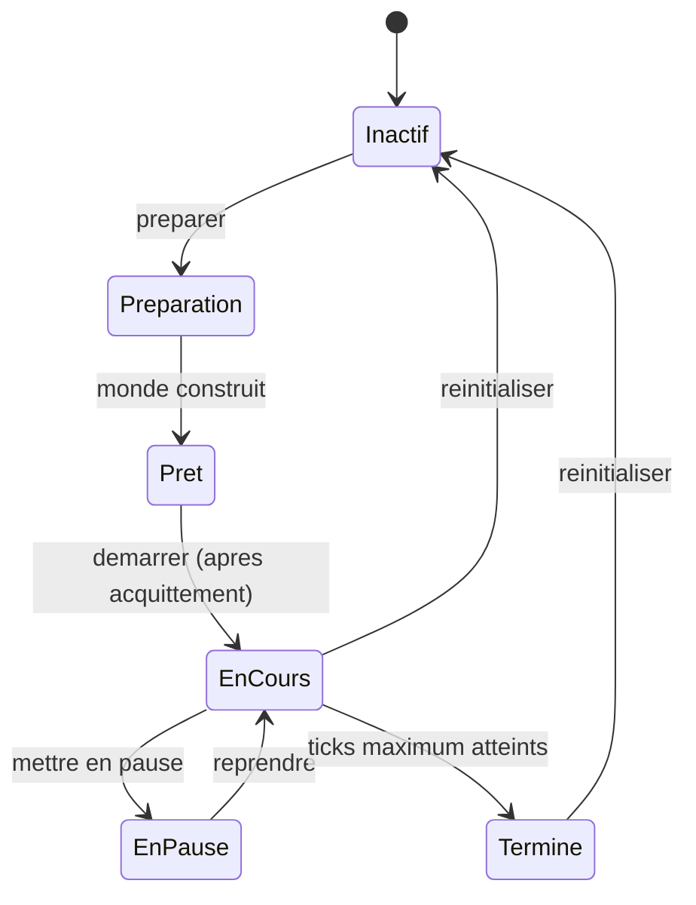

# SYNE V. Les contrats

SYNE possède la vérité du monde, mais il ne vit pas seul. Deux familles de clients l'entourent : ceux qui observent et mesurent (ECHOS), ceux qui montrent et pilotent (PRISM). Pour qu'ils puissent travailler sans réécrire le monde ni dépendre de ses détails internes, il faut des contrats explicites, versionnés et stables. Ce chapitre les décrit.

Depuis la version 0.15.0, le **contrat d'observabilité** porte la version 0.4.0, et la **version moteur** diffusée dans chaque message est 0.15.0. La version moteur identifie les règles du run : deux runs ne sont comparables que si leurs versions moteur coïncident.

Un contrat, dans ce projet, n'est pas un document : c'est une interface qui fonctionne et que des tests vérifient. Le livre décrit les contrats parce qu'ils sont la frontière entre ce que le moteur garantit et ce dont il ne répond pas. Tout ce qui est écrit ici est un engagement tenu ; tout ce qui n'y figure pas n'est pas garanti, même si le code le fait aujourd'hui.

**Pourquoi ce chapitre importe pour la question directrice.** Pour qu'on puisse observer un phénomène sans le fausser, il faut une langue commune entre celui qui agit et celui qui regarde. Les contrats sont cette langue. Sans eux, chaque client devrait deviner les détails internes du moteur, et toute évolution casserait les observateurs. Pour la question directrice, l'enjeu est précis : la séparation entre décider et mesurer n'est possible que si l'état du monde est transmis de façon stable et lisible. Les contrats sont donc ce qui rend l'observation scientifique plutôt qu'artisanale.

## 1. Deux transports

Le moteur expose deux transports.

- Un **flux temps réel** par WebSocket, sur le port 5180 par défaut, en JSON textuel encodé en UTF-8, en notation camelCase. Les trames sont des messages texte, jamais des trames binaires.
- Un **contrôle** par HTTP REST, sur le port 5181 par défaut, pour préparer le monde et commander son cycle de vie.

Les ports ne sont pas figés : ils sont configurables, et le bind par défaut est local (`127.0.0.1`). Un client ne doit jamais supposer un port en dur.

Cette séparation entre deux transports répond à deux besoins distincts. Le flux d'observation est unidirectionnel et volumineux : il pousse un état par tick. Le contrôle est bidirectionnel, ponctuel et critique : chaque commande a un résultat, et son ordre importe. Mélanger les deux sur un même canal aurait rendu le contrôle dépendant du débit d'observation, ce qui est exactement ce qu'il faut éviter : un monde qui produit beaucoup d'état ne doit pas ralentir les ordres de pilotage.

## 2. Le message d'initialisation

Avant tout instantané, le moteur émet un message `world_initialized`. Il décrit la topologie statique : dimensions, taille de cellule, cadence, durée simulée par tick, correspondance d'unités, le nombre de cellules, les entités de départ, les cellules, les obstacles, les emplacements de ressources et les régions.

La description est versionnée. Sa version courante est 1.1. Un consommateur qui compare les versions doit accepter une référence « 1.0 » comme compatible. La description 1.1 ajoute deux champs additifs : la durée simulée par tick (qui vaut 60 par défaut, soit une minute, et 5 pour le profil de représentation) et la correspondance d'unités (informative). Les champs antérieurs sont inchangés.

| Champ de la description | Rôle |
| :-- | :-- |
| dimensions, taille de cellule | repères spatiaux du monde |
| cadence, durée simulée par tick | repères temporels |
| correspondance d'unités | projection informative |
| entités de départ | identifiant, espèce, position |
| cellules | position, terrain, praticabilité, hauteur, coût |
| obstacles | disques initiaux |
| emplacements de ressources | marqueurs par cellule |
| régions | découpages de dix cellules |

Chaque agent de départ expose son identifiant, son espèce et sa position. Chaque cellule expose sa position, un type de terrain, sa praticabilité, une hauteur, un coût de déplacement et les obstacles qui la recouvrent. Le type de terrain vaut « plaines » partout, tant que le moteur n'a pas de biomes : c'est un champ prévu, non une fonctionnalité active.

La topologie statique n'est envoyée qu'une fois. C'est une décision importante : envoyer la description complète du monde à chaque tick serait coûteux et inutile. Les cellules ne changent que par les mutations d'obstacles, qui sont transmises dans les snapshots. Un client qui reconstruit l'état complet doit donc appliquer les mutations successives à la description initiale. Cette règle impose une discipline au consommateur, mais elle économise une quantité considérable de bande passante sur des runs longs.

## 3. L'instantané par tick

Le moteur émet exactement un message global `snapshot` par tick. Ce snapshot est l'état dynamique autoritaire complet du tick : tous les agents, les stocks de ressources, les obstacles, les groupes, les territoires et les livres actifs, plus les mutations du monde et les actions exécutées pendant le tick.

La topologie statique (les cellules) n'est envoyée qu'une fois, à l'initialisation. Les cellules modifiées doivent être reconstruites à partir des mutations et des obstacles complets du snapshot.

Les principaux champs du snapshot sont :

| Champ | Rôle |
| :-- | :-- |
| `version`, `engineVersion` | versions du contrat et du moteur |
| `runId`, `seed` | identité du run et graine effective |
| `tick`, `simulatedTimeMinutes`, `simulatedTimeSeconds` | temps simulé |
| `aliveCount` | entités vivantes |
| `agents[]` | état complet exposé de chaque entité |
| `resources[]` | stocks globaux des quatre ressources |
| `obstacles[]` | constructions et obstacles |
| `groups[]`, `territories[]`, `books[]` | systèmes collectifs activés |
| `worldChanges[]`, `actions[]` | mutations et résultats d'action du tick |

Le champ `runId` est l'identité de contenu consommée par ECHOS. Depuis une calibration, les runs pilotés utilisent un format canonique `run-<seed>-<12hex>` : la graine reste lisible dans l'identifiant, et un suffixe hexadécimal garantit l'unicité entre deux runs de même graine. La graine effective est aussi exposée directement, ce qui évite aux clients de la dériver du nom.

Le champ `actions[]` décrit, pour chaque agent, l'action exécutée et son résultat : action, issue (exécutée ou bloquée), cause éventuelle, puis les variations d'énergie, de faim, de soif et de fatigue, et, le cas échéant, la réserve consommée. C'est cette table qui rend une action inspectable.

Un instantané est donc **auto-suffisant** pour l'état dynamique, et **non auto-suffisant** pour la topologie. Cette distinction a une conséquence pratique pour l'observatoire : ECHOS conserve la description initiale, l'applique une fois, puis suit les mutations. Un consommateur qui aurait raté le message d'initialisation (par exemple à cause d'une reconnexion avant le premier snapshot) ne peut pas reconstruire la topologie à partir des seuls snapshots. C'est une des raisons pour lesquelles l'observatoire signale les trous au lieu de les combler, comme le montrera la partie ECHOS.

## 4. Les événements

À côté des snapshots, le moteur émet des événements typés, utiles au diagnostic et à l'analyse. La liste ci-dessous rassemble ceux que la version décrite émet ou peut émettre.

| Événement | Moment | Contenu principal |
| :-- | :-- | :-- |
| `tick_summary` | à chaque tick | nombre de vivants |
| `decision_made` | à chaque décision | intention, utilité, drapeaux, cause |
| `action_completed` | à chaque action | résultat de l'exécution |
| `message_sent` | à l'émission | identifiant, émetteur, type, charge |
| `message_received` | à la réception | confiance effective, sauts |
| `group_formed` | à la formation | membres, identifiant |
| `group_dissolved` | à la dissolution | durée de vie, bilan |
| `group_decision` | à la décision | intention dominante, part pondérée |
| `agent_spawned` | à une naissance | parents |
| `agent_died` | à une mort | identifiant |
| `world.construction_placed` | à une mutation | obstacle |
| `world.construction_removed` | à une mutation | obstacle |
| `world.season_changed` | au basculement | saison |
| `world.territory_membership_changed` | au franchissement | entrée, sortie |
| `world.book_written`, `world.book_read` | à l'écriture ou la lecture | auteur, lecteurs |

Les événements `decision_made`, `action_completed` et les mutations restent émis séparément pour la compatibilité et le diagnostic, mais les consommateurs qui mettent à jour un état doivent traiter le snapshot comme la source de vérité, et éviter d'appliquer deux fois les mutations qu'il contient déjà.

Cette double règle, événements pour le diagnostic et instantané pour l'état, est le point le plus délicat du contrat. Elle stipule qu'un événement raconte **ce qui s'est passé**, tandis qu'un instantané décrit **ce qui est**. Un consommateur peut s'abonner aux événements pour réagir (afficher un effet, journaliser), mais s'il veut connaître l'état, il doit lire l'instantané. Appliquer les mutations d'un événement en plus de celles d'un instantané produirait un double comptage. Le livre y revient dans la partie PRISM, où ce piège est le plus fréquent.

## 5. Le contrôle

Le contrôle suit une machine à états.

Les opérations principales sont préparer, accuser réception, démarrer, mettre en pause, reprendre, réinitialiser et lire l'état.

Un monde préparé explicitement doit être acquitté avant d'être démarré. Après un prepare explicite, un démarrage exige cet accusé de réception ; un démarrage direct conserve l'auto-préparation historique.

Une règle mérite d'être citée pour sa valeur d'exemple : un démarrage alors que le run a atteint son nombre maximal de ticks (état « terminé ») renvoie une erreur dédiée, `run_finished`, qui oriente le client vers une réinitialisation plutôt que vers une préparation. Cette précision a remplacé une erreur générique qui induisait en erreur. C'est un petit détail de contrat, mais il illustre la méthode : rendre les messages justes, corriger explicitement.

Le contrôle est **non intrusif** : aucune commande ne retire de tirage au générateur ni ne change la trajectoire. Un run piloté produit exactement le même état qu'un run ininterrompu, et un test le vérifie.

L'acquittement obligatoire mérite une explication. Pourquoi exiger que le monde soit préparé, puis acquitté, puis démarré, plutôt que de tout enchaîner ? Parce que la préparation construit le monde et peut échouer : un layout invalide, une configuration incohérente, un obstacle hors bornes. Si le moteur démarrait aussitôt, une préparation échouée produirait un run dans un état inattendu. En imposant un accusé de réception explicite, le contrat force le client à vérifier que le monde est réellement prêt avant de le faire avancer. C'est une discipline de sûreté, et elle a un coût : trois appels au lieu d'un. Le projet préfère le coût à l'ambiguïté.

## 6. La compatibilité ascendante

La règle est simple et unique. Un **ajout** de champ est compatible (mineur) : les consommateurs doivent tolérer les champs qu'ils ne connaissent pas. Une **suppression**, un **renommage** ou un **changement de sens** sont incompatibles (majeur). Le champ de version du snapshot permet aux consommateurs de détecter les évolutions.

| Modification du contrat | Compatibilité | Version |
| :-- | :-- | :-- |
| Ajout d'un champ | compatible | mineure |
| Ajout d'un événement | compatible | mineure |
| Suppression d'un champ | incompatible | majeure |
| Renommage d'un champ | incompatible | majeure |
| Changement de sens d'un champ | incompatible | majeure |

Cette règle a une conséquence pratique : de nombreuses fonctionnalités récentes (inventaire, engagements) sont émises sous drapeaux, avec une sortie bit-à-bit identique lorsqu'elles sont désactivées. Un consommateur ancien peut donc lire un flux récent sans la plupart des surprises.

La règle de compatibilité est ce qui rend le versionnage indépendant possible. Puisque un ajout est compatible, un composant peut évoluer sans forcer ses clients à changer en même temps. Cela signifie qu'un client écrit pour une version ancienne continue de fonctionner, en ignorant les nouveautés, au lieu de se briser. Dans un projet où les composants versionnent séparément, cette règle n'est pas un confort : c'est ce qui empêche une évolution locale de propager une renumérotation générale.

## 7. Ce que ce chapitre apporte à la question directrice

Ce chapitre a montré que le monde parle à ses clients par des contrats explicites, versionnés et non intrusifs. C'est ce qui permet de séparer décider, mesurer et montrer sans créer de dépendances cachées. Les clients observent un flux autoritaire ; ils ne le réécrivent pas.

Ce que ce chapitre ne permet pas encore de conclure : que les clients exploitent correctement ces contrats. Il faut, pour cela, entrer dans les détails de configuration (les valeurs qui changent le monde) puis dans les systèmes collectifs (ce que le monde produit au-delà de l'individu). Le chapitre suivant traite la configuration et la calibration.
