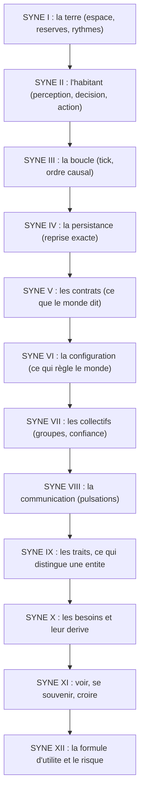

# Chapitre 5. SYNE : le monde qui doit pouvoir se passer de nous

**Mise à jour au 4 novembre 2026.** Les chapitres de cette partie décrivent
SYNE 0.17.0 et ses mécanismes, dont le monde autonome historique. Dans le
couplage V2, PRISM est l'autorité du monde physique et SYNE reçoit des
observations pour la cognition. L'adaptateur, la boucle couplée et l'application
aux croyances sont livrés ; l'extraction complète du monde SYNE et la reprise
commune restent ouvertes. Les contrats WebSocket décrits ici restent ceux du
mode SYNE autonome/V1 ; le contrat SYNE↔PRISM V2 est distinct.

Si la question directrice demande des lois fondamentales, le projet doit en décrire l'autorité sans ambiguïté. En V1, cette autorité vivait dans SYNE. En V2, le monde physique relève de PRISM, tandis que SYNE porte la cognition. Cette partie raconte le moteur .NET et ses mécanismes tels qu'ils sont implémentés ; elle distingue le mode autonome historique du couplage V2.

Le nom est un acronyme, mais c'est d'abord une fonction : **SYNE est le composant cognitif qui décide**. En V1, il était aussi la source de vérité du monde physique. Dans le couplage V2, PRISM détient ce monde ; SYNE reçoit ses observations, les applique aux croyances et renvoie des commandes. La boucle fonctionne et a été exercée sur 1 000 ticks, mais l'extraction complète depuis le moteur SYNE n'est pas terminée.

## Ce que ce chapitre raconte

Ce chapitre suit un monde, de l'intérieur. Il ne s'agit pas d'énumérer des classes de code, mais de comprendre comment un espace, des ressources et des rythmes d'un côté, une cognition de l'autre, et une boucle causale qui les relie, peuvent produire des trajectoires singulières à partir de règles communes.

SYNE 0.17.0, en C# sur .NET, tient cette promesse par quatre vertus inséparables.

- **Il simule.** Un plan continu avec des réserves qui respirent et une géographie qui résiste.
- **Il fait décider.** Des entités BDI à utilité transparente, dont un calcul complet est détaillé.
- **Il persiste.** On peut l'arrêter en plein vol et le reprendre à l'identique, au bit près.
- **Il dit ce qu'il fait.** Des snapshots, des événements et des contrats versionnés.

Au relevé du 4 novembre, les suites SYNE comptaient 708 réussites : 604 Core et 104 Console. Les chiffres de couverture et les relevés antérieurs sont datés dans les rapports de tests ; ils ne sont pas recalculés ici. Voir le [statut transversal](../../governance/LIVEX-CURRENT-STATUS.md) et le [relevé détaillé de la release V1](../../governance/LIVEX-STATUS.md). Ces résultats attestent les comportements couverts, pas une vérité générale sur le monde simulé.

## Comment lire cette partie

Cette partie se lit comme une visite du monde, de l'intérieur.

1. **SYNE I, la terre et son métabolisme** : l'espace, les réserves, les obstacles et les rythmes, puis l'anatomie interne du moteur.
2. **SYNE II, la cognition en action** : comment Charlie décide de manger plutôt que de parler, de la perception à l'action.
3. **SYNE III, la boucle de simulation** : le tick, l'ordre causal, la distribution des fréquences et le niveau de détail.
4. **SYNE IV, persistance et reprise** : sauvegarde, chargement, reprise exacte et migrations.
5. **SYNE V, contrats** : snapshots, événements et contrôle, avec la règle de compatibilité.
6. **SYNE VI, configuration et calibration** : fichiers, profils, flags et calibration du monde.
7. **SYNE VII, systèmes collectifs** : groupes, confiance, territoires, saisons, reproduction, mort et livres.
8. **SYNE VIII, communication par pulsations** : types de messages, dégradation et confiance.
9. **SYNE IX, les huit traits** : tempéraments, plage et neutralité, modulateur de personnalité, héritage.
10. **SYNE X, les besoins** : six manques, une énergie, des seuils, la dérive par tick et les états critiques.
11. **SYNE XI, voir, se souvenir, croire** : les formules d'une information faillible (confiance perceptuelle, décroissance de la saillance, révision des croyances).
12. **SYNE XII, la formule d'utilité et la prise de risque** : bénéfice, coût, risque, confiance, personnalité, urgence, sélection, hystérésis et interruption.

À chaque étape, le texte revient à la question : en quoi ce choix rend-il l'émergence possible sans la programmer ?

## Le trajet d'une entité, en un regard

Le schéma suivant résume le parcours qu'une entité accomplira dans cette partie. Il servira de fil : chaque chapitre en détaille une portion.

## Un exemple pour tenir le fil

Pour que la partie ne soit pas une abstraction, elle suit une entité, Charlie. Charlie a faim, il voit un voisin, et il devra choisir. Le chapitre SYNE II déroule son calcul complet, chiffre par chiffre. Ce fil a une vertu pédagogique : au lieu de décrire des mécanismes en général, il montre un mécanisme précis produisant une décision précise. Le lecteur qui suit Charlie saura, à la fin de la partie, comment une règle locale devient un comportement.

## Avertissement de portée

Le répertoire `syne-mock`, séparé, contient un serveur Node.js destiné au développement des clients sans lancer le moteur. Il émule une partie des contrats : ce n'est ni le moteur réel, ni une référence d'équivalence algorithmique. Seuls le moteur .NET et ses contrats font foi pour les règles et les résultats de simulation.

Les valeurs citées dans cette partie sont les valeurs par défaut de la version 0.17.0, telles qu'elles figurent dans les options de simulation du code, sauf mention contraire. Certains systèmes livrés (saisons, territoires, livres, constructions, primitives cognitives) sont désactivés par défaut afin de préserver la trajectoire de référence ; leur activation est décrite avec leur statut.

Un troisième avertissement concerne la lecture des chiffres. Un même paramètre peut apparaître dans plusieurs chapitres sous des formes différentes : valeur par défaut, valeur d'un profil, valeur calibrée. Le livre précise chaque fois le contexte. En cas de doute entre une valeur citée dans la prose et celle d'un fichier de configuration versionné, le fichier prime.

- [SYNE I, monde et moteur](01-monde-et-moteur.md)
- [SYNE II, agents et cognition](02-agents-cognition.md)
- [SYNE III, boucle de simulation](03-boucle-simulation.md)
- [SYNE IV, persistance et reprise](04-persistance.md)
- [SYNE V, contrats](05-contrats.md)
- [SYNE VI, configuration et calibration](06-configuration.md)
- [SYNE VII, systèmes collectifs](07-systemes-collectifs.md)
- [SYNE VIII, communication par pulsations](08-communication.md)
- [SYNE IX, traits et tempéraments](09-traits-et-temperaments.md)
- [SYNE X, besoins, seuils et dérive](10-besoins-seuils-et-derive.md)
- [SYNE XI, perception, mémoire et croyances](11-perception-memoire-et-croyances.md)
- [SYNE XII, la formule d'utilité et le risque](12-la-formule-dutilite-et-le-risque.md)

## Ce que cette partie apporte à la question directrice

En refermant cette partie, le lecteur doit pouvoir répondre à une question précise : comment des règles locales et aveugles peuvent-elles produire des comportements qui ne sont écrits nulle part ? La réponse tient en une chaîne : un métabolisme qui contraint, une cognition qui décide de façon traçable, une boucle qui ordonne le temps, une persistance qui rend la trajectoire rejouable, des contrats qui la rendent lisible, une configuration qui la règle, des collectifs qui émergent, une communication qui les relie, des traits qui différencient les individus, des besoins qui les contraignent, une information faillible qui les trompe, et une formule d'utilité qui tranche.

La suite du livre quittera le monde pour l'observer. Mais rien ne serait observable si le monde ne produisait d'abord des faits. Cette partie produit les faits.
