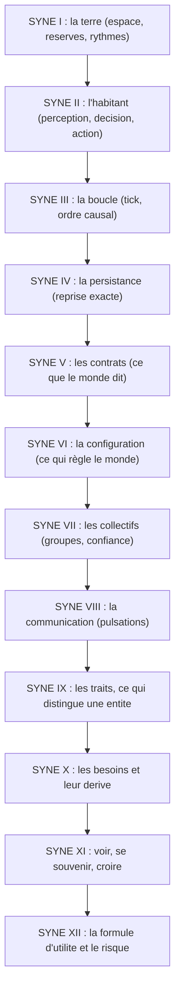

# Chapitre 5. SYNE : le monde qui doit pouvoir se passer de nous

Si la question directrice demande des lois fondamentales, SYNE est l'endroit où elles vivent. Ce chapitre raconte le moteur autoritaire, celui qui possède la vérité du monde et peut tourner sans écran, sans observateur et sans décor. Il montre en quoi chaque mécanisme sert la question : comment des règles locales et aveugles peuvent laisser apparaître du collectif sans jamais l'ordonner.

Le nom est un acronyme, mais c'est d'abord une fonction : **SYNE est le composant qui décide**. Tout le reste du projet tourne autour de ce fait. L'observatoire mesure ce que SYNE produit, la scène montre ce que SYNE décide, l'orchestrateur archive ce que SYNE a produit. Aucun de ces composants ne réécrit l'état du monde ; SYNE en est la source unique. Cette unicité est ce qui rend la question directrice testable, car il n'y a qu'un seul endroit où les lois du monde existent.

## Ce que ce chapitre raconte

Ce chapitre suit un monde, de l'intérieur. Il ne s'agit pas d'énumérer des classes de code, mais de comprendre comment un espace, des ressources et des rythmes d'un côté, une cognition de l'autre, et une boucle causale qui les relie, peuvent produire des trajectoires singulières à partir de règles communes.

SYNE 0.15.0, en C# sur .NET, tient cette promesse par quatre vertus inséparables.

- **Il simule.** Un plan continu avec des réserves qui respirent et une géographie qui résiste.
- **Il fait décider.** Des entités BDI à utilité transparente, dont un calcul complet est détaillé.
- **Il persiste.** On peut l'arrêter en plein vol et le reprendre à l'identique, au bit près.
- **Il dit ce qu'il fait.** Des snapshots, des événements et des contrats versionnés.

À l'état décrit, six cent trente-quatre tests couvrent le moteur, et la couverture agrégée des assemblages mesurée est de 87,41 %. Ce n'est pas un chiffre de fierté : c'est la condition pour croire ce qu'on observe.

## Comment lire cette partie

Cette partie se lit comme une visite du monde, de l'intérieur.

1. **SYNE I, la terre et son métabolisme** : l'espace, les réserves, les obstacles et les rythmes, puis l'anatomie interne du moteur.
2. **SYNE II, la cognition en action** : comment Charlie décide de manger plutôt que de parler, de la perception à l'action.
3. **SYNE III, la boucle de simulation** : le tick, l'ordre causal, la distribution des fréquences et le niveau de détail.
4. **SYNE IV, persistance et reprise** : sauvegarde, chargement, reprise exacte et migrations.
5. **SYNE V, contrats** : snapshots, événements et contrôle, avec la règle de compatibilité.
6. **SYNE VI, configuration et calibration** : fichiers, profils, flags et calibration du monde.
7. **SYNE VII, systèmes collectifs** : groupes, confiance, territoires, saisons, reproduction, mort et livres.
8. **SYNE VIII, communication par pulsations** : types de messages, dégradation et confiance.
9. **SYNE IX, les huit traits** : tempéraments, plage et neutralité, modulateur de personnalité, héritage.
10. **SYNE X, les besoins** : six manques, une énergie, des seuils, la dérive par tick et les états critiques.
11. **SYNE XI, voir, se souvenir, croire** : les formules d'une information faillible (confiance perceptuelle, décroissance de la saillance, révision des croyances).
12. **SYNE XII, la formule d'utilité et la prise de risque** : bénéfice, coût, risque, confiance, personnalité, urgence, sélection, hystérésis et interruption.

À chaque étape, le texte revient à la question : en quoi ce choix rend-il l'émergence possible sans la programmer ?

## Le trajet d'une entité, en un regard

Le schéma suivant résume le parcours qu'une entité accomplira dans cette partie. Il servira de fil : chaque chapitre en détaille une portion.

## Un exemple pour tenir le fil

Pour que la partie ne soit pas une abstraction, elle suit une entité, Charlie. Charlie a faim, il voit un voisin, et il devra choisir. Le chapitre SYNE II déroule son calcul complet, chiffre par chiffre. Ce fil a une vertu pédagogique : au lieu de décrire des mécanismes en général, il montre un mécanisme précis produisant une décision précise. Le lecteur qui suit Charlie saura, à la fin de la partie, comment une règle locale devient un comportement.

## Avertissement de portée

Le répertoire `syne-mock`, séparé, contient un serveur Node.js destiné au développement des clients sans lancer le moteur. Il émule une partie des contrats : ce n'est ni le moteur réel, ni une référence d'équivalence algorithmique. Seuls le moteur .NET et ses contrats font foi pour les règles et les résultats de simulation.

Les valeurs citées dans cette partie sont les valeurs par défaut de la version 0.15.0, telles qu'elles figurent dans les options de simulation du code, sauf mention contraire. Certains systèmes livrés (saisons, territoires, livres, constructions, primitives cognitives) sont désactivés par défaut afin de préserver la trajectoire de référence ; leur activation est décrite avec leur statut.

Un troisième avertissement concerne la lecture des chiffres. Un même paramètre peut apparaître dans plusieurs chapitres sous des formes différentes : valeur par défaut, valeur d'un profil, valeur calibrée. Le livre précise chaque fois le contexte. En cas de doute entre une valeur citée dans la prose et celle d'un fichier de configuration versionné, le fichier prime.

- [SYNE I, monde et moteur](01-monde-et-moteur.md)
- [SYNE II, agents et cognition](02-agents-cognition.md)
- [SYNE III, boucle de simulation](03-boucle-simulation.md)
- [SYNE IV, persistance et reprise](04-persistance.md)
- [SYNE V, contrats](05-contrats.md)
- [SYNE VI, configuration et calibration](06-configuration.md)
- [SYNE VII, systèmes collectifs](07-systemes-collectifs.md)
- [SYNE VIII, communication par pulsations](08-communication.md)
- [SYNE IX, traits et tempéraments](09-traits-et-temperaments.md)
- [SYNE X, besoins, seuils et dérive](10-besoins-seuils-et-derive.md)
- [SYNE XI, perception, mémoire et croyances](11-perception-memoire-et-croyances.md)
- [SYNE XII, la formule d'utilité et le risque](12-la-formule-dutilite-et-le-risque.md)

## Ce que cette partie apporte à la question directrice

En refermant cette partie, le lecteur doit pouvoir répondre à une question précise : comment des règles locales et aveugles peuvent-elles produire des comportements qui ne sont écrits nulle part ? La réponse tient en une chaîne : un métabolisme qui contraint, une cognition qui décide de façon traçable, une boucle qui ordonne le temps, une persistance qui rend la trajectoire rejouable, des contrats qui la rendent lisible, une configuration qui la règle, des collectifs qui émergent, une communication qui les relie, des traits qui différencient les individus, des besoins qui les contraignent, une information faillible qui les trompe, et une formule d'utilité qui tranche.

La suite du livre quittera le monde pour l'observer. Mais rien ne serait observable si le monde ne produisait d'abord des faits. Cette partie produit les faits.
