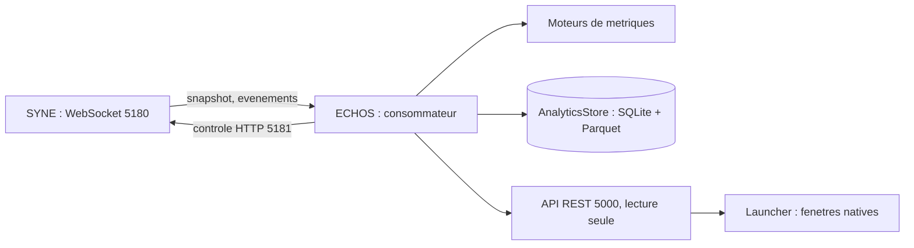
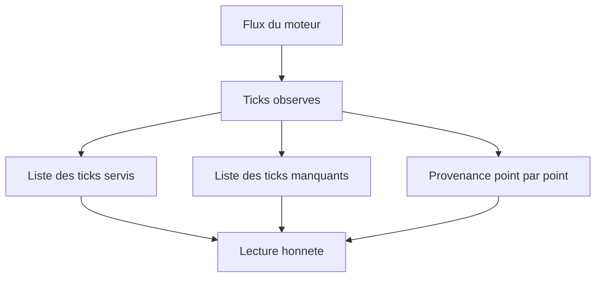

# ECHOS I. Architecture et ingestion

ECHOS est un observatoire : il transforme l'exécution d'un monde en données compréhensibles, sans jamais écrire dans ce monde. Ce chapitre décrit sa place, son architecture, son mode d'ingestion et la manière la plus importante dont il reste honnête : en signalant ses trous plutôt qu'en les recousant.

L'analogie la plus juste est celle du télescope. Un télescope n'agit pas sur l'étoile qu'il observe ; il collecte sa lumière, la concentre, et produit une image. Il a des aberrations, une résolution finie, des nuits où il ne voit rien. Un astronome honnête note les nuits manquées. ECHOS se veut de cette nature : un instrument qui regarde le monde de loin, sans le toucher, et qui documente ses propres limites.

**Pourquoi ce chapitre importe pour la question directrice.** Un astronome ne touche pas aux étoiles : il recueille leur lumière, la concentre, et note les nuits où il n'a rien vu. Pour la question directrice, l'observatoire doit être de cette nature, car une mesure qui modifierait le phénomène rendrait toute réponse suspecte. Ce chapitre décrit la position d'ECHOS : en aval du monde, jamais dedans. C'est cette position qui autorise à dire « voici ce que le monde a produit » sans craindre d'avoir influencé le résultat.

## 1. La place d'ECHOS

ECHOS se place entre le moteur et la présentation. Il consomme le flux temps réel du moteur, calcule, stocke, puis publie une lecture. Trois relations le définissent.

- Il **observe** le moteur par le flux WebSocket (port 5180 par défaut), en lisant des snapshots et des événements.
- Il **pilote** le moteur par le contrôle HTTP (port 5181 par défaut), pour démarrer, mettre en pause, reprendre et réinitialiser.
- Il **publie** une API REST locale (port 5000 par défaut), en lecture seule, consommée par le Launcher.

Il ne modifie jamais la persistance de référence du moteur. Les données d'analyse sont séparées des données de simulation : d'un côté, l'état canonique du monde ; de l'autre, les agrégations, métriques et indices mesurés.

Cette séparation entre les deux persistances est ce qui garantit la non-ingérence. Le monde a sa propre sauvegarde, autoritaire ; l'analyse a la sienne, dérivée. Si l'analyse corrompait sa base, le monde resterait intact : il suffirait de réingérer. Inversement, si le monde était restauré à un état antérieur, l'analyse devrait être recalculée, mais elle ne pourrait pas « remonter le temps » du monde. Cette asymétrie est voulue : l'analyse est un point de vue, non une autorité.

## 2. L'architecture

Le composant décompose quatre responsabilités : l'analyse (les calculs scientifiques), l'application (l'API et le pilotage), le stockage (les données d'analyse) et l'ingestion (les clients de transport). La responsabilité d'interface a été retirée : aucune page n'est servie, aucune application de bureau n'est lancée par ECHOS. La présentation appartient au Launcher.

Ce retrait est une décision assumée. Une interface web et un shell de bureau existaient en version de travail. Ils ont été supprimés parce qu'ils dupliquaient la présentation du Launcher et alourdissaient le projet. Cette décision est cohérente avec la règle de séparation : un composant qui observe ne doit pas aussi porter l'expérience utilisateur.

Il faut mesurer ce que ce retrait coûte et ce qu'il rapporte. Il coûte une certaine autonomie de visualisation : on ne peut plus ouvrir une page et voir les courbes. Il rapporte une clarté de rôle : ECHOS ne montre rien, il publie. Le Launcher, lui, présente. Cette répartition stricte évite le doublon que connaissent beaucoup de projets, où deux composants affichent les mêmes données avec des incohérences entre eux. En supprimant l'interface d'ECHOS, le projet s'interdit ce doublon.

## 3. La pile technique

ECHOS repose sur Python. Le service d'API utilise FastAPI et un serveur ASGI. Le calcul scientifique s'appuie sur NumPy (calcul numérique), Pandas (manipulation tabulaire), SciPy (méthodes scientifiques) et NetworkX (graphes, pour le réseau de confiance). Le stockage d'analyse combine SQLite (agrégations et contexte) et Parquet via PyArrow (séries lourdes).

Une divergence avec la spécification de conception est assumée et documentée : la conception initiale prévoyait Django pour l'application. Le prototype de la version en cours utilise FastAPI local. Cette divergence est écrite noir sur blanc plutôt que masquée.

Cette divergence mérite d'être citée comme un exemple de la méthode du livre. Une spécification ancienne prévoyait un cadre applicatif lourd ; l'implémentation a retenu un cadre plus léger, mieux adapté à un service headless sans interface. Le projet n'a pas réécrit la spécification pour la faire coïncider avec le code, ni caché l'écart : il l'a documenté. C'est exactement la discipline du primat du code, appliquée à un choix technique.

## 4. L'ingestion

L'ingestion consomme le flux du moteur tick après tick. Deux clients de transport sont disponibles : un client WebSocket pour l'observation, et un client de contrôle HTTP pour le pilotage. Les modèles d'ingestion (instantané de monde, événement externe) sont des structures camelCase validées.

Toutes les données ne sont pas stockées à chaque tick. L'ingestion résume un tick sur vingt, plus le dernier, ce qui réduit fortement le volume. À titre d'ordre de grandeur, un tick complet peut peser environ deux cents kilo-octets, tandis qu'un tick résumé en pèse environ douze. Résumer n'est pas trahir, à condition de le dire : la cadence de contexte et le sous-échantillonnage sont publiés par l'API, de sorte qu'un lecteur sait toujours ce qu'il regarde.

Le sous-échantillonnage mérite une justification. Stocker chaque tick d'un run de plusieurs centaines de milliers de ticks produirait des volumes considérables, pour un gain souvent nul : les métriques varient lentement, et un tick sur vingt suffit à décrire leur évolution. Mais tout stocker n'est pas nécessaire non plus de tout conserver à la même cadence : les contextes détaillés, plus lourds, sont conservés à une cadence plus faible que les séries. L'important est que ces choix soient **publiés** : une courbe sous-échantillonnée doit dire qu'elle l'est, sinon le lecteur croirait à une résolution qu'elle n'a pas.

Un ordre de grandeur complète cette description : sur un run long, la part du dernier tick conservé en détail garantit que l'état final est toujours accessible sans être sous-échantillonné. On ne perd donc pas l'instant présent au profit de l'historique.

## 5. Signaler les trous plutôt que les recoudre

C'est ici que se joue l'honnêteté de l'instrument. Un trou survient lorsqu'un tick manque : reconnexion, interruption, enchaînement de runs. Deux attitudes sont possibles : recoudre silencieusement (interpoler, combler) ou signaler. ECHOS signale.

L'API publie trois choses. La liste des ticks réellement observés. La liste des ticks manquants entre le premier et le dernier tick observé. Un drapeau de provenance aligné point par point. Un trou n'est jamais interpolé ni décalé : il est visible. Le rattrapage invisible est hors périmètre ; le signalement est la méthode.

Cette règle a une conséquence concrète déjà rencontrée dans le projet : plusieurs métriques restaient à zéro sur des runs réels non pas parce que le monde était vide, mais parce que l'instrument n'avait rien mesuré. La distinction entre « zéro observé » et « non mesuré » a été rendue explicite (elle est détaillée au chapitre des métriques).

Le choix de signaler plutôt que de recoudre a un coût visuel : les courbes présentent des lacunes là où une interpolation produirait une ligne continue et rassurante. Le projet assume cette laideur, parce qu'une ligne continue sur des données manquantes serait un mensonge. Un observateur qui voit un trou sait qu'il doit interpréter avec prudence ; un observateur qui voit une courbe pleine croirait à une mesure continue. La lacune est une information, non un défaut.

## 6. La reprise après une mort violente du flux

Un instrument qui perd son flux doit se rétablir. Après une mort violente de la connexion, le client se reconnecte rapidement (de l'ordre d'une demi-seconde) et reprend l'ingestion. Ce comportement est prouvé par test, non promis. Les ticks manqués pendant l'interruption ne sont pas inventés : ils apparaissent comme lacunes.

La distinction entre une déconnexion voulue et une mort violente est importante. Une déconnexion normale n'appelle pas de reconnexion : le client s'arrête proprement. Une mort violente, en revanche, doit être détectée et compensée, sans quoi l'observatoire resterait aveugle alors que le monde continue de tourner. Le test qui couvre ce comportement est une preuve que l'instrument se rétablit, et il rappelle que la reprise n'invente jamais les ticks perdus.

## 7. La structure du code

Le dépôt ECHOS s'organise en modules.

- `api` : l'application FastAPI, les routes et le cache de séries.
- `analysis` : les moteurs de métriques et le registre qui les compose.
- `ingestion` : les modèles de contrat, l'alignement par tick et les clients de transport.
- `storage` : l'agrégation, la base SQLite, les séries Parquet et le pipeline de consommation.

Chaque sous-ensemble est construit et testé séparément. Les moteurs exposent un contrat simple : un nom, une liste de métriques et une fonction de calcul sur un instantané. Cette uniformité permet au registre de composer les moteurs sans connaître leurs détails.

Cette organisation reflète les quatre responsabilités. L'ingestion sait lire un contrat de transport ; l'analyse sait calculer sur un instantané ; le stockage sait conserver ; l'application sait publier. Aucun module n'empiète sur le voisin, ce qui rend chaque partie testable indépendamment : on peut vérifier un moteur de métriques sans monter un serveur, et vérifier l'ingestion sans connaître les formules.

## 8. Ce que ce chapitre apporte à la question directrice

Ce chapitre a montré comment un observatoire se place entre un monde et un regard, sans toucher au monde : il ingère, résume, stocke, publie, et signale honnêtement ce qu'il n'a pas vu. C'est la condition pour que la mesure ne fabrique pas le phénomène.

Ce que ce chapitre ne permet pas encore de conclure : que les métriques disent quelque chose d'intéressant. Pour cela, il faut entrer dans les sept moteurs et dans le score composite, en gardant toujours en tête la distinction entre un chiffre mesuré et un chiffre de repli. C'est le sujet du chapitre suivant.
