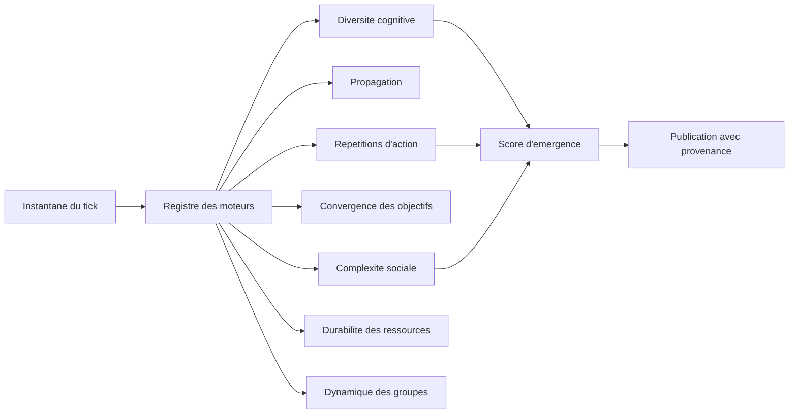

# ECHOS II. Les métriques et le score d'émergence

Mesurer l'émergence, c'est mesurer un phénomène que l'on ne veut pas avoir provoqué. Ce chapitre décrit les sept moteurs de métriques, le score composite qui les rassemble, et la règle qui évite le plus d'erreurs : distinguer un zéro observé d'un zéro non mesuré.

Il faut tenir d'emblée une distinction qui structure tout le chapitre. Une métrique n'est pas un verdict. C'est une transformation, appliquée à un instantané du monde, qui produit un nombre ou une structure. Ce nombre peut être exact et néanmoins trompeur, s'il est lu comme une conclusion. Le projet s'impose donc deux disciplines : nommer chaque métrique pour qu'elle dise exactement ce qu'elle mesure, et publier, à côté de chaque valeur, la preuve que l'instrument a bien mesuré.



**Pourquoi ce chapitre importe pour la question directrice.** Imaginez un thermomètre qui, en mesurant la température, la modifierait : il ne servirait à rien. La question directrice demande d'observer une émergence que l'on n'a pas provoquée ; il faut donc des instruments qui comptent sans influencer. Ce chapitre est celui où cette exigence devient concrète : chaque métrique est une manière de poser une question précise au monde (les croyances se dispersent-elles, l'information circule-t-elle, les groupes se forment-ils), et chaque réponse est assortie de sa provenance. C'est ce qui permet de dire non seulement ce qu'on voit, mais ce qu'on n'a pas vu.

## 1. Sept moteurs, un registre

ECHOS calcule sept familles de métriques, plus un moteur composite.

| Moteur | Ce qu'il mesure |
| :-- | :-- |
| Diversité cognitive | dispersion des croyances et des objectifs |
| Propagation de l'information | circulation et dégradation des messages |
| Complexité sociale | structure du réseau de relations |
| Convergence des objectifs | alignement ou divergence des buts |
| Répétitions d'action | régularités dans l'historique des décisions |
| Durabilité des ressources | stocks, capacités et flux des réserves |
| Dynamique des groupes | formation, vie et dissolution des communautés |
| Indicateurs d'émergence | score composite des six premiers |

Le catalogue de ces métriques est versionné ; il porte la version 2.0.0 et comporte soixante et une fiches. Chaque fiche précise l'identifiant, le moteur, le libellé français, l'unité, le domaine, la définition, la formule, la population de dénominateur, la fenêtre, le sens de lecture d'une hausse, le statut, les états de données possibles, l'avertissement éventuel et la forme de visualisation recommandée. En cas d'écart entre ce chapitre et le catalogue, le catalogue fait foi.

Le registre est ce qui rend le système extensible sans le rendre opaque. Chaque moteur expose un contrat simple : un nom, une liste de métriques, une fonction de calcul sur un instantané. Le registre les compose sans connaître leurs détails internes. Ajouter une famille de métriques ne demande donc pas de modifier les autres, ce qui préserve la lisibilité de l'ensemble.

Une révision sémantique mérite d'être citée, parce qu'elle est exemplaire. Plusieurs métriques portaient des noms qui affirmaient plus que ce qu'elles mesuraient. Une « centralité de réseau » mesurait en réalité la concentration des émissions, et a été renommée en « concentration de l'émetteur ». Une « vitesse de diffusion de l'information » mesurait le délai d'émission (le moment où 80 % des entités ont émis), non la réception, et a été renommée en « délai de couverture des émetteurs ». Un « potentiel de coopération » ne testait aucune compatibilité par paire et a été renommé en « concordance de catégories de buts ». Une « dégradation de précision de rumeur » était un calcul théorique, sans précision observée, et a été renommée en « décroissance théorique par saut ». Un « détecteur de boucles » mesurait des répétitions, non des boucles causales, et ses métriques ont été renommées en conséquence. Enfin, un « indice d'imprévisibilité » a été retiré, car il aurait exigé une base prédictive hors échantillon.

Renommer une métrique pour qu'elle dise la vérité est un acte de méthode, pas de cosmétique. Les anciens noms restent consignés pour migrer les séries historiques, mais ne doivent plus être employés.

Ce passage est l'un des plus importants du livre, et il mérite d'être lu lentement. Il raconte une tentation universelle : appeler « émergence » ce qui n'est qu'une mesure. Un nom ambitieux rend un résultat plus impressionnant, mais il ment sur sa portée. Un « détecteur de boucles » qui compterait des répétitions ferait croire à une causalité circulaire démontrée, alors qu'il ne compte que des régularités. Le projet a choisi de se priver de ces noms flatteurs. Le lecteur doit y voir une garantie : quand une métrique porte un nom, elle mérite ce nom.

## 2. Les métriques, par famille

**Diversité cognitive.** Elle mesure la dispersion des croyances et des objectifs : entropie de Shannon des triplets de croyances observés, entropie normalisée, part des croyances hors de la valeur majoritaire (le désaccord, en excluant les faits unanimes), variance des confiances, entropie des catégories d'objectifs, convergence (part de la population dans la catégorie majoritaire), couverture (part d'entités déclarant un objectif), diversité d'action, nombre de décisions, âge moyen des objectifs et diversité d'expression des traits.

**Propagation de l'information.** Volume de messages par entité et par tick, délai de couverture des émetteurs (le temps pour que 80 % des entités aient émis), décroissance théorique par saut, nombre maximal de sauts observés, concentration de l'émetteur dominant et couverture des émetteurs. Une précision importante : le délai mesuré porte sur l'**émission**, pas sur la réception ; le libellé le dit désormais.

**Complexité sociale.** Confiance moyenne, variance de confiance, densité du réseau (arêtes uniques sur paires possibles, dénominateur `n(n-1)/2`), coefficient de clustering moyen sur voisinage symétrisé, degré sortant moyen (et non une centralité intermédiaire), nombre de communautés inférées par propagation d'étiquettes déterministe, et correspondance de taille des communautés.

**Convergence des objectifs.** Alignement global (part de la population dans la catégorie majoritaire), entropie des objectifs, concordance de catégories (probabilité que deux entités tirées au hasard partagent une catégorie, la somme des carrés des parts) et comptages par catégorie.

**Répétitions d'action.** Nombre de paires (agent, action) répétées plus de deux fois dans la fenêtre, fréquence moyenne des répétitions, équilibre de la distribution des actions et répétitions amplifiées (au-delà de 1,5 fois la fréquence uniforme théorique). L'avertissement est explicite : ce moteur ne détecte **pas** de boucle causale, il compte des répétitions.

**Durabilité des ressources.** Taux de remplissage des réserves, nombre de réserves critiques (sous 20 % de capacité), couverture des réserves publiées, consommation par tick, temps de récupération moyen entre un passage sous 20 % et un retour au-dessus de 80 %, nombre d'épisodes de récupération et nombre de crises non résolues (encore ouvertes au dernier tick observé, c'est-à-dire une observation censurée, jamais un zéro rassurant).

**Dynamique des groupes.** Nombre de communautés inférées (distinctes des groupes déclarés par le moteur, sans jamais les additionner), taille moyenne, couverture de population, durée de vie moyenne déclarée, taux de formation et de dissolution normalisés sur la fenêtre observée, comptages bruts, part de succès déclarés sur les dissolutions qui le publient, et sorties de membres par dissolution.

Une remarque sur la distinction entre communautés inférées et groupes déclarés. Le moteur SYNE publie des groupes qu'il a constitués par cohésion. L'observatoire, de son côté, peut inférer des communautés à partir du graphe de confiance, par une méthode de propagation d'étiquettes. Ces deux ensembles ne coïncident pas, et il serait faux de les additionner ou de les confondre : un groupe déclaré est une structure constatée par le moteur, une communauté inférée est une structure déduite par l'analyse. Le catalogue les sépare explicitement, et les métriques de l'un ne se mélangent jamais avec celles de l'autre.

## 3. L'entropie de Shannon

Deux familles de métriques reposent sur l'entropie de Shannon.

```text
H(P) = -Σ p_i log2(p_i)     pour tout p_i > 0
```

Deux conventions coexistent et ne se mélangent jamais : les entropies brutes, exprimées en bits, qui croissent avec le nombre de catégories ; et les entropies normalisées, exprimées en fractions, ramenées à leur maximum atteignable. Seules les versions normalisées entrent dans le score composite.

| Forme | Expression | Unité | Usage |
| :-- | :-- | :-- | :-- |
| Entropie brute | `-Σ p_i log2 p_i` | bits | lecture directe d'une dispersion |
| Entropie normalisée | `H / log2 k` | fraction | entrée du score composite |

La normalisation répond à un piège précis. Une entropie brute dépend du nombre de catégories : une même dispersion sur dix valeurs donne une entropie plus grande que sur deux. Additionner des entropies brutes favoriserait donc mécaniquement les situations à nombreuses catégories, ce qui n'est pas ce qu'on veut mesurer. La normalisation ramène chaque entropie à la fraction de son maximum, ce qui la rend comparable d'une famille à l'autre. C'est pourquoi seules les versions normalisées alimentent le score composite.

## 4. Le score d'émergence

Le score composite combine six composantes déjà normalisées, avec des poids qui somment à un.

```text
EmergenceScore = Σ w_i × c_i     (c_i dans [0, 1], somme des w_i = 1)
```

| Composante | Poids |
| :-- | --: |
| Diversité des croyances normalisée | 0,15 |
| Diversité des objectifs normalisée | 0,15 |
| Délai de couverture des émetteurs (normalisé) | 0,10 |
| Coefficient de clustering | 0,15 |
| Part moyenne des répétitions d'action | 0,20 |
| Couverture de communauté | 0,25 |

Plusieurs choix rendent ce score lisible. Les composantes sont bornées, donc le score est borné. Les entropies brutes sont normalisées avant d'être additionnées. Le délai de diffusion est neutralisé lorsqu'il n'est pas mesuré : une vitesse nulle signifierait une diffusion instantanée, ce qui est inobservable ; la contribution vaut donc zéro, jamais le maximum de la formule. Enfin, les poids sont publiés, et non codés en dur dans la formule, afin qu'une analyse de sensibilité puisse les examiner sans modifier la formule en cachette.

Chaque terme est publié comme contribution distincte, et la somme des contributions égale exactement le score. C'est un invariant testé : n'importe quelle interface peut décomposer le score sans le recalculer.

Un avertissement accompagne toujours ce score : c'est une **heuristique d'observation**, de statut exploratoire, jamais une preuve scientifique d'émergence. Le texte de l'avertissement est un invariant publié tel quel.

Le choix de rendre les poids publiés mérite une justification, car il touche à l'honnêteté du score. Un score composite à poids cachés serait un oracle : on l'accepterait sans savoir ce qu'il privilégie. Ici, les poids sont visibles, et le lecteur peut constater que la couverture de communauté pèse le plus (0,25), suivie des répétitions d'action (0,20), puis de trois composantes à 0,15 et du délai à 0,10. Ce n'est pas une vérité, c'est un choix, et il est affiché comme un choix. Une analyse de sensibilité peut le discuter.

## 5. La complexité du système

Un second indicateur composite, la complexité du système, est la moyenne de trois grandeurs normalisées : la diversité normalisée des croyances, celle des objectifs, et la fonction normalisée du délai de couverture. C'est une formule bornée dans l'intervalle [0, 1]. L'avertissement est net : ce n'est **pas** une approximation de la complexité de Kolmogorov. C'est une moyenne de dispersions normalisées, à statut exploratoire.

Cet avertissement vaut d'être souligné, car il prévient une confusion classique. Le mot « complexité » évoque, pour un informaticien, la complexité algorithmique ou la complexité de Kolmogorov, des notions précises et profondes. L'indicateur d'ECHOS n'a rien à voir : c'est une moyenne de trois dispersions, sans lien avec la longueur minimale d'un programme qui engendrerait le monde. Le projet refuse l'homonymie trompeuse et l'écrit noir sur blanc.

## 6. Les phénomènes auto-détectés

ECHOS signale quelques phénomènes dont la condition est satisfaite, avec la trace des signaux déclencheurs (valeur observée et seuil).

| Phénomène | Condition |
| :-- | :-- |
| Franchissement de seuil de communautés | plus de deux communautés |
| Répétitions d'action soutenues | plus de cinq paires répétées |
| Convergence forte des objectifs | convergence supérieure à 0,7 |
| Concentration des émetteurs | part de l'émetteur dominant supérieure à 0,3 |
| Dynamique organisationnelle | plus de cinq communautés et sorties par dissolution supérieures à un |

Deux précautions les encadrent. Les libellés décrivent ce qui est réellement observé (un comptage, pas une formation ; des répétitions, pas une boucle causale). Et les seuils, hérités, ne sont pas calibrés : une **absence de détection n'est pas l'absence du phénomène**, et l'interface doit l'écrire à côté d'une liste vide.

## 7. La provenance : zéro observé contre non mesuré

C'est la règle la plus importante de ce chapitre. Plusieurs métriques dépendent d'une fenêtre que le tick courant ne porte pas, et renvoient alors une valeur de repli neutre. Cette valeur est la bonne réponse du moteur, mais elle n'est pas une observation. La confondre avec une mesure réelle est exactement ce qui a laissé passer plusieurs métriques à zéro sur des runs réels.

Un drapeau de provenance distingue les cas, pour chaque couple (moteur, métrique) et à chaque tick.

| Provenance | Signification | Lecture correcte |
| :-- | :-- | :-- |
| vrai | la métrique a été calculée | valeur observée |
| faux | repli neutre, faute de fenêtre | non mesuré |
| absence | tick sans observation, distinct du faux | aucunement observé à ce tick |

La règle de consommation est sans ambiguïté : un faux ne doit jamais être affiché comme un zéro, c'est « non mesuré » ; et une absence n'est pas « aucunement observé à ce tick ».

Cette distinction s'accompagne d'une obligation de publication de la fenêtre réellement couverte : les ticks manquants sont listés, le sous-échantillonnage de lecture est annoncé, la cadence des contextes détaillés est publiée, et le niveau de fidélité de conservation est écrit dès le début du run. Un lecteur sait toujours ce que l'instrument a réellement vu.

L'importance de cette règle ne peut pas être surestimée. La faute la plus grave qu'un observatoire puisse commettre n'est pas de se tromper, mais de présenter une absence de mesure comme une mesure nulle. Une courbe plate à zéro suggère un monde où rien ne se passe ; si elle est en réalité due à un instrument qui n'a pas mesuré, elle fabrique une conclusion fausse. Le projet a payé cette leçon : plusieurs métriques restaient à zéro non parce que le monde était vide, mais parce que l'instrument n'avait rien vu. Depuis, la provenance est un champ obligatoire, publié point par point, et la règle de lecture est explicite. C'est ce genre de détail qui distingue un instrument d'un tableau de bord décoratif.

## 8. Ce que ce chapitre apporte à la question directrice

Ce chapitre a montré comment l'observatoire pose la question, moteur par moteur : les croyances se dispersent-elles, l'information circule-t-elle, le social se complexifie-t-il, les objectifs convergent-ils, les actions se répètent-elles, les ressources tiennent-elles, les groupes vivent-ils et meurent-ils. Il a montré aussi la limite qui protège l'instrument : un chiffre n'est jamais une preuve, et un zéro n'est jamais un fait tant que sa provenance n'est pas établie.

Ce que ce chapitre ne permet pas encore de conclure : pourquoi un phénomène apparaît. Une métrique mesurée ne suffit pas ; il faut pouvoir remonter la chaîne causale. C'est le sujet du chapitre suivant.

Ce chapitre décrit les moteurs et les noms ; il ne donne pas le détail des équations. Celui-ci est ailleurs dans cette partie, et volontairement séparé pour ne pas alourdir le récit : les **outils mathématiques partagés** (entropie, variance, concordance) au chapitre **ECHOS V**, les **formules des sept familles** au chapitre **ECHOS VI**, l'**indice de viabilité dynamique** au chapitre **ECHOS VII**, et les **composites, la reproductibilité et la causalité** au chapitre **ECHOS VIII**.
