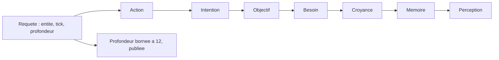

# ECHOS III. Analyse causale et comparaison

Une métrique dit qu'un phénomène existe. Elle ne dit pas pourquoi. Ce chapitre décrit comment ECHOS reconstruit une chaîne de causes à partir des traces du moteur, et comment il compare deux runs. C'est ici que la question directrice trouve sa réponse méthodologique : on ne se contente pas d'observer, on cherche à expliquer, et l'on signale les limites de l'explication.

Il faut comprendre la place exacte de ce chapitre dans le livre. Les chapitres précédents ont décrit un monde qui trace ses décisions, puis un observatoire qui transforme ce flux en chiffres. Ce chapitre-ci franchit une étape : il ne se contente plus de compter, il remonte. C'est là que l'analyse causale commence, et c'est aussi là que le risque d'interprétation abusive est le plus grand. Le livre s'y attache donc à séparer, encore et encore, ce qui est mesuré de ce qui est conclu.

**Pourquoi ce chapitre importe pour la question directrice.** Une métrique dit qu'un phénomène existe ; elle ne dit pas pourquoi. Or la question directrice ne se contente pas d'un constat spectaculaire : elle exige que le comportement soit **retraçable** et **rejouable**. Ce chapitre est celui de l'enquête : comme un détective qui remonte d'un indice à sa cause, l'analyse causale remonte d'une action jusqu'à la perception qui l'a rendue possible. C'est cette remontée qui transforme une observation en explication, et une explication en hypothèse testable.

## 1. La chaîne de traçabilité

Tout part de la chaîne que le moteur rend traçable :

```text
Action ← Intention ← Objectif ← Besoin ← Croyance ← Mémoire ← Perception
```

Le moteur produit, à chaque décision, une trace : les besoins, les croyances considérées, les scores d'utilité par action, l'action choisie et les drapeaux de délibération et d'interruption. ECHOS stocke ces traces et les expose.

Cette chaîne n'est pas une vue de l'esprit : chaque flèche correspond à un mécanisme réel. Une action suit d'une intention (l'engagement retenu). Une intention suit d'un objectif (ce que l'entité cherche). Un objectif suit d'un besoin (le manque qui l'a engendré). Le besoin s'appuie sur une croyance (ce que l'entité tient pour vrai). La croyance vient d'une mémoire (un souvenir plus ou moins saillant). La mémoire vient d'une perception (ce qui a été observé). Remonter la chaîne, c'est donc parcourir, dans l'ordre inverse, le chemin par lequel le monde a produit une décision.

## 2. La reconstruction causale

ECHOS peut reconstruire la chaîne causale d'une entité à un tick donné, sur une profondeur bornée (douze au maximum). La réponse est une liste de couches : action, intention, objectif, besoin, croyance, et ainsi de suite jusqu'à la perception. Chaque couche porte un libellé, le tick et un détail.



Trois bornes encadrent cette reconstruction. La première est la **profondeur** : au-delà de douze, la profondeur demandée est réduite et la profondeur servie est publiée. La deuxième est le **périmètre** : la chaîne est bornée aux traces disponibles, elle ne prétend pas expliquer ce que le moteur n'a pas enregistré. La troisième est l'**honnêteté sémantique** : la reconstruction ne conclut pas. Elle expose une chaîne d'états, et laisse à l'analyste le soin de séparer l'observation, l'interprétation et l'hypothèse.

C'est une distinction que le projet tient pour essentielle. Remonter une chaîne n'est pas démontrer une causalité au sens fort. C'est rendre inspectable une séquence de décisions, afin qu'un humain puisse formuler une hypothèse et, s'il le souhaite, la tester par une nouvelle expérience.

La borne de profondeur mérite une justification. Pourquoi douze ? Parce qu'au-delà, la chaîne cesse d'être lisible, et parce que le risque d'artefact croît. En pratique, remonter de l'action jusqu'à la perception demande sept à huit couches ; douze laisse une marge pour explorer les ramifications (plusieurs croyances, plusieurs besoins). Au-delà, on ne gagne pas en compréhension : on accumule du détail sans hiérarchie. Le projet préfère une chaîne courte et complète à une chaîne exhaustive et illisible.

## 3. Les traces de décision

L'API expose les traces de décision d'un run, triées de façon déterministe par (tick, identifiant d'entité). Chaque trace comporte le tick, l'entité, l'action choisie, l'utilité, les drapeaux de délibération et d'interruption, la cause (une chaîne lisible, par exemple « faim=30,soif=20,fatigue=10,5 »), et des comptages (croyances, objectifs, souvenirs) ainsi que les niveaux de besoins.

| Champ de trace | Rôle |
| :-- | :-- |
| tick, entité | localisation de la décision |
| action, utilité | ce qui a été retenu et son score |
| drapeaux | délibération ou interruption |
| cause | chaîne lisible des besoins et seuils |
| comptages | croyances, objectifs, souvenirs |
| niveaux de besoins | valeurs courantes |

Deux propriétés rendent ces traces exploitables. Elles sont **déterministes** : deux appels sur un run inchangé renvoient le même corps. Elles sont **rejouables** : parce qu'elles proviennent d'une trajectoire déterministe, on peut reproduire exactement la situation qui a produit une décision.

## 4. La comparaison de deux runs

Comparer deux runs est le geste scientifique élémentaire : faire varier un paramètre et observer la différence. ECHOS expose une comparaison qui distingue deux niveaux.

Un **résumé léger** compare sans empreinte et sans verdict : il présente des ordres de grandeur et ne conclut pas. Un **résumé complet** compare avec séries et empreinte, et seul ce niveau autorise à parler de « bit-identique ».

Cette gradation est une leçon tirée de l'expérience. On pourrait croire qu'une comparaison de runs devrait toujours aller au bout. En pratique, deux usages coexistent : un usage exploratoire, où l'on veut un ordre de grandeur sans engager une conclusion, et un usage strict, où l'on veut affirmer une identité. Le résumé léger sert le premier, le résumé complet le second. Confondre les deux ferait dire « identique » à partir d'un aperçu, ce que le projet refuse.

La comparaison s'appuie sur des méta-métriques de reproductibilité, calculées par des fonctions pures, stables entre rejeux.

| Méta-métrique | Définition |
| :-- | :-- |
| Reproductible | même graine, même version moteur, même empreinte de contenu |
| Score de reproductibilité | 1,0 si reproductible, sinon une décroissance selon les écarts |
| Écart cognitif | écart entre les distributions de croyances des populations |
| Écart social | écart entre les réseaux de confiance |

L'**empreinte canonique** est un hachage de contenu : les séries de métriques, les résumés de tick, le journal d'événements et les contextes, sérialisés de façon triée, en excluant l'étiquette du run (deux runs du même protocole ne diffèrent que par leur nom). L'empreinte utilise un algorithme de hachage cryptographique.

Le fait d'exclure l'étiquette du run de l'empreinte est un détail qui porte une idée. Deux runs du même protocole, nommés différemment, doivent avoir la même empreinte : sinon on ne pourrait pas dire qu'ils sont identiques au fond. L'empreinte porte donc sur le **contenu**, pas sur le contenant. C'est ce qui permet à la comparaison de porter sur la trajectoire réellement produite, non sur la manière dont on l'a étiquetée.

L'**écart cognitif** et l'**écart social** sont des normes normalisées bornées : les distributions de croyances (par triplet sujet, prédicat, valeur) et les réseaux de confiance (poids de paire moyen, non orienté) sont normalisés avant comparaison, de sorte que l'écart soit toujours dans l'intervalle [0, 1].

Une leçon d'expérience est consignée dans le projet : à une époque, le seed était dérivé du nom du run, ce qui produisait des comparaisons vides. La correction a consisté à propager la graine effective depuis le moteur. Ce n'est pas un détail : comparer « bit-identique » exige de comparer des runs réellement identiques.

Cet incident mérite d'être raconté, car il est instructif. Tant que la graine était dérivée du nom, deux runs « identiques » ne l'étaient pas réellement : leur graine changeait avec leur étiquette. Les comparaisons ne portaient donc que sur des différences de nom, et le verdict « bit-identique » était mécaniquement triste à observer. La correction, propager la graine effective depuis le moteur, a rétabli le sens de la comparaison. Leçon : une méta-métrique ne vaut que si ses entrées sont ce qu'elles prétendent être.

## 5. La synthèse multi-runs

Au-delà de la comparaison par paires, ECHOS expose une synthèse multi-runs : le contexte de contrôle (les paramètres communs) et la dispersion publiée sur un ensemble de runs (de deux à douze). Cette synthèse sert à observer une tendance sans surinterpréter un seul cas.

Le projet insiste sur une règle statistique élémentaire : une répétition ne suffit pas. Une différence observée sur un run unique peut être un artefact. C'est pourquoi les campagnes sont rejouées sur plusieurs graines, et pourquoi le nombre de runs nécessaires pour conclure est une question ouverte assumée.

Cette honnêteté statistique distingue le projet d'une démonstration. Un run peut produire un résultat spectaculaire par hasard ; sans répétition, on ne saurait pas si ce résultat se reproduit. La synthèse multi-runs et les campagnes existent pour répondre à cette question, et le livre ne prétendra jamais qu'une structure observée une fois est un phénomène général.

## 6. Les rapports déterministes

Les rapports produits par ECHOS sont déterministes : les exports sont triés, sans horodatage d'émission, sans aléa. Deux lectures d'un run inchangé produisent un corps identique. Un export de métriques est disponible en JSON et en CSV (au format standard des fichiers tabulaires, avec un ordre de lignes stable). Cette reproductibilité n'est pas un ornement : elle permet de vérifier qu'un rapport est bien celui d'un run donné, et de le comparer sans bruit.

Un rapport sans horodatage peut sembler étrange, mais c'est un choix cohérent. Si un rapport portait l'heure de son émission, deux lectures du même run produiraient des rapports différents, et l'on ne pourrait plus vérifier par comparaison binaire qu'il s'agit du même contenu. Le projet préfère un rapport qui ne change jamais tant que le run ne change pas : la reproductibilité du rapport est la contrepartie de la reproductibilité du run.

## 7. Ce que ce chapitre apporte à la question directrice

Ce chapitre a montré comment remonter d'une action à ses causes et comment comparer deux expériences de façon reproductible. C'est ce qui transforme une observation en enquête : on ne dit pas seulement qu'un groupe est apparu, on peut examiner la chaîne de décisions qui l'a précédé, et vérifier que la même graine produit la même histoire.

Ce que ce chapitre ne permet pas encore de conclure : qu'une chaîne reconstruite soit une explication définitive. La causalité d'une simulation reste une causalité de modèle, à interpréter avec prudence. Le chapitre suivant décrit le contrat qui rend ces données accessibles à d'autres composants, et le profil de viabilité qui résume le sort d'un run.
