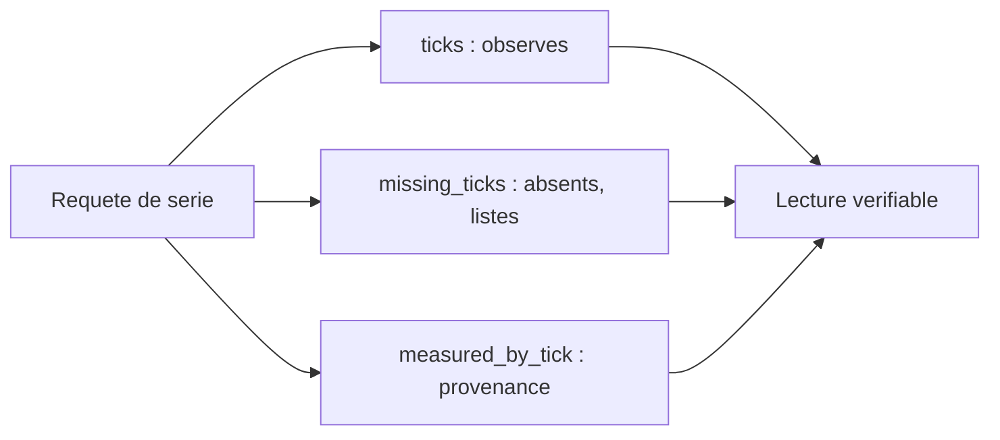

# ECHOS IV. API, lecture seule et viabilité

Les métriques ne servent à rien si personne ne peut les lire. Ce chapitre décrit l'interface par laquelle ECHOS publie sa lecture : une API locale, en lecture seule, qui alimente la présentation du Launcher. Il décrit aussi le profil de viabilité, qui résume le sort d'un run sans le recalculer côté interface.

Ce chapitre a une fonction particulière dans le livre. Les chapitres précédents ont décrit ce qu'ECHOS calcule ; celui-ci décrit comment il le **donne**. Une API est une frontière : tout ce qui est exposé devient une promesse envers un client. Le projet traite donc ses routes avec le même sérieux que ses contrats de transport, en distinguant ce qui est disponible de ce qui n'est que spécifié.

**Pourquoi ce chapitre importe pour la question directrice.** Un résultat qui ne peut pas être lu par un autre composant reste un résultat privé. Ce chapitre décrit la langue par laquelle l'observatoire parle au reste de la pile, et le résumé qui répond à la question la plus simple : le monde a-t-il tenu ? Pour la question directrice, l'enjeu est de rendre l'observation **utilisable** : un observatoire qui mesurerait sans rien publier serait inutile, et un observatoire qui publierait en modifiant le monde serait dangereux. La lecture seule est la règle qui concilie les deux.

## 1. Une API locale et lecture seule

L'API REST d'ECHOS écoute sur le port 5000 par défaut, en local. Depuis le retrait de l'interface, cette API est le seul contrat de sortie du composant : elle alimente les fenêtres natives du Launcher.

Une règle d'or la gouverne : l'API est **en lecture seule**. Aucune route n'écrit dans le monde observé. C'est la traduction directe du principe « mesurer sans toucher » : un observatoire qui modifierait ce qu'il observe ne serait plus un observatoire.

Cette règle a une exception apparente qu'il faut comprendre : les routes de **contrôle** (démarrer, mettre en pause, reprendre, arrêter, réinitialiser) ne modifient pas l'**analyse** ; elles relaient des ordres au **moteur**. Autrement dit, l'API d'analyse ne touche jamais à ses propres données, et lorsqu'elle relaie un ordre au monde, c'est un ordre que le monde exécute selon son propre contrat, sans qu'ECHOS décide quoi que ce soit. La lecture seule porte sur l'analyse, non sur l'interdiction de piloter.

Deux détails pratiques encadrent l'usage. La base d'analyse est fournie soit directement au moment de la construction de l'application, soit par une variable d'environnement qui indique le chemin du fichier SQLite. Sans base configurée, les routes de données répondent une erreur d'indisponibilité (503), tandis que la route de santé et la racine restent disponibles : un service qui n'a rien à lire dit « je n'ai pas de données », pas « tout va bien ». De même, si le serveur de contrôle du moteur n'est pas lancé, les routes de contrôle répondent 503 avec une instruction de démarrage.

## 2. Les endpoints principaux

L'API regroupe plusieurs familles d'opérations.

| Famille | Exemples de routes | Rôle |
| :-- | :-- | :-- |
| Santé et contrôle | santé, état, démarrer, pause, reprise, arrêt, réinitialisation | relais vers le moteur |
| Runs | liste, métadonnées, séries, export, traces, calibration, viabilité | lecture d'un run |
| Catalogue | catalogue des métriques, fiches | référence versionnée |
| Analyse | synthèse multi-runs, journal, chaînes causales, croyances, réseau, groupes, monde, phénomènes | inspection |
| Comparaison | comparaison de deux runs (léger ou complet) | mise en regard |

Le Launcher sonde cette API à intervalles réguliers (de l'ordre de la seconde) et affiche les séries. Aucune diffusion WebSocket de métriques n'est servie par ECHOS à ce jour : la présentation lit, elle ne reçoit pas de flux poussé.

Le choix d'une lecture par sondage plutôt que d'un flux poussé est un compromis assumé. Un sondage périodique est simple, robuste, et suffit pour des métriques qui varient lentement ; il évite la complexité d'un canal persistant et des problèmes de reconnexion. Si un jour un affichage plus réactif devenait nécessaire, un flux poussé serait ajouté, mais il n'existe pas aujourd'hui, et le livre ne prétend pas l'inverse.

## 3. La forme des réponses

Les réponses suivent un ordre déterministe : les runs sont triés par identifiant, les séries par tick, les lignes d'export par (tick, moteur, métrique). Les séries de métriques portent, pour chaque tick observé, la valeur, la provenance et, lorsque le sous-échantillonnage s'applique, la liste des ticks réellement servis.

Trois champs méritent d'être distingués.

- `ticks` : les ticks réellement observés, éventuellement sous-échantillonnés.
- `missing_ticks` : les ticks absents entre le premier et le dernier tick observé, listés et jamais interpolés. La liste est bornée, avec un comptage exact.
- `measured_by_tick` : la provenance, alignée point par point, vrai, faux ou absente.

Ces trois champs, ensemble, garantissent qu'un lecteur sait exactement ce que l'instrument a vu, ce qu'il a manqué, et ce qu'il a servi comme repli.

Le bornage de la liste des ticks manquants est une nécessité pratique, mais il n'introduit aucune ambiguïté : la liste peut être tronquée, mais le comptage exact est fourni. Un client sait donc combien de ticks manquent, même s'il ne reçoit pas leur énumération complète. On retrouve la même rigueur que partout : ne jamais confondre « je ne montre pas tout » avec « il n'y a rien ».

## 4. Le profil de viabilité

Un run a un destin : il survit, il s'éteint, ou l'on ne sait pas. Le profil de viabilité résume ce destin sans obliger l'interface à le recalculer.

Il expose la population, les besoins, les ressources, la complétude de l'observation et une chronologie d'extinction. Le résultat de population est calculé directement dans la base, au moment de l'ingestion, ce qui le rend disponible pendant que le run est encore en cours : un observateur peut constater « run fini avec écosystème mort » sans recalculer lui-même depuis les séries.

| Champ | Signification |
| :-- | :-- |
| population | effectif au fil du run |
| besoins | niveaux agrégés |
| ressources | stocks agrégés |
| complétude | part des ticks observés |
| résultat | survivant, éteint ou inconnu |
| tick d'extinction | premier tick à zéro vivant, ou nul |

Trois valeurs de résultat existent : survivant, éteint et inconnu. Le tick d'extinction est le premier tick où le nombre d'entités vivantes atteint zéro, ou bien nul. Un run sans tick est marqué inconnu, non « éteint » : là encore, l'absence d'observation n'est pas un fait.

Ce profil matérialise un principe déjà rencontré : la viabilité est drapée en fin de traitement, à partir des données brutes, plutôt que déduite par une interface qui interpréterait. La question « le monde a-t-il tenu ? » reçoit une réponse simple, vérifiable et publiable.

Le calcul de viabilité au moment de l'ingestion est un choix qui a une conséquence importante sur l'usage : on peut suivre un run en direct et savoir, à tout moment, s'il est encore vivant. Sans ce calcul anticipé, il faudrait attendre la fin du run pour interroger les séries, et l'on perdrait l'intérêt de l'observation en temps réel. Le profil de viabilité répond donc à une question simple mais cruciale : le monde est-il encore en vie ?

## 5. Le succès conceptuel non implémenté

Il faut, une fois encore, distinguer le disponible de l'envisagé, mais aussi l'envisagé du planifié. Une spécification mathématique existe pour un indice de viabilité dynamique, successeur conceptuel du score d'émergence : moyenne géométrique pondérée, couverture, régimes et trajectoire post-run. Cet indice n'est **pas implémenté** au moment de la rédaction, et le livre le présente comme tel, jamais comme une capacité. Sa livraison est en revanche **planifiée** : elle est découpée en trois phases qui doivent être achevées avant la publication de ce livre, et le chapitre ECHOS VII en donne la référence complète, phases, sorties et constantes comprises. Un troisième statut apparaît donc dans le livre : ni disponible, ni abandonné, mais **en cours de réalisation**.

La décision retenue est la cohabitation : le score composite décrit plus haut reste le composite implémenté et publié tant que l'indice de viabilité dynamique n'est ni implémenté ni calibré. Un succès conceptuel n'est pas un succès de livraison.

Ce point est un exemple pur de la discipline du livre. Il serait tentant de présenter l'indice de viabilité dynamique comme une avancée, puisqu'une spécification en existe. Le projet refuse : tant qu'il n'y a ni implémentation ni calibration, il n'y a pas de capacité. Le livre le dit sans détour, et réserve le terme « disponible » au score composite réellement publié. La distinction entre une idée prometteuse et une fonctionnalité livrée est, une fois encore, la ligne de partage du livre.

## 6. Ce que ce chapitre apporte à la question directrice

Ce chapitre a montré comment l'observatoire publie sa lecture : une API locale en lecture seule, des réponses déterministes, une provenance explicite et un profil de viabilité qui dit si le monde a tenu. C'est par ce contrat que la présentation peut montrer sans recalculer et sans tricher.

Ce que ce chapitre ne permet pas encore de conclure : que le monde à l'écran soit fidèle au monde mesuré. Cette fidélité dépend d'un troisième composant, celui qui montre sans décider. C'est le sujet du chapitre suivant : PRISM.
