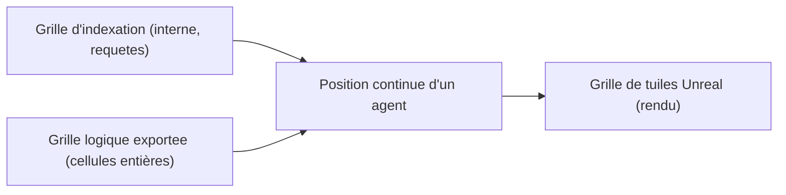

# PRISM I. Le projet Unreal et la place du rendu

Une simulation qui ne se voit pas reste une expérience mentale. PRISM donne au monde une représentation. Mais une représentation peut tricher : elle peut décider à la place du moteur, inventer une vie que le monde ne produit pas. Ce chapitre décrit la place du rendu et la frontière qui empêche cette triche.

Le problème posé par ce chapitre est plus subtil qu'il n'y paraît. Représenter un monde, c'est traduire un état logique en une scène tridimensionnelle. Cette traduction peut se faire de deux manières : passivement, en reflétant l'état reçu, ou activement, en ajoutant des comportements que le monde n'a pas. La première est fidèle ; la seconde est une mise en scène. Tout l'enjeu de PRISM est de rester dans la première, en résistant à la tentation permanente de la seconde.

**Pourquoi ce chapitre importe pour la question directrice.** Une scène est un miroir, pas un acteur. Si le miroir se mettait à bouger tout seul, ce qu'on verrait ne serait plus le monde, mais un spectacle. La question directrice perdrait tout son sens : on ne saurait plus si ce que l'on observe à l'écran vient des lois du monde ou d'une mise en scène. Ce chapitre pose donc une règle simple et vitale : montrer sans décider. C'est elle qui garantit que l'image reste une fenêtre sur le monde, et non une seconde réalité.

## 1. La règle non négociable

La règle est simple : **SYNE seul décide**. Le moteur est l'autorité de l'état simulé. La scène initialise depuis le monde décrit, suit les instantanés comme la vérité, ponctue d'effets à partir des événements sans les double-traiter, et commande par le contrôle sans porter la logique. Elle ne modifie jamais la vérité du monde.

Cette règle protège la question directrice. Si la scène décidait des comportements, alors ce que l'on observerait à l'écran ne serait plus le produit des lois locales du monde, mais le produit d'un script visuel. L'émergence serait truquée. La séparation stricte entre décider et montrer est donc une exigence scientifique, non une préférence d'architecture.

On peut mesurer la portée de cette règle par un contre-exemple. Imaginez qu'un démonstrateur veuille montrer un « rassemblement spontané » dans la scène, et qu'il fasse converger visuellement des acteurs vers un point pour rendre la scène plus vivante. Ce faisant, il afficherait un phénomène que le moteur n'a pas produit, et tout observateur croirait à un résultat d'émergence. La règle interdit exactement cela : la scène ne peut montrer que ce que le moteur a décidé. Un rassemblement visible doit être un rassemblement réel, présent dans l'état du monde.

## 2. L'hôte technique

Dans le dépôt, un projet Unreal minimal sert d'hôte technique pour le plugin : `LDK.uproject`. Il permet de compiler et de tester le plugin sans dépendre du projet PRISM complet. Son nom, `LDK`, ne signifie pas qu'il serait le projet complet LIVEX ni un second produit. C'est un outil de développement, comme le `syne-mock` l'est pour le transport.

La version d'Unreal Engine documentée pour le dépôt est 5.8.3. Le plugin dépend de trois modules Unreal : HTTP, Json et WebSockets.

La distinction entre l'hôte technique et le projet final mérite d'être soulignée, car elle évite une confusion fréquente chez un lecteur qui découvrirait l'arborescence. Le projet `LDK` sert à compiler et à tester le plugin ; il n'est pas la scène finale du jeu. Celle-ci, PRISM, est un projet Unreal à part entière, en construction. Le dépôt contient donc un hôte minimal, non le produit final. Le livre le dit pour qu'on ne prenne pas un outil de développement pour la livraison.

## 3. L'échelle : une unité pour un mètre

Représenter un monde logique dans un moteur 3D pose une question d'échelle. Le monde SYNE est un plan continu, sans relief ni matériau ; l'espace Unreal a des unités, des collisions et un NavMesh. Il faut donc choisir une correspondance.

Le choix retenu est une échelle `k`, définie par la taille de la tuile divisée par la taille de cellule : combien d'unités Unreal pour une unité de position SYNE. Le profil retenu instancie `k` à 100, c'est-à-dire qu'une unité SYNE vaut un mètre (`1 uu = 1 cm`). Tout le vocabulaire du monde devient métrique : un rayon de perception de 70 unités devient 70 mètres.

```text
k = taille_tuile / worldCellSize          [unités Unreal par unité SYNE]
k = 3200 / 32 = 100
UnrealX = SyneX × k
```

Ce choix s'accompagne d'une contrainte de vitesse. Pour qu'un acteur Unreal rattrape à chaque tick l'état autoritaire du moteur, sa vitesse de marche doit être au moins égale au produit de l'échelle, de la vitesse maximale du trait et du nombre de ticks par seconde. Le profil retenu règle la cadence à six ticks par seconde : `600 = 100 × 1,0 × 6`. La vitesse apparente d'un agent médian coïncide alors avec la vitesse de marche par défaut d'Unreal, sans modifier les réglages du moteur.

```text
vitesse_apparente = k × TPS × speed          [uu/s]
MaxWalkSpeed(agent) ≥ k × speed_max × TPS    = 100 × 1,5 × 6 = 900 uu/s
```

Le tableau suivant donne la vitesse apparente d'un agent médian (vitesse 1,0) pour différentes cadences, en gardant `k = 100`.

| TPS | ms par tick | vitesse apparente | journée réelle |
| --: | --: | --: | --: |
| 1 | 1000 | 100 uu/s | 24 min |
| 6 (retenu) | 166,7 | 600 uu/s | 4 min |
| 10 (défaut SYNE) | 100 | 1000 uu/s | 2 min 24 |
| 15 | 66,7 | 1500 uu/s | 1 min 36 |

La contrainte de vitesse est ce qui relie l'échelle et la cadence. On ne peut pas les choisir indépendamment : une fois l'échelle fixée à une unité pour un mètre, la cadence détermine la vitesse apparente, et cette vitesse doit rester compatible avec les capacités par défaut d'Unreal. Le choix de six ticks par seconde n'est donc pas arbitraire : c'est celui qui fait coïncider la vitesse d'un agent médian avec la vitesse de marche par défaut du moteur, sans avoir à modifier cette dernière.

## 4. Les trois grilles

Un point délicat de l'intégration est de ne pas confondre trois repères.

- La **grille d'indexation interne** du moteur sert à accélérer les requêtes spatiales. Ce n'est pas le terrain Unreal, et ses cases ne sont pas des tuiles visibles.
- La **grille logique exportée** (les cellules) est destinée à la génération procédurale. Une cellule a des coordonnées entières ; la taille de cellule exprime sa largeur en unités SYNE. La position d'un agent reste continue, non un numéro de cellule.
- La **grille de tuiles Unreal** fixe le rendu. Une cellule logique correspond à une tuile de taille égale à la taille de cellule multipliée par l'échelle. Au profil retenu, une cellule de 32 unités donne une tuile de 3 200 unités Unreal, c'est-à-dire la cellule de partition de monde par défaut d'Unreal.



Confondre ces repères est une source classique d'erreurs : placer un acteur à un indice de cellule au lieu d'une position continue, ou interpréter une case comme une tuile. Le guide d'intégration insiste sur la conversion : pour retrouver la cellule d'une position continue, on divise par la taille de cellule et l'on prend la partie entière, bornée aux dimensions du monde.

## 5. Le profil de monde

Le profil retenu pour la représentation vise un monde d'environ cinq kilomètres carrés : 2 240 unités de côté, 70 cellules de 32 unités, soit une surface de 5,02 km². La région regroupe dix cellules (320 mètres), les ressources sont posées par quatre types et trois marqueurs déterministes, et les cellules sont exportées une seule fois, dans le message d'initialisation.

| Profil | côté | cellule | cellules | surface |
| :-- | --: | --: | --: | --: |
| Référence (calibré) | 500 | 10 | 50 × 50 | 0,25 km² |
| Représentation (retenu) | 2 240 | 32 | 70 × 70 | 5,02 km² |
| Grand (option) | 5 000 | 40 | 125 × 125 | 25 km² |

Un calcul de densité mérite d'être rapporté honnêtement. Le nombre moyen de voisins dans un rayon donné croît avec la densité d'agents. Dans un monde de cinq kilomètres carrés, la vie sociale ne retrouve une moyenne de quelques voisins qu'autour de plusieurs centaines d'agents. Au lancement (cinquante à cent agents), un agent ne croise qu'une fraction de voisin en moyenne. Le livre ne cache pas ce point : il est documenté avec les options possibles (lancer sur le profil calibré puis passer au grand profil à la montée en effectifs, accepter la rareté avec le joueur comme pôle social, ou étendre la borne de perception, ce qui serait une modification du moteur). Aucune de ces options n'est cachée : PRISM consomme le rayon que SYNE lui donne.

Ce calcul de densité est un des aveux les plus honnêtes du livre. On pourrait croire qu'un monde plus grand est simplement « plus impressionnant ». En réalité, agrandir le monde dilue les rencontres, et donc appauvrit la vie sociale. Un monde de cinq kilomètres carrés peuplé de cinquante agents est un monde largement vide, où les entités se croisent rarement. Le projet préfère le dire et proposer des options plutôt que de laisser découvrir la déception à l'écran. C'est cohérent avec tout le reste : un problème annoncé vaut mieux qu'un problème caché.

## 6. Ce que le monde exporte et ce qu'il n'exporte pas

Le moteur exporte un plan logique. Il n'exporte, à l'état décrit, ni altitude, ni type de sol, ni biome : toutes les cellules portent un terrain de plaines et une hauteur nulle. La navigabilité et le coût de déplacement d'une cellule sont déterminés par la présence d'un obstacle. Le relief, la pente et le NavMesh sont la responsabilité d'Unreal.

Les emplacements de ressources du message d'initialisation sont des marqueurs de génération, indexés par cellule, et non des stocks localisés. Les stocks que le moteur simule et renvoie dans les instantanés restent des réserves globales par type. Un consommateur ne doit pas replacer les acteurs de ressource à partir des stocks globaux.

Cette dernière règle évite une erreur séduisante : croire que les réserves globales sont localisées quelque part. Elles ne le sont pas. Un client qui placerait un « tas de nourriture » proportionnel au stock global inventerait une géographie que le moteur ne connaît pas. Les marqueurs de ressources servent à décorer la scène, non à représenter un stock. La distinction est fine, mais elle sépare une scène fidèle d'une scène qui invente.

## 7. Cadence, rendu et temps simulé

La fréquence de rendu d'Unreal et la cadence de simulation sont indépendantes. La durée simulée d'un tick est configurable, comme le nombre de ticks calculés par seconde réelle ; la configuration ne doit donc pas être réglée à soixante sous prétexte que le jeu vise soixante images par seconde.

Le profil retenu associe six ticks par seconde à cinq secondes simulées par tick, soit un ratio de trente : une seconde réelle vaut trente secondes simulées, et une journée simulée de 86 400 secondes passe en environ quarante-huit minutes réelles. Ce rythme est volontaire, mais il doit être affiché dans l'interface, faute de quoi l'observateur croirait regarder un temps réel.

Ce découplage entre rendu et simulation est une source fréquente de confusion. Un développeur habitué aux moteurs de jeu réglant la simulation sur la fréquence d'image (soixante par seconde) commettrait ici une erreur grave : il ferait tourner le monde soixante fois plus vite que prévu, et les entités mourraient en quelques secondes. La cadence du monde est une grandeur du modèle, non une caractéristique du matériel. Elle doit être choisie pour la fidélité, pas pour la fluidité.

## 8. Ce que le projet Unreal fait, et ce qu'il ne fait pas

Le projet Unreal PRISM porte le monde présenté, les acteurs, le rendu, l'interface et les interactions. Il consomme les données du plugin et produit leur représentation. Le plugin, lui, ne crée pas automatiquement le terrain, les acteurs, les widgets, les animations ou les règles de navigation, et ne prend aucune décision simulée.

Les spécifications de scène, de rendu et d'interaction de ce composant décrivent des **objectifs produit** : elles indiquent l'intention visuelle sans imposer une implémentation interne. Ce sont des cibles de présentation, non des fonctions livrées à l'état décrit. Le chapitre des limites y revient.

## 9. Ce que ce chapitre apporte à la question directrice

Ce chapitre a montré comment un monde logique devient une scène, sans que la scène ne devienne un second monde : échelle explicite, cadence découplée du rendu, frontière stricte entre décider et montrer. C'est cette discipline qui garantit que ce que l'on voit est bien le monde, non une mise en scène.

Ce que ce chapitre ne permet pas encore de conclure : que la scène soit fidèle au flux. Cette fidélité dépend d'un plugin discipliné, exposé au Blueprint et rigoureux dans sa consommation des contrats. C'est le sujet du chapitre suivant.
