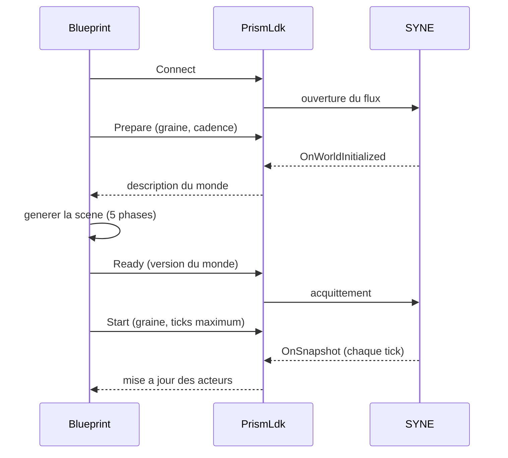

# PRISM II. Le plugin PRISM-LDK

Le projet Unreal et le moteur ne se parlent pas directement. Entre eux, un plugin fait le traducteur : il transporte les messages, les convertit en types utilisables par Blueprint, et rediffuse les événements. Ce chapitre décrit ce que le plugin est, ce qu'il fait, et la règle qui l'empêche de devenir un moteur parallèle.

Le plugin est un cas d'école de séparation des responsabilités. Il a une tentation permanente : comme il reçoit toutes les données, il pourrait se mettre à calculer, à lisser, à anticiper. Chaque fois qu'il cède à cette tentation, il introduit un second moteur, et la scène cesse de refléter le monde. Tout le chapitre décrit la discipline qui l'en empêche.

**Pourquoi ce chapitre importe pour la question directrice.** Un traducteur transmet un texte sans le réécrire. Si le traducteur se mettait à composer, le lecteur ne lirait plus l'auteur. Le plugin est ce traducteur : il transporte et convertit, sans jamais décider. Ce chapitre compte pour la question parce qu'il ferme la boucle dangereuse qui ferait de la représentation une cause : si la scène renvoyait au moteur une position inventée, le monde dépendrait du rendu, et l'émergence observée serait truquée par l'affichage.

## 1. Une couche mince

PRISM-LDK (*LIVEX Development Kit*, module `PrismLdk`) est une couche d'intégration C++ légère, exposée à Blueprint. Il fournit les types et les contrats SYNE, les fonctions de connexion et de contrôle, l'adaptation des messages et des répartiteurs d'événements. Un sous-système de l'instance de jeu porte l'accès au service et les fonctions Blueprint, que le graphe obtient par un nœud dédié.

Le plugin n'est pas un moteur. Il ne crée pas automatiquement le terrain, les acteurs, les widgets ou les animations, et ne prend aucune décision simulée. Le code C++ reste limité aux besoins d'intégration et au contrat Blueprint : les choix de rendu et de gameplay appartiennent au projet Unreal.

Cette minceur est une contrainte, non une faible ambition. Un plugin épais serait plus gourmand : il ajouterait de la logique, donc des occasions de divergence. Un plugin mince se contente de traduire. La règle est simple : tout ce qui n'est pas nécessaire pour transporter et convertir n'a pas sa place dans le plugin. C'est ce qui garantit que le plugin ne pourra jamais décider à la place du monde, même par accident.

## 2. Deux transports

Le plugin utilise deux transports, symétriques à ceux du moteur.

- Un flux **WebSocket** en lecture, sur le port 5180 par défaut, pour recevoir le monde préparé, les instantanés, les deltas et les événements.
- Un canal **HTTP** en écriture, sur le port 5181 par défaut, pour les commandes de contrôle et la lecture du statut.

Les adresses sont remplaçables par des options de connexion. Le lancement du moteur est distinct du lancement du projet Unreal : le moteur expose ses serveurs quand il est lancé avec les options correspondantes, et le plugin s'y connecte.

La symétrie des transports n'est pas un hasard : le plugin reprend la même répartition que le moteur, un canal pour les données (lecture) et un canal pour le contrôle (écriture). Cette symétrie simplifie la supervision, puisque le Launcher connaît déjà ces deux ports et peut surveiller le lien du plugin de la même manière que celui des autres clients.

## 3. Les événements exposés au Blueprint

Le plugin convertit chacun des messages du moteur en un événement utilisable par Blueprint.

| Message du moteur | Événement Blueprint | Rôle |
| :-- | :-- | :-- |
| `world_initialized` | `OnWorldInitialized` | description du monde préparé |
| `snapshot` | `OnSnapshot` | état dynamique complet du tick |
| `world_delta` | `OnWorldDelta` | mutations du monde (obstacles notamment) |
| événements typés | `OnSyneEvent` | décisions, actions, communication, groupes |

À côté de ces événements, des répartiteurs signalent le cycle de vie et les résultats : connexion, déconnexion, résultat de commande, erreur.

Un point d'ergonomie est souvent source de confusion et vaut d'être noté. La lecture de l'état de connexion est une fonction pure, qui se branche sur un aiguillage d'énumération. Les répartiteurs d'événements, eux, ne se branchent pas sur le fil d'exécution d'une commande : il faut les assigner pour associer un événement personnalisé, qui sera appelé plus tard par le plugin lorsque la connexion sera réellement établie. Assigner un événement ne le déclenche pas immédiatement. Ce détail, apparemment mineur, est la cause la plus fréquente d'un graphe Blueprint qui ne réagit pas.

## 4. Le cycle de connexion et de préparation

Le flux normal est : connecter, préparer, recevoir la description du monde, générer la scène, accuser réception, démarrer, recevoir les instantanés.

La connexion est déclenchée explicitement, jamais au démarrage du sous-système. Une reconnexion automatique peut être demandée après une perte inattendue, mais elle ne déclenche jamais la première connexion et s'annule sur une déconnexion volontaire. La graine doit être conservée, afin de pouvoir reproduire un run et de relancer une réinitialisation avec les mêmes paramètres.

Après une préparation explicite, le moteur exige l'accusé de réception avant le démarrage. Ignorer cet ordre, ou réutiliser une graine incompatible, produit une erreur : par exemple une erreur « monde non prêt ». Ces codes doivent être affichés, jamais supposés absents.

## 5. L'ordre de génération de la scène

Dans l'événement d'initialisation, la scène se génère en phases, et l'accusé de réception n'est donné qu'une fois toutes les phases terminées.

1. **Topographie** : lire les dimensions et la taille de cellule, parcourir les cellules, créer les tuiles.
2. **Obstacles** : parcourir les obstacles, instancier les collisions visuelles depuis les positions et les rayons.
3. **Ressources** : instancier les marqueurs initiaux ; leurs coordonnées sont des indices de cellule, non des positions continues.
4. **Agents** : créer chaque acteur à sa position initiale, en l'indexant par identifiant, afin que le premier instantané mette à jour les mêmes acteurs sans doublon.
5. **Régions** : préparer les volumes ou découpages nécessaires.

Une fonction dédiée à la construction du monde depuis la description permet de remplacer plus tard la stratégie de tuiles ou de partition sans toucher à la connexion.

L'ordre des cinq phases est contraignant : la topographie avant les obstacles, les obstacles avant les agents, et l'accusé de réception en dernier. Cet ordre garantit que, lorsque le monde est déclaré prêt, toutes ses couches existent. Un générateur qui accuserait réception trop tôt, par exemple après les tuiles mais avant les acteurs, ferait démarrer la simulation sur une scène incomplète, et le premier instantané chercherait des acteurs qui n'existent pas.

## 6. Projeter les instantanés

L'instantané est la source de vérité de l'état dynamique. À chaque instantané, la scène met à jour les acteurs : retrouver l'acteur par identifiant, convertir la position continue en cellule, déplacer l'acteur si la cellule a changé, mettre à jour les variables d'état (énergie, faim, soif, fatigue, intention, action), réconcilier les obstacles, mettre à jour les réserves, groupes, territoires, saisons et livres.

Deux optimisations évitent des erreurs classiques. Il ne faut pas interroger tous les acteurs d'une classe à chaque tick : mieux vaut conserver une table indexée par identifiant. Et il ne faut pas relancer une navigation à chaque instantané si la cellule cible n'a pas changé.

Un point de discipline important : la position projetée sur le NavMesh, avec son altitude, est une projection visuelle Unreal, non la position simulée. L'identifiant et les coordonnées logiques restent l'état autoritaire ; on ne renvoie jamais au moteur une position ou une altitude inventées par le rendu.

Cette dernière règle est peut-être la plus importante du chapitre, car elle ferme une boucle dangereuse. Si la scène renvoyait au moteur la position qu'elle a projetée sur le terrain, le monde se mettrait à dépendre du rendu, et l'affichage deviendrait une cause. La règle interdit cette boucle : le monde produit les positions, la scène les projette, et rien ne remonte. C'est ce qui garantit qu'une scène différente (un autre terrain, un autre moteur de rendu) produirait le même monde.

## 7. Deltas, événements et double traitement

Les deltas et les événements sont utiles aux notifications et aux effets ponctuels, mais leurs mutations peuvent aussi figurer dans l'instantané. Appliquer deux fois la même mutation produirait un double effet. La règle est donc nette : l'instantané est la source de vérité de l'état, les événements servent au journal, à l'interface ou aux effets ponctuels, sans réappliquer leurs changements.

Ce point mérite d'être illustré. Supposons qu'un obstacle soit créé au tick 400. Cette création figure à la fois dans un événement et dans l'instantané du tick. Un client naïf qui appliquerait l'événement puis l'instantané créerait l'obstacle deux fois ; un client qui n'appliquerait que l'instantané le créerait exactement une fois. C'est pourquoi la règle stipule de traiter l'instantané comme la source de vérité et de réserver les événements à l'information. Le piège est fréquent, et le livre le signale pour qu'on ne l'impute pas à tort à la simulation.

## 8. Un exemple concret : pourquoi les obstacles peuvent être absents

Un cas instructif est consigné dans la documentation. Un tableau d'obstacles vide dans le message d'initialisation signifie souvent que le moteur a préparé un monde sans layout, car les obstacles sont désactivés par défaut, et que le nœud de préparation du plugin n'envoie que la graine et la cadence. Activer le booléen sans fournir de layout ne crée aucun obstacle. Pour obtenir des obstacles, il faut fournir le layout côté moteur, ou étendre le contrat de préparation pour transmettre cette configuration. Ce n'est pas un défaut du rendu : c'est une conséquence du contrat, et il faut la comprendre pour ne pas l'imputer à tort à la scène.

Cet exemple illustre une règle plus générale : lorsqu'une scène paraît vide, la cause est souvent en amont, dans un contrat ou une configuration, non dans le rendu. Le livre décrit régulièrement ce genre de diagnostic, car il vaut mieux qu'un lecteur sache où chercher la cause réelle.

## 9. Ce que ce chapitre apporte à la question directrice

Ce chapitre a montré comment un plugin discipliné relie un moteur autoritaire et une scène : deux transports, des événements exposés à Blueprint, un cycle de préparation ordonné, une génération en phases, une règle stricte contre le double traitement. C'est ce qui garantit que la scène reflète le monde sans le réinventer.

Ce que ce chapitre ne permet pas encore de conclure : que l'ensemble de la pile soit pilotable et archivable par une seule application. Cette orchestration est la responsabilité d'un quatrième composant, le Launcher, dont la partie suivante décrit le rôle, les campagnes et le format d'archive.
