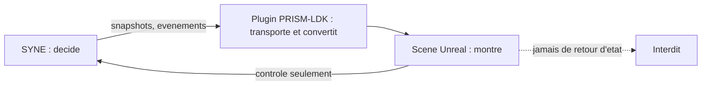

# Chapitre 7. PRISM : montrer sans décider

Reste à donner au monde un visage sans lui donner des ordres. PRISM, projet Unreal final, est ce visage. Ce chapitre raconte pourquoi il doit rester un reflet discipliné si la question directrice veut garder son sens : dès que la scène décide à la place du moteur, l'émergence n'est plus observée, elle est truquée.

Trois entités portent des noms proches et ne doivent jamais être confondues. **LIVEX** est le projet complet. **PRISM** est son projet Unreal final : il porte le monde présenté, les acteurs, le rendu, l'interface et les interactions. **PRISM-LDK** (*LIVEX Development Kit*, nom de module Unreal `PrismLdk`) est le plugin d'intégration qui relie les deux : une couche mince qui transporte, convertit et diffuse, jamais un moteur parallèle.

## Pourquoi la représentation est un problème, pas une évidence

On pourrait croire que montrer un monde est neutre : on affiche ce que le moteur calcule, et c'est tout. En pratique, c'est faux. Une représentation doit prendre des décisions : où placer un objet, comment interpoler un déplacement, quelle animation jouer. Chacune de ces décisions est une occasion de s'écarter du monde. Une scène qui lisse un déplacement pour l'esthétique peut, sans le vouloir, suggérer une continuité que le monde n'a pas. Une scène qui anime un « rassemblement » peut faire croire à une structure que le moteur n'a pas produite. La discipline de PRISM consiste à limiter ces libertés au strict nécessaire, et à les garder visuelles, jamais décisionnelles.

## Comment lire cette partie

1. **Le projet Unreal et la place du rendu** : ce que PRISM est, ce que l'hôte technique du dépôt n'est pas, et pourquoi la scène ne décide jamais.
2. **Le plugin PRISM-LDK** : transport, conversion en types Blueprint, cycle de connexion et règles de consommation.
3. **L'échelle, la cadence et le transport** : le facteur spatial, le ratio de temps simulé, le cycle de préparation, ce que le moteur exporte et ce que le rendu invente.
4. **Le flux de données et le rendu** : l'instantané comme source de vérité, la construction du décor, la projection, l'interpolation et les trois interdits du rendu.

## La frontière, en un regard

Le trait plein descendant porte l'état du monde vers la scène. Le seul trait remontant autorisé porte des **commandes**, jamais des positions ou des états inventés par le rendu. La boucle interdite, en pointillé, est celle qui transformerait la scène en cause.

## État et avertissement de portée

PRISM et PRISM-LDK sont, à l'état décrit, en version de travail. Le plugin consomme le contrat d'observabilité SYNE 0.4.0. Dans le dépôt, l'hôte technique `LDK.uproject` sert à compiler et tester le plugin ; son nom n'en fait ni le projet complet LIVEX, ni un second produit.

L'expérience de rendu interactive complète est **hors périmètre** de la version 0.1 : les spécifications de scène, de rendu et d'interaction décrivent des objectifs de présentation, non des fonctions livrées. Toute capture ou image doit être rapportée à sa version, et toute illustration conceptuelle doit être annoncée comme telle, jamais présentée comme une preuve. La validation du plugin dans le projet Unreal ciblé est exigée avant livraison.

## Ce que cette partie apporte à la question directrice

Cette partie répond à une question précise : comment un monde logique devient-il une scène, sans que la scène devienne un second monde ? La réponse tient en une échelle explicite, une cadence découplée du rendu, et une frontière non négociable entre décider et montrer. À la fin de cette partie, le lecteur saura pourquoi ce que l'on voit est bien le monde, et non une mise en scène.

| Risque | Garde-fou |
| :-- | :-- |
| la scène décide | SYNE seul décide |
| la scène invente un état | la scène suit l'instantané |
| la scène renvoie une position | interdiction de renvoyer un état |
| cadence confondue avec le rendu | cadence et rendu découplés |
| nom trompeur | PRISM, PRISM-LDK et LIVEX distingués |
