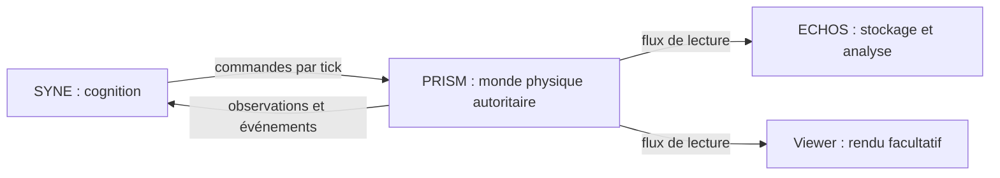

# Chapitre 7. PRISM : simuler le monde, puis le représenter

PRISM a changé de fonction entre les deux versions de LIVEX. En V1, PRISM est
un projet Unreal et son plugin PRISM-LDK reçoit les données du moteur SYNE pour
les représenter. En V2, PRISM désigne une simulation .NET headless qui porte
l'état physique du monde : terrain, matière, temps, déplacement, actions et
structures. Cette transformation déplace une frontière fondamentale. La
scène ne porte plus le monde ; le monde simulé existe sans scène.

Ce chapitre décrit PRISM V2 tel qu'il est implémenté au 4 novembre 2026. Il
distingue la base fonctionnelle, le couplage actuel avec SYNE et les preuves
encore attendues. Les anciens chapitres Unreal sont conservés comme description
historique de PRISM V1 et sont balisés comme tels.

## Comment lire ce chapitre

1. [PRISM V2 : le monde et sa simulation](05-prism-v2.md)
2. [Le plugin PRISM-LDK de V1](02-plugin-ldk.md), repère historique
3. [L'échelle et le transport Unreal de V1](03-echelle-cadence-et-transport.md), repère historique
4. [Le flux et le rendu Unreal de V1](04-flux-de-donnees-et-rendu.md), repère historique

## La frontière V2

SYNE reste l'horloge maîtresse et décide des actes cognitifs. PRISM applique les
commandes au monde, avance ses systèmes et renvoie ce que l'agent peut
observer. ECHOS et le viewer lisent les sorties de PRISM ; ils ne décident pas
à sa place. Le viewer V2 est optionnel et son client de lecture n'est pas
encore branché au lancement live.

## Ce qui est et ce qui n'est pas établi

Le host, les actions physiques, la génération déterministe, les chaînes
d'outils et d'agriculture, les structures et les points de reprise ont des
tests fonctionnels. Le contrat SYNE↔PRISM `1.0.0` est gelé. Le relevé local du
4 novembre compte 403 tests PRISM réussis. La boucle couplée SYNE/PRISM et
l'application des observations aux croyances sont implémentées ; le transport
a été exercé sur 1 000 ticks.

Cela ne suffit pas à déclarer l'intégration complète. Le run R2 couplé de
5 000 ticks, ses répétitions identiques, la reprise commune et les validations
interplateformes restent à réaliser. ECHOS peut valider et conserver les
enveloppes du flux PRISM, mais cette ingestion n'est pas encore intégrée au
cycle de run et aux métriques. Les chaînes livrées n'ont pas toutes de
scénarios bout en bout pilotés par bot. La performance mesurée après
optimisation est un résultat local, pas une porte de viabilité franchie.

Les résultats expérimentaux disponibles restent bornés : le contraste de
quête spatiale a été confirmé dans le protocole préenregistré ; le cycle
homéostatique social n'a pas été confirmé ; l'émergence générale n'est pas
établie. Un monde plus riche et des interactions fonctionnelles ne remplacent
pas les expériences de validation.
