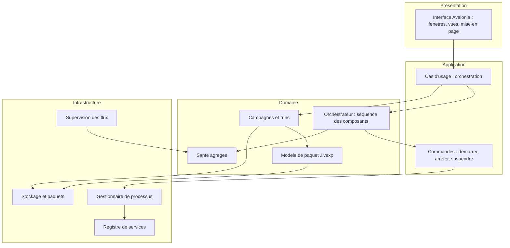

# Launcher I. Orchestration, supervision et réseau

Un monde, un observatoire et une scène ne forment pas encore une pile praticable. Il manque un chef d'orchestre qui les lance, les surveille et les arrête proprement, sans s'immiscer dans leurs échanges. Ce chapitre décrit le Launcher : ses couches, ses frontières, sa supervision et son plan de communication.

Le Launcher est peut-être le composant le plus facile à mal comprendre. On pourrait le croire central, puisqu'il pilote tout : ce serait une erreur. Le Launcher est périphérique au flux de données, même s'il est central au flux de commandement. Il ordonne le début et la fin, il n'achemine pas le milieu. Comprendre cette nuance, c'est comprendre pourquoi l'architecture résiste à la panne d'un seul composant.

**Pourquoi ce chapitre importe pour la question directrice.** Un chef d'orchestre ne joue pas des instruments : il donne le départ et l'arrêt, sans s'installer dans le son. Le Launcher est ce chef d'orchestre. Il compte pour la question parce que c'est lui qui transforme une intention (« comparer ces configurations ») en suite d'opérations reproductibles : c'est par lui qu'une émergence observée devient une expérience répétable, et non un moment unique. Sa discipline (piloter sans posséder, superviser sans dégrader) est ce qui permet d'étudier la question à l'échelle d'une campagne.

## 1. Une application de bureau en couches strictes

Le Launcher est organisé en couches, et chaque couche ne connaît que celle qui la suit. La dépendance est strictement descendante.



La couche présentation ne connaît que l'application. La couche application valide les intentions de l'utilisateur. La couche domaine porte les règles d'orchestration, le modèle de campagne, le modèle de paquet et la santé. La couche infrastructure apporte les processus, le réseau, les fichiers et les horloges, par des interfaces déclarées dans le domaine.

Une règle est nette : le domaine ne référence jamais Avalonia, ni les types de processus, ni les chemins de fichiers. Ces dépendances sont introduites par l'infrastructure. Et le Launcher ne référence aucun assembly de SYNE, d'ECHOS ou de PRISM : les composants sont des processus externes, pas des bibliothèques. Seul un assembly de contrat de référence est autorisé, pour réutiliser les types sérialisés de l'observabilité.

Cette règle d'indépendance est ce qui garantit qu'un composant peut être remplacé sans recompiler le Launcher. Puisque le Launcher ne référence pas les assemblies des composants, il ne dépend que de leurs **contrats**. Un composant peut évoluer, changer d'implémentation interne, être réécrit dans un autre langage, tant que son contrat ne change pas. C'est aussi ce qui permet au Launcher d'orchestrer un composant qui n'existe pas encore : l'installateur, par exemple, sera un simple exécutable à lancer, sans que le Launcher en connaisse le code.

## 2. Les deux frontières

La distinction la plus importante de l'architecture sépare deux frontières.

- La **frontière de contrôle** : démarrage, arrêt, suspension, configuration, requêtes d'état, requêtes d'analyse. Le Launcher y intervient pleinement.
- La **frontière de données** : instantanés, deltas, événements, résultats d'analyse, rapports. Le Launcher y touche seulement en bordure, pour l'archivage, jamais pour relayer.

Trois conséquences en découlent. Le Launcher ne dégrade jamais un composant : si l'analyse est indisponible, il signale l'absence au lieu de la remplacer par une lecture approximative. Il ne devient jamais propriétaire de l'état simulé : il détient des références et des empreintes, pas une copie du monde. Il ne dégrade jamais la science : il transporte, date, rattache et archive un résultat, sans jamais l'interpréter.

Cette notion de « non-dégradation » est plus profonde qu'elle n'en a l'air. Il serait tentant, lorsqu'un composant est indisponible, de compenser : estimer une métrique manquante, reconstruire un état par interpolation. Le Launcher s'interdit cette compensation. Une absence reste une absence ; elle est signalée, jamais comblée. C'est la même philosophie qui traverse ECHOS, appliquée à l'échelle de l'orchestration.

## 3. Le modèle de concurrence

Le Launcher est un processus de bureau événementiel. Il n'exécute aucun calcul scientifique. Quatre unités le composent : le thread d'interface (mono-thread, asynchrone), une boucle d'orchestration en tâche de fond unique, un pool de supervision pour le sondage et la collecte, et une tâche séquentielle dédiée à l'écriture du paquet.

Quatre règles garantissent la robustesse. Une seule séquence d'orchestration, afin qu'une action de l'utilisateur n'entre pas en conflit avec une réaction automatique. Aucune attente bloquante sur l'interface, afin qu'un composant figé ne fige pas la fenêtre. Une écriture de paquet sérialisée, sans accès concurrent au fichier. Une annulation coopérative, propagée par jeton, jamais par terminaison forcée d'un thread.

Ces règles répondent à des situations concrètes. Un composant qui se fige ne doit pas geler l'interface : c'est pourquoi aucune attente bloquante n'est autorisée. Un utilisateur qui annule ne doit pas laisser un paquet à moitié écrit : c'est pourquoi l'écriture est sérialisée et la file d'attente unique. Une action automatique (par exemple une reprise après échec) ne doit pas entrer en conflit avec une action manuelle : c'est pourquoi il n'y a qu'une seule séquence d'orchestration. Ces contraintes sont techniques, mais leur effet est visible : l'application reste réactive même quand un composant se comporte mal.

## 4. La supervision à six niveaux

Superviser une pile, c'est l'observer à plusieurs échelles. Le Launcher distingue six niveaux emboîtés.

| Niveau | Objet |
| :-- | :-- |
| L0 | l'hôte : processeur, mémoire, disque, réseau |
| L1 | le processus : identifiant, disponibilité, mémoire, redémarrages |
| L2 | le service : disponibilité, latence, erreurs, connexions |
| L3 | la simulation : tick, cadence, agents, événements par seconde |
| L4 | la campagne : progression, échecs, durée médiane |
| L5 | le global : santé agrégée, alertes actives |

Un niveau supérieur se compose des niveaux inférieurs ; aucun ne duplique une mesure. Trois exigences structurent cette supervision. Elle ne modifie jamais le résultat d'une simulation : aucune métrique ne consomme le générateur aléatoire ni ne conditionne la logique de simulation. Elle est légère par défaut : aucune dépendance obligatoire à un outil de supervision externe, ces outils restant des exports optionnels. Et le contrat est identique pour tous les composants, sans exception.

La première exigence mérite d'être rappelée : aucune métrique consommée par la supervision n'entre dans la simulation. C'est la même règle qu'à tous les niveaux du projet : observer ne change pas le monde. Un compteur de latence, un taux d'occupation mémoire, un nombre de redémarrages sont des informations **sur** le système, pas des entrées du système. Les mêler au générateur ou à la logique simulée introduirait une dépendance invisible entre l'observation et le phénomène.

Le modèle d'état distingue plusieurs situations qu'on confond souvent. Un composant **dégradé** répond encore, mais un critère de santé est hors seuil. Un composant **injoignable** est vivant, mais une sonde échoue ou le tick est figé alors que la simulation tourne ; un tick figé **en pause** n'est pas un blocage. Enfin, « connecté » n'est pas un état de composant : c'est une relation entre deux composants, à afficher comme attribut de lien.

La règle d'agrégation globale est celle du pire état parmi les composants requis, adoucie pour les optionnels, et l'état global affiche toujours sa cause principale.

La distinction entre « figé » et « en pause » est un exemple typique d'un problème que la supervision doit traiter avec finesse. Un tick qui n'avance pas peut signifier deux choses opposées : une pause volontaire, où il n'y a rien à signaler, ou un blocage, où il faut alerter. Un superviseur naïf confondrait les deux et produirait des fausses alertes à chaque pause. Le projet distingue explicitement les cas, car une supervision qui crie au loup perd toute crédibilité.

## 5. Le plan de communication

Le Launcher distingue le contrôle et les données. Le contrôle est faible en volume et centralisé : il passe par le Launcher. Les données sont volumineuses et directes : elles ne passent pas par le Launcher.

```text
Launcher   ──(controle)──►  Composants
SYNE       ──(donnees)───►  ECHOS
SYNE       ──(donnees)───►  PRISM
Composants ──(sante)────►   Launcher
ECHOS      ──(resultats)─►  Launcher (archivage)
```

Le trait commun : le Launcher est sur le chemin de tout ce qu'il doit contrôler ou archiver, et sur le chemin d'aucun flux de données temps réel. C'est ce qui lui permet de piloter sans devenir un goulot d'étranglement, et de rester hors du chemin critique de la simulation.

L'espace d'adressage interne du Launcher réserve une plage de ports (par exemple 5200 à 5399), et les ports des composants restent configurables : 5180 et 5181 pour le moteur, 5000 pour l'analyse.

Ce plan de communication est ce qui distingue le Launcher d'un broker. Un broker est sur le chemin de toutes les données ; il peut les inspecter, les transformer, les re-router, mais il devient un point de défaillance unique et un goulot d'étranglement. Le Launcher, lui, est un orchestrateur : il commande le début et la fin, mais les données vont directement du producteur au consommateur. Si le Launcher s'arrêtait au milieu d'un run, la simulation continuerait de produire ses instantanés vers l'analyse et la scène ; seul le commandement serait interrompu. C'est une propriété de robustesse délibérée.

## 6. La sécurité et la détection de blocage

Deux sujets complètent l'orchestration. La détection de blocage : un run est déclaré bloqué si le tick n'avance pas pendant un délai donné alors que la simulation est en cours. La sécurité : le Launcher ne fait pas d'hypothèse sur la confiance des entrées, les chemins de paquet sont validés, et les ports sont vérifiés avant usage.

La détection de blocage est un garde-fou, non un diagnostic. Elle indique qu'un run ne progresse plus, sans prétendre dire pourquoi. La cause peut être un composant figé, une ressource saturée, un verrou. Le Launcher alerte, et l'humain diagnostique. Cette répartition des rôles est cohérente avec la philosophie générale : le Launcher signale l'anomalie, il n'invente pas l'explication.

## 7. Le déploiement

Le Launcher est distribué comme une application de bureau autonome, sans installation de langage ni de base de données. La version 0.1 cible Windows et Linux. macOS n'est pas prévu. Le Launcher ne s'installe pas comme service et ne s'exécute pas dans un conteneur : il suppose un poste de travail, une session interactive et un système de fichiers local.

Ce choix de déploiement découle du rôle : le Launcher est un poste de commandement, non un service d'arrière-plan. Il suppose un humain devant l'écran, des fenêtres, une session. C'est pourquoi il est distribué comme application de bureau, et non comme service. Un utilisateur qui voudrait le faire tourner sur un serveur sans écran se tromperait de composant : la production scientifique se fait par des scripts de campagne, non par l'interface.

## 8. Ce que ce chapitre apporte à la question directrice

Ce chapitre a montré comment orchestrer une pile sans la confondre : couches strictes, deux frontières, supervision à six niveaux, plan de communication où le contrôle est centralisé et les données sont directes. C'est ce qui permet de piloter la question directrice à l'échelle d'une campagne, sans dégrader ni la simulation, ni l'analyse, ni le rendu.

Ce que ce chapitre ne permet pas encore de conclure : qu'une campagne soit archivable et rejouable dans le temps. C'est précisément l'objet du chapitre suivant : les campagnes et le paquet `.livexp`.
