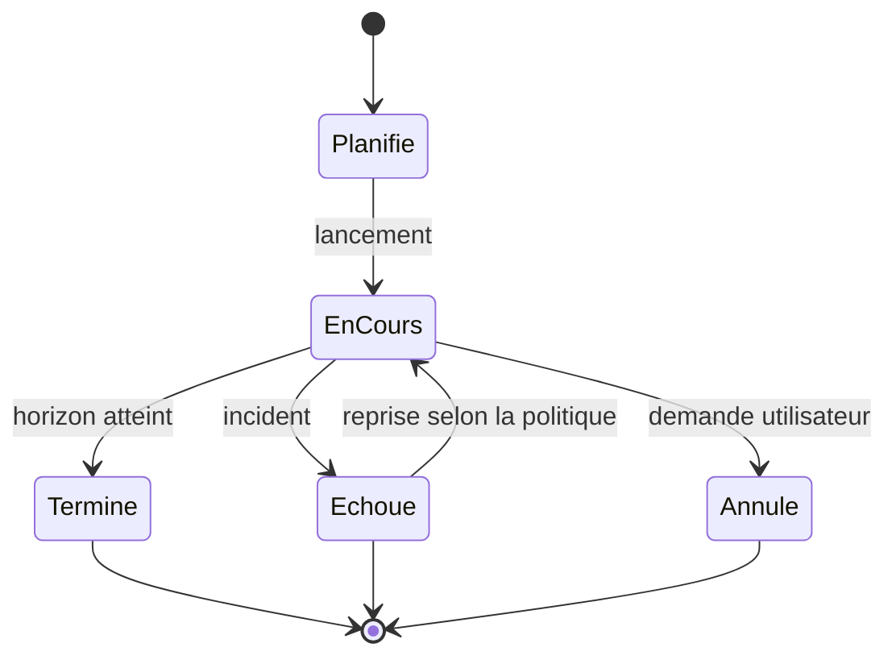

# Launcher II. Campagnes et paquet `.livexp`

L'émergence ne se proclame pas : elle s'archive. Ce chapitre décrit comment le Launcher enchaîne des runs reproductibles, comment il reprend une campagne interrompue, et comment il scelle le tout dans un paquet déterministe, rouvrable des mois plus tard.

Le mot « archive » a ici un sens fort. Il ne s'agit pas de conserver une sortie pour mémoire, mais de constituer un objet qui **rejoue**. Une campagne archivée doit pouvoir être rouverte, comprise sans le logiciel qui l'a produite, et comparée à une autre. Le paquet `.livexp` est cet objet. Tout le chapitre décrit les propriétés qui le rendent rouvrable et reproductible, et les précautions qui l'empêchent de mentir.

**Pourquoi ce chapitre importe pour la question directrice.** Un résultat qu'on ne peut pas rouvrir ni rejouer n'est pas un résultat, c'est une anecdote. Imaginez un bocal scellé : tout ce qui s'y est produit peut être rouvert, examiné, comparé des mois plus tard. Le paquet de campagne est ce bocal. Il compte pour la question parce qu'il transforme une émergence observée en objet partageable et vérifiable : quelqu'un d'autre peut rouvrir l'archive, refaire l'expérience et constater la même chose. Sans cette archive, l'émergence resterait une histoire que l'auteur raconte.

## 1. Campagne et run

Deux niveaux d'exécution organisent le travail.

- Une **campagne** est un ensemble paramétré de runs, destiné à produire une analyse agrégée. C'est l'unité de partage et d'archivage.
- Un **run** est une exécution élémentaire, reproductible et autonome. C'est l'unité d'échec et de reprise.

Une campagne est entièrement décrite par un objet de définition, écrit dans le paquet au moment de sa création. Cet objet porte un identifiant, un titre, un profil d'exécution, la configuration du moteur (référencée ou incluse), le nombre de runs, l'horizon de ticks, la stratégie de dérivation des graines, la graine de base, la politique d'échec et une note libre. La définition est complète et autosuffisante : le fichier suffit à rejouer la campagne.

| Champ de la définition | Rôle | Exemple |
| :-- | :-- | :-- |
| identifiant | nom stable de la campagne | calibration-saison-3 |
| titre | libellé affichable | Calibration saison 3 |
| profil | profil d'exécution | analyse |
| configuration | moteur, référencé ou inclus | base.json |
| nombre de runs | nombre de runs | 12 |
| horizon de ticks | durée de chaque run | 5000 |
| stratégie de graine | dérivation des graines | dérivée |
| graine de base | point de départ | 1000 |
| politique d'échec | comportement en cas d'échec | continuer |
| note | texte libre | (optionnel) |

La séparation entre campagne et run a une conséquence pratique importante : elle découple l'unité de partage de l'unité d'échec. Si un run échoue, on le reprend sans perdre la campagne. Si une campagne est terminée, on la partage comme un tout. Imaginez l'inverse : si tout était au même niveau, une seule erreur obligerait à tout refaire, et une campagne réussie serait inséparable de ses runs individuels. Le découpage évite ces deux extrêmes.

## 2. L'exécution séquentielle

En version 0.1, les runs d'une campagne s'exécutent l'un après l'autre. Un seul moteur sert toute la campagne, un run n'est jamais lancé avant que le précédent soit terminé, l'ordre est stable et chaque run a une graine distincte.

La séquentialité n'est pas une limite subie, c'est un choix assumé pour la version 0.1. La parallélisation est envisagée ; elle introduira un ordonnancement par emplacements et des granularités de reprise plus fines.

Il faut expliquer pourquoi la séquentialité est un choix, et non un pis-aller. Paralléliser des runs exigerait plusieurs moteurs, donc des ressources matérielles supérieures, et surtout une gestion soigneuse des ports, des bases d'analyse et des fichiers. Pour une première version, la simplicité prime : un run à la fois, avec un état propre, se reprend facilement et se diagnostique aisément. Le projet préfère annoncer une limite qu'il maîtrise plutôt que de promettre une parallélisation non vérifiée.

## 3. La dérivation des graines

La reproductibilité d'une campagne repose sur des graines prévisibles et dérivables, jamais tirées au hasard à l'exécution.

- La stratégie **dérivée** calcule la graine d'un run comme la graine de base augmentée du numéro de run.
- La stratégie **explicite** prend une liste de graines donnée dans la définition.
- La stratégie **dérivée par hachage** disperse largement les graines.

```text
derivee        : graine(n) = graine_de_base + n
explicite      : graine(n) = liste[n]
derivee_hash   : graine(n) = hash(graine_de_base, n)
```

La stratégie dérivée est celle par défaut. Le Launcher n'invente jamais de graine : une campagne sans stratégie explicite est refusée à la création. La relation entre campagne, numéro de run et graine est écrite dans les métadonnées du run, afin qu'un run isolé reste reproductible sans la campagne entière.

La règle « le Launcher n'invente jamais de graine » est une garantie de reproductibilité. Si les graines étaient tirées au hasard au moment de l'exécution, deux campagnes identiques produiraient des résultats différents, et l'on ne pourrait plus comparer. En imposant des graines dérivables et en refusant une campagne sans stratégie, le Launcher s'assure que la même définition produit toujours la même famille de runs. Une campagne est donc, en puissance, un ensemble de trajectoires déterminées.

## 4. Le cycle de vie d'un run

Un run traverse plusieurs états : planifié, en cours, terminé, échoué ou annulé. En cas d'échec, une politique détermine la suite : réessayer puis passer, s'arrêter, ou continuer.



Un point important concerne la reprise. Reprendre une campagne interrompue ne rejoue pas les runs déjà terminés. La reprise s'appuie sur l'index des runs et sur le journal de campagne, jamais sur un balayage du disque. L'entrée d'un run repris est identique à celle du run d'origine, et le journal l'atteste. C'est ce que le livre appelle archiver pour rejouer : une interruption ne produit pas une nouvelle histoire, mais la reprise de la même.

Ce détail distingue une reprise d'une relance. Si reprendre consistait à relancer tous les runs depuis le début, une interruption ferait perdre le travail déjà accompli. Si reprendre consistait à balayer le disque pour deviner où l'on s'est arrêté, la reprise dépendrait de l'état du système de fichiers, donc serait fragile. En s'appuyant sur l'index et le journal, la reprise est **déclarative** : elle sait exactement où elle en est, parce que le journal le lui dit. Le journal devient donc la mémoire de la campagne, et c'est lui qui garantit qu'une interruption ne change pas l'histoire.

## 5. Le paquet `.livexp`

Le paquet `.livexp` est le format unique de données du Launcher. Il porte une campagne, ses runs, les artefacts qu'ils ont produits et les rapports qui en découlent. Il a une double nature.

- **Vivant** pendant la campagne : écriture continue, en incrément, pour la reprise et la supervision.
- **Scellé** après la campagne : aucune écriture, immuable, pour le partage et l'archivage.

Cette double nature est la propriété structurante du format : le paquet est à la fois un espace de travail durable pendant l'exécution et un artefact autonome après coup, sans conversion ni export.

Le conteneur choisi est le format ZIP, avec l'extension `.livexp`, en variante ZIP64 (une campagne dépasse couramment quatre gigaoctets). La compression est le déflate par défaut, le stockage brut pour les entrées déjà compressées. Le conteneur est un choix d'implémentation : le format est la structure logique, et un lecteur doit pouvoir ouvrir un paquet sans dépendre du ZIP.

La double nature du paquet est ce qui le distingue d'un simple export. Beaucoup de systèmes produisent un fichier d'export une fois le travail terminé, et un espace de travail séparé pendant le travail. Ici, c'est le même objet : vivant puis scellé. Cela signifie qu'une campagne interrompue laisse un paquet récupérable, non un fouillis de fichiers intermédiaires. Et une campagne terminée laisse un paquet scellé, non une conversion à refaire. Cette continuité entre travail et archive est la propriété qui rend le format élégant.

## 6. La structure d'un paquet

Un paquet contient un manifeste, la définition de campagne, un journal d'exécution, une provenance, une note de lecture, un dossier de runs et un dossier d'analyse.

- Le **manifeste** est le point de commit : il porte l'identité, l'état, la version de schéma et l'inventaire. Il est écrit en dernier ; son absence à jour signifie que le paquet est récupérable plutôt que valide.
- La **définition** décrit la campagne de façon déclarative.
- Le **journal** (une ligne par événement) trace les transitions.
- La **provenance** consigne qui, quand, avec quelles versions et sur quelle plateforme.
- La **note de lecture** permet d'ouvrir le paquet sans le Launcher.
- Chaque **run** possède ses métadonnées, sa configuration résolue, ses données, ses journaux et ses empreintes.
- L'**analyse** contient les résultats par run, l'analyse agrégée et le rapport d'émergence, fichier de référence.

Le nom du rapport de référence est unique : il n'a qu'un seul emplacement, et le dossier des rapports ne contient que des copies volontaires. Sans cette règle, un même fichier aurait deux emplacements concurrents et aucune source de vérité.

La note de lecture joue un rôle particulier : elle permet d'ouvrir le paquet **sans le Launcher**. C'est une propriété d'archivage au sens fort : un paquet doit rester compréhensible même si le logiciel qui l'a produit n'est plus disponible. Un lecteur qui ouvrirait le paquet dans vingt ans devrait pouvoir comprendre ce qu'il contient, à quelles versions et dans quelles conditions, à partir de son seul contenu.

## 7. Les états du paquet

Le manifeste porte un état parmi trois.

- **Vivant** : la campagne est en cours, l'écriture est attendue.
- **Scellé** : la campagne est terminée, le paquet est immuable.
- **Récupérable** : l'écriture a été interrompue, la reprise est possible, le contenu est incomplet.

Trois états suffisent, et leur existence repose sur une idée simple : un paquet ne doit jamais être dans un état ambigu. Il est en cours, terminé, ou interrompu-récupérable. Jamais « peut-être terminé » ni « probablement valide ». Cette clarté permet à la reprise de savoir quoi faire sans deviner.

## 8. L'écriture normative

À la fin de chaque run, l'ordre d'écriture est normatif : d'abord le répertoire du run, puis ses empreintes, puis l'index des runs, puis le journal, puis le manifeste recompté. Un paquet interrompu entre deux étapes est récupérable, et la reprise se base sur l'index, pas sur l'examen des répertoires.

Le **scellement** rend le paquet immuable : horodatage de fin, passage à l'état scellé, recalcul d'empreinte, figage du journal et normalisation des entrées ZIP. Un paquet scellé est en lecture seule ; toute tentative d'écriture est refusée.

L'ordre normatif d'écriture est ce qui rend la reprise sûre. En écrivant d'abord les données du run, puis les empreintes, puis l'index, puis le journal, puis le manifeste, le Launcher s'assure qu'un crash laisse toujours un état cohérent : si le manifeste n'est pas à jour, c'est que la campagne n'est pas terminée, et le paquet est récupérable. Le manifeste est le point de commit, et tout ce qui précède reste valide même si tout s'arrête après.

## 9. La reproductibilité du paquet

Un paquet scellé est déterministe : deux campagnes de contenu identique produisent deux paquets identiques octet pour octet. Plusieurs sources de non-déterminisme sont neutralisées : horodatages des entrées ZIP fixés, permissions normalisées, ordre d'écriture imposé, identifiants de session absents du paquet, chemins absolus interdits, noms d'entrées dérivés, compression à niveau fixé.

Cette propriété est vérifiable : deux paquets scellés se comparent sans différence. Elle fait du paquet un support de reproductibilité au même titre que la graine. C'est aussi pourquoi la configuration résolue **exclut les valeurs de transport** (port de contrôle, jeton de session, identifiant de corrélation, horodatages, chemins) : ces valeurs changent à chaque exécution, et les inscrire ferait diverger deux paquets d'une même campagne qui doivent rester identiques.

La configuration résolue mérite une précision. Elle enregistre les décisions du Launcher, non les réglages internes du moteur, qui restent la propriété du composant. La surcouche de configuration qu'elle contient n'est pas une reformulation de la campagne : c'est le document réellement écrit avant le lancement, produit par le même type que celui qui a été appliqué. Le paquet ne peut donc pas attester une configuration différente de celle qui a tourné.

L'objectif « octet pour octet » impressionne, mais sa justification est pratique. Si deux campagnes identiques produisaient des paquets différents, on ne pourrait pas vérifier, par simple comparaison de fichiers, qu'elles sont bien identiques. On devrait rouvrir chaque paquet, recalculer, comparer champ par champ. En rendant le paquet déterministe, le projet transforme une vérification coûteuse en une comparaison élémentaire. C'est le même esprit que les empreintes dorées de la simulation : rendre la vérification triviale pour qu'elle soit faite.

## 10. La sécurité et les limites

Le format intègre des contre-mesures de sécurité : refus des chemins de traversée, plafond de taille décompressée et de ratio de compression (protection contre les bombes de décompression), refus des entrées exécutables et des liens symboliques, verrou d'écriture exclusif, vérification du contrôle d'intégrité de chaque entrée, et absence de secret dans la configuration résolue.

Quelques limites sont documentées : le nombre de runs par paquet est borné, la taille d'une entrée est plafonnée, et le ratio de décompression est limité. Ces plafonds sont des garde-fous, non des optimums.

L'absence de secret dans la configuration résolue mérite une mention. Un paquet d'archive est destiné à être partagé : il ne doit contenir aucun jeton, aucune clé, aucun mot de passe. La configuration résolue exclut donc les valeurs sensibles, et cette exclusion est une propriété de conception, non une précaution ajoutée après coup. Un format d'archive partageable doit être sûr à partager par construction.

## 11. Ce que ce chapitre apporte à la question directrice

Ce chapitre a montré comment une campagne enchaîne des runs reproductibles, comment elle se reprend sans rejouer, et comment elle se scelle dans un paquet déterministe. C'est par ce dispositif que l'émergence devient un objet archivé, partageable, rouvrable, plutôt qu'une anecdote d'écran.

Ce que ce chapitre ne permet pas encore de conclure : que la pile soit installable simplement sur un poste. Cette dernière brique, encore à l'état de spécification, est décrite au chapitre suivant : l'installateur.
