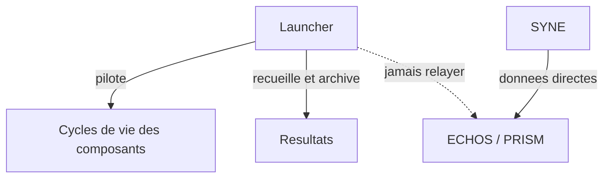

# Chapitre 8. Le Launcher : archiver pour rejouer

Piloter sans posséder, archiver sans relayer. Le Launcher est l'orchestrateur qui permet à la question directrice de devenir une pratique : lancer la même expérience, l'interrompre, la reprendre sans la rejouer, la sceller à l'octet près, la rouvrir des mois plus tard.

Le Launcher est une application de bureau native, écrite en .NET avec Avalonia. Il orchestre les composants sans contenir ni simulation (SYNE), ni analyse (ECHOS), ni rendu (PRISM). Il pilote leurs cycles de vie, laisse les données aller directement du moteur aux consommateurs, et recueille les résultats pour les archiver.

## Pourquoi un orchestrateur, et pas un simple lanceur

On pourrait réduire le Launcher à un bouton « démarrer » : il lance les processus, et c'est tout. Le projet lui confie davantage, pour une raison de méthode. Une expérience scientifique n'est pas un lancement unique, c'est une **campagne** : plusieurs runs, des graines dérivées, une politique d'échec, une reprise possible, une archive scellée. Sans orchestrateur, ces opérations seraient manuelles, donc fragiles et non reproductibles. Le Launcher existe pour transformer une intention (« comparer ces configurations ») en une suite d'opérations reproductibles et archivables.

## Comment lire cette partie

1. **Orchestration, supervision et réseau** : les couches, les frontières de contrôle et de données, les six niveaux d'observation et le plan de communication.
2. **Campagnes et paquet `.livexp`** : comment une campagne enchaîne des runs reproductibles, comment elle se reprend et comment elle se scelle.
3. **Observabilité et supervision** : les six niveaux d'observation, les neuf états de composant, l'agrégation, le contrat de santé et le nommage des métriques.
4. **Le paquet, le flux de données et le réseau** : la structure du paquet, le manifeste et le scellement, la règle du seul écrivain, les graines dérivées, et les plans de contrôle et de données.

## Trois relations, en un regard

Le Launcher **pilote** les cycles de vie (il démarre, arrête, configure, interroge l'état ou demande une analyse). Il **laisse les données aller directement** du moteur aux consommateurs, sans jamais les relayer. Il **recueille les restitutions** pour les archiver. Confondre ces trois relations conduirait à faire du Launcher un goulot d'étranglement et un point de défaillance, ce que l'architecture interdit.

## État et rôle

Le Launcher est présent dans le dépôt et testé (tests unitaires, d'intégration et de bout en bout). Il est prévu comme un composant de poids égal à SYNE, ECHOS et PRISM : sa suppression ne doit rendre aucun autre composant inutilisable, et il ne dépend d'aucun autre composant pour fonctionner. Les composants sont des participants, pas des dépendances.

Deux modes d'utilisation du moteur, de poids égal, structurent l'orchestration : ECHOS pour l'analyse, la reproductibilité et la calibration ; PRISM pour la représentation en temps réel. Le Launcher permet de les activer séparément ou ensemble, sans introduire de hiérarchie entre eux. Le mode représentation (PRISM) reste verrouillé tant que l'intégration Unreal n'est pas validée.

## Ce que cette partie apporte à la question directrice

Cette partie répond à une question précise : comment une observation devient-elle un résultat partageable ? La réponse tient en trois opérations : orchestrer sans posséder, superviser sans dégrader, archiver sans relayer. À la fin de cette partie, le lecteur saura comment le projet transforme des runs éphémères en archives rejouables, et pourquoi cette transformation est la condition d'une science cumulative.
