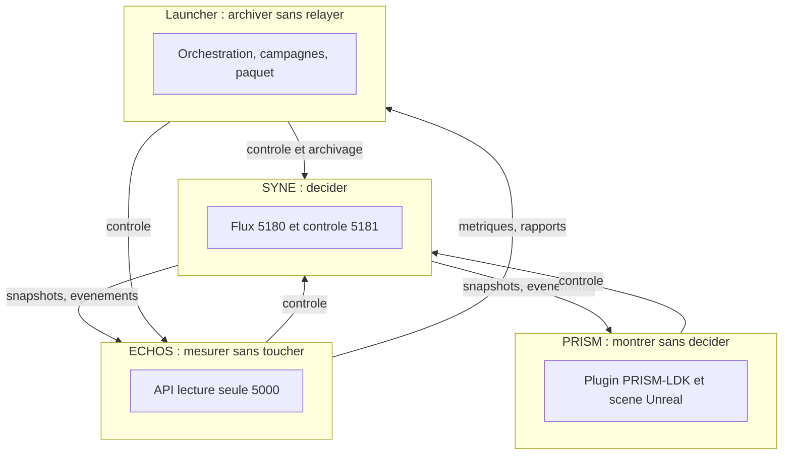
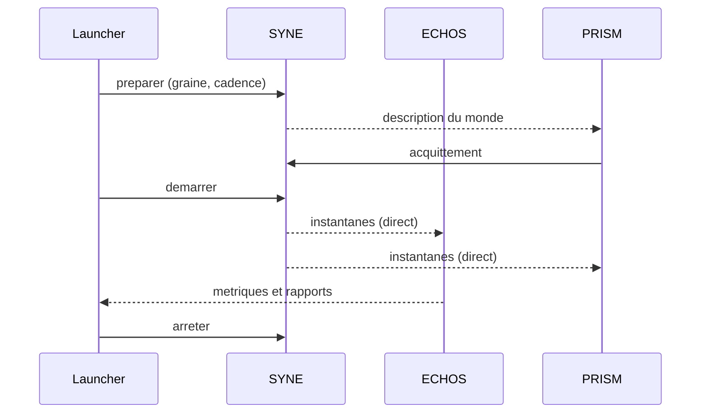

# Chapitre 10. Intégration système

Les composants ont été décrits séparément. Ce chapitre les relie. Il raconte comment la pile fonctionne de bout en bout, quels contrats la tiennent, et comment un parcours complet a été vérifié contre les composants réels. C'est ici que la séparation des responsabilités cesse d'être un principe d'architecture pour devenir une pratique observée.

Il faut comprendre l'enjeu de ce chapitre. Décrire des composants isolés est relativement facile : chacun a ses contrats, ses tests, son rôle. La difficulté commence lorsqu'il faut les faire travailler ensemble. Deux composants qui fonctionnent parfaitement séparément peuvent échouer ensemble, parce qu'ils ne s'entendent pas sur un format, un ordre, une sémantique. L'intégration est donc le moment de vérité d'une architecture.

**Pourquoi ce chapitre importe pour la question directrice.** Quatre instruments justes pris séparément peuvent former un ensemble faux : c'est le moment où les pièces doivent s'emboîter qui révèle si l'architecture tient. Pour la question directrice, l'intégration est l'épreuve de vérité : elle vérifie que le moteur décide, que l'observatoire mesure sans toucher, que la scène montre sans décider et que l'orchestrateur archive sans relayer, **ensemble**, sur des composants réels. Si un seul interdit cédait, la réponse à la question serait entachée.

## 1. La pile en un regard

Quatre responsabilités, deux outils, un monde.

Le moteur produit la vérité du monde et la diffuse. L'observatoire la lit et la mesure. La scène la reflète. L'orchestrateur pilote les cycles de vie, laisse les données circuler directement et archive les résultats. Chaque composant protège les autres de leurs tentations.

## 2. Les contrats qui tiennent la pile

L'intégration repose sur trois contrats.

| Contrat | Transport | Port | Contenu |
| :-- | :-- | --: | :-- |
| Temps réel | WebSocket | 5180 | initialisation, instantané par tick, événements |
| Contrôle | HTTP | 5181 | préparer, acquitter, démarrer, pause, reprise, arrêt, réinitialisation, état |
| Lecture | REST | 5000 | runs, métriques, exports, comparaisons, inspections |

- Le **contrat temps réel** (WebSocket, port 5180 par défaut) : un message d'initialisation, puis un instantané global par tick et des événements typés. JSON textuel, camelCase.
- Le **contrat de contrôle** (HTTP, port 5181 par défaut) : préparer, accuser réception, démarrer, mettre en pause, reprendre, arrêter, réinitialiser, lire l'état.
- Le **contrat de lecture** (API REST d'ECHOS, port 5000 par défaut) : runs, métriques, exports, comparaisons, inspections, en lecture seule.

La règle de compatibilité est unique : un ajout est compatible, une suppression ou un changement de sens est incompatible. C'est cette règle qui a permis d'ajouter des fonctionnalités (saisons, territoires, livres, inventaire, engagements, temps simulé en secondes) sans rompre les consommateurs.

## 3. Le chemin de bout en bout

Un parcours complet relie cinq moments.

1. **Préparer.** L'orchestrateur demande au moteur de préparer un monde, avec une graine et une cadence. Le moteur construit ce monde et en diffuse la description.
2. **Acquitter.** La scène génère sa représentation et accuse réception. Après une préparation explicite, le démarrage exige cet accusé.
3. **Démarrer.** Le moteur lance la simulation. Les instantanés partent vers l'observatoire et la scène, directement, sans passer par l'orchestrateur.
4. **Mesurer et montrer.** L'observatoire agrège et expose ses métriques en lecture seule ; la scène met à jour sa représentation sans jamais décider.
5. **Archiver.** À la fin de chaque run, l'orchestrateur collecte les restitutions et scelle la campagne dans un paquet.

Le point essentiel est que les données de télémétrie survivent à un arrêt de l'orchestrateur : elles vont directement du moteur aux consommateurs. L'orchestrateur est sur le chemin du contrôle et de l'archivage, jamais sur celui des données temps réel.

## 4. La preuve d'extrémité réelle

Le livre conserve deux relevés qu'il faut distinguer. Le rapport d'acceptation Launcher du 17 octobre 2026 documente un run de bout en bout à 33/33 contre SYNE publié et ECHOS réel, avec une campagne scellée puis relue. Dans la vérification locale du 18 octobre, la suite est à 31/33 : les deux scénarios J3 réels échouent sur l'assertion du journal « analyse individuelle collectée ». Le premier est une campagne réussie antérieure, le second le résultat local plus récent; le parcours complet n'est donc pas vert dans le checkout courant. Les suites Unit (174/174) et Integration (20/20) restent vertes. Sans `LIVEX_SYNE_PUBLISHED_ROOT`, quatre tests conditionnels sont comptés comme échecs par le runner au lieu d'être marqués ignorés. Les détails et sorties se trouvent dans le [statut local courant](../governance/LIVEX-STATUS.md) et le [rapport d'acceptation pérenne](../governance/realignment/LAUNCHER-ACCEPTANCE-2026-10.md).

Ce type de preuve est important parce qu'il dépasse le test unitaire. Un test unitaire valide un comportement isolé ; un parcours de bout en bout valide que les contrats s'emboîtent réellement : que l'observatoire ingère ce que le moteur émet, que l'orchestrateur reprend là où il s'est arrêté, que le paquet scellé se rouvre et que le rapport régénéré est identique. Le rapport ancien documente ces propriétés pour ses scénarios; l'échec local les empêche d'être généralisées comme acceptation courante sans réserve.

Il faut mesurer la force et la faiblesse de ces preuves. Elles portent sur une seule plateforme (Windows) et des dates distinctes; elles ne prouvent pas que d'autres combinaisons fonctionneraient ni que le parcours J3 demeure vert dans tous les runs. « 33/33 le 17 octobre » est un résultat de campagne archivé, pas une promesse de reproductibilité universelle.

## 5. Les frontières vérifiées

Chaque interdit de l'architecture est vérifié.

- **Le piloté égale l'interrompu.** Un run piloté par le contrôle produit exactement le même état qu'un run laissé libre : l'ordonnancement du contrôle ne consomme aucun tirage.
- **Le rapport égale sa régénération.** Un rapport archivé est identique au rapport régénéré à partir des mêmes données : la production est déterministe.
- **L'entrée n'est jamais rejouée.** Une reprise reprend après le dernier run terminé, sans le rejouer.
- **Le zéro lu est distingué du zéro aveugle.** Un chiffre non mesuré n'est jamais affiché comme un zéro observé.

| Interdit | Preuve exécutable |
| :-- | :-- |
| SYNE ne doit pas être mis en scène | piloté égal à l'interrompu |
| ECHOS ne doit pas altérer le monde | lecture seule, provenance des mesures |
| PRISM ne doit pas décider | la scène suit l'instantané |
| Le Launcher ne doit pas relayer | données directes moteur vers consommateurs |
| La reprise ne doit pas rejouer | entrée prise après le dernier run terminé |
| Un zéro ne doit pas mentir | provenance publiée point par point |

Ces quatre propriétés forment la version exécutable des quatre interdits : SYNE décide, ECHOS mesure sans toucher, PRISM montre sans décider, le Launcher archive sans relayer.

## 6. Les divergences assumées

L'intégration ne cache pas ses écarts. Plusieurs divergences entre la conception initiale et la réalisation sont consignées. L'observatoire n'utilise pas le cadre applicatif initialement prévu, mais un cadre plus léger. L'observatoire n'a plus d'interface propre : la présentation est portée par l'orchestrateur. L'échelle et la cadence de la représentation ont été formalisées par une décision dédiée. La communauté de détection utilise une méthode déterministe plutôt que l'algorithme initialement envisagé, incompatible avec la contrainte de déterminisme.

Une divergence assumée n'est pas un défaut dissimulé : c'est une décision documentée, avec sa justification.

La dernière divergence est particulièrement instructive. Un algorithme de détection de communautés avait été envisagé pour l'analyse ; il a été écarté au profit d'une méthode déterministe, parce qu'il introduisait de l'aléa et donc de la non-reproductibilité. C'est un exemple de contrainte forte (le déterminisme) qui l'emporte sur une préférence technique. Le projet choisit la reproductibilité, même au prix d'un algorithme moins raffiné.

## 7. Ce que ce chapitre apporte à la question directrice

Ce chapitre a montré que la pile fonctionne de bout en bout : préparation, acquittement, démarrage, mesure, archivage, reprise, scellement. Il a montré que les frontières entre composants sont vérifiées, et que les écarts de conception sont assumés.

Ce que ce chapitre ne permet pas encore de conclure : que la pile soit fiable dans le temps. Pour cela, il faut examiner un contrat encore plus exigeant que les autres, celui qui commande tout le reste : le déterminisme. C'est le sujet du chapitre suivant.
