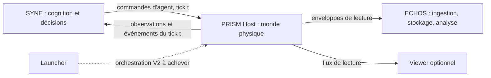

# Chapitre 10. Intégrer deux moteurs sans confondre leurs responsabilités

Un monde V2 n'est plus le seul travail de SYNE. PRISM fait avancer le monde
physique ; SYNE conserve la cognition des agents et leurs décisions. Pour
qu'ils forment une simulation unique, ils doivent partager l'ordre du temps,
des identifiants, des commandes et des observations. Les contrats rendent cette
frontière vérifiable. Le code de couplage existe, mais l'intégration complète
et sa preuve de longue durée restent à terminer.

Ce chapitre décrit l'état connu au 4 novembre 2026. Il ne confond pas
l'architecture V1 de la release publique avec le couplage V2 en cours, et ne
présente pas le test de transport sur 1 000 ticks comme l'acceptation d'un run
de 5 000 ticks.

## 1. La pile en un regard

La boucle SYNE↔PRISM est couplée : SYNE prépare les décisions de ses agents,
PRISM applique leurs commandes et renvoie ce qu'ils peuvent observer. SYNE
reçoit ces observations et met à jour ses croyances. PRISM reste propriétaire
de l'état physique ; SYNE reste propriétaire de l'état cognitif. Le viewer ne
possède ni l'un ni l'autre. ECHOS reçoit un flux de lecture distinct.

La migration demeure partielle. Le moteur SYNE conserve encore son monde
historique et les systèmes à extraire. Il existe donc deux contextes valides :
la simulation autonome V1, où SYNE porte le monde, et le couplage V2, où PRISM
porte le monde physique utilisé par la boucle couplée. Les textes et les
résultats doivent nommer le contexte qu'ils décrivent.

## 2. Les contrats et les transports

Le contrat SYNE↔PRISM `1.0.0` sépare les échanges de tick du contrôle de
l'application.

| Échange | Sens | Canal | Rôle |
| :-- | :-- | :-- | :-- |
| Préparation et cycle de vie | Launcher → PRISM | HTTP | Préparer, démarrer, suspendre, reprendre et arrêter le host |
| Commandes et résultat du tick | SYNE ↔ PRISM | WebSocket lockstep ou appel embarqué | Ordonner le tick et échanger commandes, observations et événements |
| Flux de lecture | PRISM → ECHOS / viewer | WebSocket de lecture | Publier snapshots, deltas, entités, métriques et chantiers |
| Analyse historique V1 | SYNE → ECHOS | WebSocket SYNE, puis API REST ECHOS | Ingestion des snapshots et événements V1 |

Le format JSON utilise des enveloppes versionnées et un numéro de tick. Les
commandes sont idempotentes afin qu'un rejeu n'applique pas deux fois la même
action. Les observations absentes ne sont pas assimilées à une valeur zéro.
Les deux versions de simulation n'ont pas les mêmes schémas : le contrat
WebSocket SYNE `0.5.0` n'est pas le contrat SYNE↔PRISM `1.0.0`.

## 3. La boucle couplée effectivement livrée

Le client SYNE prépare et contrôle PRISM. `PrismReadStreamClient` lit le flux,
vérifie les versions et les séquences, et sait se resynchroniser sur un
snapshot. `PrismObservationMapper` convertit les observations physiques en
observations cognitives SYNE. `CognitionPipeline.ApplyExternalObservations`
les applique aux croyances. `PrismCoupledRunner` orchestre ce parcours ; le
CLI expose le paramètre `--prism-url`.

Au 4 novembre, cette boucle a été exercée pendant 1 000 ticks sans crash. Les
suites SYNE comptaient 708 tests réussis et celles de PRISM 403. Ces résultats
établissent que le transport et les composants couverts fonctionnent dans
leurs scénarios. Ils ne prouvent pas encore que 5 000 ticks couplés sont
reproductibles sur plusieurs exécutions, ni qu'une reprise restaure
simultanément le monde PRISM et l'état cognitif SYNE.

La prochaine preuve d'intégration est R2 : 5 000 ticks, au moins trois
exécutions identiques, comparaison d'empreintes bit à bit et reprise partagée.
Ce critère est plus exigeant qu'un test de connexion : il vérifie l'identité
de la trajectoire complète après l'échange entre les moteurs.

## 4. ECHOS reçoit le flux V2, sans analyser encore le run complet

ECHOS conserve son ingestion historique des flux SYNE. Une voie PRISM distincte
valide et enregistre les enveloppes du flux de lecture avec leur séquence,
leur tick et leur `contentHash`. L'API peut restituer les enveloppes
enregistrées.

Cette base ne constitue pas encore une ingestion de production. ECHOS-100 doit
encore raccorder le flux au cycle d'un run, puis produire ou joindre les
métriques attendues. Le service ne fabrique pas une mesure SYNE si le contrat
PRISM ne la fournit pas. La séparation préserve la provenance : ce qui a été
observé, ce qui a été calculé et ce qui n'a pas été mesuré restent distincts.

## 5. Launcher et visualiseur

Le Launcher V1 sait orchestrer et archiver la pile publiée. Un manifeste de
host PRISM V2 est présent et raccordé au Launcher générique, mais le cycle
complet de lancement, d'attribution des ports, de préparation coordonnée et
d'archivage des résultats PRISM reste une tâche d'intégration. Les lanes
LAUNCHER-200 à 202 décrivent ce travail.

Le viewer V2 a des modes de caméra, un rendu de terrain par région et un
client de flux live. Ce client sait traiter les séquences et les snapshots de
resynchronisation, mais il n'est pas encore connecté à la commande CLI de
lancement. L'aperçu actuel utilise des agents de démonstration statiques ; il
ne doit pas être interprété comme une visualisation d'une campagne en direct.

## 6. Déterminisme, campagnes et limites

PRISM dispose d'une campagne réduite épinglée (trois graines, 200 ticks,
trois bots) et d'une campagne complète manuelle (trois graines, 5 000 ticks,
trois bots). Les neuf empreintes de la campagne complète du 4 novembre sont
consignées dans le suivi PRISM. La boucle couplée SYNE↔PRISM n'a pas encore
produit l'équivalent de cette campagne complète répétée.

La campagne PRISM observe les bots PRISM, pas la cognition SYNE. R2 observe le
couplage et ne peut être remplacé par les empreintes des bots. De même, une
campagne à un agent n'établit pas la viabilité d'un monde de cinquante ou cent
agents. Chaque preuve répond à son propre critère.

## 7. Ce que l'intégration permet d'affirmer

LIVEX possède une première boucle V2 fonctionnelle entre la cognition SYNE et
le monde autoritaire PRISM. ECHOS sait conserver le flux de lecture PRISM et
le viewer sait traiter ce flux côté client. Ces trois capacités sont des
jalons distincts. L'ingestion ECHOS n'est pas encore liée au run supervisé et
le viewer n'est pas encore lancé en mode live par défaut.

L'intégration V2 n'est pas déclarée achevée : restent R2, la reprise partagée,
l'extraction complète du monde historique de SYNE, le raccordement de
production ECHOS et Launcher, les validations multiplateformes et les portes
de calibrage. Les résultats scientifiques déjà publiés demeurent bornés :
quête spatiale confirmée selon le protocole, cycle social non confirmé,
émergence générale non établie.
