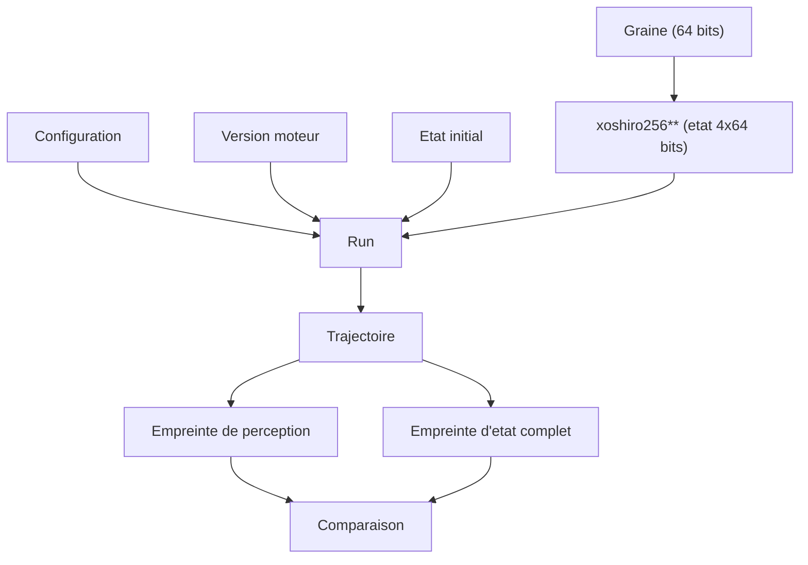

# Chapitre 11. Reproductibilité et déterminisme

Tout le livre repose sur une promesse : même graine, mêmes réglages, même version, même trajectoire, au bit près. Ce chapitre explique comment cette promesse est tenue, comment elle est vérifiée, et pourquoi elle est, avant d'être technique, un contrat moral.

Le déterminisme est le concept le plus important du livre et le plus facile à sous-estimer. À première vue, c'est une propriété d'ingénieur : des runs identiques produisent des résultats identiques. En réalité, c'est ce qui sépare une expérience d'une anecdote. Sans déterminisme, on observerait des phénomènes sans pouvoir dire s'ils se reproduisent ; on ne pourrait pas comparer deux configurations ; on ne pourrait pas débattre d'une décision, puisque la même situation pourrait produire autre chose. Le déterminisme est la condition de toute discussion scientifique sur le système.



**Pourquoi ce chapitre importe pour la question directrice.** Deux expériences identiques qui ne donnent pas le même résultat n'apprennent rien. Toute la question directrice repose donc sur une promesse invisible : même graine, mêmes réglages, même version, même trajectoire. C'est cette promesse qui transforme une observation en fait, une comparaison en mesure, et une décision en objet discutable. Sans elle, rien de ce que le livre affirme ne serait vérifiable.

## 1. La définition

Le déterminisme bit-à-bit signifie que deux exécutions identiques (même graine, même configuration, même version moteur, même état initial) produisent exactement la même trajectoire : mêmes événements, mêmes décisions, mêmes états. Sans cette propriété, il devient impossible de distinguer une conséquence d'une règle d'un effet accidentel de l'aléatoire ou de l'ordre d'exécution.

## 2. Les quatre piliers d'une exécution reproductible

Une exécution est reproductible si quatre éléments coïncident : la **graine** (un entier de 64 bits), la **configuration**, la **version moteur** (qui identifie les règles) et l'**état initial**. Ces quatre éléments constituent la définition d'un run. Deux runs ne sont comparables que si leurs versions moteur coïncident.

| Pilier | Ce qu'il fixe | Pourquoi il compte |
| :-- | :-- | :-- |
| Graine | la suite pseudo-aléatoire | point de départ du hasard |
| Configuration | tous les paramètres | réglages du monde |
| Version moteur | les règles | deux versions ne sont pas comparables |
| État initial | les conditions de départ | d'où part le monde |

La version moteur joue un rôle particulier : elle identifie les **règles** du run. Deux runs à graine et configuration identiques, mais à versions moteur différentes, ne sont pas comparables, car les règles ont changé. C'est pourquoi la version moteur figure dans chaque message : un observateur peut toujours vérifier qu'il compare ce qui est comparable.

## 3. Le générateur

Le moteur utilise un générateur unique et sérialisable, `xoshiro256**`, initialisé par `splitmix64` à partir de la graine. Le choix est justifié : le générateur est l'un des plus rapides en 64 bits, sa qualité statistique est éprouvée, et son état tient en quatre mots de 64 bits, donc facilement sérialisable.

Une règle stricte l'accompagne : l'usage du générateur standard du cadre d'exécution est interdit, car son état n'est pas directement sérialisable et son comportement n'est pas stable entre versions du cadre.

Interdire un générateur n'est pas anodin. On pourrait croire qu'un générateur standard suffirait, puisque la graine fixe la suite. Mais deux problèmes se posent : son état interne n'est pas exposé de manière portable, donc on ne peut pas le sauvegarder ni le restaurer exactement ; et son algorithme peut changer d'une version du cadre à l'autre, ce qui ferait diverger deux runs « identiques » exécutés avec des plateformes différentes. En imposant un générateur propre, dont l'algorithme est figé et l'état sérialisable, le projet s'affranchit de ces deux risques.

## 4. La sérialisation du générateur

L'état complet du générateur (quatre fois 64 bits) est sauvegardé à chaque sauvegarde. Une simulation sauvegardée au tick 1000, rechargée puis poursuivie, produit exactement les mêmes événements qu'une exécution ininterrompue. C'est la reprise exacte, et elle ne repose pas sur un rejouage : elle restaure l'état en place.

Ce choix de restaurer plutôt que de rejouer a une conséquence pratique considérable. Rejouer une simulation depuis le début pour la reprendre à un tick donné prendrait un temps proportionnel à ce tick, et deviendrait impraticable pour des runs longs. Restaurer l'état prend un temps constant. C'est ce qui rend la reprise utilisable dans une campagne où les runs durent des centaines de milliers de ticks.

## 5. L'ordre causal strict

Les sous-systèmes s'exécutent dans un ordre causal strict (la boucle en quinze étapes). Aucune exécution parallèle ne doit introduire de non-déterminisme : la parallélisation de la perception, par exemple, doit rester déterministe par agrégation d'ordre fixe. Les entités sont traitées par identifiant croissant, la communication en une passe, la révision des groupes intercalée à une position fixe, la mortalité et le cycle des réserves placés en fin de tick.

Un principe traverse tout le moteur : là où un hasard est nécessaire (déplacement pseudo-aléatoire, incompréhension d'un message, tirage de conflit de priorités, mutation d'héritage), il est dérivé d'un hachage stable des identifiants et du tick, jamais du générateur global. La conséquence est nette : l'avancement du générateur reste minimal (un tirage par tick), et deux runs au même seed produisent la même trajectoire.

Le hachage stable mérite une explication, car c'est une astuce élégante. Plutôt que de tirer au sort la direction d'un déplacement, on calcule un hachage (par exemple avec `splitmix64`) de l'identifiant de l'entité, du tick et du désir courant. Ce hachage produit une valeur qui ressemble à un tirage aléatoire, mais qui est entièrement déterminée par ses entrées. Deux conséquences en découlent : on obtient de la variété (les directions ne se répètent pas de manière naïve) sans consommer le générateur global, et le résultat est reproductible par construction. C'est ce qui permet à un run de rester exactement rejouable malgré des milliers de décisions pseudo-aléatoires.

## 6. La vérification

Le déterminisme n'est pas affirmé, il est testé. Plusieurs mécanismes le vérifient.

- Un test de reprise bit-à-bit : un run relancé depuis une sauvegarde produit le même hachage qu'un run ininterrompu.
- Des checksums de trajectoire pour détecter toute divergence.
- Des matrices graines par configurations : pour chaque graine d'un jeu fixe, exécuter un nombre défini de ticks et valider le checksum.
- Un test de régression de déterminisme : un hash épinglé de la trajectoire perception et décision (graine 12345, 25 entités, 200 ticks), plus l'égalité bit-à-bit entre deux runs identiques et la différence entre deux graines.

Deux empreintes dorées sont épinglées par défaut : une empreinte de perception et une empreinte d'état complet. Toute altération bit-à-bit de la trajectoire change ces valeurs et fait échouer un test.

Le dernier mécanisme mérite d'être souligné : le test vérifie **à la fois** que deux runs identiques produisent le même résultat **et** que deux graines différentes produisent des résultats différents. Sans la seconde vérification, un moteur figé (qui produirait toujours la même chose, quelle que soit la graine) passerait le premier test sans être déterministe au sens utile. Le test s'assure donc que la graine a bien un effet, tout en garantissant que ce sont les mêmes entrées qui produisent le même résultat.

## 7. Les altérations volontaires

Le déterminisme ne signifie pas que la trajectoire ne change jamais. Le projet a volontairement changé la trajectoire lors de deux calibrations, D1 puis B1. Chaque changement a suivi trois gestes simultanés : incrémenter la version, mettre à jour la version moteur diffusée, et recalculer les empreintes dorées dans le même commit que la décision. La cause du changement a été isolée et vérifiée.

Ce point est essentiel à la compréhension du contrat. Le déterminisme garantit que, pour une version donnée, une graine reproduit une trajectoire. Il n'exige pas que deux versions produisent la même trajectoire. Ce qui serait interdit, c'est une altération silencieuse : une modification de la trajectoire sans changement de version ni recalcul d'empreinte. L'épinglage des checksums rend cette faute impossible à commettre sans la voir.

On peut formuler la règle ainsi :

```text
version inchangée  => trajectoire inchangée (meme graine, meme config)
trajectoire changée => version incrémentée ET empreintes recalculees
```

Cette règle transforme le déterminisme d'une contrainte en un garde-fou. Il ne s'agit pas d'interdire tout changement : il s'agit d'interdire les changements **invisibles**. Un changement annoncé, versionné et re-verrouillé est légitime ; un changement silencieux ne l'est pas.

## 8. L'échelle temporelle et la neutralité

Un cas particulier mérite d'être cité, car il montre comment on peut introduire de la liberté sans falsifier le passé. Le moteur dispose désormais d'un levier d'échelle temporelle (la durée simulée par tick). Au ratio neutre (une minute par tick, compatibilité historique), chaque opération retourne simplement sa valeur d'entrée : aucune arithmétique n'est appliquée, et la trajectoire de référence reste inchangée au bit près. La liberté nouvelle ne falsifie donc pas le passé.

```text
R = (secondes simulees par tick) / 60        [ratio neutre : R = 1]
R = 1   => valeur inchangee (aucune arithmetique)
R ≠ 1   => classe A mise a l'echelle, classe B inchangee
```

## 9. Le déterminisme côté observatoire

Le déterminisme ne concerne pas que le moteur. L'observatoire produit des rapports déterministes : exports triés, absence d'horodatage d'émission, absence d'aléa. Deux lectures d'un run inchangé produisent un corps identique. La comparaison de deux runs s'appuie sur une empreinte de contenu canonique, et les méta-métriques de reproductibilité sont des fonctions pures, stables entre rejeux.

Ce déterminisme de l'observatoire est ce qui rend la chaîne complète vérifiable : un run reproductible produit une série reproductible, qui produit un rapport reproductible, qui produit un paquet reproductible.

## 10. Ce que ce chapitre apporte à la question directrice

Ce chapitre a montré comment la promesse de reproductibilité est tenue et vérifiée, du générateur jusqu'au paquet. C'est cette promesse qui fait de LIVEX un instrument plutôt qu'une démonstration : sans elle, aucune comparaison d'expériences n'aurait de sens.

Ce que ce chapitre ne permet pas encore de conclure : que les expériences elles-mêmes apportent des connaissances. Le déterminisme est une condition, non un résultat. Le chapitre suivant raconte les campagnes, c'est-à-dire les enquêtes menées grâce à cet instrument.
