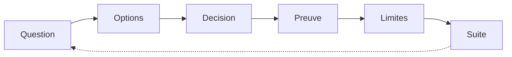

# Chapitre 12. Les campagnes comme enquêtes

Chaque campagne de ce livre suit le même gabarit d'enquête : contexte et question, options envisagées, décision et raisons, preuve, limites, suite. Ce chapitre raconte les campagnes menées, y compris celles qui ont échoué, car expérimenter consiste à instruire la question directrice à charge réelle, scripts rejouables à l'appui.

Une campagne est ce qui distingue une observation d'une preuve. Observer, c'est regarder un run tourner ; mener une campagne, c'est poser une question précise, définir un protocole, exécuter plusieurs fois, et confronter le résultat à une attente. Le projet applique aux campagnes la même exigence qu'aux tests : elles doivent être rejouables par un script, et leurs conclusions doivent être bornées à ce qui a été mesuré.

**Pourquoi ce chapitre importe pour la question directrice.** Regarder un monde tourner n'apprend pas grand-chose ; lui poser une question précise, avec un protocole et une preuve, en apprend davantage. Les campagnes sont cet acte d'enquête. Elles comptent pour la question parce qu'elles substituent à l'impression une méthode : on mesure, on isole, on corrige, on rejoue. Et elles comptent doublement parce qu'elles publient leurs échecs : un monde qui meurt, un benchmark qui plafonne, une reprise qui échoue indiquent autant qu'une réussite.

## 1. Le gabarit d'une enquête

Une campagne n'est pas une démonstration : c'est une question posée au système, avec une méthode et une preuve. Le gabarit retenu comporte six éléments. Le contexte et la question. Les options envisagées. La décision et ses raisons. La preuve. Les limites. La suite. Rien n'est promis au-delà de ce qui est mesuré.

| Étape du gabarit | Ce qu'elle apporte |
| :-- | :-- |
| Contexte et question | ce que l'on cherche |
| Options envisagées | ce que l'on aurait pu faire |
| Décision et raisons | ce que l'on a fait, et pourquoi |
| Preuve | ce qui a été mesuré, rejouable |
| Limites | ce que la preuve ne couvre pas |
| Suite | ce qui reste à faire |

Ce gabarit a une vertu : il rend visible le raisonnement, non seulement le résultat. Une campagne qui publierait uniquement sa conclusion serait dogmatique ; une campagne qui publie aussi ses options et ses limites est discutable. Le livre s'impose donc ce format partout.

## 2. La stabilisation : rendre le monde viable

La première campagne visait la survie. Le constat de départ était simple : le monde mourait. À cinquante puis cent agents, sur deux mille cinq cents ticks et trois graines, la version antérieure ne tenait pas.

Le diagnostic a isolé plusieurs causes. Une dégradation périodique annulait la régénération des réserves. Le déplacement, action majoritaire, coûtait plus que le revenu amorti des repas, ce qui faisait décroître l'énergie sans borne. Et deux besoins sans mécanisme de satisfaction franchissaient leur seuil en déclenchant des actions coûteuses en permanence.

La correction, la calibration B1, a rendu viables les défauts eux-mêmes, sans écrire de comportement : suppression de la dégradation par défaut, régénération nette, coût de déplacement abaissé, gains d'énergie ajoutés, dérives abaissées. Le résultat, sur six runs (cinquante et cent agents, trois graines), a été : zéro extinction, zéro mort, pente d'énergie bornée, population conservée.

| Indicateur | Avant B1 | Après B1 |
| :-- | :-- | :-- |
| Extinctions (6 runs) | survient avant 2500 | zéro |
| Morts | nombreuses | zéro |
| Pente d'énergie | décroissante sans borne | bornée |
| Population | s'effondre | conservée |

La limite est explicite : cette campagne établit une viabilité sur un horizon et un profil donnés. Elle ne prouve pas qu'un autre monde serait viable, ni que des phénomènes intéressants apparaîtront. Elle prouve seulement que le monde ne meurt plus dans les conditions mesurées.

## 3. L'enchaînement : comparer sans rouvrir le monde

La deuxième campagne visait la comparaison. Comment comparer plusieurs populations sans interrompre le moteur ?

La réponse est l'enchaînement par réinitialisation. Dans une session unique, six populations différentes sont exécutées par réinitialisation partielle, en conservant le serveur. Les pentes obtenues sont identiques à celles du chemin classique, ce qui prouve qu'on peut comparer plusieurs configurations sans rouvrir le monde. La preuve est rejouable par script, et la conformité au contrat de stabilité a été constatée sur six couples population par graine.

Cette campagne répond à un besoin concret de l'expérimentation. Comparer deux populations demanderait normalement de relancer le moteur pour chacune, ce qui allongerait chaque expérience. L'enchaînement par réinitialisation permet de tout faire dans une seule session, en réutilisant le serveur, et la campagne prouve que les mesures restent identiques à celles du chemin classique. On gagne du temps sans perdre en validité.

La limite : la campagne porte sur un nombre de populations et de graines fixé. Elle ne tranche pas la question ouverte du nombre de runs nécessaires pour conclure statistiquement.

## 4. La cadence et la pression : mesurer sous contrainte

La troisième campagne visait la résistance. Que se passe-t-il quand le monde est sous pression, quand un travailleur ralentit ou se fige, quand la connexion meurt ?

Le protocole a fait tourner trente secondes en trois phases (régime nominal, travailleur gelé, reprise), à cent puis cinquante ticks demandés. Les résultats : soixante-seize puis quarante-quatre ticks effectifs, une base figée au tick exact pendant le gel, un rattrapage par lots de cent cinquante-cinq, un retard médian de deux à cinquante, un trou à cent contre zéro à cinquante, et une reconnexion après mort violente en une demi-seconde.

| Observation | Valeur |
| :-- | :-- |
| Ticks effectifs (100 puis 50 demandés) | 76, puis 44 |
| Base pendant le gel | figée au tick exact |
| Rattrapage | par lots de 155 |
| Retard médian | 2 à 50 ticks |
| Trous | 1 à 100 demandés, 0 à 50 |
| Reconnexion après mort violente | environ 0,5 s |

Tout a été signalé, rien masqué. C'est la leçon de cette campagne : sous pression, l'honnêteté de l'instrument compte plus que la performance brute. Un trou visible vaut mieux qu'un trou recousu.

## 5. Les benchmarks : mesurer là où ça casse

La quatrième campagne visait le débit. Les benchmarks honnêtes, libres de toute hypothèse flatteuse, tiennent à cinquante et à cinq cents agents, et échouent à mille : six ticks par seconde au lieu des dix attendus, à cause d'un goulot dans la perception. Le résultat est documenté et hors blocage pour les scénarios visés, mais il est publié tel quel.

Un benchmark qui ne montre que ses réussites n'est pas un benchmark. Celui-ci indique explicitement où le système plafonne, à quelle version et sur quelle machine (une machine de référence), et renvoie à la mesure de référence : l'annexe K en donne la machine, le protocole, les chiffres par population, les planchers de non-régression et le coût de l'observabilité.

Ce résultat mérite d'être lu comme un acte de méthode. Publier qu'un système plafonne à une certaine population, à une version donnée, est désagréable ; c'est pourtant ce qui donne du crédit aux autres chiffres. Si le projet n'avait publié que les cas favorables, tous ses chiffres seraient suspects. En publiant le plafond, il prouve qu'il mesure au lieu de sélectionner.

## 6. La validation Windows

La cinquième campagne visait la portabilité. Sur une machine réelle, le build se fait sans avertissement, deux cent huit tests passent sans échec ni orphelin, le parcours de bout en bout (campagne, interruption, reprise, paquet scellé) fonctionne contre un moteur publié et une analyse réelle, et treize travaux d'intégration sont verts après quatre défauts révélés par les premiers lancements Windows et corrigés : un glob de shell, un test sauté, un verrou de fermeture, un plancher de débit.

Cette campagne illustre une vertu de la méthode : ce sont les premiers tests sur une nouvelle plateforme qui révèlent les défauts d'environnement, et non les tests qui passaient déjà sur l'ancienne.

Il faut souligner le mot « révélés ». Les quatre défauts n'étaient pas des défauts de conception ; ils étaient des hypothèses implicites sur la plateforme (un comportement de shell, un test qui supposait un autre système, un verrou qui ne se libérait pas, un seuil de débit trop optimiste). C'est précisément ce que teste une nouvelle plateforme : elle casse les hypothèses implicites. Le projet a corrigé les quatre, et les a documentés. C'est la version exécutée de l'adage selon lequel la portabilité se prouve en portant.

## 7. La validation transverse

Une validation transverse (hors essai longue durée) a également été conduite. Elle vérifie la cohérence de la pile sur des scénarios courts et variés. Elle est acquise à l'état décrit.

## 8. Ce que ces campagnes ne prouvent pas

Il faut être précis sur ce que ces enquêtes n'établissent pas. Elles prouvent que le monde tient, que les comparaisons sont reproductibles, que l'instrument signale ses trous, et que la plateforme est portable. Elles ne prouvent pas qu'un phénomène émergent intéressant apparaîtra, ni qu'un résultat observé soit autre chose qu'une conséquence de paramètres choisis. Les campagnes suivantes devront porter sur l'observation des phénomènes eux-mêmes, avec la prudence statistique que le projet revendique.

Cette distinction est le cœur de la rigueur du projet. Ces campagnes sont des campagnes de **mécanique** : elles vérifient que la machine fonctionne. Elles ne sont pas des campagnes de **phénomène** : elles ne disent pas ce que la machine produit d'intéressant. Le livre les sépare nettement, et refuse de laisser croire qu'une plateforme qui fonctionne est une découverte. Une plateforme qui fonctionne est la condition d'une découverte, pas la découverte elle-même.

## 9. Ce que ce chapitre apporte à la question directrice

Ce chapitre a montré la méthode à l'œuvre : mesurer, isoler une cause, corriger, assumer, rejouer. Il a montré aussi qu'un échec mesuré vaut un succès mesuré. La question directrice n'avance pas par proclamation, mais par enquêtes rejouables.

Ce que ce chapitre ne permet pas encore de conclure : ce que l'on peut réellement observer dans cette version. C'est le sujet du chapitre suivant.
