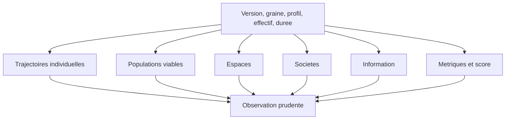

# Chapitre 13. Ce que cette version permet d'observer, prudemment

Chaque résultat de ce chapitre dépend des règles et paramètres cités. Chacun illustre un comportement possible, jamais une loi générale. La visualisation aide à voir, jamais à prouver. Et les expériences ambiguës, expliquées, valent autant que les réussites.

Ce chapitre occupe une place délicate dans le livre. C'est celui où le lecteur attend le plus : « qu'est-ce que vous avez observé ? ». C'est aussi celui où le risque de surinterprétation est le plus grand. Le projet s'impose donc une discipline constante : décrire ce que l'instrument permet de voir, sans transformer une observation en conclusion. Le lecteur doit pouvoir lire chaque observable en gardant en tête qu'il dépend d'un profil, d'une graine et d'une version.

**Pourquoi ce chapitre importe pour la question directrice.** C'est le chapitre où la question reçoit sa matière : qu'est-ce que cette version permet réellement d'observer ? Ni plus, ni moins. Chaque observable y est présenté avec sa réserve, parce que la question directrice ne se satisfait pas d'une réponse vague : elle demande des faits situés, rapportés à une version, une graine et un profil. Ce chapitre tient donc l'équilibre le plus difficile du livre : montrer assez pour instruire la question, sans jamais prétendre au-delà de ce qui est mesuré.

## 1. Les trajectoires individuelles

Le premier observable est la trajectoire d'une entité. D'une part, on peut suivre son état (position, énergie, faim, soif, fatigue), ses décisions chiffrées, ses actions et leurs conséquences en termes de variations. D'autre part, on peut remonter une chaîne causale bornée, de l'action jusqu'aux besoins et aux perceptions, sans que le système conclue seul. Enfin, on peut inspecter ses croyances au tick récent, son réseau de confiance, ses groupes actifs et sa mémoire bornée.

Ces observables sont rejouables à graine identique et remontables jusqu'à la perception. Ils illustrent le cœur de l'ouvrage : des comportements non programmés mais analysables. L'avertissement reste entier : un comportement observé dépend des règles et paramètres utilisés, et ne constitue pas une loi.

| Observable individuel | Ce qu'il montre |
| :-- | :-- |
| État au fil du temps | position, énergie, faim, soif, fatigue |
| Décisions chiffrées | action choisie, utilité, drapeaux |
| Chaîne causale | action jusqu'à la perception |
| Croyances récentes | ce que l'entité tient pour vrai |
| Réseau de confiance | ses relations dirigées |
| Groupes actifs | ses appartenances |
| Mémoire bornée | ses souvenirs et leur saillance |

## 2. Les populations viables

Le deuxième observable est la viabilité d'une population. Sur six runs de deux mille cinq cents ticks, à cinquante et cent agents, on observe zéro extinction, une énergie en pente bornée et une population conservée. La mort est drapée en fin de traitement, sans recalcul côté interface : le profil de viabilité expose le résultat de population (survivant, éteint ou inconnu), le tick d'extinction éventuel, une pente, les parts d'actions affamées et le régime des réserves.

La question « le monde a-t-il tenu ? » reçoit donc une réponse simple et vérifiable. Mais la limite est claire : la viabilité est un observable de survie, non un jugement sur l'intérêt du monde.

## 3. Les espaces

Le troisième observable concerne l'espace. On peut observer des densités autour des sources, des déviations produites par les obstacles, des saisons pures (fonction du tick) et des territoires observés (par présence). Ces observables sont spatiaux et visuels, mais ils restent sujets à une règle : une image aide à voir, jamais à prouver.

Ce point mérite d'être appuyé, car les images sont trompeuses. Une carte de densité à un instant donné peut suggérer un « rassemblement » qui n'est qu'une coïncidence. Une animation peut donner l'impression d'une organisation qui n'existe pas dans les chiffres. Le projet insiste donc : une visualisation est un instrument d'exploration, non une preuve. Ce qui compte, ce sont les séries, les comptages et la comparaison reproductible, non l'impression visuelle.

## 4. Les sociétés

Le quatrième observable concerne le social. On peut observer la confiance (relation dirigée qui se gagne lentement et se perd vite), des groupes d'au moins trois membres revus à intervalle régulier, un consensus (part pondérée d'une intention) et des naissances par consentement. Les livres, à l'état décrit, restent observationnels : leur bénéfice cognitif est reporté, et le livre le dit.

Ces observables posent la question de la durabilité. Une structure qui apparaît et disparaît n'est pas encore une société ; ce que l'on observe, à ce stade, ce sont des formations et des dissolutions, mesurées plutôt que provoquées.

Il faut être précis sur le mot « société ». Ce que l'observatoire compte, ce sont des **groupes** (par cohésion), des **communautés inférées** (par le graphe de confiance), des **dissolutions** et des **naissances**. Ce sont des faits mesurables. Le mot « société » est une interprétation de ces faits, qui n'engage pas le moteur. Le livre l'emploie donc avec réserve : dire qu'« une société émerge » serait déjà une conclusion que les données ne portent pas.

## 5. L'information

Le cinquième observable concerne la circulation de l'information. On peut mesurer une émission et une réception par tick, un taux d'incompréhension (5 %), une confiance qui décroît à chaque saut, des volumes échangés, une couverture des émetteurs, un délai pour qu'une fraction de la population émette, une concentration de l'émetteur dominant, et une décroissance théorique par saut.

Là encore, la précision sémantique compte : ce que l'on mesure est l'émission, non la réception ; la décroissance est théorique, non une précision observée. Le livre insiste sur ces distinctions parce qu'elles évitent les surinterprétations.

## 6. Les métriques et le score

Le sixième observable est l'ensemble des métriques : sept moteurs, un score composite normalisé avec ses contributions publiées, une complexité bornée, des phénomènes avec un avertissement, une provenance qui distingue l'aveugle de l'absent, un catalogue de soixante et une fiches, une comparaison légère ou complète, une synthèse multi-runs, des rapports déterministes et des exports triés.

Rappelons la règle qui gouverne tout : un score d'émergence est un indicateur exploratoire, jamais une preuve. Et un zéro non mesuré n'est pas un zéro observé.

*Statut du score (A0-4/BL-04, 17 octobre 2026).* Le score composite demeure **exploratoire**. Le protocole de verdict impose une provenance en trois états — mesuré, absent, zéro observé — et traite une provenance inattendue comme un échec de critère, non comme un silence. La campagne d'octobre 2026 distingue un zéro observé (aucune décision ciblant un nœud dans le modèle global) d'une mesure absente (distance aux sources, non calculable sans nœud). Elle publie également un verdict **non confirmé** pour le cycle social, sans déplacement de seuil. Le protocole, les résultats et les limites sont conservés dans le [rapport expérimental pérenne](../governance/realignment/EXPERIMENTAL-VALIDATION-2026-10.md).

| Observable | Statut | Réserve |
| :-- | :-- | :-- |
| Trajectoires | disponible | dépend des règles |
| Viabilité | disponible | survie, non intérêt |
| Espaces | disponible | image ne prouve pas |
| Sociétés | en formation | structures, non institutions |
| Information | disponible | émission, non réception |
| Score d'émergence | exploratoire | jamais une preuve |

## 7. La charge de la preuve

Lire ces résultats sans surinterpréter exige de toujours préciser plusieurs éléments : la version, la graine, les réglages (profil et surcouche), l'effectif, la durée et le régime. Toute capture doit être rapportée à sa version. À ce prix, le chapitre tient sa promesse : montrer ce que la version décrite permet d'observer, sans jamais prétendre au-delà.

Cette exigence de contexte peut sembler tatillonne, mais elle est ce qui protège le projet. Un chiffre sans contexte est ininterprétable : « un groupe s'est formé au tick 1200 » ne veut rien dire si l'on ne précise pas la graine, le profil et l'effectif. Le livre attache donc à chaque résultat son contexte, et invite le lecteur à exiger ce contexte partout, y compris ailleurs.

## 8. L'expérience négative

Un mot sur les expériences ambiguës. Un résultat nul n'est pas un échec du projet : il peut être une information. Une absence d'émergence, documentée, reste un résultat ; ce qui serait inacceptable, ce serait de la présenter comme une réussite, ou de maquiller un zéro non mesuré en zéro observé. C'est pourquoi la provenance et la fenêtre couverte sont publiées partout.

Cette position sur l'expérience négative est plus importante qu'elle n'en a l'air. La science avance autant par les résultats négatifs que par les positifs, à condition qu'ils soient publiés. Un projet qui ne rapporterait que ses réussites biaiserait toute lecture. En publiant ce qui n'apparaît pas, le livre permet à un lecteur de juger de la fréquence réelle des phénomènes, non de l'impression laissée par quelques cas favorables.

## 9. Ce que ce chapitre apporte à la question directrice

Ce chapitre a montré, prudemment, ce que cette version permet d'observer : des trajectoires traçables, des populations viables, des espaces, des sociétés en formation, une information qui circule, et un ensemble de métriques assorti de ses réserves. C'est la matière à partir de laquelle la question directrice pourra être instruite.

Ce que ce chapitre ne permet pas encore de conclure : une réponse à la question. La version décrite permet d'observer des mécanismes, non de démontrer une émergence forte. Le chapitre suivant rassemble, sans complaisance, les limites réelles du projet.
