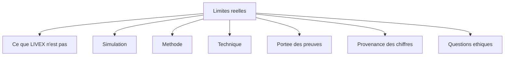

# Chapitre 14. Limites réelles

Un livre qui ne dirait que des réussites serait une brochure. Ce chapitre rassemble les limites réelles du projet, classées par nature : limites de la simulation, limites de méthode, limites techniques, limites de portée et questions éthiques. L'objectif est de rendre impossible toute surinterprétation des résultats.

Ce chapitre pourrait sembler contredire l'ambition d'un livre exhaustif : pourquoi consacrer une partie entière à ce qui manque ? Parce qu'un projet se définit autant par ses frontières que par son contenu. Un lecteur qui connaît les limites d'un système peut l'utiliser correctement ; un lecteur qui les ignore finira par lui prêter des pouvoirs qu'il n'a pas. L'exhaustivité, ici, signifie l'exhaustivité dans l'aveu autant que dans la description.

**Pourquoi ce chapitre importe pour la question directrice.** Une réponse honnête inclut ses angles morts. Ce chapitre existe parce que la question directrice exige de savoir non seulement ce que le projet permet d'affirmer, mais aussi ce qu'il ne permet pas. Sans lui, chaque résultat des chapitres précédents pourrait être lu comme une conclusion plus large qu'il ne l'est. Écrire les limites, c'est protéger la question contre les surinterprétations qu'elle ne mérite pas.

## 1. Ce que LIVEX n'est pas

Avant les limites fines, un cadrage net. LIVEX n'est pas un jeu commercial : il n'y a ni joueur dans le moteur, ni victoire, ni scénario. Ce n'est pas un modèle économique, même si des phénomènes de type économique peuvent apparaître. Ce n'est pas une simulation biologique : les entités ne se reproduisent pas au sens classique et ne vieillissent pas. Ce n'est pas un chatbot : les entités ne conversent pas en langage naturel. Ce n'est pas une société humaine miniature : c'est un système abstrait dont les phénomènes sociaux sont analogues, sans être identiques.

| Ce que LIVEX n'est pas | Pourquoi le préciser |
| :-- | :-- |
| un jeu commercial | pas de joueur, de victoire ni de scénario |
| un modèle économique | les phénomènes économiques sont analogues, non modélisés |
| une simulation biologique | pas de reproduction sexuée ni de vieillissement |
| un chatbot | pas de langage naturel |
| une société humaine miniature | système abstrait, analogies sans identité |

## 2. Les limites de la simulation

Le monde logique est un plan continu bidimensionnel, sans relief, sans pente, sans NavMesh. Il ne simule pas la matière : il calcule des états. La physique est simplifiée au mouvement et au blocage. Les ressources sont des compteurs, non des objets spatiaux, dans cette version. Les entités sont abstraites : ce ne sont pas des modèles cognitifs complets, et elles peuvent se chevaucher.

Ces limites ne sont pas des défauts cachés : elles définissent le domaine de validité des observations. Ce qui est vrai dans un plan sans relief ne l'est pas nécessairement dans un monde avec terrain.

La dernière limite, le chevauchement des entités, mérite une explication, car elle surprend. Dans ce monde, deux entités peuvent occuper le même point : il n'y a pas de collision entre elles, seulement avec les obstacles. C'est une simplification qui allège le calcul et évite les blocages, mais elle éloigne le modèle d'un espace physique où les corps ne se superposent pas. Le projet l'assume : c'est un monde de positions, non de volumes.

## 3. Les limites de méthode

Une simulation ne prouve rien sur le monde réel. La correspondance entre ses concepts (besoins, croyances) et les sciences humaines est approximative. Une absence d'émergence n'est pas un échec du projet en soi. Le déterminisme bit-à-bit dépend d'un contexte d'exécution : il vaut pour une version moteur, une graine et une configuration données, sur une exécution séquentielle.

S'y ajoute une limite statistique assumée. Une différence observée sur un seul run peut être un artefact ; le nombre de runs nécessaires pour conclure de façon robuste reste une question ouverte. Le projet préfère l'écrire que de le trancher à la légère.

La limite sur la correspondance conceptuelle est probablement la plus profonde. Les mots « besoin », « croyance », « confiance » sont employés dans le livre pour décrire des mécanismes du moteur, non des états mentaux. Un « besoin » est un compteur qui monte. Une « croyance » est un triplet avec une confiance. Ces mots sont commodes, mais ils ne doivent pas faire glisser vers une lecture psychologique. Le projet s'en sert comme d'un vocabulaire technique, et rappelle régulièrement qu'une analogie n'est pas une identité.

## 4. Les limites techniques

Le projet est optimisé pour un développeur unique, avec un formatage uniforme. Les ressources externes sont à vérifier manuellement. La parallélisation est bornée par le déterminisme : on ne peut pas paralléliser librement les écritures. Les benchmarks montrent un plafond de débit à mille agents (six ticks par seconde au lieu de dix), dû à un goulot dans la perception ; l'annexe K détaille les mesures, la machine de référence et l'écart restant. Le support d'exécution est limité à Windows et Linux ; macOS n'est pas prévu.

Une limite d'échelle mérite d'être soulignée : la représentation vise un monde d'environ cinq kilomètres carrés, mais la densité sociale y est faible au lancement, ce qui contraint les interactions tant que la population n'est pas montée en effectifs. C'est un compromis documenté, non une découverte tardive.

## 5. Les limites de couverture de preuve

Toutes les capacités prévues ne sont pas livrées, et le livre le rappelle. À la coupe du 12 octobre, les benchmarks de longue durée, la reprise de travailleur et le parcours d'interface complet ne constituaient pas des preuves de publication. Les campagnes scientifiques ont été rejouées par le chemin de réinitialisation; le rapport de campagne Launcher du 17 octobre documente un run J3 à 33/33, mais la vérification locale du 18 octobre donne 31/33 avec deux assertions d'analyse en échec. Le journal des travaux ouverts reste donc ouvert.

Plusieurs fonctionnalités sont livrées mais désactivées par défaut : saisons, territoires, livres, constructions, primitives cognitives, inventaire, engagements, contrôle de saillance. Leur activation change la trajectoire et n'est pas encore calibrée. Le livre les décrit comme disponibles mais inactives, jamais comme actives.

| Catégorie | Exemples |
| :-- | :-- |
| Préuves non encore publiées | benchmarks longue durée, reprise de travailleur, parcours d'interface |
| Livré mais désactivé | saisons, territoires, livres, constructions, inventaire, engagements |
| Hors périmètre 0.1 | rendu interactif complet, ressources spatiales, négociation territoriale, conflit actif |
| Spécifié, non implémenté au relevé du 18/10 | indice de viabilité dynamique (DVI à sept composantes; seules les séries de source et la calibration post-run sont disponibles) |
| Spécifié, non implémenté | installateur |

Certaines capacités sont explicitement hors périmètre de la version 0.1 : l'expérience de rendu interactive complète, les sources spatiales de ressources, la négociation territoriale et la conflictualité collective active.

Deux cas ne doivent pas être confondus avec une capacité livrée. L'**indice de viabilité dynamique** est spécifié, mais le relevé du code du 18 octobre 2026 ne trouve ni moteur DVI ni métriques à sept composantes. L'endpoint de viabilité publie les séries sources et la calibration post-run; le score composite reste le composite publié. Le chapitre ECHOS VII décrit la spécification et un plan en phases, non un mécanisme en service. La livraison autrefois prévue avant la publication du livre n'est pas attestée. L'**installateur** reste à l'état de spécification sans plan de livraison annoncé.

## 6. Les limites de provenance

Un chiffre peut tromper. Un test vert confirme le comportement qu'il couvre, mais ne valide pas l'ensemble d'un contrat entre composants. Le run Launcher 33/33 archivé le 17/10 et le run local 31/33 du 18/10 sont des relevés distincts; le second laisse deux assertions J3 en échec, et quatre skips conditionnels sont comptés en échecs si le moteur publié manque. Les tests du moteur et ceux du mock valident des produits distincts, et leur réussite ne démontre pas que les deux simulations soient équivalentes. Aucun résultat automatisé de la scène ne peut être déduit de la réussite des autres composants.

Les couvertures doivent toujours être lues avec leur date et leur assemblage : au 18 octobre, ECHOS mesure 91,30 %, SYNE Core 91,17 % et Console 63,46 %, sans agrégat SYNE par union recalculé. Le total ancien de seize tests ignorés et les exclusions de couverture appartiennent au relevé historique du 12 octobre; ils ne sont pas présentés ici comme une mesure actuelle. Les limites d'exécution restent publiées, non passées sous silence.

## 7. Les questions éthiques

Le projet soulève des questions qu'il ne résout pas, mais qu'il rend explicites.

- **Souffrance simulée** : les entités peuvent mourir et, à terme, s'affronter. Une représentation non glorifiante est un choix.
- **Tromperie** : simuler le mensonge et la désinformation pose une question de fond, notamment sur ce que le système pourrait suggérer de la désinformation réelle.
- **Frontière homme-machine** : l'utilisateur observe des entités qui ressemblent à des créatures vivantes.
- **Déterminisme et choix** : un système déterministe prive-t-il l'entité de « choix » ? Position du projet : l'entité a une autonomie informatique, sans liberté métaphysique.

La position du projet est celle de la transparence : mécanismes publics, non-auto-déception, abstraction annoncée, et responsabilité par la documentation des choix. C'est pourquoi la conflictualité collective active reste hors périmètre tant qu'un arbitrage éthique n'a pas été conduit.

## 8. Ce que ces limites protègent

Ces limites ne sont pas des aveux de faiblesse. Elles protègent la question directrice. Présenter un comportement spectaculaire comme une preuve d'intelligence, ou un score comme une validation, aurait détruit la valeur du projet. En écrivant ses limites, le livre rend le projet difficile à mal interpréter, et donc digne de confiance.

## 9. Ce que ce chapitre apporte à la question directrice

Ce chapitre a rassemblé les limites réelles du projet, sans complaisance : domaines non couverts, méthode bornée, plafonds techniques, preuves partielles, chiffres à provenance, questions éthiques. C'est le pendant nécessaire de tout ce que le livre a affirmé.

Reste à refermer, en rappelant ce qui a été construit, ce qui reste ouvert et ce que le projet permet honnêtement d'espérer. C'est l'objet de la conclusion.
