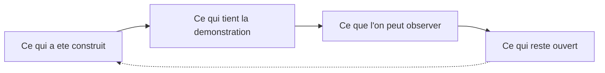

# Chapitre 15. Conclusion

La question était : peut-on construire un environnement virtuel régi par des lois fondamentales, au sein duquel des entités autonomes peuvent produire des comportements et des structures qui n'ont pas été explicitement programmés ? Ce livre n'a pas répondu oui, et il n'a pas répondu non. Il a montré comment la question est devenue un système qui tourne, et ce que ce système permet honnêtement d'affirmer.

Une conclusion de projet technique prend souvent la forme d'un bilan triomphal. Ce livre refuse ce ton, non par fausse modestie, mais parce qu'un bilan triomphal trahirait la question. La question n'était pas « peut-on construire un système impressionnant ? » ; elle était « peut-on construire un environnement où des comportements non programmés apparaissent, et le démontrer honnêtement ? ». La seconde partie de la question, la démonstration honnête, est aussi exigeante que la première.

## 1. Ce qui a été construit

Le projet a produit une plateforme expérimentale en temps réel, composée de quatre responsabilités nettement séparées.

- **SYNE décide.** Un moteur autoritaire, déterministe, persistant, indépendant du rendu. Il simule un monde fini à réserves partagées, fait décider des entités par une utilité transparente, se sauvegarde et se reprend au bit près, et se raconte par des contrats versionnés.
- **ECHOS mesure sans toucher.** Un observatoire en lecture seule qui ingère, résume, stocke, calcule sept familles de métriques et publie une lecture, en signalant ses trous plutôt qu'en les recousant.
- **PRISM montre sans décider.** Un projet Unreal et un plugin d'intégration en couche mince, reliés au moteur par des contrats, disciplinés au point de refuser de devenir un second monde.
- **Le Launcher archive sans relayer.** Un orchestrateur de bureau qui pilote, supervise à six niveaux, enchaîne des campagnes et scelle des paquets déterministes.

Autour, deux outils assument des rôles modestes : le mock émule sans prouver, l'installateur promet sans affirmer.

| Composant | Verbe | Serment |
| :-- | :-- | :-- |
| SYNE | décider | ne jamais être mis en scène |
| ECHOS | mesurer | ne jamais toucher au monde |
| PRISM | montrer | ne jamais décider |
| Launcher | archiver | ne jamais relayer |
| syne-mock | émuler | ne jamais faire autorité |
| Installateur | installer | ne jamais promettre |

## 2. Ce qui tient la démonstration

Trois dispositifs font tenir l'ensemble.

Le premier est le **déterminisme** : même graine, mêmes réglages, même version, même trajectoire, au bit près, du générateur jusqu'au paquet. Sans lui, aucune comparaison n'aurait de sens.

Le deuxième est le **principe code-first** : en cas de doute, le code prime ; un chiffre non vérifié n'entre pas dans le livre ; les empreintes dorées rendent toute modification silencieuse impossible.

Le troisième est l'**honnêteté systématique des mesures** : la provenance de chaque valeur est publiée, un zéro non mesuré n'est pas un zéro observé, une absence de détection n'est pas l'absence du phénomène, et les limites sont écrites au lieu d'être tues.

Ces trois dispositifs ne sont pas indépendants : ils forment une chaîne. Le déterminisme rend la comparaison possible ; le code-first garantit que la comparaison porte sur le système réel ; l'honnêteté des mesures garantit que la comparaison ne trompe pas. Retirer un maillon, et toute la chaîne perd sa valeur.

## 3. Ce que cette version permet d'observer

La version décrite permet d'observer des trajectoires individuelles traçables et rejouables, des populations viables sur un horizon calibré, des espaces, des sociétés en formation et en dissolution, une information qui circule et se dégrade, et un ensemble de métriques assorti de ses réserves. Elle permet aussi de comparer deux runs de façon reproductible et de reconstruire des chaînes causales bornées.

Elle ne permet pas d'observer une émergence forte, ni de tenir une société durable pour acquise, ni d'affirmer qu'un comportement observé soit autre chose qu'une conséquence de paramètres choisis.

## 4. Ce qui reste ouvert

Le projet laisse ouverts, et le dit, un certain nombre de chantiers. La scène interactive complète, hors périmètre de la version 0.1. Le support d'exécution au-delà de Windows et Linux. L'activation calibrée des systèmes livrés mais désactivés (saisons, territoires, livres, constructions, primitives cognitives). Les sources spatiales de ressources et la conflictualité collective. L'indice de viabilité dynamique reste une spécification : le relevé du code du 18 octobre ne trouve ni moteur DVI à sept composantes ni sorties correspondantes, malgré l'échéance antérieure envisagée avant publication. L'installateur, qui n'a pas encore une ligne de code. Le nombre de runs nécessaires pour conclure statistiquement.

Ces chantiers ne sont pas des promesses : ce sont des constats d'inachèvement, écrits comme tels. L'annexe L les reprend un par un, dans l'ordre où ils se commandent, en distinguant les capacités livrées mais non activées, les jalons présents dans le code mais non franchis et ce qui reste hors périmètre.

## 5. Ce que la méthode a appris

Le livre a raconté deux calibrations, un benchmark qui échoue, des trous signalés et des divergences assumées. De ces récits, une méthode se dégage. Mesurer avant d'affirmer. Isoler une cause avant de corriger. Assumer une correction par un changement de version et un recalcul d'empreinte. Publier les échecs. Refuser de présenter une intention comme une livraison. Cette méthode vaut au-delà de LIVEX : c'est la manière de rendre un travail complexe vérifiable.

On peut résumer cette méthode en une phrase, qui pourrait servir de devise au projet : **un résultat n'est un résultat que si l'on peut le rejouer et en énoncer les limites**. Tout ce livre l'applique, depuis le calcul de Charlie jusqu'au scellement des paquets.

## 6. La question directrice, à nouveau

Une société peut-elle émerger sans avoir été programmée ? Une culture peut-elle apparaître, se transmettre, évoluer puis disparaître sans qu'aucune règle ne l'ait explicitement ordonnée ? Le livre ne connaît pas les réponses. Il a construit l'instrument qui rend ces questions testables : des lois locales, des entités autonomes, une observation sans contact, une reproductibilité stricte et une archive rejouable.

Que l'émergence advienne ou non, l'important est que le projet ne triche pas avec sa propre question. Si un jour un comportement collectif non programmé apparaît dans ce monde, il sera possible de dire quelles règles locales l'ont produit, de le rejouer et de le réfuter. Si rien n'apparaît, ce sera un résultat, non un silence.

Cette dernière phrase mérite d'être pesée. Dans beaucoup de projets, l'absence de résultat est vécue comme un échec et dissimulée. Ici, elle est traitée comme une donnée. Un monde où les structures ne se forment jamais, documenté, serait une information sur les conditions nécessaires à l'émergence. C'est cette disposition d'esprit, plus que n'importe quelle fonctionnalité, qui fait de LIVEX une entreprise de recherche plutôt qu'une démonstration.

## 7. Le premier succès

Le premier succès de ce livre n'est pas une découverte, c'est une clarté. Si, en refermant, le lecteur sait reformuler le projet, trouver ses preuves et signaler un problème précis, alors le livre a rempli son contrat.

Bienvenue dans LIVEX. Le monde continue de tourner, et il attend ses prochaines enquêtes.
