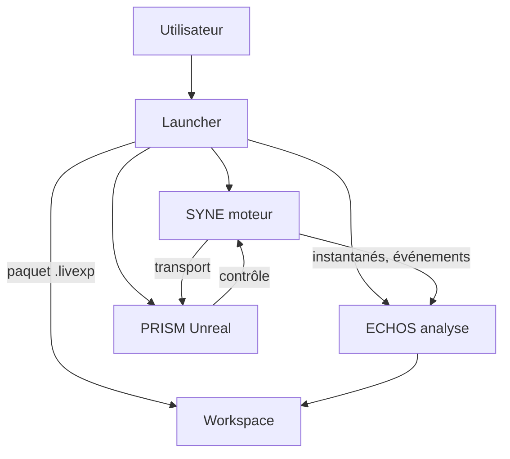
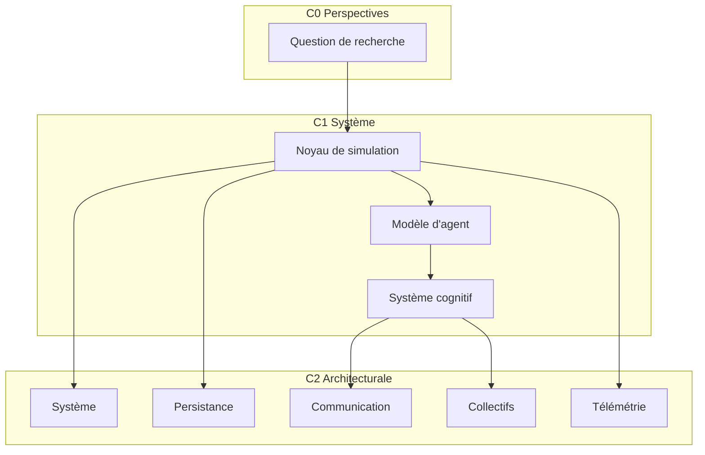
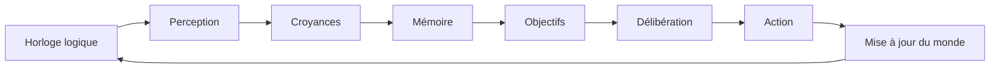
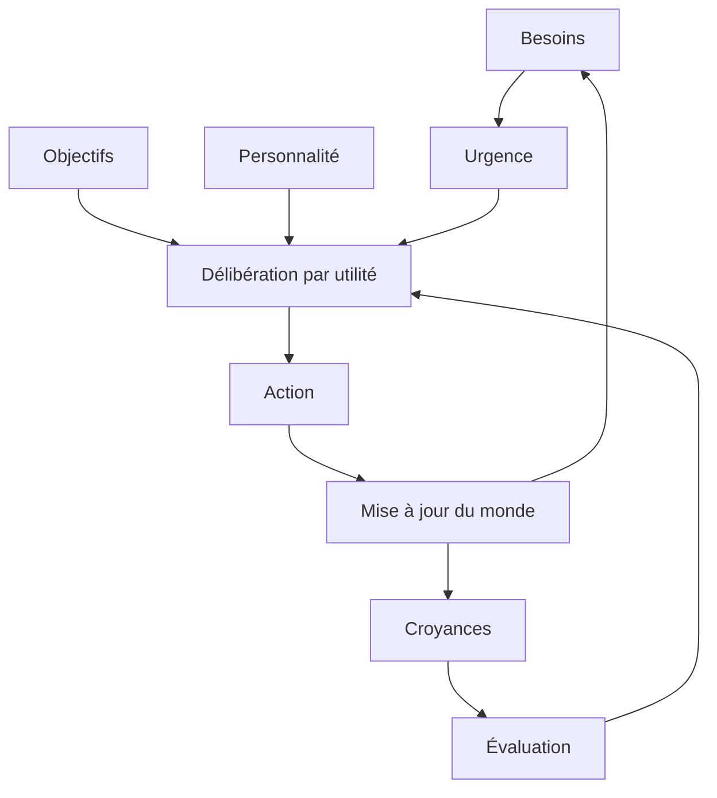
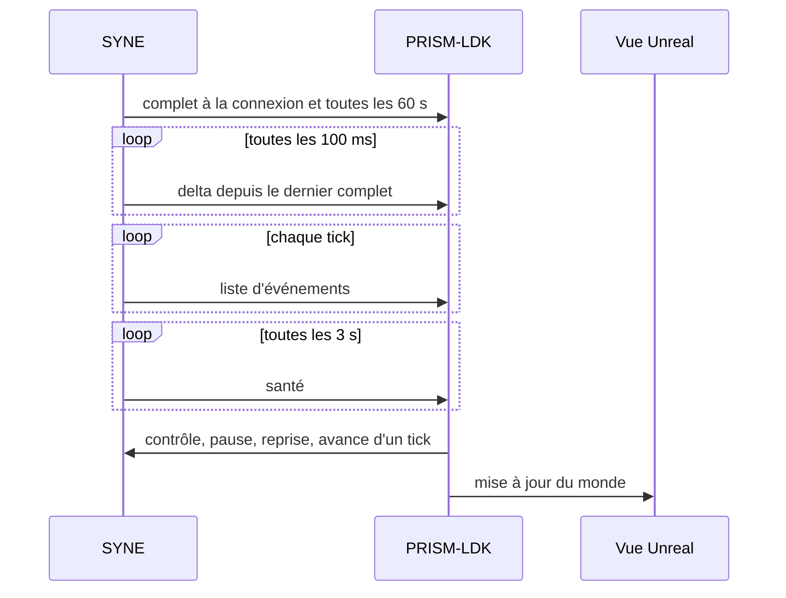
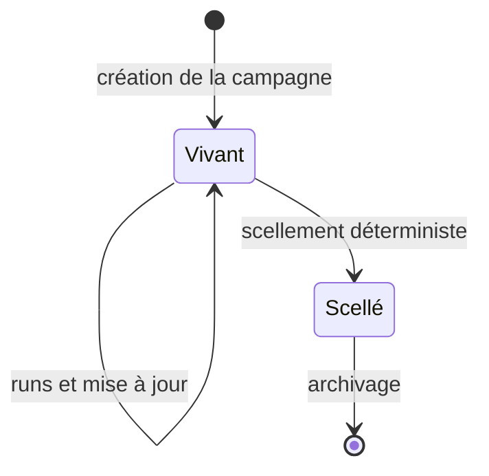
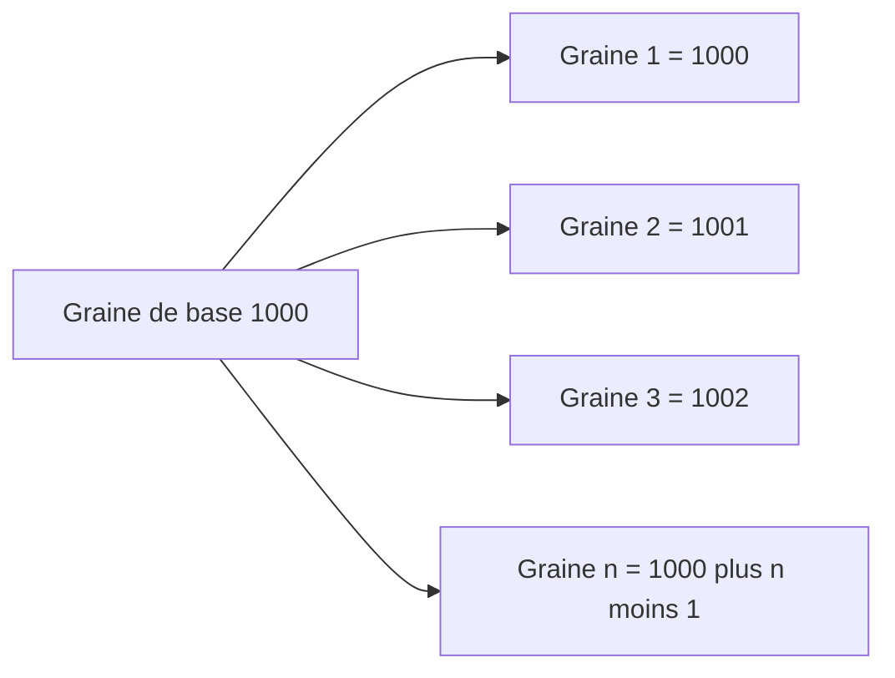
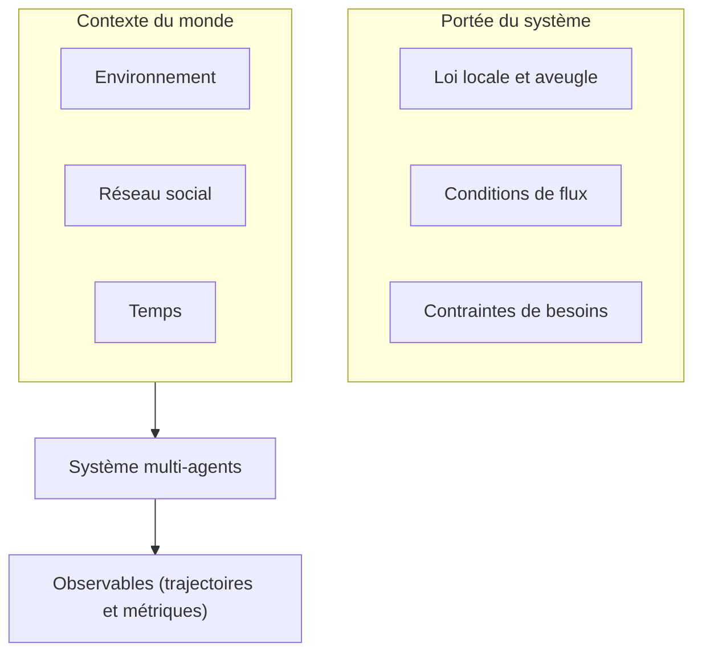
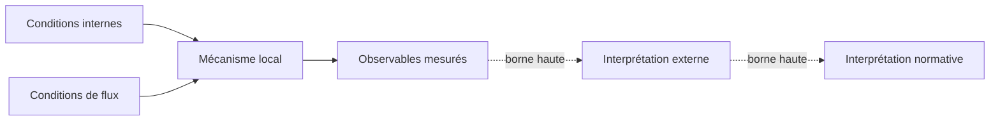
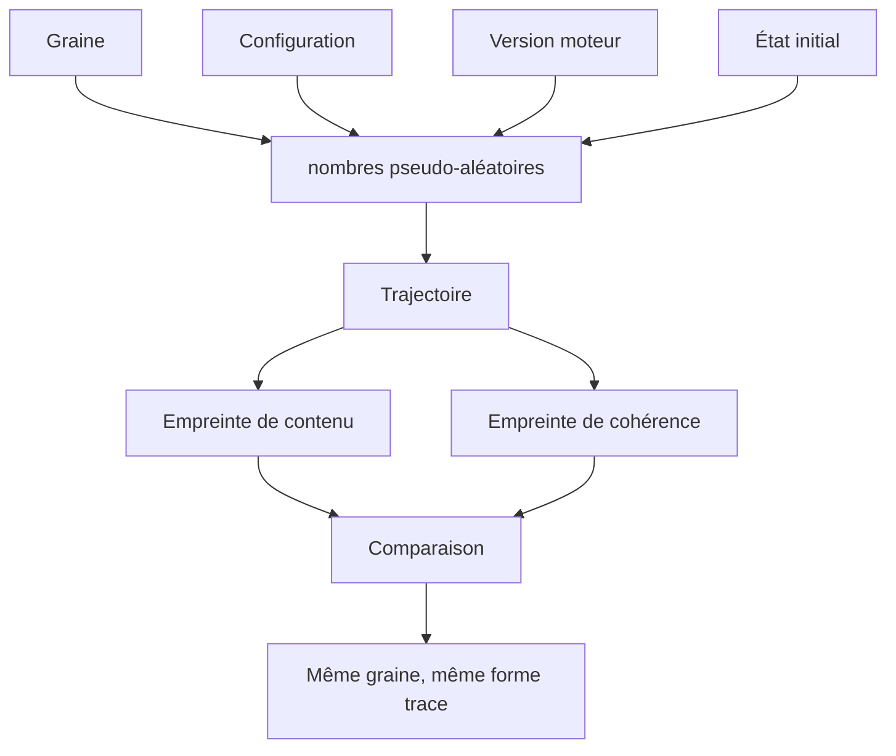

# Annexe D. Schémas d'architecture

Cette annexe rassemble les schémas structurants du projet sous forme de diagrammes Mermaid, reproductibles dans le dépôt. Chaque schéma porte une légende qui indique ce qu'il montre et, surtout, ce qu'il ne montre pas.

## D.1 Vue d'ensemble de la pile

Lecture : le Launcher orchestre, le moteur décide, ECHOS mesure, PRISM montre. Aucun composant ne contourne le Launcher pour écrire dans le workspace. Le schéma ne montre pas les composants internes, décrits dans les sections suivantes.

## D.2 Architecture en couches du moteur

Lecture : les couches techniques reposent sur des responsabilités séparées. Aucune couche n'a de vue du collectif. Le schéma n'indique pas les flux de données précis, décrits en D.3.

## D.3 Boucle de simulation

Lecture : la boucle est locale à chaque entité, à chaque tick. La perception est partielle et faillible. Le schéma ne montre pas les systèmes collectifs, qui se forment par agrégation de ces boucles.

## D.4 Boucle d'une entité

Lecture : c'est le cycle de l'agent, de la tension interne à l'action. Une seule action est exécutée par tick. Le schéma n'inclut pas la décroissance de mémoire, qui agit sur les croyances et les souvenirs.

## D.5 Publication par PRISM

Lecture : l'instantané est la source de vérité, l'événement un signal complémentaire. Le contrôle est le seul flux montant. Le schéma ne montre pas la compression, interdites de détailler hors annexe technique.

## D.6 Cycle de vie d'un paquet `.livexp`

Lecture : un paquet est vivant pendant la campagne, scellé après. Le scellement recalcule un hachage et ne doit plus être modifié. Le schéma ne montre pas la structure interne, décrite dans la documentation du Launcher.

## D.7 Dérivation des graines

Lecture : les graines sont prévisibles et dérivables, jamais tirées à l'exécution. Le schéma ne montre pas les stratégies explicite et hachée, décrites dans la documentation du Launcher.

## D.8 Contexte du système

Lecture : le système transforme des conditions contextuelles en observables, sous des lois locales. Le schéma ne montre pas la frontière interprétative, qui relève de l'analyse causale.

## D.9 Frontière causale

Lecture : le livre sépare franchement le mécanisme mesuré (traits pleins) de l'interprétation (pointillés). La borne haute est une limite explicite, pas une conclusion du moteur. Le schéma ne fournit aucune preuve des interprétations externes.

## D.10 Reproductibilité

Lecture : quatre éléments définissent un run et deux empreintes le vérifient. Le schéma n'explique pas la tolérance temporelle, détaillée dans la partie sur la reproductibilité.
