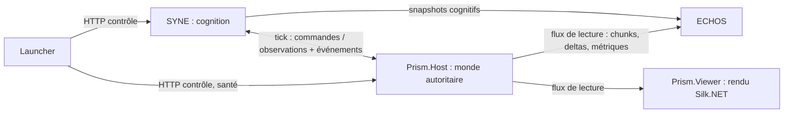

# ARCHITECTURE — PRISM (V2)

**Composant** : PRISM
**Statut** : [SPÉCIFICATION V2 — NON IMPLÉMENTÉ]
**Dernière mise à jour** : 3 novembre 2026
**Dépend de** : [`VISION.md`](VISION.md), [`adr/ADR-005-stack-dotnet-silknet-headless.md`](adr/ADR-005-stack-dotnet-silknet-headless.md), [`API_CONTRACTS.md`](API_CONTRACTS.md)
**Source Monographie** : —

---

## 1. Vue d'ensemble



Un run complet démarre **SYNE + PRISM (headless) + ECHOS**. Le visualiseur est facultatif (mode Immersion). SYNE reste l'horloge maîtresse : PRISM n'avance que sur un `tick` reçu.

## 2. Solution .NET

```text
prism/
├── Prism.sln
├── Prism.Core/            # monde, génération, tick, entités, navigation, recettes — BCL seule
├── Prism.Contracts/       # messages, versions, codecs, IWorldHost
├── Prism.Content/         # schémas JSON, validateur, compilateur de contenu → tables en mémoire
├── Prism.Host/            # exécutable headless : contrôle HTTP, liaison WebSocket, persistance SQLite
├── Prism.Viewer/          # exécutable client : Silk.NET (OpenGL), meshing, interface
├── Prism.Bots/            # agents de test et de benchmark
├── Prism.Benchmarks/      # B1…B5 + B6 (rendu)
├── Prism.Core.Tests/  Prism.Viewer.Tests/  Prism.Content.Tests/  Prism.Contracts.Tests/
├── Prism.Host.Tests/  Prism.Bots.Tests/  Prism.Architecture.Tests/
├── content/               # pack de contenu par défaut (JSON) — voir CONTENT_SPEC.md
└── component.json         # manifeste Launcher (host) ; le manifeste viewer reste à produire (PRISM-118)
```

Règles de dépendance : `Core` ← `Content` ← `Host` ; `Viewer` ne référence que `Contracts` (et `Core` en lecture pour le meshing partagé via un sous-ensemble `Prism.Core.Readonly`). Aucune flèche ne va de `Core` vers un projet graphique. Un test d'architecture (analyseur de références) l'impose en CI.

## 3. Modèle d'exécution du noyau

| Élément | Règle |
| :-- | :-- |
| Thread de simulation | Un seul thread orchestre le tick ; il peut paralléliser des phases **sans état partagé mutable** (mises à jour de chunks, perception) |
| Parallélisme | Par chunk (mises à jour aléatoires/programmées), par agent (perception en lecture seule). Les écritures du monde se font en une phase **séquentielle ordonnée** |
| Visualiseur embarqué | Tick sur son propre thread ; le rendu lit un instantané de chunks à double tampon ; le rendu ne verrouille jamais le tick |
| Temps réel | Aucun. Un run headless va aussi vite que la machine le permet |

## 4. Flux de données

1. **Entrée** : `TickRequest(t, commands[])` de SYNE (ou `IWorldHost.Step`).
2. **Traitement** : l'ordre fixe de [`SIMULATION_LOOP.md`](SIMULATION_LOOP.md) §2.
3. **Sortie** : `TickResult(t, observations[], events[], worldChecksum?)` à SYNE.
4. **Lecture** : après le tick, les chunks modifiés (*dirty*) et les métriques sont publiés pour ECHOS et le visualiseur ; l'instantané complet est envoyé à la connexion, puis des deltas.

## 5. Cycle de vie

| État | Description | Transitions |
| :-- | :-- | :-- |
| `Idle` | Process vivant, contenu non chargé | `Prepare` → `Loading` |
| `Loading` | Contenu validé, monde généré ou restauré | → `Ready` ou `Failed` |
| `Ready` | Monde prêt, `world_ready` diffusé (version de monde, empreinte) | `Start` → `Running` |
| `Running` | Avance sur `tick` | `Pause`, `Stop` |
| `Paused` | Aucun tick accepté, lecture disponible | `Resume`, `Stop` |
| `Stopped` / `Failed` | Fin ; résultats et empreinte finaux écrits | — |

Le contrôle HTTP (santé `/health/ready`, préparation, démarrage, pause, reprise, arrêt) suit l'esprit de l'`INTEGRATION_CONTRACT` du Launcher ; PRISM n'ajoute aucune route de simulation sur ce plan.

## 6. Dépendances externes (à valider en notices tierces)

| Dépendance | Usage | Projet |
| :-- | :-- | :-- |
| SQLite (Microsoft.Data.Sqlite) | Persistance des points de reprise | `Host` |
| Silk.NET (OpenGL, Windowing, Input) | Fenêtre, contexte GL, entrées | `Viewer` |
| Bibliothèque d'interface immédiate | Inspecteur, HUD | `Viewer` |
| xUnit + FsCheck (ou équivalent) | Tests, tests par propriétés | Tests |

Aucune dépendance de simulation hors BCL. Les licences exactes sont à vérifier et à porter dans `THIRD-PARTY-NOTICES.md` avant toute publication (ROADMAP P13).

## 7. Sécurité et robustesse

- Écoute locale par défaut (comme SYNE) ; jeton de session du Launcher exigé sur les routes de contrôle.
- Contenu **validé par schéma** avant chargement ; un pack invalide empêche le démarrage avec une erreur structurée (jamais un état partiel).
- Toute commande est validée : identifiants inconnus, position hors monde, droits d'accès, version de protocole inconnue → échec motivé, pas de plantage.

## Points restés ouverts dans ce document

Voir [`adr/README.md`](adr/README.md) §3 (Q-01, Q-05).

## Mises à jour

| Date | Changement | Motif |
| :-- | :-- | :-- |
| 3 novembre 2026 | Arborescence des tests complétée (14 projets) ; manifeste viewer signalé comme restant à produire | Audit de cohérence avec le code |
| 1er novembre 2026 | Création | Refonte V2 |
