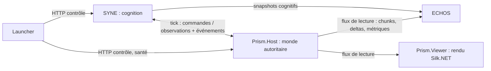

# ARCHITECTURE — PRISM (V2)

**Composant** : PRISM
**Statut** : [IMPLÉMENTATION EN COURS — P2 À P11 LIVRÉES (VIEWER COMPRIS) ; P12/P13 À FAIRE]
**Dernière mise à jour** : 15 novembre 2026
**Dépend de** : [`VISION.md`](VISION.md), [`adr/ADR-005-stack-dotnet-silknet-headless.md`](adr/ADR-005-stack-dotnet-silknet-headless.md), [`API_CONTRACTS.md`](API_CONTRACTS.md)
**Source Monographie** : —

---

## 1. Vue d'ensemble



Un run complet démarre **SYNE + PRISM (headless) + ECHOS**. Le visualiseur est facultatif (mode Immersion). SYNE reste l'horloge maîtresse : PRISM n'avance que sur un `tick` reçu.

## 2. Solution .NET

```text
prism/
├── Prism.sln
├── Prism.Core/            # monde, génération, tick, entités, navigation, recettes — BCL seule
├── Prism.Contracts/       # messages, versions, codecs, IWorldHost
├── Prism.Content/         # schémas JSON, validateur, compilateur de contenu → tables en mémoire
├── Prism.Host/            # exécutable headless : contrôle HTTP, liaison WebSocket, persistance SQLite
├── Prism.Viewer/          # exécutable client : Silk.NET (OpenGL), meshing, interface
├── Prism.Bots/            # agents de test et de benchmark
├── Prism.Benchmarks/      # B1…B5 + B6 (rendu)
├── Prism.Core.Tests/  Prism.Viewer.Tests/  Prism.Content.Tests/  Prism.Contracts.Tests/
├── Prism.Host.Tests/  Prism.Bots.Tests/  Prism.Architecture.Tests/
├── content/               # pack de contenu par défaut (JSON) — voir CONTENT_SPEC.md
└── component.json         # manifeste Launcher (host) ; celui du viewer est `viewer.component.json` (PRISM-118)
```

Règles de dépendance : `Core` ← `Content` ← `Host` ; `Viewer` ne référence que `Contracts` (et `Core` en lecture pour le meshing partagé via un sous-ensemble `Prism.Core.Readonly`). Aucune flèche ne va de `Core` vers un projet graphique. Un test d'architecture (analyseur de références) l'impose en CI.

## 3. Modèle d'exécution du noyau

| Élément | Règle |
| :-- | :-- |
| Thread de simulation | Un seul thread orchestre le tick ; il peut paralléliser des phases **sans état partagé mutable** (mises à jour de chunks, perception) |
| Parallélisme | Par chunk (mises à jour aléatoires/programmées), par agent (perception en lecture seule). Les écritures du monde se font en une phase **séquentielle ordonnée** |
| Visualiseur embarqué | Tick sur son propre thread ; le rendu lit un instantané de chunks à double tampon ; le rendu ne verrouille jamais le tick |
| Temps réel | Aucun. Un run headless va aussi vite que la machine le permet |

## 4. Flux de données

1. **Entrée** : `TickRequest(t, commands[])` de SYNE (ou `IWorldHost.Step`).
2. **Traitement** : l'ordre fixe de [`SIMULATION_LOOP.md`](SIMULATION_LOOP.md) §2.
3. **Sortie** : `TickResult(t, observations[], events[], worldChecksum?)` à SYNE, dans une réponse bornée (voir §4.1).
4. **Lecture** : après le tick, les chunks modifiés (*dirty*) et les métriques sont publiés pour ECHOS et le visualiseur ; l'instantané complet est envoyé à la connexion, puis des deltas.

### 4.1 Protocole de réponse par tick : plafond et pagination (ADR-014)

Aucune réponse de tick ne dépasse **8 Mio** (8 388 608 octets, enveloppes
comprises). La taille d'**une** réponse ne dépend donc jamais du nombre d'agents,
ni du nombre d'écritures d'un tick.

| Cas | Forme de la réponse |
| :-- | :-- |
| Le tick tient sous le plafond | `TickResult(protocolVersion, tick, observations[], events[])` — **inchangé** |
| Le tick dépasse le plafond | `TickPageEnvelope(protocolVersion, tick, page{index, pageCount, complete, cursor?}, chunk{observations[], events[]})` |

- Les pages sont des **tranches contiguës** du flux (observations puis événements,
  dans l'ordre publié) : les concaténer par `index` redonne le `TickResult`
  d'origine à l'octet près. Le découpage ne dépend ni du temps, ni d'un ordre
  d'itération de dictionnaire.
- `pageCount` est connu dès la fin du tick : un lecteur prouve qu'il a tout reçu,
  et un chaînage incomplet est une erreur, jamais une lecture partielle.
- Suite de la lecture : `GET /data/tick/result?cursor=…`, en lecture seule (le
  monde n'avance pas). Les pages d'un tick restent valables jusqu'au tick suivant
  (`page_expired`, 409) ; un curseur illisible est refusé (`page_invalid`, 409).
- Le contenu est sous `chunk`, jamais à la racine : une page **ne peut pas** être
  désérialisée comme un `TickResult`, donc un client qui ignore la pagination
  échoue au lieu d'appliquer un tick partiel.
- Un élément seul plus gros que le plafond ne peut pas être découpé : l'hôte
  répond `413 payload_too_large` avec la taille fautive et n'envoie aucun corps
  partiel. La liaison lockstep WebSocket, qui ne pagine pas, refuse de la même
  façon (`{ error: "payload_too_large" }`).
- Contrat détaillé : [`API_CONTRACTS.md`](API_CONTRACTS.md) §2.1 ; décision et
  alternatives écartées : [`adr/ADR-014`](adr/ADR-014-plafond-reponse-tick-pagination.md).

## 5. Cycle de vie

| État | Description | Transitions |
| :-- | :-- | :-- |
| `Idle` | Process vivant, contenu non chargé | `Prepare` → `Loading` |
| `Loading` | Contenu validé, monde généré ou restauré | → `Ready` ou `Failed` |
| `Ready` | Monde prêt, `world_ready` diffusé (version de monde, empreinte) | `Start` → `Running` |
| `Running` | Avance sur `tick` | `Pause`, `Stop` |
| `Paused` | Aucun tick accepté, lecture disponible | `Resume`, `Stop` |
| `Stopped` / `Failed` | Fin ; résultats et empreinte finaux écrits | — |

Le contrôle HTTP (santé `/health/ready`, préparation, démarrage, pause, reprise, arrêt) suit l'esprit de l'`INTEGRATION_CONTRACT` du Launcher ; PRISM n'ajoute aucune route de simulation sur ce plan.

## 6. Dépendances externes (à valider en notices tierces)

| Dépendance | Usage | Projet |
| :-- | :-- | :-- |
| SQLite (Microsoft.Data.Sqlite) | Persistance des points de reprise | `Host` |
| Silk.NET (OpenGL, Windowing, Input) | Fenêtre, contexte GL, entrées | `Viewer` |
| Bibliothèque d'interface immédiate | Inspecteur, HUD | `Viewer` |
| xUnit + FsCheck (ou équivalent) | Tests, tests par propriétés | Tests |

Aucune dépendance de simulation hors BCL. Les licences exactes sont à vérifier et à porter dans `THIRD-PARTY-NOTICES.md` avant toute publication (ROADMAP P13).

## 7. Sécurité et robustesse

- Écoute locale par défaut (comme SYNE) ; jeton de session du Launcher exigé sur les routes de contrôle.
- Contenu **validé par schéma** avant chargement ; un pack invalide empêche le démarrage avec une erreur structurée (jamais un état partiel).
- Toute commande est validée : identifiants inconnus, position hors monde, droits d'accès, version de protocole inconnue → échec motivé, pas de plantage.

## Points restés ouverts dans ce document

Voir [`adr/README.md`](adr/README.md) §3 (Q-01, Q-05).

## Mises à jour

| Date | Changement | Motif |
| :-- | :-- | :-- |
| 11 novembre 2026 | §4.1 : plafond de 8 Mio par réponse de tick et pagination à curseur (`TickPageEnvelope`, `GET /data/tick/result`) ; dépassement insécable refusé en `413 payload_too_large` | PRISM-142, ADR-014 |
| 3 novembre 2026 | Arborescence des tests complétée (14 projets) ; manifeste viewer signalé comme restant à produire | Audit de cohérence avec le code |
| 1er novembre 2026 | Création | Refonte V2 |
