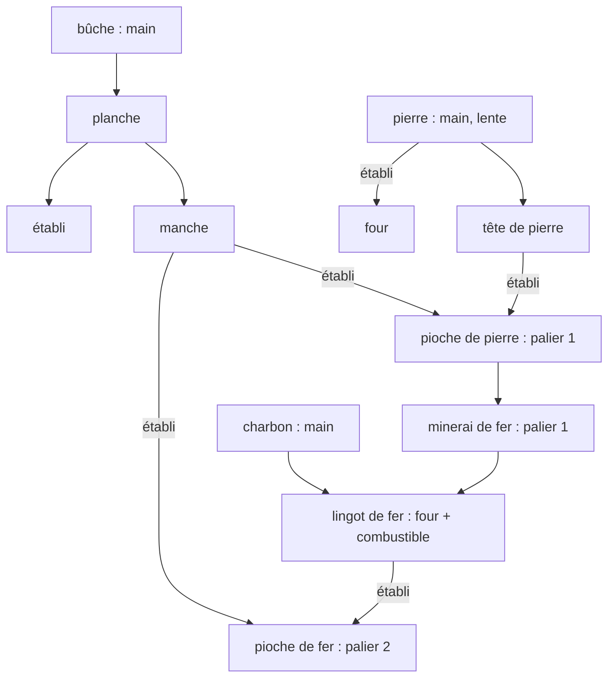

# CONTENT_SPEC — Document de contenu : formats de données, contenu minimal, calibrage

**Composant** : PRISM
**Statut** : [SPÉCIFICATION V2 — COMPILATEUR PRISM-021 ET PACK MINIMAL PRISM-022 IMPLÉMENTÉS ; EXTENSIONS DE PACK EN ATTENTE]
**Dernière mise à jour** : 2 novembre 2026
**Dépend de** : [`DATA_MODEL.md`](DATA_MODEL.md), [`SYSTEMS_SPEC.md`](SYSTEMS_SPEC.md), `../NAMING_CONVENTIONS.md`
**Source Monographie** : —

---

## 1. Principe

> Ajouter un matériau, une recette ou une culture se fait **par de la donnée, pas en modifiant le moteur.**

Le contenu est un **pack** : un dossier de fichiers JSON validés par schéma, compilé au chargement en tables d'index stables. Le **hachage du pack** (`contentHash`) entre dans la reproductibilité d'un run (avec seed, configuration et versions).

**Convention de nommage.** Conformément à `NAMING_CONVENTIONS.md`, les **identifiants et clés** sont en **anglais** (`stone_pickaxe`, `durationTicks`) ; les libellés affichés vivent dans des champs `displayName` par langue (`fr`, `en`).

## 2. Organisation d'un pack

```text
content/
├── pack.json          # id, version, schemaVersion, dépendances de packs, description
├── tags.json          # registre des tags (nom, description, hiérarchie facultative)
├── materials/*.json   # fiches de blocs
├── items/*.json       # fiches d'objets
├── recipes/*.json     # recettes
├── templates/*.json   # gabarits de structures et d'arbres
├── growth/*.json      # règles d'évolution (cultures)
├── effects/*.json     # effets d'objets sur les besoins (valeurs transmises à SYNE)
└── params.json        # paramètres de calibrage du pack (§7)
```

Règles de validation : unicité des `id`, références résolues (objets, tags, stations, gabarits), **graphe de recettes acyclique en matière créée** (sauf cycles déclarés *de régénération* : graine → culture → graine), tags déclarés, unités valides. Un pack invalide empêche le démarrage avec une erreur structurée listant **toutes** les violations.

## 3. Fiches

### 3.1 Matériau (bloc)

```json
{
  "id": "iron_ore",
  "displayName": { "fr": "Minerai de fer", "en": "Iron ore" },
  "solid": true,
  "hardness": 12,
  "minToolTier": 1,
  "tags": ["ore", "mineral"],
  "drops": [{ "item": "iron_ore_chunk", "qty": 1 }],
  "perceivable": true
}
```

Culture (bloc avec évolution) :

```json
{
  "id": "wheat_crop",
  "solid": false,
  "tags": ["crop", "edible_source"],
  "requires": { "below": "farmland", "waterWithin": 4 },
  "growth": "wheat_growth",
  "drops": [
    { "item": "wheat", "qty": [2, 3], "whenState": 3 },
    { "item": "wheat_seed", "qty": [1, 2], "whenState": 3 }
  ]
}
```

`qty` accepte un entier ou une plage inclusive `[min, max]`. `chancePermille` (défaut 1 000) et `whenState` (facultatif) définissent respectivement une probabilité de drop et son état requis. Le validateur refuse les plages inversées/non positives, les probabilités hors `[0, 1000]` et les états négatifs.

Les matériaux de sol peuvent déclarer `"tillable": true` (matériau solide). Un matériau avec croissance peut déclarer `"seedItem": "wheat_seed"` pour lier explicitement sa graine à `Planter`; les drops filtrés par `whenState` définissent la récolte. La houe requise pour labourer est l'objet portant le tag `hoe` (y compris un tag enfant).

Les tags acceptent les champs facultatifs `description` et `parent`. Un parent doit être déclaré dans le pack et la hiérarchie ne peut pas contenir de cycle.

### 3.2 Objet

```json
{
  "id": "stone_pickaxe",
  "displayName": { "fr": "Pioche de pierre", "en": "Stone pickaxe" },
  "tags": ["tool", "pickaxe"],
  "maxStack": 1,
  "toolTier": 1,
  "durability": 60,
  "weight": 3
}
```

Objet consommable : `effects: "eat_flatbread"` pointant vers `effects/*.json` (`{"hunger": -300, "energyRecovery": 20}`, valeurs en entiers ; les valeurs sont transmises à SYNE qui les applique à ses besoins), `shelfLifeTicks`.
Pour être consommable, l'objet porte aussi le tag `edible`. La consommation retire une unité et enregistre `consume` au ledger ; les effets configurés sont transmis dans l'événement `item_consumed`.

Une matière portant le tag `drinkable` peut déclarer le même champ `effects` (par exemple `water` → `drink_water`, avec `{"thirst": -300}`). Boire à une source ne modifie pas le bloc : ces sources sont infinies dans le modèle actuel. Le champ n'est compilé comme source de boisson que pour les matériaux `drinkable`.

Les outils déclarent `durability` (points d'usure maximaux) et `usePerAction` (points retirés à chaque action réussie, défaut `1`). Un objet avec une durabilité positive doit avoir `maxStack: 1`.

Un objet plaçable peut déclarer `places: "<materialId>"`. Le compilateur vérifie que le matériau existe et le runtime n'autorise la pose que pour le matériau associé à l'objet.
Un objet portant le tag `container` crée un inventaire de conteneur lorsqu'il est posé par le host (24 emplacements par défaut). Le contenu d'un conteneur non vide doit être retiré avant de pouvoir miner son bloc.

### 3.3 Recette

```json
{
  "id": "stone_pickaxe",
  "inputs": [{ "tag": "handle", "qty": 1 }, { "tag": "stone_head", "qty": 1 }],
  "outputs": [{ "item": "stone_pickaxe", "qty": 1 }],
  "station": "workbench",
  "tool": null,
  "durationTicks": 20,
  "minMastery": 0,
  "masteryCategory": "craft",
  "byProducts": []
}
```

Une entrée peut viser un **objet** (`item`) ou un **tag** (`tag`) : la recette accepte tout objet qui porte le tag, par ordre d'identifiant (déterministe) à moins que l'agent précise le choix. Les agents raisonnent sur les tags.

### 3.4 Gabarit de structure

```json
{
  "id": "shelter_3x3",
  "displayName": { "fr": "Abri 3 × 3", "en": "3×3 shelter" },
  "size": [3, 3, 3],
  "blocks": [ { "at": [0,0,0], "block": "planks" }, "…" ],
  "materials": [{ "item": "plank", "qty": 24 }, { "item": "log", "qty": 4 }],
  "workTicks": 120,
  "placement": { "flatGround": true, "clearVolume": true },
  "effect": { "type": "shelter", "volume": [[0,0,0],[2,2,2]], "fatigueRecoveryBonusPermille": 500 },
  "integrityThresholdPermille": 800
}
```

Les deux coins de `effect.volume` sont des offsets entiers inclusifs dans le
volume du gabarit ; leur ordre est sans importance. Le compilateur rejette tout
volume qui sort de `size`. L'intégrité vaut le ratio permille des blocs du
gabarit encore présents ; les effets sont actifs sur un chantier achevé lorsque
ce ratio atteint `integrityThresholdPermille`. Les gabarits d'arbres du
générateur sont des gabarits sans effet ni matériaux.

### 3.5 Règle de croissance

```json
{
  "id": "wheat_growth",
  "stages": 4,
  "stageTicks": 150,
  "jitterTicks": 25,
  "seasonFactorsPermille": { "spring": 1200, "summer": 1000, "autumn": 800, "winter": 0 },
  "witherAfterTicks": 600
}
```

## 4. Les cinq chaînes de production (contenu de départ)

| Chaîne | Étapes | Ce qui crée un coût ou un délai |
| :-- | :-- | :-- |
| **Outils** | Bûche (main) → planche → manche ; pierre (main, lente) → tête de pierre ; établi ; pioche de pierre ; minerai de fer (palier 1) + charbon → four → lingot → pioche de fer (palier 2) | Plusieurs matériaux, une station fixe, durabilité limitée |
| **Agriculture** | Graine → sol labouré (houe) → eau proche → croissance (3 transitions) → récolte → graines | Délai de plusieurs centaines de ticks, entretien, risque de flétrissement |
| **Eau** | Boire à la source → seau en bois → transport → puits (gabarit) → proximité d'eau pour l'irrigation | Distance, capacité, construction |
| **Transformation** | Blé cru → galette cuite au four avec combustible | Combustible, station ; gain de valeur nutritive et de durée de conservation |
| **Stockage** | Coffre, grenier | Capacité limitée, objets périssables qui perdent de la valeur |

### 4.1 Paliers d'outils

Trois paliers : **0** les mains, **1** bois et pierre, **2** fer. Chaque bloc minable exige un `minToolTier`. Graphe de dépendances amorçable **à mains nues** :



> **Correction du brouillon.** Le brouillon donnait « minerai de fer : palier 2 » comme exemple de fiche, tout en écrivant que le minerai de fer demande une pioche de pierre (palier 1). Ce document retient `minToolTier = 1` pour le minerai de fer ; le palier 2 est celui des outils *obtenus grâce* au fer. La pierre et le charbon de surface sont minables à mains nues (palier 0, lentement), sinon le graphe ne pourrait pas s'amorcer.

## 5. Contenu minimal (une quinzaine de types)

**Blocs (17, dont `air` et `bedrock` techniques)** : `air`, `bedrock`, `dirt`, `grass`, `stone`, `sand`, `water`, `log`, `leaves`, `iron_ore`, `coal_ore`, `farmland`, `wheat_crop`, `workbench`, `furnace`, `chest`, `planks`.

**Objets** : `log`, `plank`, `handle`, `stone`, `stone_head`, `coal`, `iron_ore_chunk`, `iron_ingot`, `wheat_seed`, `wheat`, `flatbread`, `wooden_bucket`, `water_bucket`, `stone_pickaxe`, `iron_pickaxe`, `stone_hoe` (+ objets-blocs `workbench`, `furnace`, `chest`).

**Gabarits** : `shelter_3x3`, `well`, `path_segment`, `granary`, `stair`, `bridge_segment`, `tree_oak_small`, `tree_oak_tall`.

**Tags** : `wood`, `stone`, `ore`, `fuel`, `edible`, `crop`, `tool`, `pickaxe`, `hoe`, `handle`, `stone_head`, `container`, `station`, `drinkable`, `walkable_path`.

Le tag `fuel` couvre `log`, `plank` et `coal` dans le pack v0 : une recette qui demande un combustible fonctionne avec chacun. La paille reste une extension de contenu.

**Origine des graines.** Miner `grass` donne une `wheat_seed` avec probabilité `chancePermille` (hasard à compteur sur `(position, tick)`) : le premier cycle agricole est amorçable sans bloc supplémentaire.

## 6. Règles transversales

| Règle | Contenu | Voir |
| :-- | :-- | :-- |
| Conservation | Tout objet créé a une règle, tout objet détruit aussi | `SYSTEMS_SPEC.md` §1 |
| Capacité de transport | Inventaire borné (12 emplacements) | `DATA_MODEL.md` §5 |
| Durabilité des outils | L'usage consomme de la durabilité ; l'outil se refabrique | `SYSTEMS_SPEC.md` §2 |
| Péremption | Durée de vie en ticks, ralentie par le stockage | `SYSTEMS_SPEC.md` §3 |
| Maîtrise | Progression par catégorie d'action, gain de durée/rendement | `SYSTEMS_SPEC.md` §6 |

## 7. Paramètres de calibrage (inventaire)

Toutes les valeurs ci-dessous sont des **hypothèses de départ**. Elles vivent dans `params.json` (pack) et `CONFIGURATION.md` (profil).

| Paramètre | Défaut | Unité | Sensibilité attendue |
| :-- | :-- | :-- | :-- |
| `world.size` | 256 × 256 colonnes, altitude 0…63 | blocs | Densité d'agents |
| `world.regionSize` | 16 × 16 | colonnes | Partitionnement du monde |
| `perception.nearRadius` | 16 | blocs | Charge d'observation, mémoire spatiale |
| `perception.midRadiusChunks` | 3 | chunks | Découverte, exploration |
| `communication.radius` | 50 | blocs (côté SYNE) | Partage d'information |
| `agent.inventorySlots` | 12 | emplacements | Logistique |
| `agent.moveBudgetPerTick` | 1 000 | milli-blocs | Durée des trajets |
| `movement.pathSpeedupPermille` | 2 000 | ‰ | Coût divisé par deux sur les segments de chemin |
| `time.dayLengthTicks` | 480 | ticks | Cycle agricole |
| `time.seasonLengthDays` | 4 | jours | Pression saisonnière |
| `growth.wheat.stageTicks` | 150 ± 25 | ticks | Délai production |
| `growth.waterRadius` | 4 | blocs | Irrigation |
| `tools.stonePickaxe.durability` | 60 | usages | Demande d'outils |
| `tools.ironPickaxe.durability` | 200 | usages | idem |
| `mining.baseTicksPerHardness` | 10 | ticks | Durée des extractions |
| `food.rawWheat.nutrition` / `shelfLifeTicks` | 10 / 600 | pts / ticks | Valeur du stockage |
| `food.flatbread.nutrition` / `shelfLifeTicks` | 30 / 2 400 | pts / ticks | Valeur de la cuisson |
| `granary.decaySlowdownPermille` | 500 | ‰ | Valeur de la structure |
| `mastery.gainPerActionPermille` | 5 | ‰ | Spécialisation |
| `mastery.maxSpeedupPermille` | 500 | ‰ | Division du travail |
| `randomTicksPerChunkPerTick` | 3 | blocs | Coût de monde |
| `updates.grassSpreadChancePermille` | 100 (pack minimal) | ‰ par random tick valide | Propagation des surfaces d'herbe |
| `wear.structure.decayPerTickPermille` | 0 (désactivé) | ‰ | Entretien collectif |

## 8. Compatibilité et évolutions

- `schemaVersion` suit SemVer ; un pack déclare le schéma qu'il cible ; un hôte refuse un schéma inconnu.
- Toute modification d'un pack qui change un monde généré ou une règle change `contentHash` ; la comparaison de runs dans ECHOS exige des `contentHash` égaux, sauf déclaration d'expérience.
- Packs additionnels (post-V2) : dépendances de packs, signature.

## Points restés ouverts dans ce document

Les valeurs de §7 sont calibrées en phase P12. La liste du contenu minimal peut croître sans changer l'API.

## Mises à jour

| Date | Changement | Motif |
| :-- | :-- | :-- |
| 2 novembre 2026 | Pack minimal v0 compilé ; schéma des paramètres, hiérarchie des tags, versions/identifiants, recettes et drops validés | PRISM-021/022 |
| 2 novembre 2026 | Compilateur initial : manifest, tags, matériaux, objets, recettes, références, cycles et hash SHA-256 ; couverture restante explicitée | PRISM-021 |
| 1er novembre 2026 | Création | Refonte V2 |
