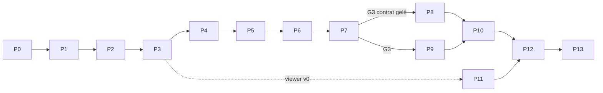

# ROADMAP — PRISM V2 (de bout en bout)

**Composant** : PRISM
**Statut** : [SPÉCIFICATION V2 — NON IMPLÉMENTÉ]
**Dernière mise à jour** : 1er novembre 2026
**Dépend de** : [`../governance/ROADMAP.md`](../governance/ROADMAP.md), [`VISION.md`](VISION.md), [`PERFORMANCE.md`](PERFORMANCE.md), [`TESTING.md`](TESTING.md)
**Source Monographie** : Annexe J (feuille de route V2)

---

## 1. Principes

- Road map **en ordre, sans dates**, comme celle du projet : l'ordre reflète les dépendances ; l'effort est donné en **taille relative** (S, M, L, XL), jamais en calendrier.
- **Portes de décision (G0…G8)** : une phase n'est franchie que si ses critères sont atteints ; une porte peut conclure à un repli.
- **Risque d'abord** : les benchmarks (P1) précèdent le code de production.
- **Contrat avant refonte cognitive** : le contrat est validé avec la cognition *actuelle* de SYNE (G3) avant la refonte de SYNE (G5).
- **Ablation avant conclusion** : aucune affirmation sur la coopération sans l'expérience d'ablation correspondante (G7).
- Aucune phase ne casse la V1 `1.x` tant que `2.0.0` n'est pas livrée (branche d'intégration dédiée).

## 2. Position dans la feuille de route du projet

La phase 4 de `docs/governance/ROADMAP.md` (*Intégration Unreal*) est **close** (V1 livrée). La V2 ouvre une nouvelle phase transverse :

| Phase projet | Intitulé | Sortie |
| :-- | :-- | :-- |
| **6 (nouvelle)** | Refonte PRISM V2 (monde voxel autoritaire) | PRISM `2.0.0`, SYNE `0.18.0`+, ECHOS adapté, Launcher/installateur adaptés, LIVEX `2.0.0` |

## 3. Vue d'ensemble

| Phase | Intitulé | Taille | Porte | Sortie principale |
| :-- | :-- | :-- | :-- | :-- |
| **P0** | Cadrage | S | G0 | Documentation V2 relue, ADR `Proposed`, solution et CI |
| **P1** | Spikes et benchmarks | M | **G1** | Rapport B1…B8 ; décision 3D vs 2.5D ; transport (Q-01) |
| **P2** | Noyau du monde | L | — | Registres, contenu validé, chunks, PRNG, empreintes, planificateur d'événements, audit |
| **P3** | Génération et visualiseur de debug | L | **G2** | Mondes dorés, générateur par seed, viewer v0 |
| **P4** | Temps et mises à jour | M | — | Calendrier, croissance, péremption, mises à jour |
| **P5** | Corps, navigation, perception | XL | — | Agent physique, A* 3D, perception, conflits |
| **P6** | Actions, macro-actions, conservation | L | — | Primitives, macro-actions, audit de conservation |
| **P7** | Contrat, hôte headless, persistance | XL | **G3** | Contrat 1.0.0 gelé, hôte, reprise bit-à-bit, validation avec la cognition actuelle |
| **P8** | Contenu, structures, chantiers | L | **G4** | Cinq chaînes jouées de bout en bout, structures, accès |
| **P9** | Refonte de SYNE (cognition + extraction du monde) | XL | **G5** | Runs SYNE + PRISM sans monde dans SYNE |
| **P10** | ECHOS, Launcher, installateur | L | **G6** | Pile complète orchestrée, métriques de coopération |
| **P11** | Visualiseur complet | L | — | Rendu, inspection, rejeu, interventions journalisées |
| **P12** | Calibrage et validation expérimentale | XL | **G7** | Critères de viabilité atteints, ablations A1…A8 |
| **P13** | Candidate de livraison | M | **G8** | PRISM `2.0.0`, LIVEX `2.0.0`, migration documentaire |

### Voies parallèles

Après la porte G3, trois voies avancent **en parallèle** : *monde* (P8), *cognition SYNE* (P9), *rendu* (P11). P10 attend P8 et P9. P12 attend P10 et P11.

## 4. Les portes de décision

| Porte | Question posée | Critères de passage | Si échec |
| :-- | :-- | :-- | :-- |
| **G0** | La conception est-elle assez cohérente pour démarrer ? | Revue croisée terminée ; ADR-004…010 relus ; solution, CI et analyseur d'architecture en place | Corriger la documentation |
| **G1** | Le 3D tient-il le budget ? | B1…B5 atteignent les cibles de `PERFORMANCE.md` §1 à 100 agents, et à 1 000 agents au moins 60 % de la cible ; transport tranché (Q-01) ; spike Silk.NET fonctionne sous Windows et Linux | Optimiser (une itération) puis **repli 2.5D** (§8) ou réduction de l'ambition de population |
| **G2** | Le monde généré est-il reproductible et jouable ? | Mondes dorés sur 3 graines ; empreintes identiques Windows/Linux ; contrôles de jouabilité passent ; viewer v0 montre le monde | Revoir paramètres de bruit, structure de génération |
| **G3** | Le contrat tient-il avec une vraie cognition ? | Contrat 1.0.0 gelé ; tests de contrat sur 2 liaisons ; reprise bit-à-bit ; run R2 (SYNE actuel + PRISM) reproductible ; analyseur : aucun flottant dans Core | Ne pas démarrer P8/P9 ; réviser le contrat (MAJOR en pré-release) |
| **G4** | Les chaînes existent-elles vraiment ? | Les 5 chaînes jouées par bots (R1) ; audit de conservation vert ; graphe amorçable à mains nues | Revoir contenu, recettes, durées |
| **G5** | SYNE est-il allégé et capable ? | `Simulation.Core` sans classe de monde ; agents SYNE accomplissent ≥ 3 chaînes sans plan scripté ; R3 reproductible ; budget SYNE tenu | Réduire la profondeur de planification ; garder l'adaptateur minimal et rouvrir ADR-009 |
| **G6** | La pile est-elle orchestrée et observable ? | Session Launcher SYNE + PRISM + ECHOS ; ECHOS ingère le flux PRISM ; manifestes valides ; installateur installe l'hôte | Corriger les contrats d'intégration |
| **G7** | Le monde sert-il l'hypothèse ? | Critères V1…V7 (`TESTING.md` §5) sur 3 graines ; ablations A1…A8 exécutées ; rapport expérimental pérenne publié (résultat positif **ou négatif**) | Ajuster le contenu ; sinon publier le résultat négatif et rouvrir ADR-004 |
| **G8** | Peut-on livrer ? | Tests verts, couverture ≥ 80 %, notices tierces, documentation migrée, V1 archivée, release candidate installée sur machine propre Windows et Linux | Corriger |

## 5. Contenu par phase

### P0 — Cadrage
**Objectif** : démarrer avec une conception cohérente.
**Travaux** : relire et corriger ce dossier ; créer la solution `prism/` et la CI ; glossaire ; stratégie de branche (branche d'intégration `feature/prism-v2`, `release/2.0.0`).
**Sortie** : G0.

### P1 — Spikes et benchmarks
**Objectif** : tuer les risques de performance et de transport **avant** d'investir.
**Travaux** : prototypes jetables (grille + générateur minimal) ; B1…B5 ; spike Silk.NET (fenêtre, un chunk maillé) ; spike planificateur (B7, côté SYNE) ; rapport et décisions (Q-01, 3D vs 2.5D).
**Sortie** : G1. Le code de prototype est **jeté** ou réécrit proprement.

### P2 — Noyau du monde
**Travaux** : registres d'identifiants stables ; compilateur/validateur de contenu ; pack minimal ; chunks et grille ; `Mix64`, flux nommés, `xoshiro256**` ; empreintes ; roue temporelle ; registre d'audit ; analyseur de dépendances et de flottants.
**Critères** : tests de vecteurs de PRNG, chunk round-trip, validation de pack avec erreurs structurées.

### P3 — Génération et visualiseur de debug
**Travaux** : bruit entier, relief, bordure, zones, strates, filons, eau, forêts, sites d'apparition, contrôles de jouabilité et tentatives ; mondes dorés ; **viewer v0** (fenêtre, meshing naïf, caméra libre) qui sert d'outil de réglage.
**Sortie** : G2.

### P4 — Temps et mises à jour
**Travaux** : calendrier, mises à jour programmées avec gigue, mises à jour aléatoires à compteur, croissance du blé et flétrissement, péremption paresseuse, propagation d'herbe ; B3 sur code de production.

### P5 — Corps, navigation, perception
**Travaux** : agents physiques, graphe de mouvement 3D, A* entier borné, pathfinding hiérarchique par chunks, perception à trois niveaux et différentielle, arbitrage de conflits, chemins aménagés ; B1/B2 sur code de production.

### P6 — Actions, macro-actions, conservation
**Travaux** : miner, poser, conteneurs, fabriquer, planter/récolter, consommer/boire, durabilité, transfert atomique, macro-actions (machines à états, indices de croyance, échecs motivés) ; audit de conservation et tests par propriétés (fuzz de commandes).

### P7 — Contrat, hôte headless, persistance
**Travaux** : `Prism.Contracts` et schémas JSON ; idempotence ; boucle de tick à ordre fixe ; hôte headless et contrôle HTTP ; liaison WebSocket en pas de verrouillage ; flux de lecture ; points de reprise ; bots ; manifeste Launcher ; **adaptateur minimal côté SYNE** (agents actuels qui marchent, mangent, boivent via contrat) ; preuve Windows/Linux ; run R2.
**Sortie** : G3 — **le contrat est gelé en `1.0.0`** ; tout changement ultérieur est une version.

### P8 — Contenu, structures, chantiers
**Travaux** : gabarits, chantiers (états, perception, pose progressive), structures (effets, intégrité), accès/propriété, cinq chaînes complètes, maîtrise, usure (optionnelle, désactivée), leviers d'ablation ; R1 (bots planificateurs).
**Sortie** : G4.

### P9 — Refonte de SYNE (voie parallèle)
**Travaux** (issues `SYNE-2xx`) : retirer le monde de `Simulation.Core` (§ `RESPONSIBILITIES.md` §4) en trois temps (parallèle → bascule par profil → suppression) ; mémoire spatiale par chunk ; croyances sur recettes/structures/chantiers ; désirs instrumentaux et sécurité alimentaire ; planificateur (GOAP ou HTN) ; adaptateur `PrismClient` complet ; savoir des recettes (simple, puis riche) ; calibrage cognitif initial ; version SYNE `0.18.0`, contrat d'observabilité `0.6.0`.
**Sortie** : G5.

### P10 — ECHOS, Launcher, installateur
**Travaux** : ECHOS ingère le flux de lecture PRISM ; refonte du moteur 6 (durabilité des ressources) sur stocks/production/usure ; nouveaux indicateurs (coopération, spécialisation, infrastructures, inégalité de stocks) ; comparaison de runs avec `contentHash` ; Launcher : PRISM requis par session, exigences §11 réécrites, `.livexp` avec `contentHash` ; installateur : paquets .NET ; retrait/réorientation de `syne-mock`.
**Sortie** : G6.

### P11 — Visualiseur complet (voie parallèle)
**Travaux** : meshing glouton incrémental, atlas procédural, occlusion ambiante, jour/nuit, agents, chantiers fantômes, caméras, inspecteur, calques, rejeu, interventions journalisées, captures, mode client/embarqué, manifeste viewer ; B8.

### P12 — Calibrage et validation expérimentale
**Travaux** : calibrage itératif (ordre dans `TESTING.md` §7) avec ADR de calibrage ; R3, R4 ; critères V1…V7 ; ablations A1…A8 (≥ 5 graines, 10 000 ticks) ; rapport expérimental pérenne (comme `EXPERIMENTAL-VALIDATION-2026-10.md`) ; ajustements de contenu ; figement des empreintes dorées.
**Sortie** : G7.

### P13 — Candidate de livraison
**Travaux** : régression de performance ; notices tierces ; archivage de la documentation V1 en `legacy-unreal/` ; ADR-002/003 `Superseded`, ADR-004…010 `Accepted` ; mise à jour de `README`, `VERSIONING`, `governance/*`, site, monographie, FAQ ; installation sur machine propre ; tags `prism-v2.0.0`, `livex-v2.0.0`.
**Sortie** : G8.

## 6. Définition de terminé pour PRISM 2.0.0

1. Monde voxel déterministe, reprise bit-à-bit, empreintes identiques Windows/Linux.
2. Contrat `1.0.0` documenté, testé sur deux liaisons ; échecs toujours motivés.
3. Cinq chaînes de production jouées de bout en bout ; audit de conservation vert.
4. Hôte headless conforme au manifeste Launcher ; visualiseur Silk.NET livré.
5. SYNE sans classe de monde ; agents planifiant à partir de recettes ; ECHOS ingérant PRISM.
6. Critères V1…V7 atteints ; ablations publiées avec leurs limites.
7. Performances : cibles §1 de `PERFORMANCE.md` atteintes ou ajustées par ADR.
8. Documentation migrée ; couverture ≥ 80 % ; notices tierces complètes.

## 7. Risques

| # | Risque | Prob. | Impact | Réponse | Porte |
| :-- | :-- | :-- | :-- | :-- | :-- |
| R1 | Pathfinding 3D / perception hors budget à 1 000 agents | Moy. | Élevé | Benchmarks d'abord, pathfinding hiérarchique, perception incrémentale ; repli 2.5D | G1 |
| R2 | La coopération n'émerge pas | Moy. | Élevé (scientifique) | Ablations ; publier le résultat négatif ; ajuster les coûts | G7 |
| R3 | Le planificateur dépasse le budget de SYNE | Moy. | Élevé | Profondeur bornée, cache, replan sur échec seulement | G5 |
| R4 | Déterminisme rompu par un flottant ou un ordre | Moy. | Élevé | Analyseur CI, empreintes, test Windows/Linux dès P3 | G2, G3 |
| R5 | Dérive de portée (météo, faune, construction libre) | Élevée | Moyen | Hors périmètre explicite (`VISION.md` §4) | toutes |
| R6 | Dette de rendu absorbe le temps | Moy. | Moyen | Rendu après le gel du contrat ; viewer v0 minimal | P11 |
| R7 | Calibrage plus long que prévu | Élevée | Moyen | Ordre de calibrage fixé ; ADR par itération | G7 |
| R8 | Invalidation des calibrages SYNE existants | Certaine | Moyen | Assumée : recalibrage ciblé P12 | G5, G7 |
| R9 | Charge de travail d'une seule personne | Élevée | Élevé | Voies parallèles limitées ; tailles relatives ; périmètre minimal d'abord | toutes |
| R10 | Dépendances graphiques (pilotes, Wayland) | Moy. | Moyen | CI rendu logiciel, tests Windows/Linux, `--embedded` optionnel | P11 |

## 8. Plan de repli (porte G1 / G5)

Le modèle de données de PRISM (matériaux, recettes, structures, contrat) est **indépendant de la géométrie**. Si le pathfinding 3D ou le rendu reste hors budget après optimisation :

1. **Grille 2.5D** : hauteur par colonne + quelques couches ; pas de surplombs ni de cavernes ; navigation 2D avec transitions de hauteur.
2. Conserver **tout le contenu** et le contrat ; seuls `Prism.Core` (géométrie) et le viewer changent.
3. Option complémentaire : réduire la population de référence (500 agents) et conserver 1 000 comme objectif de charge.

## 9. Après la V2 (non planifié)

Écoulement de l'eau (rouvre ADR-010) ; construction libre ; météo et faune ; occultation de communication par le monde ; packs de contenu signés et modding ; mode joueur-habitant ; génération hors boucle de recettes/noms ; monde plus grand ; carte multi-biomes étendue.

## 10. Dépendances externes

| Dépendance | Nécessaire pour | Risque |
| :-- | :-- | :-- |
| .NET (version du dépôt) | Tout | Faible |
| Silk.NET, UI immédiate | Viewer | Pilotes, licences à confirmer |
| Runners CI Windows et Linux | Déterminisme inter-plateformes | Disponibilité |
| Mesa (rendu logiciel) | Tests de rendu | Optionnel |

## 11. Références

[`VISION.md`](VISION.md) · [`PERFORMANCE.md`](PERFORMANCE.md) · [`TESTING.md`](TESTING.md) · [`RESPONSIBILITIES.md`](RESPONSIBILITIES.md) · [`ISSUES.md`](ISSUES.md) · [`adr/README.md`](adr/README.md)

## Mises à jour

| Date | Changement | Motif |
| :-- | :-- | :-- |
| 1er novembre 2026 | Création | Refonte V2 |
