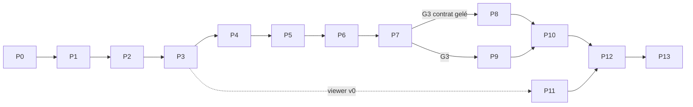

# ROADMAP — PRISM V2 (de bout en bout)

**Composant** : PRISM
**Statut** : [IMPLÉMENTATION EN COURS — **P0–P9 CLÔTRÉES**, P10 EN COURS (ECHOS ET LAUNCHER LIVRÉS ; INSTALLATEUR OUVERT), P11 (VIEWER) **LIVRÉE LE 15 NOVEMBRE 2026** (viewer complet + plan de contrôle piloté depuis le Launcher ; relevé B8 et validation graphique Linux en attente) ; **P9 clôturée le 15 novembre 2026** (aucune classe de monde dans `Simulation.Core`, `PrismWorldAdapter` seul implémenteur de `IWorld`, chaînes de production jouées par des agents SYNE sans plan scripté ; résidus transférés : reprise couplée complète → P10, plans de recettes riches → P12) ; **G4 franchie le 9 novembre 2026 (5/5 chaînes par bots, audit vert, empreinte `abab272bd13e6ba3`)** ; **G5 franchie le 14 novembre 2026 (R3 produite et reproductible, empreinte `855fdc2e1387e8d3`, coût propre à SYNE 30,5 ms/tick)** ; G1 OUVERTE NON BLOQUANTE — dernière mesure du 15 novembre 2026 : 431,5 ms/tick à 100 agents (budget 50 ms) et 850 ms à 1 000 agents (budget 250 ms), dominés par ApplyWrites à 404,7 ms ; P12/P13 reportées]
**Dernière mise à jour** : 15 novembre 2026
**Dépend de** : [`../governance/ROADMAP.md`](../governance/ROADMAP.md), [`VISION.md`](VISION.md), [`PERFORMANCE.md`](PERFORMANCE.md), [`TESTING.md`](TESTING.md)
**Source Monographie** : Annexe J (feuille de route V2)

---

## 1. Principes

- Road map **en ordre, sans dates**, comme celle du projet : l'ordre reflète les dépendances ; l'effort est donné en **taille relative** (S, M, L, XL), jamais en calendrier.
- **Portes de décision (G0…G8)** : une phase n'est franchie que si ses critères sont atteints ; une porte peut conclure à un repli.
- **Risque d'abord** : les benchmarks ciblent les risques importants ; selon la priorité du propriétaire, P2 peut avancer avant la clôture de G1, qui reste obligatoire avant validation d'intégration.
- **Contrat avant refonte cognitive** : le contrat est validé avec la cognition *actuelle* de SYNE (G3) avant la refonte de SYNE (G5).
- **Ablation avant conclusion** : aucune affirmation sur la coopération sans l'expérience d'ablation correspondante (G7).
- Aucune phase ne casse la V1 `1.x` tant que `2.0.0` n'est pas livrée (branche d'intégration dédiée).

## Suivi d'exécution

| Phase | État | Avancement / prochaine action |
| :-- | :-- | :-- |
| P0 — Cadrage | Implémentée | PRISM-001 à 005 implémentées ; build Windows réussi sur les 14 projets de la solution et cross-build des 12 projets historiques pour `linux-x64` réussi. Les projets `Prism.Bots` et `Prism.Bots.Tests`, ajoutés après cette passe, n'ont pas encore été recroisés pour Linux. La stratégie de branches V2 est documentée (`governance/GITFLOW.md` §8) et le glossaire complété (bloc, chunk/région, chantier, macro-action, pack, tag, tick V2). Exécution native Linux/CI reste à confirmer sur runner distant. |
| P1 — Spikes et benchmarks | Clôturée fonctionnellement, mesure continue ; **benchmark du tick couplé (B9) livré le 11 novembre 2026, remesuré le 15 novembre 2026** | Baseline indicative 250 ms/tick et seuil G1 3 ticks/s conservés comme repères. **Le tick couplé est mesuré et versionné** (PRISM-106, benchmark **B9** — B7 reste le spike de planification SYNE) : `scripts/prism-coupled-benchmark.py` relève le tick en JSONL et publie les relevés `benchmarks/B9-coupled-tick-*.json`. Dernier relevé complet (15 novembre, 100 agents × 25 ticks, 2 passes) : **431,5 ms/tick** (erreur-type 5,15 %), **ApplyWrites 404,7 ms** (94 %), perception 15,2 ms, macros 14,4 ms ; la perception a une erreur-type de 14,78 % (étendue maximale 29,56 %), donc le poste perception n'est pas concluant, tandis que le total (erreur-type 5,15 %) et ApplyWrites (5,49 %) restent dans la tolérance du harnais. À 1 000 agents, dernière mesure valide **850 ms** (perception 317 ms). Écarts : ×8,6 à 100 agents et ×3,4 à 1 000. G1 reste ouverte sans bloquer l'implémentation fonctionnelle ; le levier prioritaire est la suppression des recherches rejouées (PRISM-143). |
| P2 — Noyau du monde | Implémentée | PRISM-020–028 livrés et testés : registres, compilateur/validateur, pack minimal amorçable, grille 2.5D, RNG, empreintes, roue temporelle, ledger et tests générés d'ordre/idempotence. Les dépendances de packs restent une extension hors V2. |
| P3 — Génération et visualiseur de debug | En cours | PRISM-030–035 sont implémentées (socle). PRISM-036 fournit la sélection des sites sur six ressources accessibles, les planchers globaux de ressources vérifiés avant la recherche (code motivé `world.resources.below_floor`) et huit tentatives dérivées avec erreur structurée. PRISM-037 verrouille trois empreintes locales ; la matrice CI compare déjà les empreintes Windows/Linux, mais il manque une empreinte de monde **v2** et un rapport daté pour clore G2 — c'est le lot **L5** du plan d'implémentation, prochaine action de la phase. PRISM-038 dispose d'un viewer OpenGL v0 avec maillage par région et caméra libre ; le test de démarrage Windows a réussi. Le support Linux (`LinuxGlfwPlatform`, diagnostics de plateforme) est en place et testé ; la validation graphique sur runner Linux reste à faire. PRISM-039 (benchmark de génération synthétique) est **retiré** : la génération est déjà mesurée par B6 et par le `Prepare` des runs réels. |
| P4 — Temps et mises à jour | Socle implémenté | PRISM-040–045 : calendrier, ordonnanceur, random ticks, croissance saisonnière, péremption paresseuse et propagation d'herbe configurée par le pack. PRISM-046 est **retiré** : B3 a déjà tranché la question de conception (croissance programmée), un benchmark synthétique supplémentaire n'apporte rien. |
| P5 — Corps, navigation, perception | Socle fonctionnel implémenté | PRISM-050–052 et 054–056 : cycle de vie, mouvement 2.5D/A*, perception différentielle plafonnée, arbitrage et accélération des chemins configurée par les tags/gabarits. La commande `Aller` est implémentée (chemin A* calculé à la réception, un pas par tick, ordre checkpointé) et la fusion des piles au sol de même taille est en place. PRISM-053 (pathfinding hiérarchique) est **retiré du backlog** : le code existe (corridor de régions) mais n'est pas câblé, accepte des chemins plus longs que l'optimum, et la mesure B9 attribue le coût aux recherches rejouées qui échouent (PRISM-143), pas au corridor. PRISM-057 (benchmarks B1/B2 synthétiques) est **retiré** pour la même raison : B9 mesure le chemin réel. Restent les structures/chantiers, suivis en P8. |
| P6 — Actions, macro-actions, conservation | En cours | PRISM-060–069 ont un socle testé : actions primitives, macro-actions d'obtention/fabrication/culture, transfert agent-agent et fuzz déterministe de 1 M de commandes. `Miner`, `Poser`, `Fabriquer`, `Labourer`, `Planter`, `Recolter`, `Consommer`, `Transferer`, `Prendre` et `Deposer` sont raccordées au dispatch du tick ; la pose de conteneurs et leur checkpoint sont intégrés, croissance/cultures utilisent les phases host. `DefinirAccesConteneur` configure les ACL par commande. La fraîcheur est portée par les piles (`FreshnessPermilleTicks`/`FreshnessUpdatedTick`) et la fusion au sol n'agrège que des piles d'état identique (`AddItem`). Les actions à durée occupent désormais l'agent (`ActionDurationTracker`, `agent_busy`, checkpointé avec le dispatch). La décroissance de fraîcheur est appliquée à la prise dans un conteneur. `Miner`, `Fabriquer`, `Labourer`, `Planter` et `Recolter` sont enregistrées par le dispatch et résolues à l'échéance ; le résultat est renvoyé à l'étape macro qui l'a demandée (`macro_step_deferred`, canal `DeferredActionResolutions`), qui n'est validée qu'avec les quantités réellement produites. |
| P7 — Contrat, hôte headless, persistance | En cours — socles PRISM-073/074/075/076/078 ; PRISM-077 épinglée (réduite) ; PRISM-081 gelée (doc) | Avec un pack, `Prepare` compile/génère déterministement ; commandes de cycle de vie, construction et actions primitives sont dispatchées. Les observations différentielles sont produites par agent et checkpointées avec l'historique de perception ; ledger, réservations de stations et roue d'événements sont checkpointés. Le flux publie aussi les snapshots d'entités, les deltas, les chantiers/effets et les checksums. Le message `metrics` (stocks, matière par `ruleId`, chantiers, réservations, effets, échecs) est publié et exposé par `/metrics` ; les payloads sont validés au contrat par commande et un test de reprise continu/restauré vérifie ticks, empreinte et entités. PRISM-077 dispose de `Prism.Bots` (bots aléatoire, glouton, planificateur et inactif `idle` déterministes, runner qui ne parle au monde que par le contrat, empreinte de run FNV-1a) et du CLI `prism-bots` qui porte la campagne dorée. L'optimisation du tick du 4 novembre 2026 a ramené le coût de 1,26–1,49 s à ~13,6 ms/tick/agent et `Prepare` de 21–27 s à 2,0–2,4 s : la campagne réduite 3 graines × 200 ticks × 3 bots est épinglée dans `DeterministicCampaignTests`, et la campagne complète 3 × 5 000 ticks est redevenue un gate manuel de quelques minutes (rejouée le 4 novembre, 9 empreintes publiées dans [`ISSUES.md`](ISSUES.md)). Les paramètres `perception` du pack (`nearRadius`, `midRadiusChunks`, `maxObservedPerAgent`) sont désormais compilés par `PerceptionSettingsRuntimeCompiler` et appliqués par `PrismHostRuntime`, ce qui rend le calibrage par pack effectif. PRISM-078 est implémentée : `CommandMatrixContractTests` couvre les 21 kinds sur les trois liaisons (23/23 verts). PRISM-081 est gelée en `1.0.0` côté document. Restent la compression, le job dédié de rejeu interplateforme (PRISM-079) et la validation Linux du packaging. |
| P8 — Contenu, structures, chantiers | **Clôturée — G4 franchie le 9 novembre 2026** (socles PRISM-090 à PRISM-102 livrés) | Compilation/runtime des gabarits, commandes host idempotentes, contributions avec débit atomique des matériaux au prorata, pose progressive, abandon, checkpoint host, snapshots des matériaux consommés/manquants et ACL propriétaire/groupe sont testés. La perception explicite des chantiers est raccordée au flux d'observations (entrée `ConstructionSite` : `siteId`, état, travail requis/achevé, diff apparu/modifié/disparu) ; le consommateur d'abri applique les ACL `use` au propriétaire, aux agents et aux groupes (résolus par `GroupMembership`) et expose le bonus dans l'auto-observation ; les effets `water_access`, `storage` et `production` sont consommés, les cinq chaînes sont jouées par le run R1 (G4) et la campagne 50 agents reste un gate manuel. Depuis le 4 novembre 2026, le consommateur d'effets couvre aussi `water_access` et `storage` : un agent dans un puits achevé peut boire (`Consommer` → `item_consumed` canal `source`, effet `drink_water`) sans nouveau champ de contrat (PRISM-096 partielle), et la péremption des conteneurs est appliquée à chaque tick, ralentie dans le volume d'un grenier achevé avec émission d'`item_spoiled` (PRISM-098 partielle). La chaîne outils est désormais jouée de bout en bout sur le pack minimal : mains nues → établi → pioche de pierre, palier de fer refusé sans pioche, puis minerai → four → lingots → pioche de fer (`ToolChainAcceptanceTests`), avec le chemin hôte `Poser`/`Fabriquer` différé (`ToolChainHostTests`, PRISM-094 livrée via R1). Les chaînes agriculture et cuisson sont jouées sur le pack minimal (`CropChainAcceptanceTests`, `CookingChainAcceptanceTests`, PRISM-095/097 livrées via R1) : labour à la houe, croissance printanière, récolte et réensemencement ; cuisson de trois blés au four avec conservation ×4 et énergie accrue. `shelfLifeTicks` est désormais appliqué à la création des piles (minage, récolte, artisanat) et la fusion n'unit que des piles de même fraîcheur, ce qui rend la péremption des conteneurs réellement observable. **7 novembre 2026 — run R1 outillé et mesuré** : `prism-bots --r1` joue les cinq chaînes avec des bots planificateurs (5 agents, un par chaîne), l'hôte expose `AuditConservation()` (recompte agents/conteneurs/sol contre le ledger) et la campagne réduite est épinglée par `R1CampaignTests`. Résultat publié dans [`G4-R1-REPORT.md`](G4-R1-REPORT.md) : audit **vert**, run reproductible, mais **0/5 chaînes achevées** (blocages : pas d'étape de pose de station ni d'exploration dans le bot, un seul log atteignable par arbre). **G4 est franchie depuis le 9 novembre 2026** : 5 agents × 2 500 ticks, 5/5 chaînes, audit vert, empreinte `abab272bd13e6ba3`. |
| P9 — Refonte SYNE | **Clôturée le 15 novembre 2026** — G5 franchie le 14 novembre 2026 (R3 produite et reproductible, empreinte `855fdc2e1387e8d3`, coût propre à SYNE 30,5 ms/tick), plus aucune classe de monde dans `Simulation.Core`, production prouvée par agents SYNE | **Clôture du 15 novembre 2026** : les tickets `SYNE-220` à `SYNE-226` et `SYNE-228` sont livrés et G5 est franchie. Deux résidus sont **transférés, pas perdus** : le jeu complet de points de reprise couplés (`SYNE-225` : reprise après saut de séquence, rotation des checkpoints) passe en durcissement du lot P10 ; les plans de recettes riches (`SYNE-223`, enrichissement noté par ADR-019) passent en P12 avec `SYNE-227`. `PrismClient` fournit prepare/start/tick/stop HTTP et mapping BDI ; `PrismReadStreamClient` consomme le WebSocket en validant les enveloppes, les resynchronisations et les observations par agent. Cette session a livré `PrismObservationMapper`, `PrismCoupledRunner`, `CognitionPipeline.ApplyExternalObservations` et le mode CLI `--prism-url` : le transport est validé sur 1 000 ticks sans crash, puis R2 (5 000 ticks) est reproductible, et les observations PRISM alimentent les croyances. Un premier jalon de persistance couplée est ajouté (SYNE-225 amorcé). Pour SYNE-220, les étapes 1 (mode parallèle : interface `IWorld`, adaptateur `PrismWorldAdapter`) et 2 (bascule par profil) sont en place : `world.externalWorld` et le flag `--external-world` injectent l'adaptateur à la place du monde local, la surface `IWorld` couvre désormais tout ce que `Simulation.Core` consomme (entités, gisements, constructions tracées, description du monde, A*), et `PrismWorldSynchronizer` alimente l'adaptateur depuis l'auto-observation `self.position` de chaque enveloppe, branché sur la boucle couplée (`--prism-url`). L'adaptateur indexe ses entités dans la grille de perception et déplace les instances existantes plutôt que de les remplacer, pour que la cognition garde ses références ; `SyncEntities` fournit l'alignement sur un état de référence. SYNE-221 est implémentée : `SpatialMemory` conserve par agent un souvenir par chunk (masque de tags exposés, confiance révisée par la formule des croyances, décroissance et oubli, capacité bornée avec éviction déterministe), alimenté par les résumés de région PRISM via `PrismObservationMapper.ToSpatialChunks` et `CognitionPipeline.ApplyExternalSpatialObservations`, persisté de façon additive (absent quand vide, donc les empreintes des runs locaux sont inchangées). Au passage, le mappage des observations a été corrigé : PRISM sérialise ses enums en nombres, le mapper attendait des libellés et n'appliquait donc rien en production. SYNE-222 est partielle : les chantiers et les structures perçues par PRISM deviennent des croyances dédiées — `site-<id>` (état et avancement du travail, format « x,y,état » / « achevé,requis ») au lieu d'entrer dans les croyances de gisement, et `structure-<id>` (effet d'abri **éprouvé**, lu dans l'auto-observation `self` quand l'agent est abrité). Les lectures associées (`TryParseSiteState`/`TryParseSiteProgress`) sont posées pour le planificateur. Les croyances de recettes sont également en place, avec un primitif nouveau : la croyance **durable** (`Belief.IsDurable`), qui ne décroît pas et n'expire pas — une connaissance acquise ne s'oublie pas comme un fait observé. Les recettes déclarées (`agents.knowledge`, désactivé par défaut) sont injectées à la création de chaque esprit en trois croyances canoniques (`recipe-<id>` : `inputs`, `outputs`, `station`), persistées et relues ; c'est la source « simple » que SYNE-224 prolonge : un livre peut désormais **enseigner** des recettes (lignes `recipe:` de son contenu → croyances durables de source `book:<id>`, horodatées au tick de lecture, `agents.knowledge.learnFromBooks` vrai par défaut mais sans effet tant que `world.books.enabled` est faux), ce qui ferme la boucle « savoir simple puis savoir transmis ». SYNE-223 est livrée au socle : le planificateur (`agents.planner`, désactivé par défaut) décompose l'intention en étapes avec le vocabulaire d'actions existant (recherche ciblée → poursuite puis consommation), avec un cache borné déterministe à clé stable, l'invalidation et la replanification sur étape bloquée ; les plans sont transitoires (redérivés après reprise). Preuve de neutralité : sur 25 ticks, un run avec planificateur actif suit **la même trajectoire** qu'un run sans (positions et besoins identiques à chaque tick). SYNE-222 et SYNE-226 sont livrées : croyances de recettes, de chantiers et de structures, **désirs instrumentaux et sécurité alimentaire** (`DesireKind.SecureFood`, section `agents.desires.instrumental` désactivée par défaut — l'agent vise un **stock** de nourriture avant d'avoir faim, puis `Take` remplit la réserve et `Eat`/`Drink` savent la consommer). Restent SYNE-220 (étape 3, suppression du monde local), l'enrichissement de SYNE-223 (plans de recettes, cache inter-esprits), SYNE-224 (format d'écriture des livres), SYNE-225 (persistance couplée complète), SYNE-227 (recalibrage de survie) et SYNE-228 (version `0.18.0`, contrat d'observabilité `0.6.0`), plus le run R2/R3. **Run R2 rejoué et concluant le 6 novembre 2026**, après les deux travaux qu'il avait révélés. L'incarnation est en place : SYNE lit l'instantané `/data/read` (dimensions et cases praticables), affecte une case par agent de façon déterministe et émet un `Incarner` par agent au premier tick — plus aucune création d'entités sans agent PRISM en face. La convention spatiale est tranchée par **ADR-013** : 1 bloc = 1 m = 1 unité SYNE, plus de `k = 100 uu`, PRISM autoritaire sur la géométrie (profil `prism` à 256 × 256 blocs, portées en ratios du profil de référence), commandes en blocs entiers et observations en milli-blocs divisés une seule fois au bord. Mesure : 50 agents × 5 000 ticks, seed 7, pack minimal, **trois hôtes distincts** — empreinte `0bf833f4bcfc1e5e` reproduite 3/3, `minds = 50/50`, 250 000 observations positionnées, ~37 min/passe ; la reprise couplée (checkpoint `resA-299` → restauration → 300 ticks) redonne exactement l'empreinte du run continu de 600 ticks (`44c2ea085d112e05`), et deux hôtes indépendants convergent à 300 ticks (`3454884836d7c08c`). **Write-back BDI → commandes branché le 6 novembre 2026** : `CognitionPipeline.StepCoupled` délibère sans rien exécuter localement, `PrismDecisionCommandMapper` traduit la décision courante en commande (`Aller` pour `SeekFood`/`SeekWater`/`Explore`/`Socialize`/`Flee`, `Consommer` pour `Drink` — `Eat` et les actions collectives restaient non traduites, faute d'identifiant d'objet — **depuis l'étape 3b, `Eat` devient `Consommer { item }` sur un objet porté identifié par le catalogue et `SeekFood` devient `ObtenirObjet` (tag `edible`, indice borné)**)), et l'adaptateur expose les gisements PRISM sur leur **case d'approche** praticable, au même niveau que le bloc (condition d'`IsAdjacent` côté `Consommer`). Une commande n'est ré-émise que si sa cible change (ou toutes les 30 ticks), pour ne pas repayer un A* par agent et par tick. Mesure : 10 agents × 1 500 ticks, seed 7, pack minimal — **388 commandes émises**, 391 `action_completed`, 22 `path_not_found`, **3 832 déplacements observés**, 559 gisements exposés (bois ; 0 buvable), empreinte `b544dadd2d55f676` reproduite 3/3. Limite constatée : la mer du pack minimal est une **nappe enterrée** (niveau 26 sous un plateau à ~56) ; aucun bloc d'eau n'a de voisin praticable à son niveau, donc aucun gisement buvable n'est exposé et `Consommer` n'est exercé que par les tests de contrat (la consommation en monde PRISM passe par un puits `water_access`). **Étape 3b livrée le 6 novembre 2026** : `PrismItemCatalog` lit les tags d'objets du pack, la faim émet `ObtenirObjet` (`tag: edible`, `hintRadius` 8) et `Eat` consomme un objet porté identifié (inventaire `self.inventory[]` désormais lu) ; les objets comestibles au sol deviennent des cibles `resource-food-<id>`. Run couplé 6 × 600 ticks : 86 commandes, **0 `invalid_payload`**. Les `path_not_found` sont traités depuis le 6 novembre : `path_not_found` 12 → 2 et 260 réémissions évitées, empreinte inchangée. **Étape 3c livrée le 7 novembre 2026** : `World` n'est plus qu'un conteneur d'entités/territoires/livres, toute la géométrie (obstacles, gisements, grille de collision, roue locale) a disparu et les shims vides sont verrouillés par `LocalConstructionPlacement_IsNoLongerTraced_SincePrismOwnsTheGeometry` ; builds et suites SYNE verts (Core 587, Console 181). SYNE-225 (point de reprise couplé) dispose de son socle testé : écriture atomique, alignement du tick et de l'empreinte, restauration cognitive seule, refus explicite d'un snapshot désaligné. **Étape 3d livrée le 7 novembre 2026** : le type `World` n'existe plus — le conteneur local s'appelle `ObservedWorld` et n'implémente que `IWorld`, aux côtés de `PrismWorldAdapter` ; les 65 fichiers qui l'instanciaient ou le citaient (moteur, console, 37 fichiers de test, alias `WorldNamespace`, `cref`) ont été réécrits, la build est verte sans avertissement et les suites SYNE restent à 768/768. **Étape 3e livrée le 7 novembre 2026** : `ObservedWorld` est **supprimé** — `PrismWorldAdapter` est désormais la seule implémentation de `IWorld` (constructeurs à un et deux arguments, `AddTerritory`/`ApplyConfiguredLayout`, `PlaceConstruction`/`AddResourceNode` conservés comme shims vides), `EnvironmentChange` déménage dans son propre fichier, l'instanciation locale (`Program.cs`, `SimulationFactory`, `SimulationSnapshotRestorer`) passe par l'adaptateur, et les 50 fichiers qui citaient le type ont été réécrits. Build 0 avertissement, suites SYNE **768/768** vertes. Le critère « `Simulation.Core` sans classe de monde » est donc **atteint** ; restent R3 (budget et reproductibilité) et le choix de conserver ou non l'instanciation locale de l'adaptateur. **10 novembre 2026 — production jouée par des agents SYNE, R3 bornée par le coût du tick.** L'exécutif de production (`PrismProductionExecutive`) traduit le plan dérivé du graphe de recettes en commandes du contrat (`ObtenirObjet`, `FabriquerMacro`, `Poser`) ; trois défauts l'empêchaient d'aboutir, tous corrigés et testés : l'**acceptation** d'une macro-commande était lue comme sa fin (`action_completed` + `result.started`), d'où des crafts sans entrées (`input_missing`) et des refus `action_already_active` — c'est désormais `PrismProductionCommandMapper.IsCompletion` qui tranche ; une chaîne accomplie n'était **jamais comptée** puisque l'objet final satisfait le désir et qu'aucune décision `Produce` ne suivait — `ObserveInventory` la constate ; une récolte refusée `source_not_found` bouclait jusqu'à l'abandon — l'agent **prospecte** maintenant (`TrySearch`, `PrismContentMaterials.LoadDropItemKinds`, `PrismResourceSites.TryNearest`), et le tag `stone` du pack est lu comme `ResourceKind.Mineral` pour qu'une chaîne d'outils ait une cible. Mesures : **3 chaînes** par agents SYNE sans plan scripté (6 agents × 1 500 ticks, zéro abandon), **5 chaînes** sur 20 agents × 120 ticks (`chest`, `wooden_bucket`), empreinte `233d76e194c897cf` **reproduite sur deux passes**, 811/811 tests SYNE verts. R3 pleine échelle reste **non produite**, mais le coût du tick est désormais **nommé, mesuré de façon reproductible et réduit** : après profilage (10 novembre 2026), 84 ms/tick à 100 agents immobiles et 705 ms en production (contre 620 et 2 150), à savoir dominé par la **recherche de chemin** (68 % à 1 000 agents) et la **perception** (19 %). La baseline B7 du 11 novembre 2026 (PRISM-106) fixe le point de départ des optimisations à 1 000 agents : 4 533 ms de tick médian, perception 2 959 ms, pathfinding + macros 654 ms, transport client 1 376 ms, p95 14 337 ms — chaque poste est comparé à son budget dans `PERFORMANCE.md` §2. La « croissance avec la durée du run » était le checkpoint d'arrêt dans le handler. À 1 000 agents, une passe de 2 500 ticks coûterait ≈ 6 h 40 et le run **s'arrête au tick 9** sur un rejet de payload JSON de 222 Mo : **G5 reste ouverte sur un backlog ordonné de onze issues** (PRISM-104…109, 119, 140…143) : d'abord mesurer et fiabiliser les garde-fous (106 à 108), puis invalidation par région (109) et plafond de payload (142), puis perception incrémentale et chemin borné, puis SIMD, parallélisme à commit ordonné et budget mémoire — voir [`ISSUES.md`](ISSUES.md) §ph9, [`PERF-P9-PROFILE.md`](PERF-P9-PROFILE.md) et [`G5-R3-REPORT.md`](G5-R3-REPORT.md). Le GPU est écarté à ce stade : déterminisme, BCL seule et headless s'y opposent, et le goulot mesuré est du travail perdu, pas du débit. |
| P10 — ECHOS, Launcher, installateur | **ECHOS livré (ECHOS-120…123) ; manifeste Launcher aligné ; LAUNCHER-201/202 et INSTALLER-200 ouverts** | ECHOS **ingère désormais le flux PRISM en production** : `POST /ingest/prism` branche `ingest_prism_run` sur `/data/read`, `PrismRunIngestor` écrit par lots bornés et `append_prism_read_envelopes` reprend après coupure (schéma SQLite **v9**, séquences déjà stockées ignorées, identité `seed`/`contentHash` vérifiée). `POST /api/runs/{id}/prism-analysis` rejoue le flux conservé : `PrismResourceMetrics` (stocks agents/conteneurs/sol, matière créée/détruite, bilan net, usure, structures, réservations, effets, échecs) et `PrismCooperationMetrics` (coopération, spécialisation, infrastructures, inégalité de stocks) avec provenance à trois états ; `GET /api/prism/compare` nomme le premier tick et le premier champ de divergence par `contentHash` et `seed`. Le manifeste `prism/component.json` déclare `type: immersion`, `contributesTo: [immersion]` et la capacité `renderCadence` : `PrismRequirements` ne verrouille plus PRISM V2. Suites ECHOS : **419 réussis / 14 ignorés** (433 collectés, couverture 91,14 %). Côté Launcher, LAUNCHER-201 livre `world.json` dans le `.livexp` (composant autoritaire, `contentHash`, graine, pack) et LAUNCHER-202 le câblage des ports : un composant déclare au manifeste les points d'accès qu'il consomme, le Launcher lui passe l'URL résolue du producteur (`--prism-stream` pour ECHOS), refuse de lancer un consommateur sans producteur et déduit l'ordre de démarrage des `requires`/`consumes` (arrêt en ordre inverse). INSTALLER-200 est livré côté distribution : `prism-host`, `prism-viewer` et le pack de contenu sont publiés par `scripts/release/publish_prism_v2.py` (`dotnet publish` autonome win-x64 et linux-x64), déclarés facultatifs dans `installer/build/components.json` (viewer → hôte → pack) et distribués en archives mesurées ; l'ADR-010 est amendé pour ne plus couvrir que les entrées V1 sous Unreal. Restent la recette d'installation sur machine propre et le packaging complet. `MOCK-200` est retiré : `syne-mock` reste un outil de test, hors produit. |
| P11 — Visualiseur complet | **Livrée et vérifiée à l'écran le 15 novembre 2026 — PRISM-110 à PRISM-118** ; Viewer **100/100**, chargeurs d'assets câblés (`--assets`, décodeur PNG interne, palettes et police externes) | Meshing glouton incrémental par région avec budget par image et culling de frustum ; **atlas procédural** RGBA 4 × 4 généré au démarrage et UV de sommet (111) ; occlusion ambiante topologique ; cycle jour/nuit déterministe (`ViewerDayNightCycle`, `uLightTint`, couleur du ciel, HUD calendrier) ; **entités live** interpolées depuis le magasin, couleur par état et marqueur d'action, **chantiers en fantômes** remplis au prorata du travail, objets au sol colorés par fraîcheur (112) ; caméras orbite/libre, **suivi live** par identifiant et **vue en coupe** (`X`, `[`/`]`, `uCutZ`) (113) ; **inspecteur live** et **sept calques** (`1`–`7` : zones, ressources, fraîcheur, chemins par carte de chaleur, structures, propriété, construction) (114) ; modes **`--connect`**, **`--embedded`** et **`--replay`**, avec `--record` (JSONL) et rejeu à cadence contrôlée, file bornée à 512 enveloppes et resynchronisation (115) ; **interventions journalisées** désactivées par défaut, converties en commandes `Poser`/`Retirer` du contrat gelé et appliquées par le host au tick suivant (116) ; **test d'indépendance du rendu** vert (117) ; **manifeste `prism/viewer.component.json`** publié avec le binaire, **plan de contrôle** (`POST /control/play\|pause\|stop\|quit` relayés à l'hôte) et **run gaté** par le Launcher (modes **Hôte**/**Viewer**, aucun tick avant **Play**) et **harnais B8** (118, relevé non exécuté). Vérification du 15/11 : volumes d'arbres/minerais/blocs posés (culling par face), blocs minés retirés par `region_delta`, module de capture PNG (`--screenshot`, `--screenshot-frames`, `F12`), caméra souris (glisser gauche/droit, molette), coupe effective et host embarqué qui s'arrête proprement ; les blocs enterrés ne sont dessinés qu'en vue en coupe. Limites assumées : les calques `Structures` et `Ownership` ne peuvent afficher que ce que le contrat `1.0.0` publie (aucun propriétaire ni ACL de site) ; la validation graphique Windows/Linux et B8 restent différés à la demande du propriétaire. |
| P12–P13 | **Reportées après l'implémentation complète** (décision du propriétaire) | Le calibrage, les ablations A1–A8, le rapport expérimental et la validation de livraison ne sont pas des préalables au reste du développement. Ils seront ouverts quand PRISM, SYNE, ECHOS, Launcher, Installateur et Viewer seront implémentés. Les plans d'implémentation restants sont listés dans [`../governance/IMPLEMENTATION-PLAN-2026-11-15.md`](../governance/IMPLEMENTATION-PLAN-2026-11-15.md). |

P11 est livrée : l'inspecteur lit le magasin live (`Tab` parcourt les identifiants connus, action active comprise), les entités et chantiers sont rendus depuis le flux, et les modes client/embarqué/rejeu sont câblés. Depuis le 15 novembre 2026, le viewer est aussi un **plan de contrôle** : `POST /control/play|pause|stop|quit` est relayé à l'hôte, qui reste l'autorité du monde, et le Launcher ouvre la session en deux modes (**Hôte** ou **Viewer**) sans exécuter de tick avant **Play**. Les maîtrises, croyances et plans cognitifs ne sont pas publiés par le contrat `1.0.0` et ne sont donc pas affichés.

**Pour clore P11**, il ne reste que deux preuves, toutes deux différées à la demande du propriétaire : le **relevé B8** publiable (`--benchmark-frames` sur Windows) et la **validation graphique Linux** (fenêtre réelle, rendu logiciel ou pilote). Le reste (code, manifeste, tests, chaîne réelle gatée) est livré.

**Validation différée à la demande du propriétaire :** aucun benchmark/performance ni validation graphique Windows/Linux n'est exécuté pendant cette étape ; la matrice CI continue toutefois d'exécuter les suites sous les deux systèmes. Les suites fonctionnelles locales restent exécutées.

Le choix de géométrie 2.5D et le transport de référence sont décidés par ADR-011/012. Selon la priorité donnée par le propriétaire, l'implémentation fonctionnelle des phases P2–P5 avance en parallèle de G1 : les budgets détaillés et les optimisations seront réévalués sur l'intégration PRISM/SYNE. G1 n'est pas considérée franchie et reste un jalon de validation avant l'intégration complète.

## 2. Position dans la feuille de route du projet

La phase 4 de `docs/governance/ROADMAP.md` (*Intégration Unreal*) est **close** (V1 livrée). La V2 ouvre une nouvelle phase transverse :

| Phase projet | Intitulé | Sortie |
| :-- | :-- | :-- |
| **6 (nouvelle)** | Refonte PRISM V2 (monde voxel autoritaire) | PRISM `2.0.0`, SYNE `0.18.0`+, ECHOS adapté, Launcher/installateur adaptés, LIVEX `2.0.0` |

## 3. Vue d'ensemble

| Phase | Intitulé | Taille | Porte | Sortie principale |
| :-- | :-- | :-- | :-- | :-- |
| **P0** | Cadrage | S | G0 | Documentation V2 relue, décision géométrie/transport enregistrée, solution et CI |
| **P1** | Spikes et benchmarks 2.5D | M | **G1** | Rapports initiaux B1…B6 ; tick complet ≥ 3 ticks/s à 1 000 agents ; HTTP/WebSocket JSON et rendu validés par mesures représentatives |
| **P2** | Noyau du monde | L | — | Registres, contenu validé, chunks, PRNG, empreintes, planificateur d'événements, audit |
| **P3** | Génération et visualiseur de debug | L | **G2** | Mondes dorés, générateur par seed, viewer v0 |
| **P4** | Temps et mises à jour | M | — | Calendrier, croissance, péremption, mises à jour |
| **P5** | Corps, navigation, perception | XL | — | Agent physique, A* 2.5D à transitions d'altitude, perception, conflits |
| **P6** | Actions, macro-actions, conservation | L | — | Primitives, macro-actions, audit de conservation |
| **P7** | Contrat, hôte headless, persistance | XL | **G3** | Contrat 1.0.0 gelé, hôte, reprise bit-à-bit, validation avec la cognition actuelle |
| **P8** | Contenu, structures, chantiers | L | **G4** | Cinq chaînes jouées de bout en bout, structures, accès |
| **P9** | Refonte de SYNE (cognition + extraction du monde) | XL | **G5** | Runs SYNE + PRISM sans monde dans SYNE |
| **P10** | ECHOS, Launcher, installateur | L | **G6** | Pile complète orchestrée, métriques de coopération |
| **P11** | Visualiseur complet | L | — | Rendu, inspection, rejeu, interventions journalisées |
| **P12** | Calibrage et validation expérimentale | XL | **G7** | Critères de viabilité atteints, ablations A1…A8 |
| **P13** | Candidate de livraison | M | **G8** | PRISM `2.0.0`, LIVEX `2.0.0`, migration documentaire |

### Voies parallèles

Après la porte G3, trois voies avancent **en parallèle** : *monde* (P8), *cognition SYNE* (P9), *rendu* (P11). P10 attend P8 et P9. P12 attend P10 et P11.

## 4. Les portes de décision

| Porte | Question posée | Critères de passage | Si échec |
| :-- | :-- | :-- | :-- |
| **G0** | La conception est-elle assez cohérente pour démarrer ? | Revue croisée terminée ; ADR-004…010 relus ; solution, CI et analyseur d'architecture en place | Corriger la documentation |
| **G1** | Le modèle 2.5D et le transport tiennent-ils les budgets ? | B1…B6 mesurés ; le budget de `PERFORMANCE.md` §1 est atteint à 100 agents et le tick complet atteint ≥ 3 ticks/s à 1 000 ; B4/B5 mesurent les DTO réalistes ; spike Silk.NET montre les surfaces 2.5D sous Windows et Linux | Une itération d'optimisation ciblée ; si nécessaire réviser le budget sur les mesures du tick complet ou ouvrir une décision de transport sur preuve |
| **G2** | Le monde généré est-il reproductible et jouable ? | Mondes dorés sur 3 graines ; empreintes identiques Windows/Linux ; contrôles de jouabilité passent ; viewer v0 montre le monde | Revoir paramètres de bruit, structure de génération |
| **G3** | Le contrat tient-il avec une vraie cognition ? | Contrat 1.0.0 gelé ; tests de contrat sur 2 liaisons ; reprise bit-à-bit ; run R2 (SYNE actuel + PRISM) reproductible ; analyseur : aucun flottant dans Core | Ne pas démarrer P8/P9 ; réviser le contrat (MAJOR en pré-release) |
| **G4** | Les chaînes existent-elles vraiment ? | Les 5 chaînes jouées par bots (R1) ; audit de conservation vert ; graphe amorçable à mains nues — **franchie le 9 novembre 2026** | Revoir contenu, recettes, durées |
| **G5** | SYNE est-il allégé et capable ? | `Simulation.Core` sans classe de monde ; agents SYNE accomplissent ≥ 3 chaînes sans plan scripté ; R3 reproductible ; budget SYNE tenu | Réduire la profondeur de planification ; garder l'adaptateur minimal et rouvrir ADR-009 |
| **G6** | La pile est-elle orchestrée et observable ? | Session Launcher SYNE + PRISM + ECHOS ; ECHOS ingère le flux PRISM ; manifestes valides ; installateur installe l'hôte | Corriger les contrats d'intégration |
| **G7** | Le monde sert-il l'hypothèse ? | Critères V1…V7 (`TESTING.md` §5) sur 3 graines ; ablations A1…A8 exécutées ; rapport expérimental pérenne publié (résultat positif **ou négatif**) | Ajuster le contenu ; sinon publier le résultat négatif et rouvrir ADR-004 |
| **G8** | Peut-on livrer ? | Tests verts, couverture ≥ 80 %, notices tierces, documentation migrée, V1 archivée, release candidate installée sur machine propre Windows et Linux | Corriger |

**État des portes au 15 novembre 2026** : G0 franchie ; G3 franchie ([`G3-CONTRACT-REPORT.md`](G3-CONTRACT-REPORT.md)) ; **G4 franchie** (run R1 5 agents × 2 500 ticks : 5/5 chaînes, audit de conservation vert, empreinte `abab272bd13e6ba3` reproduite deux fois — [`G4-R1-REPORT.md`](G4-R1-REPORT.md)) ; **G5 franchie le 14 novembre 2026** : R3 pleine échelle (100 agents × 5 000 ticks) produite et reproductible, empreinte `855fdc2e1387e8d3` sur deux passes, 25 chaînes par passe, coût propre à SYNE 30,5 ms/tick sous le budget de 50 ms — [`G5-R3-REPORT.md`](G5-R3-REPORT.md). Le coût de l'hôte (G1, 431,5 ms à 100 agents au relevé B9 du 15 novembre 2026) reste hors du périmètre de G5 et tracé dans `PERFORMANCE.md` §2 / PRISM-104…143. **P9 est clôturée le 15 novembre 2026** : `SYNE-220` à `SYNE-226` et `SYNE-228` livrés, résidus transférés (points de reprise couplés complets → durcissement P10 ; plans de recettes riches → enrichissement P12). G1 reste ouverte mais **non bloquante** ; G2 est quasi couverte (la CI compare déjà Windows/Linux, il manque l'empreinte du monde **v2** et un rapport daté) ; G6 est ouverte mais tout son socle est livré (ECHOS ingère le flux PRISM en production et l'analyse ; le manifeste PRISM V2 satisfait les exigences Launcher §11.1 ; LAUNCHER-201/202 livrent `world.json`, le câblage des points d'accès consommés et l'ordre de démarrage/arrêt ; restent la preuve datée d'une session réelle et la distribution des artefacts V2 par l'installateur, INSTALLER-200) ; G7 et G8 sont **reportées après l'implémentation complète**.

## 5. Contenu par phase

### P0 — Cadrage
**Objectif** : démarrer avec une conception cohérente.
**Travaux** : relire et corriger ce dossier ; créer la solution `prism/` et la CI ; glossaire ; stratégie de branche (branche d'intégration `feature/prism-v2`, `release/2.0.0`).
**Sortie** : G0.

### P1 — Spikes et benchmarks
**Objectif** : identifier les risques de performance et de transport sans retarder les fondations de production.
**Travaux** : prototypes jetables (colonnes 2.5D + générateur de surface) ; B1…B6 ; comparaison WebSocket/embarqué et compression des régions ; spike Silk.NET (fenêtre, une région maillée) ; spike planificateur (B7, côté SYNE). La baseline reste indicative à 250 ms/tick (+25 % par rapport à l'hypothèse initiale), avec une marge de 10 ms. B1 (81,2 ms/1 000 routes) et B2 (32,7 ms de calcul, 34,8 ms d'encodage) cadrent les coûts isolés. B4 montre qu'un snapshot synthétique complet est trop coûteux (p95 93,67 ms/tick), mais le contrat est différentiel ; aucune optimisation supplémentaire n'est lancée avant la mesure sur l'intégration PRISM/SYNE. Les résultats servent de repères et G1 reste ouverte.
**Sortie** : G1 avant la validation d'intégration complète ; P2 peut avancer en parallèle selon la priorité du propriétaire. Le code de prototype est **jeté** ou réécrit proprement.

### P2 — Noyau du monde
**Travaux** : registres d'identifiants stables ; compilateur/validateur de contenu ; pack minimal ; colonnes et régions 2.5D ; `Mix64`, flux nommés, `xoshiro256**` ; empreintes ; roue temporelle ; registre d'audit ; analyseur de dépendances et de flottants. PRISM-020/023/024/025/026/027 sont implémentées et testées. PRISM-021 valide les références et contraintes principales du schéma, y compris les paramètres de calibrage, les tags hiérarchiques et les drops conditionnels ; les dépendances entre packs et les extensions post-V2 restent hors du compilateur courant. PRISM-022 est implémentée avec un pack v0 et un test de progression amorçable. Les seuils de performance restent à revisiter sur le tick intégré.
**Critères** : tests de vecteurs de PRNG, round-trip colonnes/régions/surcharges, validation de pack avec erreurs structurées.

### P3 — Génération et visualiseur de debug
**Travaux** : bruit entier, relief, bordure, zones, strates, filons, eau, forêts, sites d'apparition, contrôles de jouabilité et tentatives ; mondes dorés ; **viewer v0** (fenêtre, meshing naïf, caméra libre) qui sert d'outil de réglage.
**Sortie** : G2.

### P4 — Temps et mises à jour
**Travaux** : calendrier, mises à jour programmées avec gigue, mises à jour aléatoires à compteur, croissance du blé et flétrissement, péremption paresseuse, propagation d'herbe ; B3 sur code de production.

### P5 — Corps, navigation, perception
**Travaux** : agents physiques, graphe de mouvement de surface 2.5D, A* entier borné, perception à trois niveaux et différentielle, arbitrage de conflits, chemins aménagés ; B1/B2 sur code de production. PRISM-050–052 et 054–056 sont implémentées au niveau du noyau. PRISM-053 (corridor hiérarchique) est **retirée du backlog** : non câblée, sans gain démontré face aux échecs rejoués, elle peut allonger le chemin et casser les empreintes ; le raccordement aux commandes/ticks est en place (commande `Aller`, ordre checkpointé) et la modélisation complète des structures/chantiers reste à faire.

### P6 — Actions, macro-actions, conservation
**Travaux** : miner, poser, conteneurs, fabriquer, planter/récolter, consommer/boire, durabilité, transfert atomique, macro-actions (machines à états, indices de croyance, échecs motivés) ; audit de conservation et tests par propriétés (fuzz de commandes). PRISM-060/061 disposent d'un socle testé : résolution du bloc de surface/surcharge, garde de portée/perception, palier d'outil, durée selon dureté/maîtrise, drops déterministes probabilistes, inventaire/sol, ledger, association explicite objet-matériau, refus des cases occupées par un agent. PRISM-062 ajoute le stockage borné par emplacements, les accès propriétaire/agent/groupe opaque et les transferts tout-ou-rien. PRISM-063 compile les entrées exactes/par tags, vérifie station/outils/maîtrise, réserve la station selon la durée et échange entrées/sorties atomiquement avec le ledger. PRISM-064 lie les graines explicitement aux cultures, laboure les sols déclarés avec une houe, plante avec conditions eau/sol et récolte les drops configurés uniquement à maturité. PRISM-065 consomme une unité d'objet `edible` ou boit à une source `drinkable`, transmet les effets configurés dans `item_consumed` et audite la destruction des objets ; les sources sont inchangées. PRISM-066 conserve la durabilité restante dans chaque pile d'outil, use selon `usePerAction`, détruit l'outil à zéro et audite `wear` pour le minage, le labourage et les recettes avec outil ; les transferts agent/conteneur préservent cet état. PRISM-067 orchestre l'obtention depuis les sources perçues uniquement, la fabrication et le cycle labourage→plantation→attente de maturité→récolte sur ordre ; la perception ne donne lieu à aucune recherche globale. PRISM-068 transfère agents à agents de manière tout-ou-rien. PRISM-069 exécute un million de transferts/consommations à seed fixe avec audits globaux périodiques. La fraîcheur est matérialisée dans les piles d'inventaire et au sol : les additions/fusions n'agrègent que des piles de même fraîcheur et de même durabilité, et un dépôt de pile périmable passe par `GroundItemStore.AddItem`. Les actions à durée occupent l'agent jusqu'à `tick + durée` (`ActionDurationTracker`, échec `agent_busy`, état checkpointé avec la fenêtre d'idempotence). Les piles d'inventaire et de conteneur portent leur fraîcheur et un conteneur l'applique à la prise (`ApplyDecay`, ledger `spoil`, `item_spoiled`). Le balayage de fraîcheur des inventaires est appliqué à chaque tick de cycle de vie et publie les événements de péremption. Les cinq actions à durée (`Miner`, `Fabriquer`, `Labourer`, `Planter`, `Recolter`) sont résolues à l'échéance (`action_started` puis `action_completed`, `Annuler` pour interrompre). Les macro-actions n'avancent plus sur un effet non appliqué : le dispatch renvoie le résultat à l'étape en attente, qui publie `macro_step_deferred` puis se valide avec les quantités produites. Une macro de minage occupe donc l'agent pendant toute la durée configurée.

### P7 — Contrat, hôte headless, persistance

**Travaux** : contrat, idempotence, ordre du tick, hôte HTTP/WebSocket, flux de lecture, points de reprise, bots, manifeste Launcher, adaptateur SYNE, preuve interplateforme et run R2. PRISM-070–072 restent le socle DTO/dispatch/orchestration. PRISM-073/074 ajoutent le cycle de contrôle HTTP authentifié et les endpoints WebSocket lockstep/read-only. `Prepare` compile un pack et génère le terrain ; PRISM-075 publie snapshots, deltas régionaux, entités (agents/inventaires/objets au sol), chantiers et effets actifs, ainsi que des checksums périodiques. PRISM-076 persiste ces agents et objets avec le monde, les chantiers, les ordres de déplacement, le dispatch/idempotence, la cadence automatique et la rotation ; les autres systèmes métier restent à raccorder et le point de reprise couplé SYNE est livré (SYNE-225, reprise bit-identique validée en R2), la reprise continu/restauré étant vérifiée par test. PRISM-080 possède un manifeste de host validé côté Windows (endpoint `readStream` avec `path` `/data/read` et `launchArgument` `--read-port`, binaire autonome produit par `prism/scripts/publish.sh`) ; le packaging final et la validation Linux restent à faire. PRISM-077 est partielle (quatre bots, campagne dorée réduite épinglée) et PRISM-078 est implémentée (matrice des 21 kinds sur les trois liaisons). Restent PRISM-079 et PRISM-081 et le raccordement complet des systèmes ; le client SYNE est livré et le transport couplé est validé par R2 et R3. G3 est **franchie sur le versant lecture** : R2 (PRISM-082) rejoue 50 agents × 5 000 ticks avec incarnation, `minds = 50/50`, 250 000 observations et empreinte `0bf833f4bcfc1e5e` reproduite trois fois, et la reprise couplée redonne l'empreinte du run continu ; le write-back BDI → commandes est branché depuis la passe P9 et validé (239 commandes, `449942918aec7c4c` × 3).
**Sortie** : G3 — **le contrat est gelé en `1.0.0`** ; tout changement ultérieur est une version.

### P8 — Contenu, structures, chantiers
**Travaux** : compilation runtime des gabarits et validation de placement déterministe (socle PRISM-090) ; chantiers (états, perception, pose progressive), structures (effets, intégrité), accès/propriété, cinq chaînes complètes, maîtrise, usure (optionnelle, désactivée), leviers d'ablation ; R1 (bots planificateurs).
**Sortie** : G4.

### P9 — Refonte de SYNE (voie parallèle)
**Clôture** : G5 franchie le 14 novembre 2026, phase clôturée le 15 novembre 2026. Résidus transférés : reprise couplée complète (saut de séquence, rotation) en durcissement P10 ; plans de recettes riches et calibrage en P12.
**Travaux** (issues `SYNE-2xx`) : retirer le monde de `Simulation.Core` (§ `RESPONSIBILITIES.md` §4) en trois temps (parallèle → bascule par profil → suppression) ; mémoire spatiale par chunk ; croyances sur recettes/structures/chantiers ; désirs instrumentaux et sécurité alimentaire ; planificateur (**chaînage arrière borné, SYNE ADR-019** — le choix GOAP/HTN est tranché) ; adaptateur `PrismClient` complet ; savoir des recettes (simple, puis riche) ; calibrage cognitif initial ; version SYNE `0.18.0`, contrat d'observabilité `0.6.0`.
**Sortie** : G5.

### P10 — ECHOS, Launcher, installateur
**Travaux** : socle ECHOS-120 : validation du flux versionné, persistance atomique des enveloppes PRISM et reprise par snapshot après un saut de séquence ; restent l'ingestion raccordée au cycle de run, la refonte du moteur 6 (durabilité des ressources) sur stocks/production/usure, les nouveaux indicateurs (coopération, spécialisation, infrastructures, inégalité de stocks), la comparaison de runs avec `contentHash` ; Launcher : PRISM requis par session, exigences §11 réécrites, `.livexp` avec `contentHash` ; installateur : paquets .NET ; retrait/réorientation de `syne-mock`.
**Sortie** : G6.

### P11 — Visualiseur complet (voie parallèle)
**Travaux** : meshing glouton incrémental (socle intégré au viewer v0), atlas procédural, occlusion ambiante, cycle jour/nuit (implémenté : `ViewerDayNightCycle`, teinte lumineuse et HUD calendrier), agents, chantiers fantômes, caméras, inspecteur, calques, client de lecture (`ViewerReadStreamClient`/`ViewerLiveSession` : socle testé, non câblé au CLI), rejeu, interventions journalisées, captures, mode client/embarqué, plan de contrôle (`/control/play|pause|stop|quit` relayés à l'hôte), run gaté par le Launcher (modes Hôte/Viewer), manifeste viewer ; B8. Les mesures et validations Windows/Linux sont différées jusqu'à la fin de l'implémentation.

### P12 — Calibrage et validation expérimentale
**Travaux** : calibrage itératif (ordre dans `TESTING.md` §7) avec ADR de calibrage ; R3, R4 ; critères V1…V7 ; ablations A1…A8 (≥ 5 graines, 10 000 ticks) ; rapport expérimental pérenne (comme `EXPERIMENTAL-VALIDATION-2026-10.md`) ; ajustements de contenu ; figement des empreintes dorées.
**Sortie** : G7.

### P13 — Candidate de livraison
**Travaux** : régression de performance ; notices tierces ; archivage de la documentation V1 en `legacy-unreal/` ; ADR-002/003 `Superseded`, ADR-004…010 `Accepted` ; mise à jour de `README`, `VERSIONING`, `governance/*`, site, monographie, FAQ ; installation sur machine propre ; tags `prism-v2.0.0`, `livex-v2.0.0`.
**Sortie** : G8.

## 6. Définition de terminé pour PRISM 2.0.0

1. Monde voxel déterministe, reprise bit-à-bit, empreintes identiques Windows/Linux.
2. Contrat `1.0.0` documenté, testé sur deux liaisons ; échecs toujours motivés.
3. Cinq chaînes de production jouées de bout en bout ; audit de conservation vert.
4. Hôte headless conforme au manifeste Launcher ; visualiseur Silk.NET livré.
5. SYNE sans classe de monde ; agents planifiant à partir de recettes ; ECHOS ingérant PRISM.
6. Critères V1…V7 atteints ; ablations publiées avec leurs limites.
7. Performances : cibles §1 de `PERFORMANCE.md` atteintes ou ajustées par ADR.
8. Documentation migrée ; couverture ≥ 80 % ; notices tierces complètes.

## 7. Risques

| # | Risque | Prob. | Impact | Réponse | Porte |
| :-- | :-- | :-- | :-- | :-- | :-- |
| R1 | Pathfinding 2.5D / perception hors budget à 1 000 agents | Moy. | Élevé | Mesurer d'abord, supprimer les recherches rejouées (champs de distance), perception incrémentale ; ajuster les budgets sur preuve | G1 |
| R2 | La coopération n'émerge pas | Moy. | Élevé (scientifique) | Ablations ; publier le résultat négatif ; ajuster les coûts | G7 |
| R3 | Le planificateur dépasse le budget de SYNE | Moy. | Élevé | Profondeur bornée, cache, replan sur échec seulement | G5 |
| R4 | Déterminisme rompu par un flottant ou un ordre | Moy. | Élevé | Analyseur CI, empreintes, test Windows/Linux dès P3 | G2, G3 |
| R5 | Dérive de portée (météo, faune, construction libre) | Élevée | Moyen | Hors périmètre explicite (`VISION.md` §4) | toutes |
| R6 | Dette de rendu absorbe le temps | Moy. | Moyen | Rendu après le gel du contrat ; viewer v0 minimal | P11 |
| R7 | Calibrage plus long que prévu | Élevée | Moyen | Ordre de calibrage fixé ; ADR par itération | G7 |
| R8 | Invalidation des calibrages SYNE existants | Certaine | Moyen | Assumée : recalibrage ciblé P12 | G5, G7 |
| R9 | Charge de travail d'une seule personne | Élevée | Élevé | Voies parallèles limitées ; tailles relatives ; périmètre minimal d'abord | toutes |
| R10 | Dépendances graphiques (pilotes, Wayland) | Moy. | Moyen | CI rendu logiciel, tests Windows/Linux, `--embedded` optionnel | P11 |

## 8. Optimisation du modèle retenu (portes G1 / G5)

Le modèle de données de PRISM (matériaux, recettes, structures, contrat) est **indépendant de la géométrie**. La géométrie 2.5D est retenue par ADR-011. Si navigation, perception ou rendu restent hors budget :

1. Optimiser l'indexation des régions, supprimer les recherches de chemin rejouées, les caches et les observations différentielles.
2. Conserver **tout le contenu** et le contrat ; mesurer chaque changement contre les rapports B1…B8.
3. En dernier recours, réduire par décision documentée la population de référence et garder 1 000 comme objectif de charge.

## 9. Après la V2 (non planifié)

Écoulement de l'eau (rouvre ADR-010) ; construction libre ; météo et faune ; occultation de communication par le monde ; packs de contenu signés et modding ; mode joueur-habitant ; génération hors boucle de recettes/noms ; monde plus grand ; carte multi-biomes étendue.

## 10. Dépendances externes

| Dépendance | Nécessaire pour | Risque |
| :-- | :-- | :-- |
| .NET (version du dépôt) | Tout | Faible |
| Silk.NET, UI immédiate | Viewer | Pilotes, licences à confirmer |
| Runners CI Windows et Linux | Déterminisme inter-plateformes | Disponibilité |
| Mesa (rendu logiciel) | Tests de rendu | Optionnel |

## 11. Références

[`VISION.md`](VISION.md) · [`PERFORMANCE.md`](PERFORMANCE.md) · [`TESTING.md`](TESTING.md) · [`RESPONSIBILITIES.md`](RESPONSIBILITIES.md) · [`ISSUES.md`](ISSUES.md) · [`adr/README.md`](adr/README.md)

## Mises à jour

| Date | Changement | Motif |
| :-- | :-- | :-- |
| 15 novembre 2026 | **P11 : run gaté et plan de contrôle du viewer.** Le viewer expose `play|pause|stop|quit` et les relaie à l'hôte ; le Launcher propose les modes Hôte/Viewer, attend la readiness de l'hôte puis de SYNE et n'exécute aucun tick avant Play. Vérifié en réel (`ready` tick `-1`, Play 338, Pause 343, reprise 499, Stop 503, Quit 202) ; Viewer 100/100, Launcher 181/181. Restent le relevé B8 et la validation graphique Linux | Le viewer devait piloter la session sans devenir l'autorité du monde ; la chaîne complète n'avait pas encore de preuve |
| 14 novembre 2026 | **G5 franchie — R3 produite et reproductible.** Run R3 (100 agents × 5 000 ticks, 2 passes) : empreinte `855fdc2e1387e8d3` reproduite, 25 chaînes par passe, 0 abandon, coût propre à SYNE 30,5 ms/tick sous le budget de 50 ms. Les quatre critères de G5 sont atteints ; G1 (coût de l'hôte) reste ouverte et hors périmètre. Rapport : [`G5-R3-REPORT.md`](G5-R3-REPORT.md) ; relevé : `benchmarks/G5-R3-2026-11-14-v1.json` | Le critère bloquant de G5 (R3 non produite au coût du tick couplé) est levé : R3 pleine échelle est désormais exécutable et reproductible. P12 (calibrage/ablations) et P13 (candidate de livraison) sont débloqués |
| 14 novembre 2026 | **Tick couplé : 850 → 560 ms à 1 000 agents, perception 317 → 162 ms** — trois optimisations mesurées, empreintes inchangées. (1) Une seule sérialisation de la réponse, en octets, la pagination réutilisant ces octets au lieu de re-sérialiser le tick, et validation des observations sans DOM (`HasObjectPayloads`) : 850 → 832 ms. (2) Charges utiles d'observation **typées** au lieu d'un `SerializeToElement` par agent (164 Mo alloués au premier tick, 24,7 Mo ensuite pour un JSON identique) : 832 → **582 ms** (−30 %), perception 317 → 178 ms, aller-retour 1 929 ms. (3) Diff de blocs **sauté** quand la fenêtre est réutilisée à l'identique **et** que le tick précédent n'a rien tronqué (`BlocksInSync` ; sans cette condition la réémission au-delà du plafond de 256 est perdue, et l'empreinte l'a prouvé) : 582 → **560 ms**, perception 178 → **162 ms**. Cumul : tick −34 %, perception −49 %, aller-retour 2 073 → 1 531 ms, allocations 632 → 231 Mo. Un premier correctif (résolution unique des effets de structure par tick) s'est mesuré **nul** et a été retiré. Détail et réserves : `PERFORMANCE.md` §2 bis et 2 ter, relevés `B9-coupled-tick-2026-11-14-v6/v7/v8-*.json` | Refuser de conclure sans mesure reproductible : chaque étape a été mesurée avant/après sur le même harnais avec contrôle d'empreinte, et deux hypothèses fausses ont été écartées par la mesure plutôt que par l'intuition |
| 10 novembre 2026 | **Profilage du tick couplé et premières optimisations** — trois niveaux de mesure (cognition SYNE seule, boucle couplée, phases de l'hôte) : **ni SYNE ni le transport n'étaient en cause**, le tick était dominé par la **perception** (1 089 cases relues par agent et par tick → 6,2 ms/agent) et par le **déplacement** (une recherche A\* complète par pas, budget du monde entier → 1 s par cible inatteignable). La « dégradation avec la durée du run » était l'artefact du checkpoint d'arrêt (4,2 s dans le même handler). Correctifs neutres sur les trajectoires : fenêtre de perception mémorisée par agent, dictionnaires réutilisés, diff en place ; A\* en tableaux + voisins sans allocation + `CanStandAt` mémoïsé + cache de chemin. **620 → 84 ms/tick** à 100 agents immobiles, **2 150 → 705 ms** à 100 agents en production ; 422/422 tests PRISM et 811/811 SYNE verts, empreintes de campagne inchangées. Une borne de budget par distance a été essayée puis **retirée** (elle changeait deux empreintes épinglées). Rapport [`PERF-P9-PROFILE.md`](PERF-P9-PROFILE.md) | G5 ne pouvait pas être franchie sur une mesure fausse : il fallait nommer les deux calculs dominants avant de toucher à R3 ou au budget de `PERFORMANCE.md` |
| 10 novembre 2026 | **P9 : les agents SYNE jouent les chaînes** — l'exécutif de production avance sur les faits de l'hôte (fin de macro distinguée de son acceptation), compte une chaîne quand l'objet final est **observé** dans l'inventaire, et **prospecte** quand une récolte est refusée faute de source (le tag `stone` du pack devient un gisement minéral). Mesures : **3 chaînes** sans plan scripté (6 agents × 1 500), **5 chaînes** en 120 ticks sur 20 agents, forme réduite reproductible (`233d76e194c897cf` × 2), **811/811** tests SYNE. R3 reste impossible : 2 à 6,5 s/tick à 20–100 agents, coût croissant avec la durée du run, contre 50 ms de budget — rapport [`G5-R3-REPORT.md`](G5-R3-REPORT.md) | Le dernier critère de capacité de G5 tenait à trois défauts du write-back, pas à la cognition : sans eux le plan dérivé des recettes existait mais ne pouvait pas aboutir, et la porte se serait refermée sur une mesure fausse |
| 9 novembre 2026 | **G4 franchie** : run 5 × 2 500 graine 1 → **5/5 chaînes** (outils, agriculture, eau, cuisson, stockage), audit de conservation vert (0 violation), `cropRipeEvents` 4, empreinte `abab272bd13e6ba3` (deux exécutions identiques). Trois défauts de fond corrigés : `MovementGraph.CanStandAt` rend praticable la cellule d'un trou miné (l'agent ne finit plus sur un pilier 1×1 qui refusait tous ses chemins), `PlannerBot.FindPlacementCell` pose une station sur le sol perçu de la colonne voisine, `R1Campaign` ne compte que le minerai dont la cellule d'approche est dans la composante praticable du spawn. Empreintes re-épinglées : R1 réduite `70455f3b3b4068e6`, campagne dorée g1/g2/g3 greedy et g2/g3 planner. Suites PRISM : Core 193, Content 51, Host 72, Bots 22 — rapport [`G4-R1-REPORT.md`](G4-R1-REPORT.md) | La porte butait sur un modèle de déplacement qui ignorait le terrain miné : le bot creusait la pierre de son four autour de lui et se condamnait lui-même. La station et l'atteignabilité des sources étaient les deux autres pièces du dernier écart |
| 8 novembre 2026 | **A2 livrée (macro-actions)** : la portée de bloc devient le cube 3×3×3 autour du corps (le tronc au-dessus de la base est atteignable) et le macro répond à la question de portée avec **la même règle** que les actions (`BlockActionSystem.IsAdjacent`) — le désaccord des deux règles faisait boucler un `Move` sans effet et perdait l'étape. Preuve : `MultiBlockHarvestAcceptanceTests` (deux logs d'un même arbre par `ObtenirObjet` sur le monde généré). R1 : `88ab0dcbaaab3e36`, **2/5** (eau, stockage), audit vert ; R1 réduit recalé `0ec9e45498707c21`, campagne dorée inchangée ; suites **422/422** — voir §9 du rapport G4 | La chaîne stockage était fermée par une limite du monde (un log par arbre) : chaque arbre ne libérait qu'un bloc parce que la portée s'arrêtait aux pieds |
| 7 novembre 2026 | **G4 mesurée (non franchie)** : `prism-bots --r1` joue les cinq chaînes par bots planificateurs, `PrismHostRuntime.AuditConservation()` rend l'audit de matière opposable, `R1CampaignTests` épingle la campagne réduite (5 × 200, empreinte `2608687a37a7c72d`, audit vert) ; run 5 × 1 500 : audit vert, **0/5 chaînes** ; rapport [`G4-R1-REPORT.md`](G4-R1-REPORT.md) | La porte exigeait des bots, pas seulement des scénarios système : le harnais existe maintenant et dit la vérité (pose de station et exploration manquantes dans le bot, un seul log atteignable par arbre) |
| 8 novembre 2026 | **A1 livrée (contenu/génération)** : la côte est rapprochée de l'herbe — `WorldZoneGenerator` ne classe en `Shore` que les colonnes **strictement sous** la ligne d'eau (`ShoreBand` = rangées de plage au-dessus de l'eau, 0 par défaut), donc la colonne au niveau marin est de l'herbe et touche le bloc d'eau voisin ; `worldGenVersion` 1 → 2. La contrainte de contenu reste **réelle** (`waterWithin` 4, `growth.waterRadius` 4 : la passe intermédiaire à 16/1000 est retirée), `grass` garantit la graine (1000 ‰), `TryStationItemId` reconnaît la clé de matériau (sinon aucune station n'était jamais provisionnée), et les régressions de la passe (`Till` sans validation de sol, `Plant` sans graine) sont corrigées. Preuve : `ShorelineAgricultureAcceptanceTests` sème, mûrit et récolte du blé sur la côte générée (graines 1, 2, 3). Les portes de perception des actions de culture (contournées par la passe intermédiaire) sont rétablies. R1 rejoué : `b0562544e270a726`, **1/5** (eau), audit vert ; empreintes dorées recalées (9 campagnes + R1 réduit + monde doré). Suites PRISM **421/421** | Le préalable de terrain de l'agriculture est levé et prouvé ; ce qui reste n'est plus du contenu mais A2 (récolte multi-blocs) et les capacités du planificateur (PRISM-077) — voir §9 du rapport G4 |
| 7 novembre 2026 | **P9/étape 3c livrée** : la géométrie locale a quitté `Simulation.Core` (shims vides verrouillés par test), SYNE-225 testé (alignement de tick, écriture atomique, restauration cognitive seule), SYNE 0.18.0 / contrat 0.6.0 ; suites SYNE 768/768 vertes | Le retrait du monde était l'étape restante de P9 ; il ne reste que le conteneur `World` et R3 pour G5 |
| 6 novembre 2026 | **Boucle de refus fermée (SYNE-220)** : `PrismCommandFailureMemory` — les `action_failed` durables sont attribués à leur consigne via `commandId` et ne sont plus réémis pendant 300 ticks ; `path_not_found` 12 → 2 sur le scénario couplé, 260 réémissions évitées, empreinte inchangée | Le write-back ignorait le verdict de l'hôte : 10 des 12 refus étaient des répétitions de 2 cibles inatteignables |
| 6 novembre 2026 | **Étape 3b livrée (SYNE-220)** : vocabulaire de commandes élargi — `ObtenirObjet` (tag `edible`) pour la faim, `Consommer { item }` pour un objet porté identifié, objets comestibles au sol nommés `resource-food-<id>` ; run couplé 6 × 600 ticks, 86 commandes, 0 `invalid_payload`, limite : 0 source d'eau/food exposée dans le monde minimal | Déplacer la géométrie vers l'hôte exige de cesser d'envoyer des ordres par bloc |
| 6 novembre 2026 | **Étape 3a livrée (SYNE-220)** : `SimulationSnapshot.World` optionnel, `CaptureCognition` + `worldReference`, `CoupledCheckpointStore` n'embarque plus le monde, `Restore` et SQLite refusent un snapshot cognitif ; `Core 703/703`, `Console 170/170` | Premier pas du retrait du monde local : la reprise couplée ne persiste plus ce que PRISM possède déjà |
| 6 novembre 2026 | **P9/étape 3 de SYNE-220 — relevé et séquence** : `RESPONSIBILITIES.md` §4.1 chiffre le reste à retirer côté monde (15 fichiers via `IWorld`, **1 seul** instanciant la classe `World`, **1** construction en production, 37 fichiers de test) et propose 3a persistance cognitive → 3b perception/action par le flux → 3c suppression, avec gates dont G5 | L'étape 3 était planifiée « à relever » ; la séquence est maintenant écrite et vérifiable |
| 6 novembre 2026 | **P9/SYNE-226 — documentation SYNE complétée** : `DATA_MODEL` §5.1 (mémoire spatiale par chunk) et croyances durables, `SYSTEMS_SPEC` (monde externe PRISM, note datée sur le modèle localisé de référence, §11 cognition P9), `DETERMINISM` (empreinte couplée, point de reprise, neutralité additive), `PERSISTENCE` (§4.1 ajouts au snapshot, §4.2 point de reprise couplé), plus ADR-019 | Le gate G5 exige une documentation migrée |
| 6 novembre 2026 | **P9/spike planificateur tranché — SYNE ADR-019** : chaînage arrière **borné sur règles de décomposition** (HTN léger) plutôt que GOAP pour la V2 — coût par délibération à 1 000 agents (risque R3), déterminisme sans heuristique flottante, état du monde non supposé complet (honnêteté épistémique) et replanification déclenchée par les échecs motivés du contrat ; conditions de réouverture et alternatives (HTN récursif, cache inter-esprits, GOAP) consignées | Le choix était renvoyé à un « spike P9 » jamais écrit alors que le socle SYNE-223 était livré |
| 6 novembre 2026 | **P9/SYNE-222 — désirs instrumentaux et sécurité alimentaire** : `DesireKind.SecureFood` (poursuite vers une source de nourriture crue, terminale `Take`), section `agents.desires.instrumental` (`anticipateTicks` 240, `reserveTarget` 3, désactivée par défaut et refusée sans inventaire), bénéfice tiré du **manque de réserve** et non de la faim, consommation de la réserve portée (`Inventory.TryConsume`) quand aucun gisement n'est à portée ; 18 tests Core dont un test de boucle (le désir entre en délibération avant le seuil de faim) | Le BDI ne vivait qu'au jour le jour : désir de nourriture seulement une fois la faim franchie |
| 6 novembre 2026 | **Profil `prism` retiré** : `SimulationProfiles.Prism()`/`PrismJson()`, `configs/simulation/prism.json`, le scénario `--simulation prism` (CLI et Launcher) et `syne-mock/config_prism.json` disparaissent ; le mode couplé résout le profil de référence et lit la géométrie dans l'instantané PRISM. | PRISM est un module du projet et non plus un monde Unreal : le profil ne portait plus que des vestiges (décor en disques, cadence 6 TPS/5 s) et dupliquait une géométrie qu'ADR-013 fait venir de PRISM. |
| 6 novembre 2026 | **P9/write-back** : `StepCoupled` (délibération sans exécution locale), commandes `Aller`/`Consommer` émises depuis la décision courante avec anti-redondance, gisements PRISM exposés sur case d'approche au même niveau que le bloc, diagnostic des issues PRISM (`action_completed`/`action_failed`) — 10 agents × 1 500 ticks sous le profil de référence : 239 commandes, 2 386 déplacements, `Idle` 4,75 % (57 % sous l'ancien profil `prism`), empreinte `449942918aec7c4c` × 3 | Le couplage n'était que lecture ; les agents ne bougeaient pas |
| 6 novembre 2026 | **G3/R2 concluante** : incarnation des agents (`Incarner` construit depuis l'instantané de monde PRISM) et **ADR-013** (1 bloc = 1 m = 1 unité SYNE, PRISM autoritaire sur la géométrie, profil `prism` à 256 × 256 blocs) — 50 agents × 5 000 ticks, `minds = 50/50`, 250 000 observations, empreinte `0bf833f4bcfc1e5e` × 3, reprise couplée bit-identique au run continu | G3 franchie sur le versant lecture |
| 6 novembre 2026 | **G3/R2** : run couplé tenté (50 agents × 5 000 ticks, transport stable, empreinte `079b736c91aae957` × 3) puis requalifié **non concluant** — `minds = 0` faute d'incarnation ; `CoupledFingerprint` ajoutée (4 tests) | Correction d'un constat |
| 6 novembre 2026 | SYNE-225 (socle) : point de reprise couplé — snapshot SYNE aligné sur le checkpoint PRISM (écriture atomique, validation du tick et de l'empreinte), restauration cognitive seule, correctif du premier tick après reprise (6 tests) | Avancement P9 |
| 6 novembre 2026 | P9 : SYNE-223 (socle) — planificateur intégré, cache borné déterministe, invalidation et replan sur étape bloquée ; trajectoire de référence inchangée | Avancement cognitif P9 |
| 6 novembre 2026 | P9 : SYNE-224 (socle) — savoir transmis par les livres : lignes `recipe:` du contenu → croyances durables `book:<id>`, `agents.knowledge.learnFromBooks` | Avancement cognitif P9 |
| 6 novembre 2026 | P9 : SYNE-222 (partielle) — croyances de recettes durables (`agents.knowledge`, primitif `Belief.IsDurable`) et report de la section par `TemporalScale` | Avancement cognitif P9 |
| 6 novembre 2026 | P9 : SYNE-222 (partielle) — croyances de chantier (`site-<id>` état/avancement) et de structure (`structure-<id>` abri éprouvé), lectures `TryParseSite*` pour le planificateur | Avancement cognitif P9 |
| 6 novembre 2026 | P9 : SYNE-221 — mémoire spatiale par chunk (masque de tags, confiance, décroissance/oubli, capacité), alimentée par les résumés de région PRISM, persistée de façon additive ; correction du mappage des enums PRISM (nombres et non libellés) | Avancement cognitif P9 |
| 6 novembre 2026 | P9 : bascule par profil (SYNE-220 étape 2) — `world.externalWorld` et `--external-world`, `PrismWorldSynchronizer` alimenté par `self.position`, entités de l'adaptateur indexées dans la grille, surface `IWorld` complétée (A*, description du monde, entités, gisements, drain d'environnement) et build `Simulation.Core` réparée | SYNE-220 étape 2 ; l'étape 1 laissait `Simulation.Core` non compilable |
| 6 novembre 2026 | P8 : toutes les chaînes fonctionnelles couvertes (outils, agriculture, cuisson, eau, stockage), effets restants intégrés au mouvement, bots scriptés eau/stockage | Avancement fonctionnel P8 |
| 7 novembre 2026 | P9 : socles SYNE-221/222/224 en place ; SYNE-220 et SYNE-225 restent à implémenter | Avancement P9 |
| 2 novembre 2026 | Suivi d'implémentation P0/G0 et état des validations ajouté | Démarrage PRISM V2 |
| 2 novembre 2026 | Avancement P7/P8/P11 et validations différées documentés | Host, gabarits et meshing incrémental |
| 2 novembre 2026 | Matériaux procéduraux et silhouettes d'agents de démonstration ajoutés au viewer | P11 |
| 2 novembre 2026 | HUD de preview ajouté avec métadonnées réellement disponibles et raccourcis | P11 |
| 2 novembre 2026 | Calque visuel des zones et reconstruction limitée par budget ajoutés | PRISM-114 |
| 2 novembre 2026 | Culling de frustum appliqué aux régions avant les draw calls | P11 |
| 2 novembre 2026 | Occlusion ambiante topologique ajoutée aux sommets des surfaces | P11 |
| 3 novembre 2026 | Revue fonctionnelle locale P1–P11 ; issues partielles et validations différées précisées | Suites fonctionnelles locales ; benchmarks, calibrage et comparaisons Windows/Linux restent reportés |
| 3 novembre 2026 | PRISM-077 amorcé (bots, runner, empreinte de run) et coût du tick mesuré sur Windows | Implémentation des bots ; benchmarks toujours différés |
| 3 novembre 2026 | Audit de cohérence entre la documentation et le code P0–P11 : statuts P7/P11, PRISM-078, bots, viewer Linux et comptage des tests alignés | Mise à jour globale après revue du code |
| 4 novembre 2026 | Optimisation du tick : index des surcharges par région, cache des masques de tags par région, lecture des surcharges limitée au rayon de perception, reprise de croissance ponctuelle et profilage `PRISM_TICK_PROFILE` | 1,26–1,49 s → 13,6 ms/tick/agent, `Prepare` 21–27 s → 2,0–2,4 s ; campagne réduite 3 × 200 ticks épinglée (PRISM-077/079) |
| 4 novembre 2026 | Campagne complète 3 graines × 5 000 ticks × 3 bots rejouée (9 empreintes publiées) ; paramètres `perception` du pack câblés dans le host ; contrat gelé en `1.0.0` | Gate manuel de release PRISM-077 ; calibrage par pack effectif (PRISM-054/079) ; PRISM-081 |
| 4 novembre 2026 | P8 : consommateur d'effets `water_access`/`storage`, puits buvable, péremption des conteneurs à chaque tick et ralentissement en grenier | PRISM-096/098 (partielles) |
| 4 novembre 2026 | P8 : chaîne outils jouée de bout en bout (établi, palier de fer, four, pioche de fer) et chemin hôte `Poser`/`Fabriquer` différé | PRISM-094 (partielle) |
| 4 novembre 2026 | P8 : cycle agriculture (houe, eau, croissance printanière, récolte, réensemencement) et cuisson (`bake_flatbread`) mesurés ; `shelfLifeTicks` appliqué à la création des piles, campagne 5 000 ticks rejouée à l'identique | PRISM-095/097 |
| 15 novembre 2026 | **P11 livrée** : atlas procédural, entités/actions live, chantiers fantômes, suivi et coupe, inspecteur et sept calques, modes `--connect`/`--embedded`/`--replay`/`--record`, interventions journalisées, test d'indépendance du rendu, manifeste viewer et harnais B8. Clôture conditionnée au relevé B8 publiable et à la validation graphique Linux | PRISM-110 à PRISM-118 |
| 4 novembre 2026 | P9/P10/P11 : `PrismObservationMapper`, `PrismCoupledRunner`, `ApplyExternalObservations` et CLI `--prism-url` (transport couplé validé 1 000 ticks) ; suivi des sites de construction côté viewer (62/62) | SYNE-220/221 (socle), PRISM-082 (partielle), PRISM-112 |
| 1er novembre 2026 | Création | Refonte V2 |
