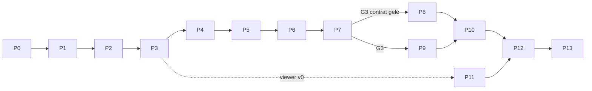

# ROADMAP — PRISM V2 (de bout en bout)

**Composant** : PRISM
**Statut** : [IMPLÉMENTATION EN COURS — SOCLES P7/P8/P11 ; P9/P10 AMORCÉS ; G1/G3 EN ATTENTE]
**Dernière mise à jour** : 3 novembre 2026
**Dépend de** : [`../governance/ROADMAP.md`](../governance/ROADMAP.md), [`VISION.md`](VISION.md), [`PERFORMANCE.md`](PERFORMANCE.md), [`TESTING.md`](TESTING.md)
**Source Monographie** : Annexe J (feuille de route V2)

---

## 1. Principes

- Road map **en ordre, sans dates**, comme celle du projet : l'ordre reflète les dépendances ; l'effort est donné en **taille relative** (S, M, L, XL), jamais en calendrier.
- **Portes de décision (G0…G8)** : une phase n'est franchie que si ses critères sont atteints ; une porte peut conclure à un repli.
- **Risque d'abord** : les benchmarks ciblent les risques importants ; selon la priorité du propriétaire, P2 peut avancer avant la clôture de G1, qui reste obligatoire avant validation d'intégration.
- **Contrat avant refonte cognitive** : le contrat est validé avec la cognition *actuelle* de SYNE (G3) avant la refonte de SYNE (G5).
- **Ablation avant conclusion** : aucune affirmation sur la coopération sans l'expérience d'ablation correspondante (G7).
- Aucune phase ne casse la V1 `1.x` tant que `2.0.0` n'est pas livrée (branche d'intégration dédiée).

## Suivi d'exécution

| Phase | État | Avancement / prochaine action |
| :-- | :-- | :-- |
| P0 — Cadrage | Implémentée | PRISM-001 à 005 implémentées ; build Windows réussi sur les 14 projets de la solution et cross-build des 12 projets historiques pour `linux-x64` réussi. Les projets `Prism.Bots` et `Prism.Bots.Tests`, ajoutés après cette passe, n'ont pas encore été recroisés pour Linux. La stratégie de branches V2 est documentée (`governance/GITFLOW.md` §8) et le glossaire complété (bloc, chunk/région, chantier, macro-action, pack, tag, tick V2). Exécution native Linux/CI reste à confirmer sur runner distant. |
| P1 — Spikes et benchmarks | Reportée à l'optimisation | Baseline indicative 250 ms/tick et seuil G1 3 ticks/s conservés comme repères provisoires ; B1–B6 initiaux documentés, dont B4 synthétique non représentatif du contrat différentiel. Le tick complet, les plafonds, le rendu Windows/Linux et les benchmarks seront réévalués lors d'une phase d'optimisation avec SYNE. G1 reste ouverte sans bloquer l'implémentation fonctionnelle. |
| P2 — Noyau du monde | Implémentée | PRISM-020–028 livrés et testés : registres, compilateur/validateur, pack minimal amorçable, grille 2.5D, RNG, empreintes, roue temporelle, ledger et tests générés d'ordre/idempotence. Les dépendances de packs restent une extension hors V2. |
| P3 — Génération et visualiseur de debug | En cours | PRISM-030–035 sont implémentées (socle). PRISM-036 fournit la sélection des sites sur six ressources accessibles, les planchers globaux de ressources vérifiés avant la recherche (code motivé `world.resources.below_floor`) et huit tentatives dérivées avec erreur structurée. PRISM-037 verrouille trois empreintes locales ; la comparaison CI Windows/Linux est reportée à une phase de validation ultérieure. PRISM-038 dispose d'un viewer OpenGL v0 avec maillage par région et caméra libre ; le test de démarrage Windows a réussi. Le support Linux (`LinuxGlfwPlatform`, diagnostics de plateforme) est en place et testé ; la validation graphique sur runner Linux reste à faire. Le benchmark PRISM-039 est reporté à la phase d'optimisation, conformément à la priorité du propriétaire. |
| P4 — Temps et mises à jour | Socle implémenté | PRISM-040–045 : calendrier, ordonnanceur, random ticks, croissance saisonnière, péremption paresseuse et propagation d'herbe configurée par le pack. PRISM-046 (benchmark B3) est reportée à la phase d'optimisation. |
| P5 — Corps, navigation, perception | Socle fonctionnel implémenté | PRISM-050–052 et 054–056 : cycle de vie, mouvement 2.5D/A*, perception différentielle plafonnée, arbitrage et accélération des chemins configurée par les tags/gabarits. La commande `Aller` est implémentée (chemin A* calculé à la réception, un pas par tick, ordre checkpointé) et la fusion des piles au sol de même taille est en place. PRISM-053 est implémentée mais non câblée : `RegionGraph` + `HierarchicalPathfinder` cherchent un corridor de régions avant l'A* cellulaire, avec repli exhaustif ; le chemin peut être plus long que l'optimum, donc la bascule dans `Aller` attend la mesure B1 de la phase d'optimisation. Restent les benchmarks PRISM-057 (reportés) ; les structures/chantiers sont suivis en P8. |
| P6 — Actions, macro-actions, conservation | En cours | PRISM-060–069 ont un socle testé : actions primitives, macro-actions d'obtention/fabrication/culture, transfert agent-agent et fuzz déterministe de 1 M de commandes. `Miner`, `Poser`, `Fabriquer`, `Labourer`, `Planter`, `Recolter`, `Consommer`, `Transferer`, `Prendre` et `Deposer` sont raccordées au dispatch du tick ; la pose de conteneurs et leur checkpoint sont intégrés, croissance/cultures utilisent les phases host. `DefinirAccesConteneur` configure les ACL par commande. La fraîcheur est portée par les piles (`FreshnessPermilleTicks`/`FreshnessUpdatedTick`) et la fusion au sol n'agrège que des piles d'état identique (`AddItem`). Les actions à durée occupent désormais l'agent (`ActionDurationTracker`, `agent_busy`, checkpointé avec le dispatch). La décroissance de fraîcheur est appliquée à la prise dans un conteneur. `Miner`, `Fabriquer`, `Labourer`, `Planter` et `Recolter` sont enregistrées par le dispatch et résolues à l'échéance ; le résultat est renvoyé à l'étape macro qui l'a demandée (`macro_step_deferred`, canal `DeferredActionResolutions`), qui n'est validée qu'avec les quantités réellement produites. |
| P7 — Contrat, hôte headless, persistance | En cours — socles PRISM-073/074/075/076/078 ; PRISM-077 épinglée (réduite) ; PRISM-081 gelée (doc) | Avec un pack, `Prepare` compile/génère déterministement ; commandes de cycle de vie, construction et actions primitives sont dispatchées. Les observations différentielles sont produites par agent et checkpointées avec l'historique de perception ; ledger, réservations de stations et roue d'événements sont checkpointés. Le flux publie aussi les snapshots d'entités, les deltas, les chantiers/effets et les checksums. Le message `metrics` (stocks, matière par `ruleId`, chantiers, réservations, effets, échecs) est publié et exposé par `/metrics` ; les payloads sont validés au contrat par commande et un test de reprise continu/restauré vérifie ticks, empreinte et entités. PRISM-077 dispose de `Prism.Bots` (bots aléatoire, glouton, planificateur et inactif `idle` déterministes, runner qui ne parle au monde que par le contrat, empreinte de run FNV-1a) et du CLI `prism-bots` qui porte la campagne dorée. L'optimisation du tick du 4 novembre 2026 a ramené le coût de 1,26–1,49 s à ~13,6 ms/tick/agent et `Prepare` de 21–27 s à 2,0–2,4 s : la campagne réduite 3 graines × 200 ticks × 3 bots est épinglée dans `DeterministicCampaignTests`, et la campagne complète 3 × 5 000 ticks est redevenue un gate manuel de quelques minutes (rejouée le 4 novembre, 9 empreintes publiées dans [`ISSUES.md`](ISSUES.md)). Les paramètres `perception` du pack (`nearRadius`, `midRadiusChunks`, `maxObservedPerAgent`) sont désormais compilés par `PerceptionSettingsRuntimeCompiler` et appliqués par `PrismHostRuntime`, ce qui rend le calibrage par pack effectif. PRISM-078 est implémentée : `CommandMatrixContractTests` couvre les 21 kinds sur les trois liaisons (23/23 verts). PRISM-081 est gelée en `1.0.0` côté document. Restent la compression, le point de reprise couplé SYNE, le run R2 et la preuve de déterminisme interplateforme. |
| P8 — Contenu, structures, chantiers | En cours — socles PRISM-090/091/092/093 | Compilation/runtime des gabarits, commandes host idempotentes, contributions avec débit atomique des matériaux au prorata, pose progressive, abandon, checkpoint host, snapshots des matériaux consommés/manquants et ACL propriétaire/groupe sont testés. La perception explicite des chantiers est raccordée au flux d'observations (entrée `ConstructionSite` : `siteId`, état, travail requis/achevé, diff apparu/modifié/disparu) ; le consommateur d'abri applique les ACL `use` au propriétaire, aux agents et aux groupes (résolus par `GroupMembership`) et expose le bonus dans l'auto-observation ; les autres effets, les chaînes de production et le run R1 restent à faire. Depuis le 4 novembre 2026, le consommateur d'effets couvre aussi `water_access` et `storage` : un agent dans un puits achevé peut boire (`Consommer` → `item_consumed` canal `source`, effet `drink_water`) sans nouveau champ de contrat (PRISM-096 partielle), et la péremption des conteneurs est appliquée à chaque tick, ralentie dans le volume d'un grenier achevé avec émission d'`item_spoiled` (PRISM-098 partielle). La chaîne outils est désormais jouée de bout en bout sur le pack minimal : mains nues → établi → pioche de pierre, palier de fer refusé sans pioche, puis minerai → four → lingots → pioche de fer (`ToolChainAcceptanceTests`), avec le chemin hôte `Poser`/`Fabriquer` différé (`ToolChainHostTests`, PRISM-094 partielle). Les chaînes agriculture et cuisson sont jouées sur le pack minimal (`CropChainAcceptanceTests`, `CookingChainAcceptanceTests`, PRISM-095/097) : labour à la houe, croissance printanière, récolte et réensemencement ; cuisson de trois blés au four avec conservation ×4 et énergie accrue. `shelfLifeTicks` est désormais appliqué à la création des piles (minage, récolte, artisanat) et la fusion n'unit que des piles de même fraîcheur, ce qui rend la péremption des conteneurs réellement observable. |
| P9 — Refonte SYNE | Adaptateur et boucle couplée amorcés | `PrismClient` fournit prepare/start/tick/stop HTTP et mapping BDI ; `PrismReadStreamClient` consomme le WebSocket en validant les enveloppes, les resynchronisations et les observations par agent. Cette session a livré `PrismObservationMapper`, `PrismCoupledRunner`, `CognitionPipeline.ApplyExternalObservations` et le mode CLI `--prism-url` : le transport est validé sur 1 000 ticks sans crash et les observations PRISM alimentent les croyances. Restent SYNE-220 (extraction du monde en 3 temps), SYNE-221 (mémoire spatiale par chunk), SYNE-222 (croyances recettes/structures/chantiers, sécurité alimentaire), SYNE-223 (planificateur, cache, replan), SYNE-224 (savoir des recettes), SYNE-225 (persistance couplée), SYNE-226 (doc), SYNE-227 (recalibrage de survie) et SYNE-228 (version `0.18.0`, contrat d'observabilité `0.6.0`), plus le run R2/R3. |
| P10 — ECHOS, Launcher, installateur | Socle ECHOS-100 commencé | ECHOS valide et persiste atomiquement les enveloppes du flux PRISM dans SQLite v8, avec `contentHash` et resynchronisation par snapshot ; l'adaptateur ne fabrique pas de métriques SYNE absentes du contrat. Le manifeste/host est raccordé au Launcher générique. Restent l'ingestion de production au cycle de run et les métriques (ECHOS-100), la refonte du moteur 6 (ECHOS-101), les indicateurs coopération/spécialisation/infrastructures/inégalité (ECHOS-102), la comparaison de runs avec premier tick de divergence (ECHOS-103), LAUNCHER-200/201/202, INSTALLER-200 et MOCK-200 (lane installer), et le packaging complet. |
| P11 — Visualiseur complet | En cours — socles PRISM-110/111/113/115 | Meshing glouton incrémental par région, budget par image, culling de frustum, occlusion ambiante topologique, cycle jour/nuit déterministe (`ViewerDayNightCycle`), modes caméra orbite/libre, grain procédural des matériaux, silhouettes voxel d'agents de démonstration, HUD de preview, inspecteur agent statique, suivi caméra de l'agent sélectionné et calque de zones activable sont intégrés au viewer v0. Le support Linux (`LinuxGlfwPlatform`, diagnostics) est en place et testé ; la validation graphique sur runner Linux reste à faire. Le client de lecture `ViewerReadStreamClient`/`ViewerLiveSession` est implémenté et testé (séquences, resynchronisation par snapshot) mais n'est pas encore câblé au CLI `--connect` : le suivi et les entités restent statiques. Le magasin suit désormais les sites de construction (`ConstructionSite`, 62/62 verts) et les silhouettes d'agents de démonstration sont visibles. Restent Atlas (111), le rendu fantôme des actions/chantiers et les entités live (112), le suivi/coupe (113), l'inspecteur et les sept calques (114), le câblage CLI `--connect`, le mode embarqué et le rejeu (115), les interventions journalisées (116), le test d'indépendance du rendu (117) et le manifeste viewer + B8 (118). |
| P12–P13 | À faire | Calibrage, ablations, validation de livraison, benchmarks et validations par plateforme sont différés jusqu'à l'implémentation complète, selon la priorité du propriétaire. |

P11 : l'inspecteur agent est amorcé pour les snapshots de démonstration (sélection `Tab`, ID, position, inventaire) ; il ne remplace pas l'inspection live exigée par PRISM-114.

**Validation différée à la demande du propriétaire :** aucun benchmark/performance ni comparaison de tests Windows/Linux n'est exécuté pendant cette étape. Les suites fonctionnelles locales restent exécutées.

Le choix de géométrie 2.5D et le transport de référence sont décidés par ADR-011/012. Selon la priorité donnée par le propriétaire, l'implémentation fonctionnelle des phases P2–P5 avance en parallèle de G1 : les budgets détaillés et les optimisations seront réévalués sur l'intégration PRISM/SYNE. G1 n'est pas considérée franchie et reste un jalon de validation avant l'intégration complète.

## 2. Position dans la feuille de route du projet

La phase 4 de `docs/governance/ROADMAP.md` (*Intégration Unreal*) est **close** (V1 livrée). La V2 ouvre une nouvelle phase transverse :

| Phase projet | Intitulé | Sortie |
| :-- | :-- | :-- |
| **6 (nouvelle)** | Refonte PRISM V2 (monde voxel autoritaire) | PRISM `2.0.0`, SYNE `0.18.0`+, ECHOS adapté, Launcher/installateur adaptés, LIVEX `2.0.0` |

## 3. Vue d'ensemble

| Phase | Intitulé | Taille | Porte | Sortie principale |
| :-- | :-- | :-- | :-- | :-- |
| **P0** | Cadrage | S | G0 | Documentation V2 relue, décision géométrie/transport enregistrée, solution et CI |
| **P1** | Spikes et benchmarks 2.5D | M | **G1** | Rapports initiaux B1…B6 ; tick complet ≥ 3 ticks/s à 1 000 agents ; HTTP/WebSocket JSON et rendu validés par mesures représentatives |
| **P2** | Noyau du monde | L | — | Registres, contenu validé, chunks, PRNG, empreintes, planificateur d'événements, audit |
| **P3** | Génération et visualiseur de debug | L | **G2** | Mondes dorés, générateur par seed, viewer v0 |
| **P4** | Temps et mises à jour | M | — | Calendrier, croissance, péremption, mises à jour |
| **P5** | Corps, navigation, perception | XL | — | Agent physique, A* 2.5D à transitions d'altitude, perception, conflits |
| **P6** | Actions, macro-actions, conservation | L | — | Primitives, macro-actions, audit de conservation |
| **P7** | Contrat, hôte headless, persistance | XL | **G3** | Contrat 1.0.0 gelé, hôte, reprise bit-à-bit, validation avec la cognition actuelle |
| **P8** | Contenu, structures, chantiers | L | **G4** | Cinq chaînes jouées de bout en bout, structures, accès |
| **P9** | Refonte de SYNE (cognition + extraction du monde) | XL | **G5** | Runs SYNE + PRISM sans monde dans SYNE |
| **P10** | ECHOS, Launcher, installateur | L | **G6** | Pile complète orchestrée, métriques de coopération |
| **P11** | Visualiseur complet | L | — | Rendu, inspection, rejeu, interventions journalisées |
| **P12** | Calibrage et validation expérimentale | XL | **G7** | Critères de viabilité atteints, ablations A1…A8 |
| **P13** | Candidate de livraison | M | **G8** | PRISM `2.0.0`, LIVEX `2.0.0`, migration documentaire |

### Voies parallèles

Après la porte G3, trois voies avancent **en parallèle** : *monde* (P8), *cognition SYNE* (P9), *rendu* (P11). P10 attend P8 et P9. P12 attend P10 et P11.

## 4. Les portes de décision

| Porte | Question posée | Critères de passage | Si échec |
| :-- | :-- | :-- | :-- |
| **G0** | La conception est-elle assez cohérente pour démarrer ? | Revue croisée terminée ; ADR-004…010 relus ; solution, CI et analyseur d'architecture en place | Corriger la documentation |
| **G1** | Le modèle 2.5D et le transport tiennent-ils les budgets ? | B1…B6 mesurés ; le budget de `PERFORMANCE.md` §1 est atteint à 100 agents et le tick complet atteint ≥ 3 ticks/s à 1 000 ; B4/B5 mesurent les DTO réalistes ; spike Silk.NET montre les surfaces 2.5D sous Windows et Linux | Une itération d'optimisation ciblée ; si nécessaire réviser le budget sur les mesures du tick complet ou ouvrir une décision de transport sur preuve |
| **G2** | Le monde généré est-il reproductible et jouable ? | Mondes dorés sur 3 graines ; empreintes identiques Windows/Linux ; contrôles de jouabilité passent ; viewer v0 montre le monde | Revoir paramètres de bruit, structure de génération |
| **G3** | Le contrat tient-il avec une vraie cognition ? | Contrat 1.0.0 gelé ; tests de contrat sur 2 liaisons ; reprise bit-à-bit ; run R2 (SYNE actuel + PRISM) reproductible ; analyseur : aucun flottant dans Core | Ne pas démarrer P8/P9 ; réviser le contrat (MAJOR en pré-release) |
| **G4** | Les chaînes existent-elles vraiment ? | Les 5 chaînes jouées par bots (R1) ; audit de conservation vert ; graphe amorçable à mains nues | Revoir contenu, recettes, durées |
| **G5** | SYNE est-il allégé et capable ? | `Simulation.Core` sans classe de monde ; agents SYNE accomplissent ≥ 3 chaînes sans plan scripté ; R3 reproductible ; budget SYNE tenu | Réduire la profondeur de planification ; garder l'adaptateur minimal et rouvrir ADR-009 |
| **G6** | La pile est-elle orchestrée et observable ? | Session Launcher SYNE + PRISM + ECHOS ; ECHOS ingère le flux PRISM ; manifestes valides ; installateur installe l'hôte | Corriger les contrats d'intégration |
| **G7** | Le monde sert-il l'hypothèse ? | Critères V1…V7 (`TESTING.md` §5) sur 3 graines ; ablations A1…A8 exécutées ; rapport expérimental pérenne publié (résultat positif **ou négatif**) | Ajuster le contenu ; sinon publier le résultat négatif et rouvrir ADR-004 |
| **G8** | Peut-on livrer ? | Tests verts, couverture ≥ 80 %, notices tierces, documentation migrée, V1 archivée, release candidate installée sur machine propre Windows et Linux | Corriger |

## 5. Contenu par phase

### P0 — Cadrage
**Objectif** : démarrer avec une conception cohérente.
**Travaux** : relire et corriger ce dossier ; créer la solution `prism/` et la CI ; glossaire ; stratégie de branche (branche d'intégration `feature/prism-v2`, `release/2.0.0`).
**Sortie** : G0.

### P1 — Spikes et benchmarks
**Objectif** : identifier les risques de performance et de transport sans retarder les fondations de production.
**Travaux** : prototypes jetables (colonnes 2.5D + générateur de surface) ; B1…B6 ; comparaison WebSocket/embarqué et compression des régions ; spike Silk.NET (fenêtre, une région maillée) ; spike planificateur (B7, côté SYNE). La baseline reste indicative à 250 ms/tick (+25 % par rapport à l'hypothèse initiale), avec une marge de 10 ms. B1 (81,2 ms/1 000 routes) et B2 (32,7 ms de calcul, 34,8 ms d'encodage) cadrent les coûts isolés. B4 montre qu'un snapshot synthétique complet est trop coûteux (p95 93,67 ms/tick), mais le contrat est différentiel ; aucune optimisation supplémentaire n'est lancée avant la mesure sur l'intégration PRISM/SYNE. Les résultats servent de repères et G1 reste ouverte.
**Sortie** : G1 avant la validation d'intégration complète ; P2 peut avancer en parallèle selon la priorité du propriétaire. Le code de prototype est **jeté** ou réécrit proprement.

### P2 — Noyau du monde
**Travaux** : registres d'identifiants stables ; compilateur/validateur de contenu ; pack minimal ; colonnes et régions 2.5D ; `Mix64`, flux nommés, `xoshiro256**` ; empreintes ; roue temporelle ; registre d'audit ; analyseur de dépendances et de flottants. PRISM-020/023/024/025/026/027 sont implémentées et testées. PRISM-021 valide les références et contraintes principales du schéma, y compris les paramètres de calibrage, les tags hiérarchiques et les drops conditionnels ; les dépendances entre packs et les extensions post-V2 restent hors du compilateur courant. PRISM-022 est implémentée avec un pack v0 et un test de progression amorçable. Les seuils de performance restent à revisiter sur le tick intégré.
**Critères** : tests de vecteurs de PRNG, round-trip colonnes/régions/surcharges, validation de pack avec erreurs structurées.

### P3 — Génération et visualiseur de debug
**Travaux** : bruit entier, relief, bordure, zones, strates, filons, eau, forêts, sites d'apparition, contrôles de jouabilité et tentatives ; mondes dorés ; **viewer v0** (fenêtre, meshing naïf, caméra libre) qui sert d'outil de réglage.
**Sortie** : G2.

### P4 — Temps et mises à jour
**Travaux** : calendrier, mises à jour programmées avec gigue, mises à jour aléatoires à compteur, croissance du blé et flétrissement, péremption paresseuse, propagation d'herbe ; B3 sur code de production.

### P5 — Corps, navigation, perception
**Travaux** : agents physiques, graphe de mouvement de surface 2.5D, A* entier borné, pathfinding hiérarchique par régions, perception à trois niveaux et différentielle, arbitrage de conflits, chemins aménagés ; B1/B2 sur code de production. PRISM-050–052 et 054–056 sont implémentées au niveau du noyau. La hiérarchie et les benchmarks sont reportés à l'optimisation ; le raccordement aux commandes/ticks est en place (commande `Aller`, ordre checkpointé) et la modélisation complète des structures/chantiers reste à faire.

### P6 — Actions, macro-actions, conservation
**Travaux** : miner, poser, conteneurs, fabriquer, planter/récolter, consommer/boire, durabilité, transfert atomique, macro-actions (machines à états, indices de croyance, échecs motivés) ; audit de conservation et tests par propriétés (fuzz de commandes). PRISM-060/061 disposent d'un socle testé : résolution du bloc de surface/surcharge, garde de portée/perception, palier d'outil, durée selon dureté/maîtrise, drops déterministes probabilistes, inventaire/sol, ledger, association explicite objet-matériau, refus des cases occupées par un agent. PRISM-062 ajoute le stockage borné par emplacements, les accès propriétaire/agent/groupe opaque et les transferts tout-ou-rien. PRISM-063 compile les entrées exactes/par tags, vérifie station/outils/maîtrise, réserve la station selon la durée et échange entrées/sorties atomiquement avec le ledger. PRISM-064 lie les graines explicitement aux cultures, laboure les sols déclarés avec une houe, plante avec conditions eau/sol et récolte les drops configurés uniquement à maturité. PRISM-065 consomme une unité d'objet `edible` ou boit à une source `drinkable`, transmet les effets configurés dans `item_consumed` et audite la destruction des objets ; les sources sont inchangées. PRISM-066 conserve la durabilité restante dans chaque pile d'outil, use selon `usePerAction`, détruit l'outil à zéro et audite `wear` pour le minage, le labourage et les recettes avec outil ; les transferts agent/conteneur préservent cet état. PRISM-067 orchestre l'obtention depuis les sources perçues uniquement, la fabrication et le cycle labourage→plantation→attente de maturité→récolte sur ordre ; la perception ne donne lieu à aucune recherche globale. PRISM-068 transfère agents à agents de manière tout-ou-rien. PRISM-069 exécute un million de transferts/consommations à seed fixe avec audits globaux périodiques. La fraîcheur est matérialisée dans les piles d'inventaire et au sol : les additions/fusions n'agrègent que des piles de même fraîcheur et de même durabilité, et un dépôt de pile périmable passe par `GroundItemStore.AddItem`. Les actions à durée occupent l'agent jusqu'à `tick + durée` (`ActionDurationTracker`, échec `agent_busy`, état checkpointé avec la fenêtre d'idempotence). Les piles d'inventaire et de conteneur portent leur fraîcheur et un conteneur l'applique à la prise (`ApplyDecay`, ledger `spoil`, `item_spoiled`). Le balayage de fraîcheur des inventaires est appliqué à chaque tick de cycle de vie et publie les événements de péremption. Les cinq actions à durée (`Miner`, `Fabriquer`, `Labourer`, `Planter`, `Recolter`) sont résolues à l'échéance (`action_started` puis `action_completed`, `Annuler` pour interrompre). Les macro-actions n'avancent plus sur un effet non appliqué : le dispatch renvoie le résultat à l'étape en attente, qui publie `macro_step_deferred` puis se valide avec les quantités produites. Une macro de minage occupe donc l'agent pendant toute la durée configurée.

### P7 — Contrat, hôte headless, persistance

**Travaux** : contrat, idempotence, ordre du tick, hôte HTTP/WebSocket, flux de lecture, points de reprise, bots, manifeste Launcher, adaptateur SYNE, preuve interplateforme et run R2. PRISM-070–072 restent le socle DTO/dispatch/orchestration. PRISM-073/074 ajoutent le cycle de contrôle HTTP authentifié et les endpoints WebSocket lockstep/read-only. `Prepare` compile un pack et génère le terrain ; PRISM-075 publie snapshots, deltas régionaux, entités (agents/inventaires/objets au sol), chantiers et effets actifs, ainsi que des checksums périodiques. PRISM-076 persiste ces agents et objets avec le monde, les chantiers, les ordres de déplacement, le dispatch/idempotence, la cadence automatique et la rotation ; les autres systèmes métier et le point de reprise couplé SYNE restent à faire, la reprise continu/restauré étant vérifiée par test. PRISM-080 possède un manifeste de host validé côté Windows (endpoint `readStream` avec `path` `/data/read` et `launchArgument` `--read-port`, binaire autonome produit par `prism/scripts/publish.sh`) ; le packaging final et la validation Linux restent à faire. PRISM-077 est partielle (quatre bots, campagne dorée non épinglée) et PRISM-078 est implémentée (matrice des 21 kinds sur les trois liaisons). Restent PRISM-079 et PRISM-081/082, le raccordement des systèmes et le client SYNE. G3 n'est pas franchie.
**Sortie** : G3 — **le contrat est gelé en `1.0.0`** ; tout changement ultérieur est une version.

### P8 — Contenu, structures, chantiers
**Travaux** : compilation runtime des gabarits et validation de placement déterministe (socle PRISM-090) ; chantiers (états, perception, pose progressive), structures (effets, intégrité), accès/propriété, cinq chaînes complètes, maîtrise, usure (optionnelle, désactivée), leviers d'ablation ; R1 (bots planificateurs).
**Sortie** : G4.

### P9 — Refonte de SYNE (voie parallèle)
**Travaux** (issues `SYNE-2xx`) : retirer le monde de `Simulation.Core` (§ `RESPONSIBILITIES.md` §4) en trois temps (parallèle → bascule par profil → suppression) ; mémoire spatiale par chunk ; croyances sur recettes/structures/chantiers ; désirs instrumentaux et sécurité alimentaire ; planificateur (GOAP ou HTN) ; adaptateur `PrismClient` complet ; savoir des recettes (simple, puis riche) ; calibrage cognitif initial ; version SYNE `0.18.0`, contrat d'observabilité `0.6.0`.
**Sortie** : G5.

### P10 — ECHOS, Launcher, installateur
**Travaux** : socle ECHOS-100 : validation du flux versionné, persistance atomique des enveloppes PRISM et reprise par snapshot après un saut de séquence ; restent l'ingestion raccordée au cycle de run, la refonte du moteur 6 (durabilité des ressources) sur stocks/production/usure, les nouveaux indicateurs (coopération, spécialisation, infrastructures, inégalité de stocks), la comparaison de runs avec `contentHash` ; Launcher : PRISM requis par session, exigences §11 réécrites, `.livexp` avec `contentHash` ; installateur : paquets .NET ; retrait/réorientation de `syne-mock`.
**Sortie** : G6.

### P11 — Visualiseur complet (voie parallèle)
**Travaux** : meshing glouton incrémental (socle intégré au viewer v0), atlas procédural, occlusion ambiante, cycle jour/nuit (implémenté : `ViewerDayNightCycle`, teinte lumineuse et HUD calendrier), agents, chantiers fantômes, caméras, inspecteur, calques, client de lecture (`ViewerReadStreamClient`/`ViewerLiveSession` : socle testé, non câblé au CLI), rejeu, interventions journalisées, captures, mode client/embarqué, manifeste viewer ; B8. Les mesures et validations Windows/Linux sont différées jusqu'à la fin de l'implémentation.

### P12 — Calibrage et validation expérimentale
**Travaux** : calibrage itératif (ordre dans `TESTING.md` §7) avec ADR de calibrage ; R3, R4 ; critères V1…V7 ; ablations A1…A8 (≥ 5 graines, 10 000 ticks) ; rapport expérimental pérenne (comme `EXPERIMENTAL-VALIDATION-2026-10.md`) ; ajustements de contenu ; figement des empreintes dorées.
**Sortie** : G7.

### P13 — Candidate de livraison
**Travaux** : régression de performance ; notices tierces ; archivage de la documentation V1 en `legacy-unreal/` ; ADR-002/003 `Superseded`, ADR-004…010 `Accepted` ; mise à jour de `README`, `VERSIONING`, `governance/*`, site, monographie, FAQ ; installation sur machine propre ; tags `prism-v2.0.0`, `livex-v2.0.0`.
**Sortie** : G8.

## 6. Définition de terminé pour PRISM 2.0.0

1. Monde voxel déterministe, reprise bit-à-bit, empreintes identiques Windows/Linux.
2. Contrat `1.0.0` documenté, testé sur deux liaisons ; échecs toujours motivés.
3. Cinq chaînes de production jouées de bout en bout ; audit de conservation vert.
4. Hôte headless conforme au manifeste Launcher ; visualiseur Silk.NET livré.
5. SYNE sans classe de monde ; agents planifiant à partir de recettes ; ECHOS ingérant PRISM.
6. Critères V1…V7 atteints ; ablations publiées avec leurs limites.
7. Performances : cibles §1 de `PERFORMANCE.md` atteintes ou ajustées par ADR.
8. Documentation migrée ; couverture ≥ 80 % ; notices tierces complètes.

## 7. Risques

| # | Risque | Prob. | Impact | Réponse | Porte |
| :-- | :-- | :-- | :-- | :-- | :-- |
| R1 | Pathfinding 2.5D / perception hors budget à 1 000 agents | Moy. | Élevé | Benchmarks d'abord, pathfinding hiérarchique, perception incrémentale ; ajuster les budgets sur preuve | G1 |
| R2 | La coopération n'émerge pas | Moy. | Élevé (scientifique) | Ablations ; publier le résultat négatif ; ajuster les coûts | G7 |
| R3 | Le planificateur dépasse le budget de SYNE | Moy. | Élevé | Profondeur bornée, cache, replan sur échec seulement | G5 |
| R4 | Déterminisme rompu par un flottant ou un ordre | Moy. | Élevé | Analyseur CI, empreintes, test Windows/Linux dès P3 | G2, G3 |
| R5 | Dérive de portée (météo, faune, construction libre) | Élevée | Moyen | Hors périmètre explicite (`VISION.md` §4) | toutes |
| R6 | Dette de rendu absorbe le temps | Moy. | Moyen | Rendu après le gel du contrat ; viewer v0 minimal | P11 |
| R7 | Calibrage plus long que prévu | Élevée | Moyen | Ordre de calibrage fixé ; ADR par itération | G7 |
| R8 | Invalidation des calibrages SYNE existants | Certaine | Moyen | Assumée : recalibrage ciblé P12 | G5, G7 |
| R9 | Charge de travail d'une seule personne | Élevée | Élevé | Voies parallèles limitées ; tailles relatives ; périmètre minimal d'abord | toutes |
| R10 | Dépendances graphiques (pilotes, Wayland) | Moy. | Moyen | CI rendu logiciel, tests Windows/Linux, `--embedded` optionnel | P11 |

## 8. Optimisation du modèle retenu (portes G1 / G5)

Le modèle de données de PRISM (matériaux, recettes, structures, contrat) est **indépendant de la géométrie**. La géométrie 2.5D est retenue par ADR-011. Si navigation, perception ou rendu restent hors budget :

1. Optimiser l'indexation des régions, le pathfinding hiérarchique, les caches et les observations différentielles.
2. Conserver **tout le contenu** et le contrat ; mesurer chaque changement contre les rapports B1…B8.
3. En dernier recours, réduire par décision documentée la population de référence et garder 1 000 comme objectif de charge.

## 9. Après la V2 (non planifié)

Écoulement de l'eau (rouvre ADR-010) ; construction libre ; météo et faune ; occultation de communication par le monde ; packs de contenu signés et modding ; mode joueur-habitant ; génération hors boucle de recettes/noms ; monde plus grand ; carte multi-biomes étendue.

## 10. Dépendances externes

| Dépendance | Nécessaire pour | Risque |
| :-- | :-- | :-- |
| .NET (version du dépôt) | Tout | Faible |
| Silk.NET, UI immédiate | Viewer | Pilotes, licences à confirmer |
| Runners CI Windows et Linux | Déterminisme inter-plateformes | Disponibilité |
| Mesa (rendu logiciel) | Tests de rendu | Optionnel |

## 11. Références

[`VISION.md`](VISION.md) · [`PERFORMANCE.md`](PERFORMANCE.md) · [`TESTING.md`](TESTING.md) · [`RESPONSIBILITIES.md`](RESPONSIBILITIES.md) · [`ISSUES.md`](ISSUES.md) · [`adr/README.md`](adr/README.md)

## Mises à jour

| Date | Changement | Motif |
| :-- | :-- | :-- |
| 6 novembre 2026 | P8 : toutes les chaînes fonctionnelles couvertes (outils, agriculture, cuisson, eau, stockage), effets restants intégrés au mouvement, bots scriptés eau/stockage | Avancement fonctionnel P8 |
| 2 novembre 2026 | Suivi d'implémentation P0/G0 et état des validations ajouté | Démarrage PRISM V2 |
| 2 novembre 2026 | Avancement P7/P8/P11 et validations différées documentés | Host, gabarits et meshing incrémental |
| 2 novembre 2026 | Matériaux procéduraux et silhouettes d'agents de démonstration ajoutés au viewer | P11 |
| 2 novembre 2026 | HUD de preview ajouté avec métadonnées réellement disponibles et raccourcis | P11 |
| 2 novembre 2026 | Calque visuel des zones et reconstruction limitée par budget ajoutés | PRISM-114 |
| 2 novembre 2026 | Culling de frustum appliqué aux régions avant les draw calls | P11 |
| 2 novembre 2026 | Occlusion ambiante topologique ajoutée aux sommets des surfaces | P11 |
| 3 novembre 2026 | Revue fonctionnelle locale P1–P11 ; issues partielles et validations différées précisées | Suites fonctionnelles locales ; benchmarks, calibrage et comparaisons Windows/Linux restent reportés |
| 3 novembre 2026 | PRISM-077 amorcé (bots, runner, empreinte de run) et coût du tick mesuré sur Windows | Implémentation des bots ; benchmarks toujours différés |
| 3 novembre 2026 | Audit de cohérence entre la documentation et le code P0–P11 : statuts P7/P11, PRISM-078, bots, viewer Linux et comptage des tests alignés | Mise à jour globale après revue du code |
| 4 novembre 2026 | Optimisation du tick : index des surcharges par région, cache des masques de tags par région, lecture des surcharges limitée au rayon de perception, reprise de croissance ponctuelle et profilage `PRISM_TICK_PROFILE` | 1,26–1,49 s → 13,6 ms/tick/agent, `Prepare` 21–27 s → 2,0–2,4 s ; campagne réduite 3 × 200 ticks épinglée (PRISM-077/079) |
| 4 novembre 2026 | Campagne complète 3 graines × 5 000 ticks × 3 bots rejouée (9 empreintes publiées) ; paramètres `perception` du pack câblés dans le host ; contrat gelé en `1.0.0` | Gate manuel de release PRISM-077 ; calibrage par pack effectif (PRISM-054/079) ; PRISM-081 |
| 4 novembre 2026 | P8 : consommateur d'effets `water_access`/`storage`, puits buvable, péremption des conteneurs à chaque tick et ralentissement en grenier | PRISM-096/098 (partielles) |
| 4 novembre 2026 | P8 : chaîne outils jouée de bout en bout (établi, palier de fer, four, pioche de fer) et chemin hôte `Poser`/`Fabriquer` différé | PRISM-094 (partielle) |
| 4 novembre 2026 | P8 : cycle agriculture (houe, eau, croissance printanière, récolte, réensemencement) et cuisson (`bake_flatbread`) mesurés ; `shelfLifeTicks` appliqué à la création des piles, campagne 5 000 ticks rejouée à l'identique | PRISM-095/097 |
| 4 novembre 2026 | P9/P10/P11 : `PrismObservationMapper`, `PrismCoupledRunner`, `ApplyExternalObservations` et CLI `--prism-url` (transport couplé validé 1 000 ticks) ; suivi des sites de construction côté viewer (62/62) | SYNE-220/221 (socle), PRISM-082 (partielle), PRISM-112 |
| 1er novembre 2026 | Création | Refonte V2 |
