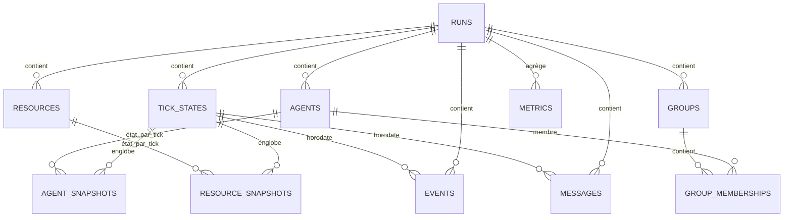

# PERSISTENCE.md

**Composant** : SYNE
**Statut** : [STABLE]
**Dernière mise à jour** : 6 novembre 2026
**Dépend de** : `DATA_MODEL.md`, `DETERMINISM.md`
**Source Monographie** : ADR-011 (Persistance JSON → SQLite), Annexe G (schéma SQLite V2.0), §3.6.4 (sérialisation état RNG)

---

## 1. Objectif

La persistance garantit la **sauvegarde** et la **reprise exacte** de la simulation, avec une garantie de **déterminisme bit-à-bit** : reprendre au tick 1000 et poursuivre doit produire exactement les mêmes événements qu'une exécution ininterrompue.

## 2. Stratégie en deux versions (ADR-011)

| Version | Format | Usage |
| :-- | :-- | :-- |
| **V1** | JSON | Simple, inspectable, débogage |
| **V2** | SQLite | Transactionnalité, évolution du schéma, requêtes analytiques (ECHOS), migration versionnée |

- SQLite intégré via NuGet (`Microsoft.Data.Sqlite` 10.0.12) — voir ADR-011.
- Le format JSON reste utilisable en debug à côté du SQLite (`SimulationSnapshotCodec`, déterministe).
- La migration V1 → V2 est documentée par scripts SQL.

## 3. Schéma SQLite V2.0 (Annexe G) — 11 tables

### Tables clés

1. **runs** — identité du run : `id`, `name`, `started_at`, `ended_at`, `seed`, `config`, `total_ticks`.
2. **tick_states** — état à un tick : `run_id`, `tick_number`, `state`, `rng_state` (état 4×64 bits du PRNG), `timestamp`. **`state` = snapshot JSON déterministe complet (monde + cognition, `SimulationSnapshotCodec`)** — c'est la colonne capitale de la reprise bit-à-bit.
3. **agents** — entités : `id`, `run_id`, `species`, `name`, `birth_tick`, `death_tick`, `current_state`, `initial_traits`.
4. **agent_snapshots** — état par tick du modèle réel V0.1 : position x/y, **energy, hunger, thirst, fatigue** (état des besoins — le modèle n'a pas de `health` distincte), `current_action`, `action_progress`, beliefs, goals, relationships, memory.
5. **resources** — ressources : type, position, quantity, capacity.
6. **resource_snapshots** — quantité par tick.
7. **groups** — groupes : name, formation_tick, dissolution_tick, leader_id, avg_cohesion.
8. **group_memberships** — appartenances : role, joined_tick, left_tick.
9. **events** — événements : type, entity_id, target_id, details.
10. **messages** — communications : type, sender_id, receiver_id, content, confidence, hops.
11. **metrics** — agrégats par tick (alive_count, moyennes santé/énergie/faim/soif, totaux décès/naissances/conflits/coopérations/groupes/messages).

> **Implémentation V0.1 (PR U8)** : `SqlitePersistenceStore` crée les 11 tables (`PRAGMA user_version = 2`). Le run est identifié par `run_id` ; `tick_states.state` porte le snapshot bit-à-bit complet ; les tables relationnelles `agents`/`resources`/`groups`/`resource_snapshots`/`metrics` sont peuplées à chaque sauvegarde en sous-ensemble relationnel de ce snapshot. `events`/`messages`/`agent_snapshots` restent prêtes à recevoir l'alimentation analytique (ECHOS) — hors périmètre V0.1.

## 4. État RNG et reprise exacte

- L'**état complet du PRNG (4 × ulong)** est sauvegardé dans `tick_states.rng_state`.
- Reprise au tick N : charger `rng_state`, l'état du monde à N, poursuivre. Pas de re-détermination par re-jouage.
- Règle : `System.Random` est interdit (non stable entre runtimes, état non sérialisable) — §3.6.3.
- **Snapshot bit-à-bit (`SimulationSnapshot`)** : qui — monde (taille + cellule, obstacles, entités au trait près, réserves **en place** `ResourceStocks.RestoreState`), cognition par entité (besoins, mémoire+séquence, croyances, confiance, files de messages non éphémères + relais, taux de succès, intention, objectif collectif, **holdover `LastDecision`**), groupes actifs + `NextGroupId`, et le PRNG 4×64. Les états dérivés (grille spatiale, cache A*, buffers par-tick) sont reconstruits déterministiquement à la restauration. Validé par `PersistenceTests.ReloadFromSnapshot_ContinuesBitForBitIdenticalToUninterruptedRun` (hash bit-à-bit du run relancé == run ininterrompu).

Les livres (SYNE-121) sont inclus dans le `WorldSnapshotDto` (contenu, auteur, tick d’écriture et lecteurs) afin que la reprise conserve les consultations déjà enregistrées. Le codec JSON évolue au schéma 3 ; le schéma relationnel SQLite reste à la version 2.

### 4.1 Ajouts P9 au snapshot (tous additifs)

| Élément | Où | Neutralité |
| :-- | :-- | :-- |
| **Mémoire spatiale par chunk** (SYNE-221) | `Spatial` par esprit : `chunkX`, `chunkY`, `tagMask`, `confidence`, `lastSeenTick` | Absente quand vide ⇒ empreintes des runs sans résumé de région **inchangées** |
| **Croyance durable** (SYNE-222/224) | Drapeau `durable` sur `BeliefSnapshotDto` | Sérialisé seulement quand vrai (`WhenWritingDefault`) ⇒ aucune croyance ordinaire alourdie |
| **Inventaire** (D8) | Quantités par `ResourceKind` | Déjà persisté ; restauré seulement si l'inventaire est actif |

### 4.3 Snapshot scindé : cognition seule (étape 3a de SYNE-220, 6 novembre 2026)

Le snapshot ne suppose plus que SYNE possède le monde. `SimulationSnapshot.World` est
**optionnel** et `SimulationSnapshotCodec` expose deux captures :

| Capture | Monde | Usage |
| :-- | :-- | :-- |
| `Capture(loop)` | complet (`world` : taille, obstacles, entités, gisements, réserves, livres, territoires) | run **local**, reprise autosuffisante — format et hash **inchangés** (le champ `worldReference` n'est écrit que pour une capture cognitive) |
| `CaptureCognition(loop, contentHash?)` | **absent** | run **couplé** : le monde appartient à PRISM, seul l'état que l'hôte ne peut pas reconstruire est persisté |

- Un snapshot cognitif porte à la place une **référence de monde** `worldReference { width, height, cellSize, contentHash? }` :
  dimensions et cellule attendues, et l'empreinte du contenu PRISM quand l'appelant la fournit. Ce n'est pas un monde —
  aucune entité, aucun gisement — donc il ne peut pas être restauré à la place du monde autoritaire.
- `SimulationSnapshotRestorer.Restore` **refuse explicitement** un snapshot sans monde (il reconstruirait une boucle vide
  et la ferait passer pour une reprise) ; le chemin couplé passe par `RestoreCognition`, qui ne touche pas au monde.
- `SqlitePersistenceStore` refuse de même un snapshot cognitif : les tables relationnelles (`agents`, `resources`,
  `metrics`) décrivent le monde, absent de ce snapshot.
- **Neutralité locale** : un run local capture et restaure par les mêmes chemins qu'avant, et le JSON d'un snapshot complet
  reste identique (absence déclarée par `WhenWritingNull`, jamais un monde vide de remplissage).
- Reste ouvert : l'étape **3b** (perception/action par le flux d'observations, aujourd'hui `Aller`/`Consommer` seulement)
  puis **3c** (suppression du monde local) — voir `docs/prism/RESPONSIBILITIES.md` §4.1.

> Le snapshot SYNE reste autosuffisant pour un run local ; il cesse de l'être — volontairement — pour un run couplé.

### 4.2 Point de reprise couplé (SYNE-225)

En mode couplé, deux sauvegardes doivent rester **alignées** : le checkpoint PRISM (qui contient le monde) et le snapshot SYNE (qui contient la cognition).

- `CoupledCheckpointStore.Save` écrit `<checkpointId>.syne.json` de façon **atomique** (fichier `.tmp` puis remplacement) : un arrêt brutal ne laisse jamais un snapshot tronqué à la place d'un point de reprise valide. Depuis l'étape 3a, ce fichier porte un snapshot **cognitif seul** (`CaptureCognition`, §4.3) — le monde ne voyage plus en double.
- L'enveloppe porte `schema` (= 1), `checkpointId`, `tick`, l'**empreinte couplée** (`CoupledFingerprint`) et le **hash du snapshot** (`SimulationSnapshotCodec.Hash`).
- `Load` **refuse** — explicitement, jamais silencieusement — un snapshot dont le tick ne correspond pas au checkpoint PRISM restauré, dont le hash de contenu ne correspond pas (fichier corrompu ou édité), ou qui est absent.
- Le snapshot contient le dernier tick **achevé**, que PRISM refuse de rejouer (`unexpected_tick`) : la reprise demande `NextTickAfterRestore(lastCompletedTick)`.
- La reprise restaure la **cognition seule** (les entités du monde viennent de PRISM) et est vérifiée bit-à-bit : un run couplé reprit redonne l'empreinte du run continu.

## 5. Sauvegarde automatique

- `simulation.autoSaveEveryNTicks` (défaut 1000) et `maxBackups` (défaut 5) — Annexe H.
- Sauvegarde atomique (transaction SQLite en V2).
- **V0.1** : le hook est câblé dans `SimulationLoop.AdvanceOneTick` sur le constructeur autosave (`Action<SimulationLoop>`), déclenché à chaque multiple de `autoSaveEveryNTicks` — purement en écriture, **aucun tirage du PRNG** ⇒ le déterminisme est inaltéré (vérifié par l'épinglage des checksums).
- La rotation `maxBackups` purge les runs les plus anciens dès « garder les N+ récents » (θ : la purge est documentée comme politique simple — compression hors périmètre).

## 6. Compatibilité et migration

- `schemaVersion` propre à la persistance, versionnée (`SchemaVersion = 3` pour le snapshot JSON (livres SYNE-121), `PRAGMA user_version = 2` pour le schéma SQLite).
- Changements de schéma = script de migration + évolution MINOR/MAJOR selon `VERSIONING.md` (format de persistance = contrat).

---

## Points restés ouverts dans ce document
- Politique de compression/archivage des vieux runs (rétention) — pas spécifié dans la Monographie (rotation simple `maxBackups` en V0.1).
- **SYNE-225, reste** : retrait des tables du monde (dépend de l'étape 3 de SYNE-220) et jeu complet de points de reprise couplés (reprise après un saut de séquence PRISM, rotation des checkpoints).