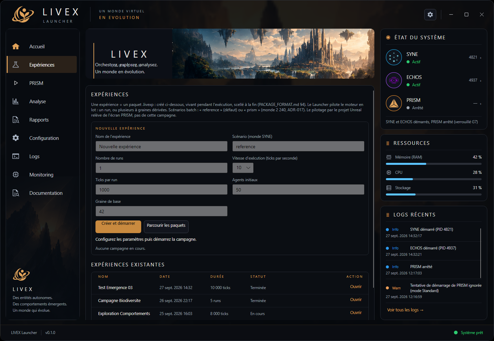

Une campagne s'achève. Les processus se sont tus, les courbes ont fini de descendre, les logs se sont arrêtés d'écrire. Il reste une question simple : qu'est-ce qui prouve que tout cela a bien eu lieu, et dans quel état exact ? Un dossier de sortie ne suffit pas. Un dossier de sortie, on peut le tripatouiller, le tronquer, le recomposer. Ce qu'il faut, c'est une **pièce à conviction**.

Le **Launcher** est le composant de LIVEX qui transforme une campagne en pièce à conviction. Il ne simule pas, n'analyse pas et ne rend pas : il coordonne, supervise et archive. C'est la porte d'entrée de la pile, et jamais sa source de vérité.

## Quatre verbes, une mission

Le rôle du Launcher peut se lire en quatre verbes. **Piloter** : démarrer, combiner et arrêter les composants, et consulter leur état réel en temps réel. **Organiser** : regrouper des runs en campagnes, rangées dans un format de paquet unique. **Observer** : afficher les mesures produites par ECHOS, sans jamais les recalculer ni compléter ce qui manque. **Contextualiser** : ouvrir une session de rendu PRISM lorsqu'elle est disponible.

Derrière ces quatre verbes se tient une philosophie, la même que celle du reste du projet : montrer l'état réel plutôt qu'une approximation rassurante. Un composant éteint doit apparaître éteint. Une mesure indisponible doit apparaître comme telle, pas comme un zéro inventé.

## Le poste de contrôle

L'interface Avalonia présente un accueil, une vue des expériences et une colonne d'état permanente. Les cartes de composants reflètent le cycle de vie effectif — démarrer ou arrêter passe réellement par le point de contrôle du composant concerné, il ne s'agit pas d'un bouton décoratif. Le tableau des expériences se construit à partir de paquets réellement présents, le journal de session défile en direct, et les ressources système sont échantillonnées.

## Découvrir, démarrer, superviser

Avant de piloter quoi que ce soit, il faut savoir ce qui existe. Le Launcher repère ses composants via leurs **manifestes** (`component.json`), qui déclarent l'exécutable par plateforme. Il démarre les composants dans l'ordre de résolution et les arrête dans l'**ordre inverse** — un consommateur ne doit ni survivre à sa source, ni disparaître avant elle.

Pendant l'exécution, une boucle de sondes honore les paramètres déclarés (`health.path`, `intervalMs`, `startupMs`) ; la perte de contact déclenche l'action prévue par la politique. L'arrêt propre passe par `/control/shutdown`, complété par un jeton d'annulation ; en dernier recours seulement, l'arrêt reste borné à l'arbre du composant, sans jamais terminer un Job Object global. La portabilité est traitée au cas par cas — scripts Windows lancés via `cmd.exe /c`, groupes de processus sous Unix, garde anti-collatéral sous Windows. Une garde d'instance unique évite enfin les conflits de ports et de fichiers.

## Une campagne devient un paquet scellé

Quand une campagne aboutit, elle devient un paquet **`.livexp`** : une archive ZIP64, d'abord vivante, puis refermée et scellée. Sa construction obéit à des règles strictes, parce qu'une archive mal maîtrisée est une source de faux résultats.

L'écriture suit un **ordre normatif** : même contenu, même archive. La copie et le hachage se font **en flux**, jamais par mise en mémoire complète — c'est ce qui permet de traiter des `stream.jsonl` dépassant 2 Gio, jusqu'à 16 Gio par entrée. Le scellement réécrit l'archive, calcule un hachage d'intégrité, puis le vérifie.

Les **frontières sont contrôlées** : seules les entrées sous `runs/RUN-xxxx/` sont admises, la traversée de chemin est refusée, les bombes zip sont bornées et un schéma inconnu est rejeté. Un lecteur malveillant ou simplement négligent ne peut pas faire dire au paquet ce qu'il ne contient pas.

## Ce que contient un .livexp

Le contenu est volontairement minimal, mais suffisant pour tout rejouer : `runs/index.json`, le `run.json` et le `provenance.json` de chaque run, les journaux, les artefacts ECHOS, et le rapport archivé **octet à octet** identique à la réponse d'ECHOS. La vérification `VerifyRunIntegrity` hache en flux, et la comparaison octet à octet entre le rapport généré et le rapport archivé est validée par des tests bout-en-bout.

Un détail résume l'esprit du format : les runs peuvent dépasser 2 Gio. On ne charge donc jamais un artefact entier en mémoire pour l'archiver. On le fait couler. C'est aussi ce qui permet à l'analyse ECHOS de tourner sur des opérations lourdes, avec un délai étendu jusqu'à 30 minutes, sans que le Launcher ait à s'immiscer dans son travail.

## La preuve sur composants réels

Ces engagements ne valent que s'ils sont tenus contre de vrais composants, pas contre des simulacres. Le **parcours J3** enchaîne un SYNE publié `win-x64` et un ECHOS réel : le run est interrompu, puis repris sans rejouer ce qui tient déjà, son entrée demeurant identique octet à octet, et le rapport archivé identique à sa régénération. Si ECHOS est absent, l'analyse est marquée « indisponible » — jamais approximée, car une valeur inventée vaut moins qu'une valeur manquante assumée.

Au relevé du 19 octobre 2026, les suites se présentent ainsi : **174 tests unitaires, 20 d'intégration, 33 bout-en-bout, 0 échec**, ces derniers exécutés avec un SYNE réellement publié. La version d'ECHOS qui a produit un rapport est consignée dans le manifeste du paquet, sous `AnalysisComponentVersion` : la traçabilité descend jusqu'à l'outil de mesure.

## Les limites, énoncées franchement

Tout n'est pas terminé, et le dire fait partie du contrat. Le rendu PRISM intégré reste en version de travail, hors périmètre V0.2. L'installateur, lui, demeure une spécification, sans artefact livré. Et le Launcher ne calcule aucune métrique : il affiche celles d'ECHOS, il ne les complète pas, il ne les réinterprète pas.

Quant à la latence bout-en-bout, elle reste sensible à la contention de la machine : un poste lourdement chargé peut ralentir un parcours. Ce n'est pas une propriété cachée du logiciel, c'est un fait d'exécution — et il vaut mieux le nommer que le taire.

## La porte d'entrée, pas la source de vérité

Le Launcher rend l'orchestration et l'archivage traçables sans jamais empiéter sur le reste : il orchestre sans réinterpréter, archive sans inventer, affiche sans recalculer. Un paquet `.livexp` n'est pas un dossier de sortie, c'est une pièce à conviction — et c'est précisément ce qui permet de discuter d'une campagne sans se demander si les chiffres ont été arrangés.

Le format de paquet, le cycle de vie des composants et les politiques de campagne sont détaillés dans le [portail de documentation](https://donovan-dev-web.github.io/LIVEX/documentation/). Les relevés d'acceptation et les évolutions du Launcher paraissent dans ce [journal](https://donovan-dev-web.github.io/LIVEX/actualites/), également disponible en [flux RSS](https://donovan-dev-web.github.io/LIVEX/actualites/feed.xml).
